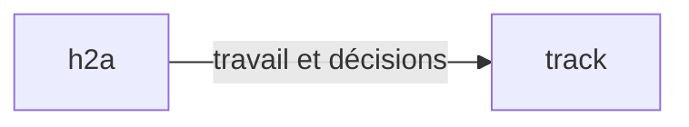

# Portable Focus decision dossiers

Every full decision dossier defaults to a Focus design-system HTML file. Deliver the file, not
a claude.ai artifact. The file runs directly from `file://`, without a server or network access.

```sh
h2a focus template -o dossier.json
# Replace the illustrative request, options, provenance and source hash.
h2a focus build dossier.json -o dossier.html
```

In a source checkout, after `npm ci` and `npm run build`, use the same arguments with
`node packages/h2a/dist/bin.js`. This always uses the checkout, never an installed binary.
`build` requires `-o` (or `--output`); validation failures leave existing output untouched.
Output cannot be the input file. `template` exports the complete editable example.

## Contract and readability

Input is exactly `@sentropic/focus`'s closed `DecisionDossierDocument`, not the reference kit's
adoption-specific model. `focus-kit/dossier.schema.json` is an exact copy of the published schema
`@sentropic/focus/schemas/decision-dossier-document.v1`; rebuilding checks synchronization.
The shipped validator is bundled directly from the authoritative `@sentropic/focus/validate`
sources, with source and output hashes checked at prepack. It adds no package dependency or separate
validation implementation. The builder calls `assertDecisionDossierDocument`, resolves diagrams, then calls
`assertDecisionDossierForPresentation` before rendering. It uses the #358 readability rules unchanged:
literal owner quote, plain stakes, proportional total time, explicit self-contained questions,
2–4 short options with consequences, recommendation, no opaque undefined codes or nested choices.
The glossary is visible. Diagram labels and explanations also go through the readability gate.
The template is illustrative, never evidence of a real owner request or review.

The gate checks structure and measurable readability. The present-decision self-audit still checks
authentic quotations, sourced claims, balanced alternatives, owner criteria and required reviews.
The builder does not attest comprehension or sign a decision. Source hashes remain opaque source
metadata; diagram expansion creates a rendered view, not a new attested source snapshot.

Cards prepare a local answer in memory. Closing/reloading clears it. No network, storage, Track
write or signature occurs. The owner communicates their choice for explicit recording through Track.
Disabled `interactions` remain source metadata. Markdown fields display as safe plain text, preserving
line breaks; arbitrary markup, images and remote resources never execute.

## Reusable ecosystem scenes

Add at least one `diagram` section. Its `syntax` is `mermaid`, its `source` can be:

| Reference | Coverage |
| --- | --- |
| `ecosystem:overview` | Coordination, distributed services, models, work, memory, visual components, apps and CLIs |
| `ecosystem:models` | h2a runtime → llm-gateway → llm-mesh → Codex, Claude Code, Vibe |
| `ecosystem:knowledge` | h2a, Track and Engram |
| `ecosystem:interfaces` | Sentropic apps, design-system, cluster-mesh and commands |

`packages/h2a/focus-kit/ecosystem.json` is a reusable versioned catalog with source paths. It depicts
conceptual relationships, **not a live inventory**. Check the selected scene against the question and
current implementation. A dossier can reference several scenes. Catalog references expand into ordinary
Mermaid in the embedded document; xyflow renders the graph with pan, pinch zoom, zoom/fit controls,
keyboard focus and a textual relationship list. The page fits phone widths without horizontal overflow.

Custom diagrams accept this deliberately small Mermaid flowchart profile. Every declaration and edge
occupies a separate line; direction is `LR`, `TB` or `TD`, IDs are lowercase, labels are plain text.
Standalone `%%` comments are accepted, including those in expanded catalog documents:



Unknown catalog references, unresolved edges, empty/oversized graphs, PlantUML and other Mermaid
constructs refuse before output. Full Mermaid/PlantUML rendering is outside this adapter's profile.
Do not quietly substitute an image for the requested interactive canvas.

## Thin consumer and maintenance

`h2a focus build` extends the existing native Focus namespace; serving and the Track facade keep
their current routing. There is no additional CLI and no adoption-kit-specific document contract.
Focus owns the schema/readability validator. The design-system lane owns the future Focus renderer;
`src/focus-build.ts` is the adapter seam where that renderer can replace this small Svelte consumer.
No source file in the read-only reference kit is modified.

The renderer uses `@sentropic/design-system-svelte` 0.34.69, themes 0.11.0 and xyflow 1.6.5.
Entropic supplies the light theme; the consumer derives a dark semantic palette through the DS theme
API. Cards, badges, buttons, container and theme provider are DS components. Borders and diagram strokes
are 1 px. The title remains an identical short document/visible title in a thin band.

The shipped `renderer.html` contains the bundled Svelte/DS/xyflow code, CSS and third-party notices. Building a dossier needs
no frontend installation, Docker, network or Python. A restrictive content policy blocks connections.
Only renderer maintainers need the repo's Node 22+ toolchain:

```sh
npm --prefix packages/h2a/focus-kit ci
node scripts/build-focus-dossier.mjs
node scripts/build-focus-dossier.mjs --check
node --test packages/h2a/test/focus-build.test.js
npm --prefix packages/h2a/focus-kit exec -- playwright install chromium
node --test packages/h2a/focus-kit/test/browser.test.mjs
```

The source/hash manifest checks the committed asset at prepack; CI builds and checks the fixture plus
desktop/phone offline browser behavior. Browser profiles, dossiers and state live in temporary dirs.
