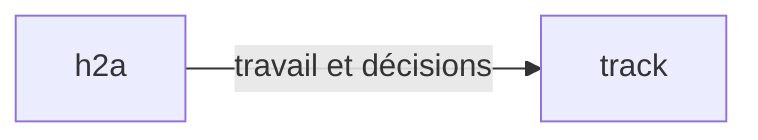

# Portable Focus decision dossiers

Every full decision dossier defaults to a Focus design-system HTML file. Deliver the file, not
a claude.ai artifact. The file runs directly from `file://`, without a server or network access.

```sh
h2a focus template -o dossier.json
# Replace the illustrative request, options, provenance and source hash.
h2a focus build dossier.json -o dossier.html
```

In a source checkout, after `npm ci` and `npm run build`, use the same arguments with
`node packages/h2a/dist/bin.js`. This always uses the checkout, never an installed binary.
`build` requires `-o` (or `--output`); validation failures leave existing output untouched.
Output cannot be the input file. `template` exports the complete editable example.

## Contract and readability

Input is exactly `@sentropic/focus`'s closed `DecisionDossierDocument`, not the reference kit's
adoption-specific model. `focus-kit/dossier.schema.json` is an exact copy of the published schema
`@sentropic/focus/schemas/decision-dossier-document.v1`; rebuilding checks synchronization.
The shipped validator is bundled directly from the authoritative `@sentropic/focus/validate`
sources, with source and output hashes checked at prepack. It adds no package dependency or separate
validation implementation. The builder calls `assertDecisionDossierDocument`, resolves diagrams, then calls
`assertDecisionDossierForPresentation` before rendering. It uses the #358 readability rules unchanged:
literal owner quote, plain stakes, proportional total time, explicit self-contained questions,
2–4 short options with consequences, recommendation, no opaque undefined codes or nested choices.
The glossary is visible. Diagram labels and explanations also go through the readability gate.
Visible diagram-core names and link labels use the same gate, including when they differ from the
text fallback. Documents without the optional structured diagram field remain valid.
The template is illustrative, never evidence of a real owner request or review.

The gate checks structure and measurable readability. The present-decision self-audit still checks
authentic quotations, sourced claims, balanced alternatives, owner criteria and required reviews.
The builder does not attest comprehension or sign a decision. Source hashes remain opaque source
metadata; diagram expansion creates a rendered view, not a new attested source snapshot.

Cards prepare a local answer in memory. Closing/reloading clears it. No network, storage, Track
write or signature occurs. The owner communicates their choice for explicit recording through Track.
Disabled `interactions` remain source metadata. Markdown fields display as safe plain text, preserving
line breaks; arbitrary markup, images and remote resources never execute.

## Reusable ecosystem scenes

Add at least one `diagram` section. Its `syntax` is `mermaid`, its `source` can be:

| Reference | Coverage |
| --- | --- |
| `ecosystem:overview` | Coordination, distributed services, models, work, memory, visual components, apps and CLIs |
| `ecosystem:models` | h2a runtime → llm-gateway → llm-mesh → Codex, Claude Code, Vibe |
| `ecosystem:knowledge` | h2a, Track and Engram |
| `ecosystem:interfaces` | Sentropic apps, design-system, cluster-mesh and commands |

`packages/h2a/focus-kit/ecosystem.json` is a reusable versioned catalog with source paths. It depicts
conceptual relationships, **not a live inventory**. Check the selected scene against the question and
current implementation. A dossier can reference several scenes. Catalog references expand into ordinary
Mermaid plus a diagram-core `SemanticDocument` in the embedded document; xyflow consumes that document
with pan, pinch zoom, zoom/fit controls,
keyboard focus and a textual relationship list. The page fits phone widths without horizontal overflow.

Custom diagrams accept this deliberately small Mermaid flowchart profile. Every declaration and edge
occupies a separate line; direction is `LR`, `TB` or `TD`, IDs are lowercase, labels are plain text.
Standalone `%%` comments are accepted, including those in expanded catalog documents:



Unknown catalog references, unresolved edges, empty/oversized graphs, PlantUML and other Mermaid
constructs refuse before output. Full Mermaid/PlantUML rendering is outside this adapter's profile.
Do not quietly substitute an image for the requested interactive canvas.

### diagram-core contract (design-system addendum 2)

`DiagramNode.scene` is an optional plain JSON object containing the DS diagram-core
`SemanticDocument`, profile `generic@1`. This is the only structured graph in the HTML payload:
`document.sections[].scene`; there is no parallel Focus node/edge model. A supplied `scene` is
authoritative for rendering and is preserved unchanged on rebuild. `syntax`, `source` and `alt`
remain required for backward-compatible text fallbacks. Catalog references and supported custom
flowcharts generate `scene` automatically.

The exact envelope has `documentId: "document:<id>"`, `schemaVersion: {major:1,minor:1}`,
`revision: 0`, `profileRefs: ["generic@1"]`, `typeDefinitions: {}`, `entities: {…}`,
`relations: {…}`, `ports: {}`, `resources: {}` and `extensions: []`. Entity/relation records are
keyed by their IDs. Entities have `{id:"entity:<id>", profile:"generic@1", type:"node"|"container",
attributes:{name:{kind:"text",value:"<label>"}}}`. Links have `{id:"relation:<id>",
profile:"generic@1", type:"link", endpoints:[{role:"source",target:"entity:a"},
{role:"target",target:"entity:b"}], attributes:{label:{kind:"text",value:"…"}}}`; a missing label
uses `attributes:{}`. Nesting uses `type:"contains"`, roles `parent` and `child`, with a container
parent and at most one parent per child, without cycles. The PR description freezes a complete example.

No view, geometry, position, direction or layout hint belongs in `scene`. Layout rules L-R1..L-R11
belong to the DS engine. The disposable xyflow adapter computes a simple grid and nested container
bounds in memory; it does not implement those rules or serialize a view. The canonical Focus validator
checks only that `scene` is an object and preserves it. The builder bounds its interim consumer to
1–80 entities, at most 240 relations, node/container entities, binary links and a containment tree;
nonempty type definitions, ports, resources and extensions are outside that renderer's profile.
No dependency on the private diagram-core package is added. Pin its authoritative JSON Schema when
the design-system publishes it; the current consumer bounds do not claim full diagram-core validation.

## Thin consumer and maintenance

`h2a focus build` extends the existing native Focus namespace; serving and the Track facade keep
their current routing. There is no additional CLI and no adoption-kit-specific document contract.
Focus owns the schema/readability validator. The design-system lane owns the future Focus renderer;
`src/focus-build.ts` is the adapter seam where that renderer can replace this small Svelte consumer.
No source file in the read-only reference kit is modified.

The renderer uses `@sentropic/design-system-svelte` 0.34.69, themes 0.11.0 and xyflow 1.6.5.
Entropic supplies the light theme; the consumer derives a dark semantic palette through the DS theme
API. Cards, badges, buttons, container and theme provider are DS components. Borders and diagram strokes
are 1 px. The title remains an identical short document/visible title in a thin band.

The shipped `renderer.html` contains the bundled Svelte/DS/xyflow code, CSS and third-party notices. Building a dossier needs
no frontend installation, Docker, network or Python. A restrictive content policy blocks connections.
Only renderer maintainers need the repo's Node 22+ toolchain:

```sh
npm --prefix packages/h2a/focus-kit ci
# After changing canonical Focus schema/validation, refresh the shared delivery copies:
npm run registry:sync -w @sentropic/focus
npm run vendor:focus
node scripts/build-focus-dossier.mjs
node scripts/build-focus-dossier.mjs --check
node --test packages/h2a/test/focus-build.test.js
npm --prefix packages/h2a/focus-kit exec -- playwright install chromium
node --test packages/h2a/focus-kit/test/browser.test.mjs
```

The source/hash manifest checks the committed asset at prepack; CI builds and checks the fixture plus
desktop/phone offline browser behavior. Browser profiles, dossiers and state live in temporary dirs.

## H1 embedded evidence (dossier diagrams v3)

The explicit new template is selected with the freshly built checkout:

```sh
node packages/h2a/dist/bin.js focus template --evidence -o dossier.json
node packages/h2a/dist/bin.js focus build dossier.json -o dossier.html
```

This envelope declares `schemaVersion: 2`, independently of diagram-core's
`scene.schemaVersion`. Absence keeps historical v1; unknown versions refuse.
The v1 schema file/URN are unchanged. V2 adds required sources, citations,
evidence groups and annexes (arrays may be empty). Old validators refuse v2;
the TypeScript document union and registry entry 2.0 require a breaking Focus
release. This PR does not publish packages or reuse approval attestations.

Sources have a stable id, title, frozen origin (uri or repo/revision/path),
mediaType, encoding base64, data, original-byte SHA-256 and size. UTF-8 text
(including logs, YAML, JSON and diffs) and inert PNG/JPEG are accepted. Images
also require matching encoded dimensions and alt text. Other media refuse
explicitly. Origins are never read or fetched at opening. A digest proves byte
identity, not truth, provenance authenticity or approval. Text/markup stays inert.

Citations have id, sourceId, label and either an inclusive 1-based lines locator
or a whole-image locator with caption. CRLF is one separator, lone CR/LF are
separators, Unicode is decoded as strict UTF-8, BOM bytes are preserved and a
trailing separator adds a final empty line. Section/option citationRefs resolve
explicitly. Groups summarize a claim with citationRefs/sourceRefs. Annexes have
title, summary, typed text/code/table/reference blocks and backRefs; they start
collapsed and cannot contain questions/options or executable author content.
Graph/plan bindings await H3 rather than being invented in the H1 envelope.

Summaries remain in the primary reading budget. Supporting source bytes and
annex details have a separately disclosed consultation estimate (six UTF-8
bytes per word, 180 words/minute), never a claim that all evidence takes two
minutes. Raw sources skip editorial acronym checks; titles, summaries and
supporting explanations do not. Authors/reviewers still ensure that material
risks, reservations and choices appear in the primary decision path.

The portable offers a source index, distant citation jumps, complete-source
cancellable search, at most 80 mounted lines, original-byte download and focus/
scroll return without remounting the canvas. Build failures preserve previous
output bytes: a same-directory temporary write is fsynced then renamed once.
Payload metadata fingerprints the extended envelope, renderer and validator
separately from the opaque source hash/cursor and comprehension evidence.
Markdown/terminal/static HTML retain the citation/source/annex index and identify
the portable renderer required for full consultation. Renderer assets are rebuilt
from Focus, with both schema versions indexed and hashed in the shipped manifest.

## Shared renderer boundary and blocked increments

| Surface | Preserved/shared capital | Delivery |
| --- | --- | --- |
| Semantic graph | diagram-core generic@1 identities, #368 scene and text fallback; engram guards definitions | Existing bounded h2a consumer retained |
| Layout/measurement | DS diagram-canvas ports/routes/labels/diagnostics and actual theme/font measurements | H2 blocked: diagram-core/diagram-canvas 0.1.0 both npm E404; DS2 reproducible hashed tarballs required |
| Controls/publication | DS renderer owns in-canvas case/event/before-after/group controls, hit/focus bounds, camera and atomic tuple publication | H3 blocked: H2 plus DS4/DS5 exports; no separate page toolbar qualifies |
| Dossier/build/evidence | Focus model, validation, reading order, sources/citations, portable packaging | H1 delivered independently; kit is retained, no retirement decision inferred |
| Business meaning | Consumer scenario membership, measurements, critical path and gains | sentropic S1/S2, outside this PR |

The H1 manifest declares embedded evidence capabilities only. CDN equivalence,
DS geometric qualification and linked explorer transitions are not advertised.
Numeric reactivity budgets/corpus hashes are frozen in
`focus-kit/test/fixtures/evidence-performance-policy.v1.json`. Qualification
records 30 fresh contexts per legacy/small/large artifact, 30 citation/search
cycles, doubled-line DOM checks and Linux memory for owned Chromium descendants.
The real corpus is a frozen, hashed inventory of repository sources grouped
without repeated synthetic padding; original/path/reference hashes remain in
its manifest. Browser functional tasks also cover 320/390/1440px widths.
