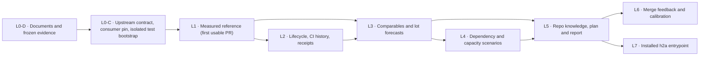

# SPEC EVOL v2 — Delivery-time estimator from measured agent velocity

Status: documentary revision after the independent Astra max and Sol max
reviews. No implementation, release, or owner approval is claimed by this
revision. No code is authorized by this document alone. Every decision carries
its source tag; propositions are never owner requirements. Owner decisions
are unchanged. The treatment of all 16 P2 remarks (no P1 in either review)
is recorded in `SPEC_EVOL_VELOCITY_ESTIMATOR.v2-changes.md`.

Sources used:

- Owner verbatim in `/home/antoinefa/.cache-tmp/claude-1000/-home-antoinefa-src-h2a/902cb8f7-eb8e-4897-9640-8b9653fc7d0e/scratchpad/0985/brief-velo-common.txt`.
- Owner decisions in `/home/antoinefa/.cache-tmp/claude-1000/-home-antoinefa-src-h2a/902cb8f7-eb8e-4897-9640-8b9653fc7d0e/scratchpad/0985/DECISIONS-owner.md`.
- Independent analysis Astra: `/home/antoinefa/.cache-tmp/claude-1000/-home-antoinefa-src-h2a/902cb8f7-eb8e-4897-9640-8b9653fc7d0e/scratchpad/0985/velo/analysis-astra.md`.
- Independent analysis Sol: `/home/antoinefa/.cache-tmp/claude-1000/-home-antoinefa-src-h2a/902cb8f7-eb8e-4897-9640-8b9653fc7d0e/scratchpad/0985/velo/analysis-sol.md`.
- Engram timings export: `/home/antoinefa/src/graphify/.graphify/scratch/design/velocity/engram-pr-timings.json`.
- Engram pipeline journal: `/home/antoinefa/src/graphify/.graphify/scratch/design/memory-finalization/PIPELINE.md`.
- Reviewed v1: `SPEC_EVOL_VELOCITY_ESTIMATOR.md`, SHA-256
  `0ac733032712f4f8095df1785068c9765122c39e5c43db238da115993478996d`.
- Independent reviews: `../rvveloa-last.md` (Astra max) and
  `../rvvelos-last.md` (Sol max), both reviewing that exact v1 digest.
- Source verification for v2: h2a Git objects at
  `46b82b42781709f2a2ab1bec6707ba58131248f0` (not the older working tree),
  sentropic `ci-knowledge-study/reconciliation.md:24` and
  `study-astra.md:57`, engram `repo-knowledge-sol.out:5-18`, and the file
  list of engram PR #400, merged as `01697527c49e26a3d40d4917384f15d08fd36243`.

Source tags: `OWNER-VERBATIM`, `OWNER-DECISION`, `BOTH-ANALYSES`,
`PROPOSITION-NOT-VALIDATED`, `REVIEW-CORRECTION` (technical specification
correction, never a new owner decision). Newly selected paths, algorithms,
and test commands below describe future work; they do not claim existing code.

## 1. Owner requirements versus propositions

### 1.1 Owner requirements

| Item | Verbatim or decision | Tag |
| --- | --- | --- |
| Build via h2a an AI delivery-time estimator from effective velocity | "Il faut développer via h2a un estimateur de délai avec l'IA sur la base de la vélocité effective que nous avons. Donne-lui la mission." (18/10, via gr-conductor) | OWNER-VERBATIM |
| Stop nominal human-day estimates for AI dev work | "arrêter les estimations de délai débiles de 45 j pour des trucs dev par l'IA… c'est lassant" | OWNER-VERBATIM |
| Estimate in agent hours and review rounds, anchored on measured durations | 12/10 decision: human engineer-days "n'ont aucun sens"; estimate in agent hours and review rounds on measured durations (MH-L0 estimated 6–9 d, done in ~1 h) | OWNER-DECISION |
| Merge date and installed date shown separately | 18/10 ~10:20 decision: "Fusion et installé, séparés" | OWNER-DECISION |
| Timing reference is capitalized repository knowledge | Sentropic owner request: "la référence des temps estimée … connaissance … capitalisée pour le repo"; conductor uses it to optimize integration plans and improve the planning skill; CI/CD and architecture graphs committed as a typed subgraph | OWNER-VERBATIM (via sentropic study) |
| Engram is guardian of all dev ontologies | 18/10 ~09:50: "Tu fais un knowledge transfert dans engram. Il doit etre le gardien de toutes les ontologies de dev" (transferred to gr-conductor, engram #400; h2a #372 closed) | OWNER-DECISION |
| Tracked under existing item, no new WP | Item `01M57KSPC5VJN455J69W4A4ZH3` "Estimateur de délai à partir de la vélocité mesurée des agents", parent `01KWWXCD9PYZZBZR5E6JQAK6T6` (WP8) | OWNER-DECISION (recorded) |

### 1.2 Propositions, not owner requirements

The following come from the gr-conductor mission proposal and the two
analyses. They are candidate scope, not ratified requirements:

- Per-lot and critical-path P50/P80/P95 in agent wall-clock with traceable
  comparables.
- Collecting first commit, PR open, merge, review rounds, author changes,
  CI cycle time per repo and job set, lot size and kind, author and reviewer
  models, owner GO waits, quota and rate-limit stalls.
- Estimate-versus-actual feedback at each merge.
- Any specific home for the algorithm (Track, harness skill, engram), any new
  Track event, any new service, any daily job, any new npm package.
- The first data point "engram memory chain ~21 h wall-clock contracts →
  0.20.0; PR open→merge 14–60 min small lots, 2.5–3.5 h large" is a relayed
  observation to qualify, not a measured distribution. Both analyses refute
  reading it as a universal ceiling (see §3.6).

### 1.3 Explicitly excluded

Source: BOTH-ANALYSES, consistent with owner scope discipline.

- Converting human-days by an arbitrary "AI factor"; LOC/hour or
  commits/hour as universal productivity; any secret model multiplier.
- Using first commit as lot start, commit count as review-round count, or
  the GitHub author account as model identity.
- Subtracting owner waits inferred from silence; replacing unknown time
  with zero; deleting slow PRs as outliers without a versioned rule.
- Summing per-lot P80/P95 into a plan P95; summing parallel CI jobs;
  adding CI time to a PR-open→merge duration that already contains it.
- Using final diff size, actual retry counts, or future CI failures as
  inputs known at forecast time (hindsight leakage).
- Replacing Track WSJF job size with estimated hours; turning a forecast
  into a merge, deploy, model-routing, or acceptance authorization.
- Adding timing fields to the closed memory MCP DTOs; expanding scope to
  report redesign, orchestrator redesign, CI optimization, or a new
  telemetry service.
- Reading the owner NO-GO on PR #372 ("chronométrage") as a veto on this
  estimator: #372 concerned 20 read-side live investigations with a 30%
  gain threshold, a different perimeter, now closed after engram #400.

## 2. Existing capital respected

Source: BOTH-ANALYSES unless noted. Reviewed base: h2a
`origin/main = 46b82b42781709f2a2ab1bec6707ba58131248f0` (package 0.98.7).

| Surface (repo, path) | Verified capital | Role under this spec |
| --- | --- | --- |
| h2a `packages/agent-stats` (`src/types.ts`, `correlate.ts`, `track-join.ts`, `vendor/pr.ts`, `src/cli.ts`, `SessionFact`, `CorrelationLink`, injected `CommandRunner`) | F12 module imported from engram; h2a owns it; session normalization, Git/PR/Track correlation with confidence, redacted excerpts, isolated tests. `private: true`, 0.1.0; `registerAgentStatsCommands` exported but no wiring to the installed h2a CLI was found | Acquire and normalize observations, hold comparables, compute distributions and calibration. The velocity engine is new code here; no parallel session or correlation system |
| h2a `packages/track` (`src/events/types.ts`, `src/model/blocker.ts`, `src/model/priority.ts`, report and `report --period`, WP/decisions/blockers) | Append-only single-writer log; pure readers; order is position + seq; `EventCore.at` is informative; blocker carries `targetId`, `ref`, `scope: intra\|extra`, `engagementRef`, resolution rules; WSJF = `(value + criticality + risk reduction) / jobSize` with no time unit (0 `priority.assessed` in the journal read) | System of record for work, decisions, blockers, WP linkage. Consumes forecast references. The algorithm is not a realization authority; no new event at bootstrap |
| h2a `packages/h2a/skills/harness/plan/SKILL.md`, `packages/h2a/skills/harness/track-report/SKILL.md`, `packages/track/skills/track-report/SKILL.md` | Lot-based planning; deterministic report plus agent contextual synthesis; validated report with WP, expected outcomes, periods, golden tests | Read the pinned timing reference, explain comparables, record assumptions, present sourced forecasts. Integrate on top of the report contract version merged from PR #374, never the superseded table |
| h2a `packages/h2a/src/runtime/governance/conductor.ts`, conductor tooling | Resolves conductor of a workspace by claim/presence | Supplies real capacity and decisions, receives the forecast in its planning packet. Not a forecast engine, not a second scheduler |
| sentropic `.tmp/ci-knowledge-study/` (`OWNER-REQUEST.md`, `study.md`, `reconciliation.md`); engram `repo-knowledge-sol.out` | Design capital, not deployed. Review corrected "three independent profiles" into one `repo-knowledge@1` with CI, architecture, timing modules; `knowledge-lock.json`; regime fingerprints; applicability `applicable / conditional-historical / incomplete`; `TimingObservation`, `TimingSeries`, `TimingEstimate`, `PlanPrediction` | The timing module of the single profile. Do not fork three competing ontologies; do not rename the study's p90 silently into p80/p95; study human-day budgets are not a velocity reference |
| engram (`rhanka/engram`, D3/D10, six frozen memory MCP tools, engram #400) | Canonical memory journal; graph projection filtered and authorization-bound; profiles and ontologies extensible | Guardian of dev ontologies (owner direction): velocity ontology and profile definitions are owned and versioned in engram, h2a consumes them (D13). Graph import is not memory admission; no arbitrary DTO fields |
| h2a `packages/h2a` (`src/cli.ts`, `cli-contract.ts`, `cli-command-map.ts`, `bin-routing.ts`, root `scripts/check-focus-vendor.mjs`), `docs/contracts/golden/{cli-verbs.json,README.md,version-matrix.json}`, root `scripts/check-public-contract.sh` | CLI facades, contract tests, verified vendor-bundle pattern (focus); CLI tests use `node:test` and the checkout build. Golden verb sets and counts are enforced | Distribution path for an installed estimate entrypoint only in L7; a checkout pilot must not be announced as an installed command |
| h2a `.github/workflows/release.yml`, `scripts/release-candidate.mjs`, `packages/h2a/test/ci-release-candidate.test.js` | Existing post-publish smoke and release attestation: repo/run/attempt, version, source SHA/tree, package tuple, smoke verdict; RC verifies `next` and tarball integrity. The current record has no target-bound installation timestamp | Extend these proofs in L7; do not invent a parallel release gate. Runner qualification and installation on a declared delivery target are different observations |

Non-negotiable constraints carried into every lot: 0 Python; tests in
temporary dirs only (`mkdtemp`, `XDG_RUNTIME_DIR` on a created temp dir);
targeted test files only (the conductor runs the full suite once at
integration); normal merges only, never squash (owner rule 12/10); conventional
English commit subjects with no attribution trailer; no touch to `main`;
no installed `h2a` binary, native host, or real agent state touched by
tests; red-before/green-after proof per regression with command and output.

## 3. Measured evidence and reconciliation of the two analyses

### 3.1 Agreed facts (BOTH-ANALYSES)

- Same checkout pin (`46b82b4…`), same Track journal (1,919 events), same
  item `01M57KSPC5VJN455J69W4A4ZH3`, same quantile convention
  (nearest-rank, `Q(p) = x[ceil(n × p)]`, 1-indexed), same P50 for
  PR-open→merge on 20 h2a PRs: 2 h 45 min 18 s (9,918 s), checked via PR
  [#367](https://github.com/rhanka/h2a/pull/367) and the auditable tables in
  both analyses.
- First commit is not lot start (rebase rewrites committer dates; author
  dates can predate the lot). Zero GitHub reviews is not zero reviews
  (all 20 PRs show `reviews` empty while conductor journals show real
  review rounds). The GitHub account `rhanka` on all 20 PRs is not a model
  identity. Skipped checks with end-before-start exist and must never
  become zero-duration successes. Residual gaps (e.g. last CI end → merge,
  8 h 44 min 50 s on [#350](https://github.com/rhanka/h2a/pull/350)) are
  unexplained, not owner waits.
- CI on the final head is fast and stable while PR-open→merge has a long
  tail: the tail is review, correction, queueing, and unattributed gaps,
  not the final CI run.

### 3.2 Divergence 1 — Sample selection drives the tail

| Axis | Astra | Sol |
| --- | --- | --- |
| Collection rule | `merged:>=2026-10-01`, limit 100 → 65 PRs, sorted by `mergedAt` desc, top 20 | `gh pr list --state merged --limit 20` (creation order as returned) |
| Fusion window | 17/10 04:53Z → 18/10 07:48Z | 17/10 04:32Z → 18/10 07:48Z |
| PRs included | Includes [#327](https://github.com/rhanka/h2a/pull/327) (117 h 49), [#343](https://github.com/rhanka/h2a/pull/343) (23 h 21), [#342](https://github.com/rhanka/h2a/pull/342) (21 h 28) | Includes [#347](https://github.com/rhanka/h2a/pull/347), [#349](https://github.com/rhanka/h2a/pull/349), [#351](https://github.com/rhanka/h2a/pull/351); excludes #327 |
| PR-open→merge quantiles | P50 2:45:18, P80 12:59:30, P95 30:02:57, max 117:49:24 | P50 2:45:18, P80 3:40:40, P95 12:59:30, max 30:02:57 |
| First committer-date after PR open | 13/20 | 10/20 (lists #348, #357–#359, #362, #364–#368) |

Reconciliation: neither row is "the" velocity reference. On n=20 from
~2 days, P80 and P95 move by inclusion or exclusion of two or three long
PRs. Both analyses agree the values are descriptive only. This spec
therefore mandates one versioned collection rule with cutoff and manifest
(D11): L0 freezes the union evidence as fixture; L1 computes Astra-rule
and Sol-rule quantiles side by side and labels both descriptive. Any later
forecast names its rule, window, and digest. The 13/20 versus 10/20 gap is
the same sample effect, not a factual conflict; the claim itself
(first-commit clock is unreliable) holds in both samples.

### 3.3 Divergence 2 — CI metric

Astra measured all final-head checks (285 checks over 20 heads):
longest-job Q50 15:00; full envelope Q50 19:11, Q80 27:15, Q95 34:03;
last-check-end → merge Q95 5 h 24 min 51 s. Sol measured only workflow
`ci`, attempt 1 (19 eligible runs; [#349](https://github.com/rhanka/h2a/pull/349)
attempt 2 quarantined because reused jobs start before their own
`created_at`): trigger → last job end P50 21:47, P80 31:15, P95 37:15;
job-span P50 18:46. Reconciliation: both are recorded, as distinct
metrics (D3). L1 stores run, attempt, workflow path, job, matrix tuple,
runner, and conclusion per observation, computes per-job service,
all-checks envelope, and per-workflow span, and quarantines reused or
incoherent attempts instead of averaging them in. Neither value is "CI
time" without its metric identity. Full history across heads (Astra found
[#365](https://github.com/rhanka/h2a/pull/365) with 5 `ci` runs on 5 heads,
3 failures, all `run_attempt = 1`) belongs to L2.

### 3.4 Divergence 3 — First-increment sizing

Astra sizes L1 by single analogue: #365 full cycle 1 h 54 min 53 s
(author-log birthtime → merge), hence "T0 + 2 h", low confidence, not a
P80/P95. Sol convolves 3 start→open proxies (4.06, 9.93, 17.07 min) with
the 20 open→merge durations into 60 sums. Applying the same construction
to both frozen cohorts gives the following nearest-rank scenario values
(seconds computed from the displayed, rounded proxies):

| Open→merge cohort | Scenario P50 | Scenario P80 | Scenario P95 |
| --- | --- | --- | --- |
| Sol, 20 PRs × 3 proxies | 2:57:22.60 (10,642.6 s) | 3:57:44.20 (14,264.2 s) | 13:16:34.20 (47,794.2 s) |
| Astra, 20 PRs × 3 proxies | 2:58:49.60 (10,729.6 s) | 13:16:34.20 (47,794.2 s) | 30:20:01.20 (109,201.2 s) |

Reconciliation (REVIEW-CORRECTION, Sol P2): start→merge composition is
useful, but does not establish which open→merge cohort transfers to L1.
Independence, transferability, one author lane, reviewer availability,
and the CI regime are assumptions. Each row has 60 combinations, not 60
independent observations; the pre-PR support remains only 3 weak proxies.
Until a lot-specific eligibility rule is frozen before seeing its outcome,
L1 presents both scenarios: P80 about T0 + 4 h to T0 + 13 h 17 and P95
about T0 + 13 h 17 to T0 + 30 h 20. These ranges express cohort
sensitivity, not confidence intervals or a calibrated envelope. No
single four-hour target is selected from these data. The
#365 analogue carries a quality caveat both analyses note: #365 later
required corrective evolution #374, so it evidences technical handover
speed, not accepted delivery.

### 3.5 Divergence 4 — Lot map

Astra proposes L1–L7 (spec embedded in L1; explicit L7 distribution via
packaged `h2a estimate`). Sol proposes L0–L6 (explicit L0 contract lot;
distribution left as a consumption check inside L5, with a warning not to
promise a public CLI verb). Reconciliation: this spec adopts L0–L7 (§6).
L0 is kept because the ontology, clocks, and fixture contract need
freezing before code; L7 is kept because owner decision "Fusion et
installé, séparés" makes the installed surface a first-class endpoint,
but L7 is gated on L5 consumption proof so Sol's warning holds: no
installed date is claimed from a checkout import.

### 3.6 Engram data reconciliation

The engram export `/home/antoinefa/src/graphify/.graphify/scratch/design/velocity/engram-pr-timings.json`
holds 60 enriched PRs (opened 24/09 → 18/10, with `first_commit`,
additions, deletions, files, commits) and 121 older PRs (opened 14/06 →
24/09, open→merge only). Nearest-rank quantiles computed from the file
during spec writing:

| Series | n | P50 | P80 | P95 | Max |
| --- | ---: | ---: | ---: | ---: | ---: |
| enriched, open→merge (h) | 60 | 0.49 | 1.00 | 6.66 | 290.35 |
| enriched, first_commit→merge (h) | 60 | 0.49 | 1.00 | 4.32 | 91.00 |
| older, open→merge (h) | 121 | 0.24 | 3.51 | 67.87 | 633.52 |
| enriched <500 changed lines, open→merge | 22 | 0.38 | 0.66 | — | — |
| enriched ≥1000 changed lines, open→merge | 29 | 0.52 | 1.50 | — | — |

Consequences, binding on this spec:

- The file's `fields` note ("hours_first_commit_to_merge includes
  authoring") does not survive §3.1: `first_commit` is git-artifact
  evidence (join and diagnostic), never a lot-start clock. L1 ingests the
  export as open→merge observations only; the first-commit series is kept
  as a named, low-quality proxy, excluded from forecasts by default.
- The older cohort's tail (P95 67.87 h) versus enriched (P95 6.66 h)
  proves regime drift: pooling the two cohorts would fabricate a
  distribution no regime ever produced. Regime fingerprints and cohort
  separation are mandatory (D6, D9).
- The relayed "14–60 min small, 2.5–3.5 h large" summary understates the
  measured tail: large-lot P80 is 1.50 h but the enriched P95 is 6.66 h,
  and engram [#387](https://github.com/rhanka/engram/pull/387) alone took
  6 h 39 min 52 s open→merge. No universal ceiling exists.
- Size separates medians weakly (0.38 vs 0.52 h) relative to the tail;
  h2a shows the same pattern (#368: 49 files, 5,842 lines, 1 h 26;
  #343: 23 files, 1,340 lines, 23 h 21). Size is a candidate covariate,
  not a duration law, and final size is hindsight at forecast time.
- `/home/antoinefa/src/graphify/.graphify/scratch/design/memory-finalization/PIPELINE.md`
  (408 lines) is prose evidence of quota 429s, author and model
  replacements, review caps, and waits, with approximate local times at
  20–30 min tick cadence. It calibrates wait causes qualitatively; it is
  not a clock source. The "~21 h contracts → 0.20.0" chain stays an
  observation to qualify: its start event and its publish/install proof
  (journal: preparation 02:05, publication 03:28, post-publish check
  04:02 on 18/10, times not UTC-stamped) must be pinned before it can be
  a chain-level comparable.

## 4. Decisions

**D1 — Metric identity before numbers.** Every observation and forecast
names start event, end event, unit (seconds, UTC instants), scope, source,
and quality; distinct metrics stay distinct: `start_to_pr_open`,
`pr_open_to_merge`, `merge_to_installed`, `agent_run_elapsed`,
`agent_work_seconds`, `ci_job_service`, `ci_envelope`, `ci_workflow_span`,
`wait_interval`. PR-open→merge is never rendered as agent active time,
remaining dev time, or an installed date. Unknown or inconsistent
timestamps are never replaced with zero; skipped checks are never
successful service samples. Source: BOTH-ANALYSES.

**D2 — Two delivery milestones, always separate.** Every lot view shows
`mergedAt` and `installedAt` as separate fields: merge measured from the
pilot onward; installed shown as `unknown` (explicit value, not blank)
until the target-bound installation proof is instrumented in L7. An
`installationTarget` declares `targetId`, kind (`ci-runner` or a named
delivery environment), platform and installation scope. Its expected
package version/tuple, artifact integrity, release source SHA and relation
to the lot merge SHA are frozen in the forecast or a linked installation
plan revision. A release may include a later merge; an ancestry proof must
show it contains the lot merge. Publication alone proves no installation.

`installedAt` is the UTC completion time of a successful install plus the
required smoke on that declared target, attesting the resolved executable
and exact expected version/artifact. L7 extends the existing release
attestation and post-publish smoke with this evidence. Each target has its
own observation. A clean CI runner establishes only that runner's result;
it cannot populate the owner workstation's `installedAt`. An unspecified
target, missing/failed smoke, wrong version/integrity/target, or unproven
merge linkage leaves the target milestone `unknown`, with a reason. The chain
(start → merge → installed) is never collapsed into one date, and no
publish is ever triggered by a forecast. Source: OWNER-DECISION
("Fusion et installé, séparés", 18/10 ~10:20); option C of both analyses.
Target/proof mechanics are REVIEW-CORRECTION, not additional owner decisions.

**D3 — CI recorded to lineages.** CI observations key on
repo + workflow path + job + matrix tuple + runner + run + attempt +
head SHA, with pagination proof (`total_count`, `pageInfo`). Service time,
pre-service delay (which may be a workflow dependency, never auto-named
"runner shortage"), and DAG makespan are separate. Reused or incoherent
attempts are quarantined with reason. Job display names alone are not
identity. Source: BOTH-ANALYSES (3.3).

**D4 — Attribution only on proven evidence.** Agent, model, and reviewer
attribution comes from session/run facts via `packages/agent-stats`,
with requested and observed model distinct and confidence recorded.
Git/GitHub authorship, prompt mentions, and empty GitHub reviews prove
nothing about identity or review rounds. Unsupported hosts (Muse and
Vibe today) stay `unattributed`, never defaulted to Claude/Codex.

Review-round convention `review-round/1` (REVIEW-CORRECTION): one round
is one evidenced submission of a lot occurrence and candidate revision
for a review wave. All reviewers requested for that submission share a
`roundId`; two parallel reviewers are two reviewer runs and one round.
Corrections followed by a new submitted candidate start a new round;
clarifications, duplicate deliveries, and retries within the same wave do
not. The submission event, candidate SHA/input revision, request/run IDs,
role, results and reconciliation/closure evidence are retained. A fresh
wave on an unchanged revision needs a distinct evidenced submission;
commit count or reviewer count cannot create one. Completed and open
rounds are separate; an unfinished round is not a completed round.
`reviewRoundsActual` is unknown/partial unless a manifest attests coverage
of all required review channels. Zero needs explicit complete coverage
and evidence that no round occurred; an empty GitHub `reviews` array is
insufficient. The count, forecast and comparison to actuals are required
outputs (L2/L3/L6), alongside elapsed agent hours. Source:
OWNER-DECISION (hours and review rounds) + BOTH-ANALYSES;
counting convention is a technical REVIEW-CORRECTION.

**D5 — AI proposes comparables, deterministic code computes.** The AI in
the planning workflow classifies the lot on information known at forecast
time and proposes comparable IDs with inclusion/exclusion reasons. A
versioned deterministic engine validates IDs, phases, metrics, and cutoffs,
then computes numbers reproducibly. No LLM-only number, no embedded second
LLM call, no numeric adjustment invented by the model. Selected and
excluded sets, weights, and the unselected local baseline are inspectable.
Weights come only from a versioned deterministic policy fixed with the
selection manifest, never a numeric adjustment invented by the AI.
Source: BOTH-ANALYSES.

**D6 — Support tiers, no calibrated claims without support.** Outputs
distinguish `descriptive` (empirical quantile of a named cohort),
`uncalibrated-conditional`, `calibrated`, and `insufficient-evidence`.
Quantile methods are versioned. `nearest-rank/1` applies to unit weights:
sort values ascending and use 1-indexed `x[ceil(n × p)]` for `0 < p <= 1`.
For unequal weights use `weighted-ecdf/1`: after sorting by value and
stable observation ID, return the first value whose cumulative weight
is at least `p × sum(weights)`. Weighted-policy weights are serialized as
positive base-10 decimal strings (at most 15 whole and 12 fractional
digits, no exponent); omitted weights mean `"1"`. Parse weights and p as
exact decimal rationals and compare integer cross-products, without
binary floating-point threshold rounding. Non-finite/zero/negative or
malformed weights, duplicate observation IDs,
an empty weighted series or invalid p are rejected, never coerced.
The forecast layer abstains on n=0 before invoking this quantile primitive.
The sum and cumulative comparisons use exact integer arithmetic; `nEff`
is an exact ratio for support checks and rounded only for display.
Equal weights reduce to `nearest-rank/1`; common
rescaling preserves the result. Return the source value without
interpolation. With values `[10,20,100]`, weights `[1,1,98]`, P50/P80/P95
are all 100. With `[10,1000]`, weights `[99,1]`, all three are 10;
unit weights on that pair give P80/P95 = 1000. These expected values are
contract fixtures, not a choice deferred to implementation.
Tail readability policy:
display a calibrated quantile only with at least 5 effective observations
beyond it (≈100 for P95, ≈25 for P80), reporting `nEff = (sum w)^2 /
sum(w^2)` under weighting plus the number of independent campaigns;
otherwise the field is `unavailable` with reason. A P95 is a predicted
quantile, never a 95% confidence interval. Review-round forecasts use
the same support tiers and quantile conventions on integer counts, with
their own sample and coverage counts; missing round evidence cannot be
borrowed from duration support. Source: weighting definition is a
REVIEW-CORRECTION; threshold values
PROPOSITION-NOT-VALIDATED (Astra policy proposal); tiering itself
BOTH-ANALYSES.

**D7 — Scheduling quantiles come from full trials.** A completion date
requires explicit start instant, precedence DAG (execution, qualification,
release, exclusive-writer), capacity scenario (authors, reviewers,
runners, locks, quotas, owner gates), endpoint, seed, draw count, policy
version, and capacity fingerprint for replay. Quantiles are taken over
simulated schedule outcomes, never summed per-lot quantiles. WP
containment and `IMPLEMENTS` are not precedences. Unknown capacity yields
an unconstrained scenario, not a promised date; unresolved external gates
stay named unknowns, never zero duration. Remaining time conditions on
current phase and survival; `P80 − elapsed` is forbidden as a calibrated
residual. Lifecycle-historical and phase-additive forecasts are
alternatives, never summed. Source: BOTH-ANALYSES.

**D8 — Predictions are immutable; feedback is chronological.** A forecast
record is frozen before work with `predictedAt`, input revision,
reference digest, estimator and policy versions, comparable IDs, and
assumptions. Preserve the knowledge contract's four clocks: execution
interval, evidence collection (`collectedAt`), reference publication
(`referencePublishedAt` plus publication revision), and applicability to
source revision/configuration (`appliesToRevision` plus fingerprint).
Each evidence revision also records attested `firstAvailableAt` and its
source. Event time is not availability time. A closed historical event
collected or disclosed after the cutoff is not an input to that forecast.
An eligible input must have completed execution, known availability and
historically attested collection no later than `predictedAt`; its pinned published reference
must also have been available by then and applicable to the forecast's
input revision. Unknown availability forbids a chronological evaluation
claim. Historical public data fetched again later requires independent proof of
its presence in the input snapshot actually available/collected at the
historical cutoff; otherwise it supports
only an explicitly retrospective descriptive study. Late corrections
create new evidence/reference revisions, retaining their later clocks.

Actuals reuse the same events and join idempotently on
`(repo, lot occurrence, forecast revision, merge SHA)`; corrections and
reforecasts reference prior records without rewriting them. Evaluation is
temporal (training, selection and reference inputs available by the
forecast cutoff; later outcomes used only for scoring),
grouped by campaign, publishing coverage, quantile loss, absolute error,
bias, abstention and missingness rates, including forecast versus actual
review-round counts on complete round evidence. Open work is right-censored;
abandonment is a distinct outcome. Source: BOTH-ANALYSES +
REVIEW-CORRECTION (sentropic reconciliation row 10, four clocks).

**D9 — Regimes are fingerprinted, history is never erased.** Each
observation carries a regime fingerprint: observed model/effort when
attested, review policy, workflow path and transitive configuration,
runner, toolchain, suite/shard set, job set. Applicability is
`applicable / conditional-historical / incomplete` (sentropic study
vocabulary, adopted). A fingerprint change invalidates applicability, not
history. Cross-repo borrowing is declared and labelled, never silent
pooling — in particular never for CI. Source: BOTH-ANALYSES.

**D10 — Waits are evidenced intervals or unknown.** Wait intervals carry
start, end, cause, and source; overlaps are unioned before any
subtraction, and a net duration exists only under a stated coverage
contract. A silent gap is `unclassified`, never an owner wait, quota
stall, or pause. Source: BOTH-ANALYSES.

**D11 — One versioned collection rule with manifest.** Because sample
selection moves the tail (§3.2), every reference pins: rule and version,
repo, page-size and pagination proof, cutoff instant, inclusion and
exclusion lists, quarantine list, source SHAs/URLs, and snapshot digest.
The legacy Astra-rule and Sol-rule 20-PR cohorts are preserved in L0 as
frozen fixtures and reproduced exactly by L1 tests. Live collection is
read-only through an injected runner; count mismatches forbid a
"complete" claim. Source: PROPOSITION-NOT-VALIDATED (derived from
Divergence 1; rule details fixed in L0 review).

**D12 — Track stays record-only; reports stay offline and unchanged in
shape.** No GitHub call, LLM call, or implicit writer in Track reads or
reports; `.track` gains no second writer. Forecast cards live beside the
plan and are referenced by ULID and digest; Track report keeps its four
validated sections, WP linkage, period selectors, stage/status columns
(owner decision 18/10 ~04:05), "non qualifié" without colour for
never-qualified conformity, and neutral metric/status IDs with
user-language rendering (no hardcoded language). WSJF is untouched.
Source: OWNER-DECISION (report shape) + BOTH-ANALYSES (offline boundary).

**D13 — Ontology owned by engram, facts in Git, lessons via admission.**
The velocity ontology (clock types, phase types, profile `repo-knowledge@1`
timing module, applicability vocabulary) is defined and versioned under
engram as guardian of dev ontologies; h2a consumes a pinned version of
it and proposes changes upstream, never a parallel local ontology.
Numeric snapshots, forecasts, and knowledge-locks are versioned Git
artifacts with digests; their typed-graph projection is repository
knowledge, not memory. Engram receives only bounded, sourced lessons
through its existing scoped capture/admission lifecycle; graph import,
denied, stale, or superseded memory never changes numeric facts.
Unavailable memory never blocks reading pinned Git facts. Source:
OWNER-DECISION (engram guardian) + BOTH-ANALYSES (authorities split).
The exact proposed upstream artifact, consumer lock, offline validation
and division between L0-D documents and L0-C contract work are specified
in §6. Engram #400 transferred a read-side timing harness, not a
`repo-knowledge@1` profile: its four changed files contain no such
contract. Its follow-up is a separate gr-conductor-owned deliverable,
not assumed merged or funded by #400.

**D14 — Engine lives in `packages/agent-stats`.** Acquisition,
normalization, comparables, forecasting, scheduling, and calibration are
pure modules under `packages/agent-stats/src/velocity/*` reusing
`correlate.ts`, `track-join.ts`, redaction, and `SessionFact` identity.
Collectors take explicitly supplied inputs and injected clock/process/IO
ports; global discovery of homes, transcripts, or the native registry is
forbidden in velocity code paths. No new service, no autonomous merge,
no model-routing change. Source: BOTH-ANALYSES.

**D15 — Installed entrypoint is its own gated lot.** A checkout import
proves nothing installed. Distribution via a lightweight `h2a estimate`
facade over the agent-stats API, keeping the package private and reusing
the verified vendor-bundle pattern (`scripts/check-focus-vendor.mjs`
class), ships only in L7 after L5 proves a clean consumer reads the
knowledge-lock and forecasts. Exact verb and exit codes follow the h2a
CLI contract and are fixed in L0/L7 review. Source:
PROPOSITION-NOT-VALIDATED (Astra L7), constrained by Sol's warning.

## 5. Output contract (proposed, frozen in L0)

Source: PROPOSITION-NOT-VALIDATED, aligned with the knowledge study's
`TimingEstimate` / `PlanPrediction` before freeze; REVIEW-CORRECTION for
round forecasts, availability clocks and target-bound installation proof.

Per-forecast record (machine-readable, language-neutral IDs):
`schema`, `forecastId`, `revision`, `parentForecastId`, `lotRef` (Track
ULID), `repo`, `metric`, `startEvent`, `endEvent`, `predictedAt`,
`inputRevision`, `referenceDigest`, `referencePublishedAt`,
`referencePublicationRevision`, `evidenceCutoff`, `appliesToRevision`,
`estimatorVersion`, `policyVersion`,
`quantileMethod`, `support`, `sampleCount`, `nEff`, `window`,
`fingerprint`, `applicability`, `p50Seconds`, `p80Seconds`,
`p95Seconds` (fields may be `null` with `tailQualification`),
`activeSeconds`, `ownerWaitSeconds`, `quotaWaitSeconds` (`null` when
unknown), `capacityScenario` (+ fingerprint, seed, draws),
`completionAt` (only when computable), `mergedAt`, `installationTarget`,
`installationPlanRef`, `installationEvidenceRef`, `installedAt`
(`unknown` until D2's proof for that target),
`reviewRoundForecast:{convention,policyVersion,quantileMethod,support,
sampleCount,nEff,p50Count,p80Count,p95Count,comparables,missingReason}`,
`reviewRoundsActual:{convention,status,completedCount,openRoundIds,
reviewerRunCount,roundIds,coverageManifestRef,evidenceRefs}`,
`comparables:[id,url,sha,weight,reason,executedAt,collectedAt,
firstAvailableAt,evidenceRevision]`, `excluded:[id, reason]`, `baseline`,
`phaseCoverage`, `unknowns:[...]`, `nextObservation`.

Conductor lot view: goal · metric/phase · P50/P80/P95 elapsed ·
conditional date · forecast review-round counts and actual/coverage ·
target-specific merge and install milestones · support n/window · top-3 comparables · unknowns ·
next observation. Programme view: milestone, precedence graph, resources,
bottlenecks, per-scenario critical path, schedule quantiles, external
waits. Owner-facing dates render in the user's timezone; evidence keeps
UTC instants. Example bootstrap card (Sol analysis, h2a 20-PR cohort):
`pr-opened → pr-merged`, `historical-bootstrap`, `calibrated: false`,
P50 9,918 / P80 13,240 / P95 46,770 s under the Sol rule, `activeSeconds:
null`, unknowns `["pre-PR work", "unclassified waits", "attribution"]`.
Under the Astra rule the same metric reads 9,918 / 46,770 / 108,177 s;
both are descriptive (§3.2) and L1 must emit both with their rule IDs.
L1 emits the round structures with null count fields and an explicit
`missingReason` until L2 supplies round evidence and L3 forecasts it.
Actuals append as a separate linked record; their display never mutates
the immutable forecast. Count quantiles are nonnegative integers when
available; unknown/partial actual totals are null and cannot score as zero.

## 6. Lots

RED tests first in every future code lot: each RED is observed failing for
the stated behaviour (wrong number, wrong label, silent skip) before the
fix, with command, output, exit code and skip counts retained. The REDs
below are acceptance specifications, not tests already run for this
documentary revision. No full repository suite is run by these lots;
the conductor runs it once at integration.

### 6.0 Targeted execution contract (planned bootstrap in L0-C)

Use the existing package runners, not a global Vitest prescription.
Commands in the following table run from the h2a repository root; the
new `scripts/velocity-test-lane.mjs` creates a `mkdtemp` lane, copies the
candidate sources, named test files and their fixtures/contracts into a
disposable checkout, and invokes only the named files. No installed h2a
or installed dist is resolved. No glob or empty file list is accepted.

| Package / lot | Exact targeted command example | Inner command and working directory in the temporary checkout |
| --- | --- | --- |
| agent-stats, L1–L6 | `rtk node scripts/velocity-test-lane.mjs --package agent-stats --file tests/velocity-observations.test.ts` | `rtk npx --no-install vitest run --config vitest.config.ts tests/velocity-observations.test.ts`, `packages/agent-stats` |
| Track collateral, L5 | `rtk node scripts/velocity-test-lane.mjs --package track --file src/read/commands.period.test.ts` | `rtk npx --no-install vitest run --config vitest.config.ts src/read/commands.period.test.ts`, `packages/track` |
| h2a CLI, L7 | `rtk node scripts/velocity-test-lane.mjs --package h2a --file test/velocity-cli.test.js` | `rtk node --import ./packages/h2a/test/helpers/identity-isolation-guard.mjs --test packages/h2a/test/velocity-cli.test.js`, repository root |
| h2a release collateral, L7 | `rtk node scripts/velocity-test-lane.mjs --package h2a --file test/ci-release-candidate.test.js` | same Node bootstrap, `--test packages/h2a/test/ci-release-candidate.test.js`, repository root |
| Public contract, L7 | `rtk node scripts/velocity-test-lane.mjs --public-contract` | `rtk bash scripts/check-public-contract.sh`, repository root, same confined checkout/environment |

Repeat `--file` only for the exact files listed in that lot (no suite
shortcut). The bootstrap builds source dependencies before the Node CLI
tests and public-contract gate: from the temporary root,
`rtk npm run build -w @sentropic/agent-stats` then
`rtk npm run build:h2a` (the existing script runs `tsc -b` and copies
vendored sources). Generated bundles required by L7 are refreshed before
that build. Build errors or missing checkout dist/fixtures are failures,
not reasons to skip. Vitest uses the package's existing config and
`packages/h2a-runtime/vitest.native-isolation.mjs` setup.

Before any test/build child starts, create private home, config, state,
cache, tmp, runtime, process-fixture and bus directories inside the lane.
Pass their paths only in the child environment, including `HOME`,
`XDG_RUNTIME_DIR`, `XDG_CONFIG_HOME`, `XDG_STATE_HOME`, `XDG_CACHE_HOME`,
`TMPDIR`, `H2A_ROOT`, and `IDLOCK_LANE`; clear inherited host session,
socket and provider-home hints. Reuse
`packages/h2a/test/helpers/identity-isolation-guard.mjs` before Node
imports and retain native-isolation's owned-PID tracking. The existing
`identity-isolated-run.mjs` is evidence of the pattern, not a drop-in
bootstrap: its source copy list omits agent-stats and the CLI goldens.
The new wrapper copies those dependencies explicitly. Any guard changes
needed for an explicitly created private native fixture remain confined
to that lane; never relax the refusal of owner state. Shell/build
children inherit the same closed environment. The wrapper reports the
resolved source revision, commands, cwd, exits and skips; it never calls
`npm test` or a suite selector. Existing nominal non-tests are accounted
for separately under G2 and do not become estimator proofs.

Minimal order: L0-D → L0-C → L1 → L2 → L3 → L5 → L6.
L4 after L3; L7 after L5. L0 is a group with separate documentary and
contract deliveries; its code gate is not passed by a document review.

### L0-D — Documents and frozen evidence (no behaviour code)

Repos and exact files:

- h2a: `docs/specs/2026-10-18-SPEC_EVOL_agent-velocity.md` (this spec,
  post-review), `BRANCH.md`, fixture
  `packages/agent-stats/tests/fixtures/velocity/github-sample.json`
  (minimized, redacted), plus fixture copies of the engram timings
  cohorts and the skipped-check anomalies of §3.1.

RED: none for a document; instead a review gate (two independent spec
reviews, Astra max + Sol 6.1 max per standing rule) and a fixture
integrity check: digest of each fixture recorded in `BRANCH.md`.
Gate: documentary contract freezes clocks, collection/weighting/round
conventions, fixture digests and the CLI verb candidate. The knowledge
contract names (`TimingObservation` family) are reconciled with the
sentropic study and gr-conductor. This does not assert that an upstream
profile or its consumer pin exists. This v2 task creates only the three
requested Markdown artifacts; BRANCH/import work belongs to realization.

### L0-C — Engram contract artifact, h2a pin and execution bootstrap

Source: REVIEW-CORRECTION; exact paths below are **new proposed files**,
not discovered deployed capital. Responsible upstream maintainer:
gr-conductor (`rhanka/engram`, local source repository
`/home/antoinefa/src/graphify`). It owns the contract publication and its
cross-domain compatibility review with sentropic/DS. No new npm package,
service, closed memory DTO, or Track event is introduced.

| Repository | Exact planned files | Role |
| --- | --- | --- |
| engram | `profiles/repo-knowledge/1/profile.json`, `timing.schema.json`, `engram-mapping.json`, `manifest.json` in that same directory | One DS `repo-knowledge@1` profile, including CI/architecture/timing declarations and cross-domain roles; timing-record JSON schemas; explicit versioned adapter into Engram's extraction vocabulary; artifact manifest |
| engram | `src/repo-knowledge-contract.ts`, `tests/repo-knowledge-contract.test.ts`, `tests/fixtures/repo-knowledge/valid.json`, `invalid-cross-domain.json`, `invalid-clock.json` in that same fixture directory; `package.json`, `package-lock.json` | Pure export/validation entrypoint and targeted Vitest fixtures, reusing `src/ontology-profile.ts` and `src/profile-validate.ts`; pin the DS validator dependency corresponding to the study's `@sentropic/diagram-core` source contract `25c0f3d33c258fc2b906a4b85219ffce5f67eccc`, validate declarations/semantic documents, separately validate the extraction mapping. This creates no new npm package |
| h2a | `knowledge/contracts/repo-knowledge/1/profile.json`, `timing.schema.json`, `engram-mapping.json`, `manifest.json` in that same directory; `knowledge/contracts/repo-knowledge.lock.json` | Byte-identical upstream artifact files and consumer pin, distinct from repository measurement snapshots |
| h2a | `packages/agent-stats/src/velocity/contract.ts`, `packages/agent-stats/tests/velocity-contract.test.ts` | Offline digest/schema/profile/mapping validation and consumer compatibility test |
| h2a | `scripts/velocity-test-lane.mjs`, `packages/h2a/test/velocity-test-lane.test.js` | Explicit-file runner/bootstrap from §6.0, with isolation/build/skip accounting proof |

Artifact identity: logical profile `repo-knowledge@1`, initial proposed
artifact version `1.0.0` and schema version recorded in `manifest.json`.
Its file list records SHA-256 for each payload, mapping version and
validator/DS contract version. The h2a lock pins upstream repository,
full publication commit SHA, artifact subdirectory, artifact version,
file digests and manifest digest; never a branch, mutable tag, range or
an unspecified #400 follow-up. The publication commit is written in the
consumer lock after publication, not into its own upstream content.
Offline reads validate the pinned bytes without engram availability;
refresh is an explicit reviewed artifact update, never an automatic fetch.
The later `knowledge/profiles/repo-knowledge.json` is a generated
projection under this pin, not a competing ontology.

RED acceptance:

- **T-V00-C Contract is consumable.** Valid upstream artifact validates
  through both the DS profile/semantic constraints and the Engram mapping;
  a CI job → timing reference edge succeeds in the single profile.
  An undeclared target type, bad clock/unit, mapping/version mismatch,
  missing file or digest mismatch fails. H2a reproduces those verdicts
  offline from its locked bytes, not a hand-recreated local schema.
- **T-V00-I Execution is confined.** Run the bootstrap with one named
  harmless test and a controlled spawned process in a temporary lane;
  prove environment isolation and exact-file selection. Missing build,
  missing fixture, an attempted owner-state lookup, empty selector and
  an unlisted skip fail. No real state is probed as a control.

Engram's targeted command, from its disposable checkout:
`rtk npx --no-install vitest run tests/repo-knowledge-contract.test.ts`.
Its fixtures and XDG/runtime state stay in created temporary directories.
H2a's contract test uses §6.0's agent-stats command with
`tests/velocity-contract.test.ts`; the bootstrap's own Node test uses a
temporary meta-lane. Both maintainers record the exact dependency and
validator revisions. Gate: separate RED/GREEN records for this behaviour
lot, reviewed upstream artifact published, full consumer pin validated,
and isolated-runner proof. L1 cannot start against a placeholder contract.

### L1 — Measured reference, replayable (first usable deliverable)

Repo h2a. New `packages/agent-stats/src/velocity/types.ts`,
`observations.ts`, `github.ts`, `measure.ts`, `index.ts`; exports in
`packages/agent-stats/src/index.ts`; thin entry `scripts/velocity.mjs`
(no statistic duplicated); `packages/agent-stats/src/cli.ts` surface.
Tests: `packages/agent-stats/tests/velocity-observations.test.ts`,
`packages/agent-stats/tests/velocity-github.test.ts`.

RED tests:

- **T-V01 Replay the observed cohorts.** Frozen fixtures produce:
  h2a Astra-rule 20 PRs, 285 final checks, open→merge quantiles
  9,918 / 46,770 / 108,177 s; h2a Sol-rule 9,918 / 13,240 / 46,770 s;
  engram enriched (n=60) P50/P80/P95 0.49/1.00/6.66 h and older
  (n=121) 0.24/3.51/67.87 h, all `nearest-rank/1`, all labelled
  `descriptive`, `calibrated: false`.
  Also replay §3.4's two 60-combination scenarios from the frozen PR
  timestamps and three displayed proxy values: Sol
  10,642.6 / 14,264.2 / 47,794.2 s and Astra
  10,729.6 / 47,794.2 / 109,201.2 s; never label these 60 independent
  measurements or emit only the faster scenario without an eligibility rule.
- **T-V02 Preserve missingness.** Missing merge time, unfinished,
  skipped, or end-before-start checks (engram #399: 3 skipped, end = start
  − 1 s; sentropic #697: 16 such) stay incomplete/quarantined; never a
  zero-duration success, never a negative duration.
- **T-V03 Detect incomplete acquisition.** Remaining page, API error, or
  `total_count` mismatch forbids a complete-reference claim; duplicate
  pages never double n; a run with `pull_requests: []` is still joined
  via head SHA (run 39107663703 case).
- **T-V04 Keep metrics separate.** Parallel-job fixture distinguishes
  service sum, longest job, all-checks envelope, and workflow span
  (§3.3 values); CI time is never added to open→merge.
- **T-V05 Stay read-only and isolated.** Fixture replay makes no network
  call and mutates neither Git nor Track; live collection uses only the
  injected runner on explicit inputs; tests run in `mkdtemp` +
  temp `XDG_RUNTIME_DIR` and fail (never skip) when injected fixtures
  are absent.
- **T-V06 Two milestones.** Every emitted record carries `mergedAt` and
  `installedAt: "unknown"` as separate fields (D2), with unknown target
  explicitly recorded when absent. Review-count fields are null with an
  evidence/coverage reason, not fabricated zeros before L2/L3.

Gate: T-V01..T-V06 RED-then-GREEN with commands and outputs; one bounded
live collection shown with its manifest and deltas; the planning agent
can already cite the reference and its unknowns. No new npm publication.

Planning scenarios (measured inputs, §3.4): one author lane + reviewer
lanes per standing policy, same CI regime, L1 scope only. Sol gives P80
T0 + 3:57:44 and P95 T0 + 13:16:34; Astra gives P80 T0 + 13:16:34
and P95 T0 + 30:20:01. If T0 = 18/10 16:00Z (12:00 Toronto), the P80
dates are ~18/10 19:58Z and ~19/10 05:17Z; P95 dates ~19/10 05:17Z
and ~19/10 22:20Z. Show both unless a predeclared lot-specific rule
justifies one. These are neither lane reservations nor calibrated dates;
they exclude L0-D/L0-C and the remaining lots. Capture L1's own start,
round submissions/results, waits and handover using explicit attestations
under the frozen contract. Missing evidence stays unknown; L1 becomes a
prospective calibration candidate only when coverage permits it. Automatic
producer-based measurement starts in L2, not retroactively in L1.

### L2 — Execution evidence, lifecycle, full CI history

Repo h2a. New `packages/agent-stats/src/velocity/lifecycle.ts`,
`ci.ts`, `join.ts`, `intervals.ts`, `run-receipt.ts`, `run-producer.ts`,
`review-rounds.ts`; bounded extension
of `types.ts`; reuse `correlate.ts`, `track-join.ts`, `redact.ts`
without changing their existing meanings. Tests:
`packages/agent-stats/tests/velocity-evidence.test.ts`,
`velocity-ci.test.ts`, `velocity-attribution.test.ts`,
`velocity-run-producer.test.ts`, `velocity-review-rounds.test.ts`, all
under `packages/agent-stats/tests/`. New checkout-only producer entrypoint:
`scripts/velocity-run.mjs`. Edit
`packages/h2a/skills/harness/plan/SKILL.md` to name this explicit launch
path for pilot author, reviewer and correction runs; its consumption UAT
is verified here and again in L5. No runtime/conductor discovery hook is
assumed to exist in the reviewed base.

Receipt (D4, D10): `runId, repoId, lotRef, role, startedAt, finishedAt,
outcome, requestedModel, observedModel, evidenceRefs`, plus schema version,
event ID/sequence, candidate revision and review `roundId` when applicable.
The producer records explicit cause/source wait markers only when supplied;
it does not infer them from a quiet subprocess. Historical reconstruction
keeps a lower evidence grade; filesystem
birthtime and `.done` mtime are proxies, labelled as such.

Producer integration (REVIEW-CORRECTION): `scripts/velocity-run.mjs`
parses an explicit repo/lot/run/role/candidate and receipts directory,
then calls the exported `run-producer.ts` API with injected clock,
spawn/process-event, filesystem and signal ports. It records and flushes
`run.started` immediately before dispatch (the start event is explicitly
launch-request time, not an assertion of process readiness). It then
launches the supplied command, listens for spawn error/exit/close and
interrupt, and appends at most one terminal record, preserving the
original start. Normal exit, launch failure, failure and interruption
are distinct outcomes; startup failure is not a completed service sample.
The wrapper forwards interrupts only to the child PID it created and
keeps launch/exit semantics. An interrupt without observed normal end
stays censored; an uncatchable wrapper death leaves an orphan start with
`finishedAt: null`, reconciled as unknown, never a fake short success.

Receipts go to the explicitly supplied
`.tmp/velocity-pilot/receipts/<runId>.jsonl` (temporary equivalent in
tests), one writer per run, never `.track` or a discovered agent home.
No prompt/transcript is stored. Only minimized validated numeric facts
and digest manifests enter committed knowledge. The planning/conductor
launch instruction invokes this wrapper before each pilot run; the
consumer joins its emitted files, not a hand-authored receipt fixture.
For a review wave, the conductor is the sole writer of the explicit
`.tmp/velocity-pilot/review-waves/<roundId>.json` manifest. The wrapper's
wave-submission mode persists candidate revision, expected reviewer
request IDs and required channels before dispatch, then launches reviewer
runs sharing that round ID. Its wave-closure mode requires the supplied
reconciliation and result references before marking a round completed.
`review-rounds.ts` joins this manifest with the run receipts; it never
deduces complete coverage just because every receipt it found has ended.
The producer tests cover submission → parallel runs → reconciliation →
closure and refuse closure with a missing expected result.

RED tests:

- **T-V07 Rebased dates are not work starts.** Committer date after PR
  open (10/20 or 13/20 per cohort) yields no negative coding duration
  and no silent lot-start reset; engram `first_commit` stays proxy-only.
- **T-V08 Attribute only proven roles.** A PR with zero GitHub reviews
  and an evidenced external review keeps that review; shared author
  `rhanka` never becomes an agent/model; Track 55 ms `in-progress →
  done` couples are documentation stamps, not dev velocity.
  For review counting, two parallel reviewers of one submitted SHA
  produce one round and two reviewer runs; a corrected SHA resubmitted
  produces round two. Duplicate requests and clarification messages do
  not add rounds. No round/coverage proof gives null, not zero; an open
  wave stays open and cannot increment the completed count.
- **T-V09 Count cycles across heads.** #365 fixture preserves 5 `ci`
  runs on 5 heads including 3 failures, all attempt 1; #349 reused
  attempt-2 jobs stay quarantined while its open→merge stays valid.
- **T-V10 Preserve incomplete runs and overlapping waits.** Orphan start
  stays censored; overlapping quota/owner intervals are unioned once;
  undocumented gaps stay `unclassified`.
- **T-V11 Keep identity.** Equal PR numbers in different repos never
  collide; one PR serving two lots never duplicates its full elapsed
  time onto both.
- **T-V12 No relabelling of unsupported hosts.** Muse/Vibe evidence
  without a supported parser or explicit receipt stays unattributed;
  no native-home discovery in this code path.
- **T-V36 Produce prospective receipts.** Start from the actual
  `scripts/velocity-run.mjs` launch path, with a fake clock/process port
  and temporary sink: observe persisted start before dispatch and a
  single terminal record after success or failure. Inject interruption
  without normal completion and a lost terminal event; both remain
  censored. A separate CLI smoke launches only a tiny Node fixture
  process created by the test and joins its real producer output. Assert
  no fixture receipt was prewritten, no owner path was resolved, no
  duplicate terminal is emitted, and requested versus observed model
  remains distinct. Removing the producer call must make the test RED.

Gate: #360 (~19 min 55 s launch-proxy → merge) and #365 (~1 h 54 min
53 s, with its 11 min 39 s review and 6 min 59 s correction runs)
reproduced with evidence grades; producer → temporary sink → normalized
observation proven with commands/outputs and exact-resolution timestamps;
one new controlled pilot run and its review-wave manifest emitted through
the documented launch path (mandatory producer evidence for this gate);
missing historical model/wait evidence remains explicit without being
substituted for that producer proof;
attribution-collateral suites `tests/agent-stats.test.ts` and
`tests/agent-stats-h2a-evidence.test.ts` still green. No stall model
before wait coverage is displayed.

### L3 — Comparable-based forecasts with AI-assisted selection

Repo h2a. New `packages/agent-stats/src/velocity/comparables.ts`,
`cohort.ts`, `forecast.ts`, `estimate.ts`. Tests:
`packages/agent-stats/tests/velocity-forecast.test.ts`,
`velocity-estimate.test.ts`, `velocity-matching.test.ts`.

RED tests:

- **T-V13 Replay a frozen selection.** Same observations, selected IDs,
  weights, and estimator version reproduce the exact numbers; reproduces
  the Sol-cohort quantiles of T-V01. Nonuniform-weight fixtures assert
  D6's expected values (100 for `[10,20,100]` weighted `[1,1,98]`;
  P80/P95 10 for `[10,1000]` weighted `[99,1]`, versus 1000 unweighted).
  Decimal-string weights `['0.99','0.01']` give the same result; invalid
  weights/IDs/p fail. Exact cumulative-boundary equality returns the
  boundary value, without floating-point drift or interpolation.
- **T-V14 Reject hindsight and invented evidence.** Future merge,
  nonexistent PR, wrong metric, final diff size, or any post-outcome
  field cannot enter a forecast dated earlier; the AI port (injected,
  never a real model in deterministic tests) cannot inject a number.
  A run ending at 09:00 but collected/disclosed at 11:00 cannot enter a
  10:00 forecast; the same applies to a reference published at 11:00 or
  an evidence correction first available then. Earlier event timestamps
  do not override the availability cutoff or applicability revision.
- **T-V15 Expose sparse support.** n=0 yields `insufficient-evidence`,
  never 0 min; unsupported P95 stays `unavailable` as a calibrated claim
  while descriptive quantiles remain displayable (D6).
- **T-V16 Show selection effects.** Selected-cohort result and
  unselected local baseline both emitted, exclusions explained.
- **T-V17 Fail visibly on regime mismatch.** Changed CI/model/review
  fingerprint marks historical applicability
  (`conditional-historical` / `incomplete`), never silently recycles.
- **T-V37 Forecast review rounds.** Frozen complete round observations
  `[1,1,2,3]`, unit weights, produce descriptive integer P50/P80/P95
  `1/3/3` with n=4 and their own unsupported calibrated-tail labels.
  The elapsed-time cohort alone cannot fill those count fields. Missing
  round manifests yield `insufficient-evidence` and null counts;
  parallel reviewer multiplicity cannot inflate round predictions.

Gate: one real lot forecast citing comparables and exclusion reasons,
with elapsed agent hours and forecast review rounds/coverage side by
side (or a sourced abstention for the count),
recomputable without the model; engram and sentropic cohorts usable only
as declared cross-repo priors, never pooled (D9).

### L4 — Dependency and capacity scenarios

Repo h2a. New `packages/agent-stats/src/velocity/schedule.ts`,
`plan-input.ts`. Test:
`packages/agent-stats/tests/velocity-schedule.test.ts`. The plan port
receives explicit node IDs, precedence edges, and capacities; it never
re-folds the Track journal nor invents edges from titles. Track blocker
semantics (`scope`, `engagementRef`, `linked-done|linked-accepted|manual`)
are inputs, read-only.

RED tests:

- **T-V18 Schedule the whole graph.** 10 min and 8 min lots then 3 min:
  13 min at capacity 2, 21 min at capacity 1; a dependency edge forces
  the serial result regardless of capacity.
- **T-V19 Respect shared capacity.** Parallel authors sharing one
  reviewer queue for review; one shared quota outage is one common
  shock, not one independent outage per lot.
- **T-V20 Plan quantiles from trials.** Seeded fixture differs from
  summed per-lot quantiles where distributions require it; phase vectors
  from one cycle stay correlated.
- **T-V21 Gates and start stay explicit.** Graph cycle is invalid;
  WP parent is not a predecessor; missing capacity or an unresolved
  owner gate yields no unconditional completion timestamp.
- **T-V22 Condition remaining time.** An in-progress phase never yields
  a negative remainder via `quantile − age`.

Gate: a real mini-plan under 1-lane and 2-lane scenarios with real
reviewer availability; identical qualification policy in every compared
scenario. Simulation output never claims calibration by itself.

### L5 — Repository knowledge, planning, contextual reporting

Repos h2a + engram (ontology consumption only). New
`packages/agent-stats/src/velocity/knowledge.ts`, `report.ts`; tests
`packages/agent-stats/tests/velocity-knowledge.test.ts`,
`velocity-planning.test.ts`. Exact source-only SKILL edits (no plugin cache):
`packages/h2a/skills/harness/plan/SKILL.md`,
`packages/h2a/skills/harness/track-report/SKILL.md`,
`packages/track/skills/track-report/SKILL.md`. The plan skill consumes the
reference/round forecasts and L2 launch producer; the two reporting skills
consume the same pinned card and preserve the validated report contract.
No upstream engram file is changed in L5; it consumes L0-C's artifact.
Artifacts (paths proposed, names frozen in L0
with the knowledge-study owner, no parallel ontology per D13):
`knowledge/manifest.json`, `knowledge/profiles/repo-knowledge.json`,
`knowledge/velocity/observations.json`, `knowledge/velocity/series.json`,
`knowledge/velocity/graph.json`, `plan/velocity-pilot/knowledge-lock.json`,
`plan/velocity-pilot/forecasts/F001.json`. Raw session logs are never
committed; bulky evidence lives in retention with manifest + digest.

RED tests:

- **T-V23 Pin applicability.** Digest or fingerprint change marks
  applicability; history kept; an old snapshot never bounds a new regime.
- **T-V24 Separate authorities.** Knowledge export/import never admits an
  engram memory and never mutates Track realization; stale, denied, or
  superseded memory never alters numbers; reads work with memory absent.
- **T-V25 Preserve the report contract.** Forecast input never replaces
  the four sections, WP linkage, period selectors, stage/status columns,
  or existing handles; report stays offline (no GitHub, no model, no
  writer); open→merge never renders as remaining dev or installed date.
- **T-V26 Preserve language neutrality.** Metric/status IDs stay neutral;
  user-language catalogues supply prose; no hardcoded language in data.
- **T-V27 No second realization state.** Planning writes only forecast
  cards + knowledge-lock beside the lot plan; `item report-set` semantics
  (full replacement) are never used in a way that drops non-velocity
  metadata.

Gate: clean-consumer proof — a fresh checkout reads the knowledge-lock
and a forecast card and reproduces its numbers; Track collateral green:
`packages/track/src/read/commands.period.test.ts`,
`src/report/validated-report-shape.test.ts`,
`src/wp-codes-golden.test.ts` on the integrated post-#374 base; plus a
cold planning UAT (reference present/absent/stale × capacity
known/unknown) restoring comparables and conditional dates without
altering the validated report. A SKILL.md text assertion alone is not
proof the agent follows it.

### L6 — Merge feedback, calibration, engram lessons

Repo h2a (+ engram via its own MCP lifecycle only). New
`packages/agent-stats/src/velocity/actuals.ts`, `calibration.ts`;
`packages/agent-stats/src/cli.ts` surface; tests
`velocity-actuals.test.ts`, `velocity-calibration.test.ts` under
`packages/agent-stats/tests/`.

RED tests:

- **T-V28 Never rewrite a prediction.** Actual or reforecast leaves the
  original record, cutoff, and inputs byte-identical.
- **T-V29 Ingest a merge once.** Duplicate delivery of the same
  `(repo, PR, merge SHA)` changes no sample and no prior forecast.
- **T-V30 Adverse outcomes stay visible.** Open stays censored;
  abandonment differs from fast success; reopening keeps prior delivery
  and subsequent rework (#374 corrective after #365 is the fixture).
- **T-V31 No future leakage in replay.** A backtest fed future evidence
  is rejected; on the bootstrap cohorts, backtests respect that at the
  7 oldest PRs' openings no sample peer was yet merged.
  Also reject retrodated event evidence first collected/available after
  the historical forecast, late publication of the pinned reference,
  and later corrections. Without a historically available input snapshot,
  report retrospective-only or abstain; do not relabel reconstruction as
  a prospective backtest.
- **T-V32 Coverage with abstention.** Calibration report publishes
  denominators, interval coverage, quantile loss, MAE, bias, interval
  width, and abstention rate per repo/type/regime; high coverage by
  universal refusal is flagged, not scored as success.
- **T-V38 Compare forecast and actual review rounds.** A frozen round
  forecast joins completed actual waves by lot occurrence and round ID,
  preserving the original forecast. Two reviewers in round one plus a
  correction/review wave yield two completed rounds, not three reviewers.
  Count MAE/quantile loss and coverage report their own complete-evidence
  denominator; unknown/partial coverage is missing, not zero. Duplicate
  receipts do not change actual counts or scores.

Gate: forecast → merge → actual → calibration replayable end to end,
for elapsed agent hours and review-round counts with separate missingness;
baseline versus AI-matching compared on the same future lots, AI kept
only if it improves loss/coverage at equal abstention; bounded engram
lesson emitted with immutable refs and correct handling of denied,
stale, superseded admission outcomes. Shadow mode until the first
prospective calibration report is produced (D6).

### L7 — Installed h2a entrypoint and install instrumentation

Repo h2a. New `packages/h2a/src/velocity-cli.ts`; edits
`packages/h2a/src/cli.ts`, `cli-contract.ts`, `cli-command-map.ts`,
`bin-routing.ts`, `packages/h2a/package.json` (build/prepack hooks);
new `scripts/vendor-agent-stats.mjs`,
`scripts/check-agent-stats-vendor.mjs` with the generated closure under
`packages/h2a/src/vendor/agent-stats/` bound by manifest (generated
files never hand-edited). Required public-contract edits:
`docs/contracts/golden/cli-verbs.json`,
`docs/contracts/golden/README.md`,
`docs/contracts/golden/version-matrix.json`, plus the explicit verb list
and estimate happy-path/fixture in `packages/h2a/test/cli-contract.test.js`.
No new verb is considered complete without its golden set and count
updates. Tests:
`packages/h2a/test/velocity-cli.test.js`, plus targeted
`cli-contract.test.js`, `cli-command-map.test.js`, `bin-routing.test.js`,
`install-skills-hosts.test.js`, `ci-release-candidate.test.js` (all under
`packages/h2a/test/`), run with Node after the confined checkout build
in §6.0, not Vitest.

Exact installation instrumentation scope (REVIEW-CORRECTION):

- Edit `.github/workflows/release.yml` at the existing
  `post-publish-smoke` and attestation/upload steps. Preserve release
  conditions, RC `next`, integrity checks and promotion policy. Capture
  install start/end and smoke completion through an injected clock;
  attach the declared target identity, resolved executable, package tuple,
  tarball integrity and release source SHA to the smoke evidence. The
  required smoke includes the estimate fixture and version resolution
  through that exact installed executable, alongside existing release checks.
- Extend `scripts/release-candidate.mjs`'s existing `attest` path to
  consume that smoke evidence and emit a linked target-install receipt
  through new `scripts/record-velocity-install.mjs`. The latter is also
  the explicit adapter for a separately authorized target-side producer;
  it accepts a named installation plan, target and evidence paths, never
  discovers or installs on the owner machine. Existing attestation fields
  and RC verification remain authoritative for release qualification.
- New pure `packages/agent-stats/src/velocity/install.ts` validates the
  installation plan and evidence, resolves the merge/release ancestry
  through an injected Git port, and computes the target-specific
  `merge_to_installed` actual. Reuse `actuals.ts`'s idempotent joins. Tests:
  `packages/agent-stats/tests/velocity-install.test.ts` (Vitest) and
  `packages/h2a/test/velocity-install-receipt.test.js` (Node adapter /
  workflow integration), plus the existing release test above.
- New schema instance `velocity-install/1` at
  `release-attestation/installations/<targetId>.json`, retained/uploaded
  with the existing attestation, then minimized in
  `knowledge/velocity/installations.json` under the knowledge manifest.
  It records `repo`, `lotOccurrence`, `mergeSha`, `releaseSourceSha`,
  ancestry evidence, `targetId`, target kind/platform/scope, expected and
  observed version/tuple/integrity, resolved executable,
  `installStartedAt`, `installCompletedAt`, `smokeCompletedAt`,
  install/smoke outcomes, clock source, CI run/attempt or target-side
  producer identity, and attestation/smoke evidence digests.

The terminal event is **qualified installation on the declared target**:
after a successful install and smoke, `installedAt = smokeCompletedAt`
in UTC, with monotonic ordering and proven merge inclusion. Publication
time and artifact-pack smoke time are separate events. An existing RC
post-publish smoke may provide this proof only for its named CI runner;
for an owner workstation target, keep `installedAt: "unknown"` until a
distinct authorized target-side receipt proves that installation. This
confinement never touches that workstation. Tests install only into
temporary prefixes and run the exact tarball/executable they created;
all registry, clock, Git and process inputs are injected or fixture-based.

RED tests:

- **T-V33 Reach the packaged entrypoint.** A clean tarball install
  executes the estimate fixture through the h2a command, not via an
  internal import.
- **T-V34 Preserve CLI contracts and lazy boundaries.** Existing verbs
  keep output/exit semantics; the estimate path starts neither runtime,
  gateway, nor memory service.
- **T-V35 Detect bundle drift.** Changed agent-stats source with an
  unchanged embedded bundle fails packaging verification; packaged
  results match the source API exactly.
- **T-V39 Prove the target installation milestone.** Drive the existing
  attestation path plus the new producer with injected successful install
  and smoke results, clock and temporary files. For merge 10:00,
  install completion 10:05 and smoke completion 10:06, the matching
  target/version/artifact yields `installedAt = 10:06` and 360 s
  `merge_to_installed`. Publication alone, failed install, absent/failed
  smoke, wrong artifact/version/target, missing merge ancestry, or
  incoherent timestamps leave `installedAt` unknown with a reason and
  produce no successful duration sample. A valid CI-runner receipt must
  leave the workstation target unknown. Removing the producer/workflow
  connection makes the integration test RED even if pack smoke passes.
  Reuse T-V33's temporary tarball installation for one producer-path
  smoke; only the injected unit tests may supply precomputed outcomes.

Gate: publish rehearsal (dry-run) + pack smoke in existing CI
environments, targeted Node/Vitest files above, and explicit
`rtk bash scripts/check-public-contract.sh` through §6.0's isolated
public-contract wrapper. CLI goldens and announced counts agree; only
G2's named existing non-tests are excluded, never missing-build skips.
Also require a replayable target-install receipt from producer → existing
attestation → actual (T-V39); packaging alone cannot pass this gate.
No release-policy change, no gate bypass for speed. No workstation
milestone is claimed from the CI-runner proof.
An existing published export discovered at that time replaces vendoring.

## 7. Global gates

- G1 Double review: spec by two independent max reviews before code;
  code by two independent reviews before merge (standing owner rule
  18/10 ~03:25); max 3 review rounds per lot, then stop and present
  options (PIPELINE standing rule, 12/10).
- G2 Per lot: RED observed → GREEN observed on the same targeted files,
  with command, output, exit code, required-test and skip counts.
  All new estimator behaviours and required regressions have zero skips;
  missing real state, build or fixture never excuses a required test.
  Preserve only the pre-existing nominal exclusions authorized by the
  owner on 12/10 and listed by exact file + full test name in
  `scripts/test-non-tests-0986.json` at the reviewed base. In L7 this
  includes `packages/h2a/test/cli-contract.test.js` /
  `keepalive emits a action envelope on the happy path`. Report these
  separately as excluded non-tests, with their reason and count, never
  as passed tests or estimator evidence. Any new, renamed or unlisted
  skip fails; the allowlist is not extended by this spec. Runtime-build
  absent skips in `cli-command-map.test.js` are not such exclusions:
  build the checkout runtime first or fail.
- G3 Tests confined: `mkdtemp` + temp `XDG_RUNTIME_DIR`, injected inputs;
  never the installed binary, native host, real config/state, or a
  process the agent did not start; never `pkill -f` / `killall`.
- G4 Targeted files only in these lots, including on their CI jobs; the
  conductor runs the full repository suite once at integration.
  Transient "bwrap: No permissions to create a new namespace": retry the
  identical command a few times with a short pause before concluding.
- G5 Normal merges only (`gh pr merge --merge`); never modify `main`.
  Push only the author's own branch, fast-forward, never force or
  `--force-with-lease`. Conventional English subjects, zero attribution
  trailers. The contradictory forced-update wording in v1 is removed
  to match the owner's non-negotiable rule in this task.
- G6 No Python anywhere in shipped code, tests, or CI. Node + existing
  native binaries only.
- G7 Calibration honesty: until L6's first prospective report, every
  number carries its support tier (D6); a green claim without command
  and output is invalid.

## 8. NOT covered

- Active agent time, token/CPU cost, and throughput statistics until
  phase receipts accumulate (L2 starts measurement; history is proxy).
- Owner GO waits, quota stalls, author handoffs as quantified series
  until evidenced intervals exist; until then `null` / `unclassified`.
- Full CI history before L2 (all heads, all attempts, branch-protection
  and required-check policy reconstruction, deployment jobs outside
  Actions, GitHub retention limits); L1 covers final-head only.
- Muse/Vibe/host-specific session parsers beyond receipts; per-model
  speed ranking or any causal model multiplier at any lot.
- Quantile regression, survival, or hierarchical models; deferred until
  a qualified corpus proves gain over comparables (both analyses).
- Production deployment events outside the L7 npm install path,
  self-hosted/grouped runners, and provider-side quota instrumentation.
  Actual installation on an owner workstation is not proven by an RC,
  runner smoke or this documentary revision; it needs that target's
  independently authorized receipt. No such host is contacted here.
- Engram memory-host qualification and any change to D3/D10 or the six
  frozen memory MCP tools; ontology changes are engram-side decisions.
- The sentropic knowledge programme's own deployment and the governance
  unification study; this spec consumes their contracts, does not
  deliver them.

## 9. Open questions for the owner (to file, not to re-vote settled points)

- Q1 — Which planning uses and success criteria should guide the pilot:
  what uncertainty must it make visible, for whom, and for what kind of
  delivery decision? A bounded h2a lot, PTY lots already requiring costing,
  and a cross-repo chain illustrate possible uses without exhausting them.
  The technical draft uses a bounded h2a example to obtain replayable
  evidence; that is a reversible test hypothesis, not an owner-selected
  priority or an instruction that the pilot must run it first.
- Q2 — What principles should establish the authority, scope, freshness
  and limits of the capacity evidence a plan relies on, including how
  competing demands, confidence and changes should be represented?
  A conductor snapshot or a standing allocation are non-exclusive examples
  of evidence, not the proposed answer set. Pending these principles,
  capacity remains an explicit conditional scenario under D7; no model,
  spending or reservation policy is inferred.
- Q3 — What conditions should justify extending the pilot across projects:
  which demonstrated usefulness, evidence quality, calibration, ontology
  compatibility and maintenance responsibilities should govern that
  extension? Engram and sentropic are examples of consumers, not a binary
  rollout menu or a fixed order. Sharing the D13 contract and using h2a
  shadow measurements are provisional technical working hypotheses;
  neither pre-decides operational activation elsewhere.
- Settled, not to re-ask: agent hours + review rounds (12/10); merged
  vs installed separate (18/10); engram guardian of ontologies (18/10);
  capitalized repo knowledge (sentropic owner request); 0 Python.

Ends of line: a forecast never authorizes merge, publish, deploy,
model substitution, quota spend, or acceptance. It makes the next
observation cheaper, and its own error visible.
