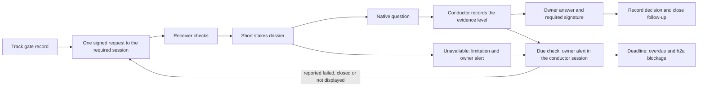

# SPEC EVOL — Owner gates must reach the native question surface

Date: 2026-11-07
Status: method contract for this PR. The signed marker, the wake guard and the due-check executor are the next implementation lot.
Scope: h2a send and receive, owner-facing host questions, conductor follow-up and the Track gate record

## Delivery decision

**D1 — Ship the method and durable follow-up rules now; implement the signed
`owner-gate` extension in the next lot.** The current PR covers requirements A
and B below and specifies C. It must not advertise C as implemented.

| Requirement | Current PR | Next implementation lot |
| --- | --- | --- |
| A. A decision/GO required in a target session immediately raises its native question after a short stakes dossier; the conductor verifies and follows up | Mandatory procedure in the h2a skill, linked from harness and present-decision. It covers unavailable tools and a target that never raises the question. | Validated receive obligation and correlated question evidence |
| B. Every pending gate has one Track record with human owner, responsible conductor, deadline, reminder cadence, executor status and closure condition, and stays visible to the owner until closed | Durable record. Surfacing: unmet in this lot (`reminders-unavailable` and an immediate owner alert). | Due-check executor `OwnerGateDueCheck`, with a budget separate from `maxRelaunches` |
| C. A signed, backward-compatible machine-readable envelope marker triggers that procedure on receive | This design, explicitly unshipped | Send schema, verification, inbox/push/wake integration, wake guard, host capability/evidence adapters, and acceptance tests |

This split is based on the implementation boundary. A new field in the sender
alone cannot provide C: local inbox reads currently return unverified data;
push carries an envelope id; wake proves injection; loop routing creates a
Track card; host questions are tools invoked by the receiving agent. A safe
implementation must connect those paths without equating any of them with a
question or owner consent. It is a separate, reviewable protocol/runtime lot,
not a small addition to this skill change.

## Observed contracts

The following paths are relative to this repository. These are facts about the
baseline examined for this design, not claims that the planned extension exists.

| Source | Existing behavior and design consequence |
| --- | --- |
| `packages/h2a/src/runtime/send.ts` | `H2ASendMessageBody` is `{kind:"message", topic:"MESSAGE", text}`. `prepareMessage` resolves the recipient, signs with a local identity, and checks its active key. Extend this shared seam for CLI and MCP. |
| `packages/h2a/src/envelope.ts` | `signEnvelope` covers all envelope fields except `signatures`. Put the marker inside `body` before signing; preserve the original envelope when adding receive diagnostics. |
| `packages/h2a/src/runtime/mcp/handlers.ts` | `handleSend` rejects unknown arguments. `handleInbox` read/put does not authenticate arbitrary local inbox content. A marker must never activate just because JSON reached that inbox. |
| `packages/h2a/src/runtime/remote/accept.ts` | Remote acceptance checks shape, target, active actor key, signature, freshness, and replay. Keep this admission boundary; do not assume every local message passed through it. |
| `packages/h2a/src/runtime/mcp/notifications.ts` | `inbox.envelope_arrived` carries instance/envelope id. Preserve that notification contract; fetch and validate the corresponding envelope. |
| `packages/h2a/src/wake.ts`, `runtime/drive/inbox-wake.ts`, `runtime/mcp/stdio.ts` | Wake formats a visible receive instruction, retries failed/deferred delivery, and normally seeds boot backlog as seen. Its success is transport evidence only. |
| `packages/h2a-runtime/src/native-host.ts` | `driveNativeInstruction` returns `driven`, `deferred`, `unresolved`, or `failed`; it does not invoke or observe a host question tool. The sidecar targets the main native session. |
| `packages/h2a/src/runtime/loop/index.ts`, `engine/adapters.ts` | `H2ALoopDecisionGate` already carries context/options/recommendation/target. `routeLoopDecision` creates a Track decision and returns `decision-raised:<id>` or `decision-already-raised:<id>`. Neither result proves a question. |
| `packages/h2a/src/runtime/loop/engine/decision.ts`, `engine/adapters.ts` | Pending inbox decisions currently derive from `type:"escalate"`. An optional marker on an ordinary message needs explicit recognition. Existing loop policy does not schedule per-gate native questions/reminders. |
| `packages/h2a/src/hosts/native-questions.ts` | Centralized guidance names native tools and mode limitations. This is guidance, not an RPC for invoking another host's tool. |

The ownership boundaries from
`2026-06-26-objective-loop-h2a-track-remote.md`,
`2026-07-07-objective-loop-mvp-plugin-relance.md`, and
`2026-07-14-SPEC_EVOL_objective-loop-continuity.md` remain: h2a owns loop
orchestration; Track owns repository work/decision state; runtime adapters own
runtime facts and guarded effects. A stopped loop never authorizes automatic
restart, and a missing native tool never authorizes a mode/permission change.

## Immediate question and conductor contract

**D2 — A pending owner gate is an obligation to ask in the required session.**
Only a decision that blocks the session's work now is a gate. A decision that
blocks nothing now goes to async review, with no native question and no
reminders (see "Reserved for the decision tool"). Reuse an existing owner
answer or authorization when it already covers the action. Do not create another
approval requirement from a preference or a routine implementation choice.

On discovering or receiving a genuine pending gate, the target agent must, in
its next available turn:

1. Verify the requester, required session, decision boundary and the
   conductor's record. A gate you discovered yourself: create the record before
   a question tool that may block. A received gate: never create one. If you
   cannot read its record, report `binding-unverified` and ask nothing.
2. Show a short, self-contained dossier: action/decision, stakes, why this
   session is required, options and consequences, recommendation, and a small
   diagram. The essential context must be visible in the session; a link alone
   is insufficient. A full HTML dossier may supplement it without delaying it.
3. Invoke the native question tool actually available and permitted in that
   host's current mode. The call must refer to the same gate, revision, options,
   and decision boundary. Respect the tool's real schema and preserve free text.
4. Report to the conductor: `question-planned` before the blocking call, then
   the tool result. Without a permitted tool, report `question-unavailable`. The
   conductor records the evidence level: `missing`, `unavailable`,
   `peer-reported` or `trace-verified`.

“Immediately” means this receive-turn obligation, not preemption of an active
tool call or bypass of an interactive typing guard. Dormant delivery remains
pending and requires conductor follow-up; no latency guarantee is invented.

The conductor records the best available evidence. `trace-verified` needs the
**actual native invocation/display trace**: gate and revision, target instance
and session, host and tool, timestamp, and call or trace reference. Across
sessions this lot has no adapter for that trace, so the level stays
`peer-reported` at most. An issued tool call that the host rejects does not
count as a raised question. When a question call blocks until answered, the
target's `question-planned` report comes before the call.

Transport acceptance, inbox pop, a wake's `driven` result, a Track card, a status
table, `decision-raised:<id>`, or the peer's unsupported “asked” statement never
provide this evidence. A peer-signed receipt proves who reported a fact; its
signature does not independently prove the host displayed the question.

**Cross-session sequence.** The conductor sends one initial request, only to a
live target that has not reported this gate. `recipient_not_live` means an
immediate owner alert, never a deposit for a dormant or replacement session.
After the request, the conductor sends nothing to the target until it reports
`question-planned`, an answer or a failure. On `question-planned`, the conductor
raises one `OWNER GATE ALERT <id>` in its own session.

**If the target never raises the question.** The conductor's due checks find no
report, so the evidence stays `missing`. Each due check raises
`OWNER GATE ALERT <id> — answer in <session> · question missing` in the
conductor's session. The conductor does not message the target again. It
re-raises at the target only after the target or the owner reports that the
question failed, closed or is not displayed. A re-raise is one new request for
the same gate and revision. At the deadline the gate becomes `overdue` and the
conductor escalates through h2a (D3).



## Durable pending record

**D3 — Every gate has exactly one authoritative record before the first
potentially blocking question.** The record is a Track decision titled
`OWNER GATE <id> — <action>` in the conductor's repository. An objective loop
may point to it but never replaces it: a `done`, `stopped` or `blocked` loop
refuses new reports. Reuse the record across retries and handovers.

| Required field | Meaning |
| --- | --- |
| Gate id and revision | Stable logical decision identity; revision changes when the decision/session contract changes, not for a retry |
| Binding | Track repository, workspace and decision id of the `OWNER GATE <id>` decision, plus the blocked item. A loop id may point to it. |
| Human decision owner | Named human who may answer; distinct from an agent signer or a reporting principal |
| Responsible conductor | Named agent responsible for delivery, checking evidence, reminding, and handover |
| Target instance and session | Exact h2a identity plus concrete owner-facing session; a channel alias is insufficient for session-bound GO |
| Escalation deadline | Absolute UTC timestamp; not consent expiry, cancellation, or permission to proceed |
| Reminder cadence and next reminder | Explicit interval and absolute UTC due time |
| Reminder executor | A timer that wakes the conductor at `nextReminderAt`, with observable liveness and a budget covering the cadence. An agent name or the loop controller alone does not qualify. None qualifies in this lot: the record says `reminders-unavailable`. |
| Question evidence | `missing`, `unavailable`, `peer-reported` or `trace-verified`; never a fabricated call id |
| Close condition | Required owner answer in the required session, any required signature, and where the outcome is recorded |
| Follow-up history | Delivery attempts, receipt/evidence checks, reminders, escalations, handovers, and closure source |

Use agreed timing. Otherwise record a **15-minute reminder cadence and an
escalation deadline 30 minutes after gate creation**. The first due check looks
for the target's report. It sends nothing to the target. Escalate unavailable
tooling at once. The deadline is the additional escalation for an unanswered
gate.

At each due check the executor reads the record again. It sends nothing to the
target while the gate question is open or its state is unknown. It reminds the
owner with `OWNER GATE ALERT <id>` (acknowledge-only) in the conductor's
session. It re-raises at the target only after the target or the owner reports
that the question failed, closed or is not displayed. Advance `nextReminderAt`
only after recording the attempt and result. On restart, one overdue check runs,
then cadence resumes. Do not replay every missed interval in a burst. A deferred
owner answer keeps the gate pending with an explicitly recorded next reminder.

At the deadline the executor marks the gate `overdue` in its record. It raises
`OWNER GATE ALERT <id> — overdue` in the conductor's session. It escalates
through h2a with `h2a_blockage_raise` (reason `OWNER GATE <id> overdue`, needs
`owner answer in <session>`). A blockage pushes `peer.blocked` to peers in
scope and types nothing. One blockage per conductor lists all its overdue gates.
The deadline never approves, cancels or closes the gate.

The existing APIs suffice for the method lot. Create the record with
`track decision new --kind commitment --title "OWNER GATE <id> — <action>" --workspace <ws> --targets <blocked-item> --context <record> --options-json <json> --recommendation <optionId> --rationale <r>`.
On restart, run `track decision ls --outcome pending --format json` and resume
every `OWNER GATE` decision. Append evidence with `track decision add-artifact`.
Use the existing Track CLI and its single-writer discipline. There are no
`--owner-gate`, `--deadline` or per-gate reminder flags implied by this design.
The current runtime does not interpret the record as a scheduler.

The objective loop controller is not a reminder timer. It wakes an agent only on
idle evidence, sends a generic line and shares its `maxRelaunches` budget
(default 3) with launches. It also types into the target terminal. The assigned
conductor performs and records due checks. A stalled conductor, an exhausted
budget or a lost session requires an owner alert and an accepted handover. Keep
the gate pending while responsibility changes. Never erase it by completing or
stopping a loop. A record that is unreachable or cannot be verified stays
pending, never implicitly satisfied.

Tracking failure must not silently postpone the owner alert. Immediately show
the stakes and the `tracking-unavailable` limitation in the required session.
The native question there still goes ahead. Alert the owner and notify the
conductor. Repair the record. Preserve recovery evidence without claiming that a
local note is the record. The dependent action remains blocked and B remains
unsatisfied until the record is restored. A passed deadline never repairs this
failure.

Closure requires an attributable owner answer and the close condition. Record
GO with `track decision select <decisionId> <optionId>`, NO-GO with
`--outcome no-go`, and keep a required signature as a separate artifact. A
deferral uses `track decision outcome <decisionId> deferred` and keeps the gate
pending. Explicit owner cancellation or supersession can close follow-up with
that reason. An agent, relay principal, timeout, receipt, or completed
implementation cannot grant owner authority. A report reply, an alert
acknowledgement or a `D1 A` line in another session never records a GO. A new
target session requires an explicit owner answer and a recorded rebind.

## Reserved for the decision tool

The owner asked on 2026-11-07 (Track item `01M6V34N5GNMHZRM85WNTH1R2J`) for an h2a
decision tool. Urgent and blocking decisions trigger the host's native question
tools. Non-blocking pending decisions stack for async review. Decisions are
modelled in engram. The proposed engram decision entity carries a blocking flag
and the states below. This design keeps that space free and maps onto it:

| Decision-tool state | Owner-gate meaning in this design |
| --- | --- |
| `pending-blocking` | An owner gate: native question now, record, due checks and deadline |
| `pending-async` | The owner deferred the gate to async review, or the decision never blocked. No native question. Reminders stop until the date the owner chose. The blocked action stays blocked. |
| `decided` | GO or NO-GO recorded from the attributable answer in the required session |
| `withdrawn` | Explicit owner cancellation |
| `superseded` | A new revision or a replacement decision |

An agent or engram may propose `withdrawn` or `superseded`. Only an owner answer
confirms it. The async stack is an engram query over pending non-blocking
decisions. It raises no native question and sends no reminder. C adds no
decision store. The planned decision tool may become the authoritative record,
under a new binding kind. The v1 marker reserves two values for it: `blocking`
(absent or `true` in v1) and `binding.kind: "decision"`. A v1 receiver classifies
`blocking: false` or a `decision` binding as `unsupported`.

## Current transport convention

**D4 — Until C ships, use only supported signed tools.** Resolve the exact
target and send through `h2a_send {to, message}`, once (D2 sequence). Begin the
text with `OWNER GATE <gate-id>`, include the record reference, the short
dossier and the required session, and request the native question and its
evidence. This is a readable method convention, not a parsed marker or a
verified receipt.

Do not pass an unsupported `owner-gate` argument to the current strict tool.
Do not downgrade to unsigned `h2a_inbox put`. The receiving skill applies D2.
The sender still verifies evidence under D3. The target pops the request after
sending `question-planned` or its failure report. Pop removes mail, not the gate
or its reminders.

In this lot every h2a message still wakes its recipient by typing a line and
Enter. The method therefore limits traffic to one request to the target and two
reports back. It never sends reminders to the target. On Claude, a conductor
alert raised with `AskUserQuestion` blocks the conductor until the owner
answers, so it runs no due check meanwhile, and a target report can still type
into that open alert. Alerts only acknowledge, so that input never becomes a
GO. Prefer a non-blocking surface where the host has one (Codex
`request_user_input_async`). The wake guard in C removes the keystroke for
every session.

## Planned machine-readable contract — implementation lot C

Everything in this section is a proposed additive API, **not available in the
current release**.

**D5 — Use the exact optional JSON property `owner-gate` inside the signed
message body.** Keep the existing envelope protocol/version/type and
`body.kind:"message"`, `body.topic:"MESSAGE"`, and `body.text`.

```ts
interface OwnerGateBinding {
  kind: "track"; // v1 only; "decision" is reserved for the decision tool
  repoKey: string;
  workspace: string;
  decisionId: string; // the `OWNER GATE <id>` Track decision
  itemId?: string; // blocked work item
  loopId?: string; // optional pointer, never the record
}

interface OwnerGateTargetSessionV1 {
  host: string;
  nativeSessionId: string; // qualified native conversation/session identity
  h2aSessionId: string; // exact discovered presence connection
}

interface OwnerGateRequestV1 {
  version: 1;
  kind: "request";
  id: string;
  revision: number; // positive safe integer
  purpose: "decision" | "go" | "signature";
  blocking?: true; // reserved: absent or true in v1, false is `unsupported`
  owner: string; // human reference, never inferred from the signer
  conductor: string; // must equal the request envelope actor
  targetSession: OwnerGateTargetSessionV1;
  binding: OwnerGateBinding;
  escalationAt: string; // ISO UTC timestamp
  reminder: { everyMs: number; nextAt: string; executor: string };
  closeCondition: string;
  dossier: {
    title: string;
    question: string;
    context: string;
    stakes: string;
    options: Array<{ id: string; title: string; consequence: string }>;
    recommendation: { optionId: string; rationale: string };
    diagram: { format: "text" | "mermaid"; source: string };
  };
}

interface OwnerGateReceiptV1 {
  version: 1;
  kind: "receipt";
  id: string;
  revision: number;
  requestEnvelopeId: string;
  requestDigest: string; // canonical SHA-256 of request envelope without signatures
  targetSession: OwnerGateTargetSessionV1;
  reported: "received" | "question-planned" | "question-invoked"
          | "question-unavailable" | "question-failed" | "question-closed"
          | "question-not-displayed" | "answer-observed" | "escalated"
          | "wrong-session" | "session-unverified" | "boundary-mismatch"
          | "binding-unverified";
  at: string;
  evidence?: { tool: string; callRef: string; traceRef: string };
  reason?: string;
}

type OwnerGateMarkerV1 = OwnerGateRequestV1 | OwnerGateReceiptV1;

interface H2ASendMessageBody {
  kind: "message";
  topic: "MESSAGE";
  text: string;
  "owner-gate"?: OwnerGateMarkerV1;
}
```

One set of terms serves the skills and this marker:

| Term | Where it appears |
| --- | --- |
| `question-planned`, `question-invoked`, `question-unavailable`, `question-failed`, `question-closed`, `question-not-displayed`, `answer-observed`, `escalated` | Target reports (`reported`) |
| `wrong-session`, `session-unverified`, `boundary-mismatch`, `binding-unverified` | Receiver refusals (`reported`). The receiver asks, records and pops nothing. |
| `missing`, `unavailable`, `peer-reported`, `trace-verified` | Evidence level in the conductor's record |
| `reminders-unavailable`, `tracking-unavailable`, `overdue` | Conductor record status |
| `OWNER GATE <id>`, `OWNER GATE ALERT <id>` | Readable request and acknowledge-only owner alert |

Identifiers are opaque bounded strings, never file paths or shell fragments.
Use a UUID gate id, bounded to 128 characters; bound other references to 512.
Reject unknown fields within v1, non-integer revisions/intervals, invalid UTC
timestamps, duplicate option ids, and recommendations absent from the options.
Classify `blocking: false` and any `binding.kind` other than `"track"` as
`unsupported`. Both are reserved for the decision tool.
Allow 2–4 options; a host with a smaller menu limit must still expose all options
in the dossier and preserve free-text selection, without silently dropping or
changing an option. `everyMs` must be at least 60,000 and at most 86,400,000;
the default remains 900,000. These bounds prevent a malformed reminder storm.

The whole serialized body, including the marker and readable fallback, is
bounded to the existing 64 KiB send budget. The dossier must remain short; cap
each prose field at 2,048 characters, titles/option titles at 160, and the
diagram at 2,048. The receiver treats the diagram as data, never executable
HTML, script, a command, or an instruction to fetch an external resource.

### Exact send and receive surfaces

Extend `h2a_send` additively:

```ts
{ to: string; message: string; backend?: "local" | "cluster-mesh";
  "owner-gate"?: OwnerGateMarkerV1 }
```

The trusted sidecar supplies the actor/key. A request's `conductor` must equal
that actor. The common sender appends a canonical readable summary of the
marker to `message` before signing, so an old receiver still sees the required
session, decision, binding, and follow-up information. Caller prose is context;
it cannot override structured fields. Without a marker, generated bytes and
legacy send behavior remain unchanged.

CLI equivalent: extend `h2a send <peer> <text>` with
`--owner-gate-file <path>` or `--owner-gate-stdin`, mutually exclusive. Parse
bounded JSON before side effects. Keep existing local key resolution; keys are
never MCP arguments or marker fields. Do not put marker JSON in argv.

Keep `h2a_inbox` read non-destructive and return original envelopes unchanged.
Add an optional sibling `ownerGates` array containing
`{envelopeId, id?, revision?, disposition, reason?}`. Disposition is
`request`, `receipt`, `unsupported`, or `rejected`; this is validation/routing
information, not a statement that a question was raised. Ordinary envelopes
are unaffected. Notification payloads remain instance/envelope-id hints.

For a validated request, the read response carries a fixed obligation:
`verify-binding-present-dossier-invoke-native-question`. The receiving skill
must perform D2 in the same receive turn and report evidence using the existing
signed `h2a_send` with a receipt marker. A receipt does not trigger a question.
The runtime supplies its current instance/session from trusted sidecar context;
arguments cannot let a caller claim to be another session. The native session
identity is qualified by that host's adapter, not inferred from a perennial
instance, a reused tmux pane, a display name, or a presence heartbeat. If the
host cannot supply/verify that identity, session-bound activation is unavailable.
A sidecar reconnect requires a recorded connection rebind and proof of the same
native session; it does not change where the owner must answer. A different
native conversation requires an explicit target revision, never silent rerouting.

C adds **no public lifecycle tool and no decision store**. Its only scheduler
is the due-check executor `OwnerGateDueCheck` (seams table). The planned
decision tool may become the authoritative record (see "Reserved for the
decision tool"). The existing Track record owns pending state, attempts, due
checks, and closure. The receive obligation is discharged by an actual host native call or
recorded escalation, not by returning this instruction. h2a cannot fabricate
that native call through MCP. Receipt fields are peer-reported facts; even a
valid signature cannot make them verified evidence or an owner decision.

### Validation, attempts, and evidence

**D6 — Authenticate before turning marker data into a question obligation.**
Use one shared runtime validator for read classification, wake classification,
and loop projection. Its planned API is
`classifyOwnerGateEnvelope(envelope, {instance, targetSession, now, resolveActiveKeys, resolveRequest})`;
it returns `none`, `request`, `receipt`, `unsupported`, or `rejected` with a
reason. Bindings/evidence are checked against the owning record by the target
and conductor; the validator does not turn sender assertions into authority.
Validate envelope shape, supported marker schema, `actor.instance` signature
against active keys, exact canonical target instance, and required session for
requests. Do not accept an arbitrary co-signature
as the actor's signature. Verify `conductor === actor.instance` for requests;
for receipts, actor must equal the original request target and the recipient
must equal its conductor. `resolveRequest` reads the original request reference
from the durable binding; an absent request means uncorrelated evidence, not a
successful receipt. Match digest, envelope id, gate, revision, and original
target session before accepting receipt evidence; the receipt's target-session
field describes that original recipient, not the conductor receiving the receipt.

Resolve bindings only through the current workspace/loop's explicit repository
mapping. A remote marker cannot supply an arbitrary filesystem path, enroll a
new agent, create a Track item in another repository, or change an owner's
authorization. An inaccessible/missing/mismatched binding produces a pending
escalation, not a native approval prompt with guessed context.

Admission is the first observation of an envelope by the receiving sidecar,
recorded per envelope id. Later reads classify from that record plus the
signature. At admission, use the existing five-minute freshness and one-minute
future-skew policy. An old request that was never admitted cannot activate
automatically: report stale and ask the conductor to send a fresh signed request
for the same gate revision. An admitted, still-pending gate survives that window
through its durable record. Never age it into approval or cancellation.

Record request digest, received envelope ids, attempts, reports, and evidence
in the existing binding before popping inbox mail. Reuse current transport
deduplication and wake journaling. Question-level deduplication compares
gate/revision and the decision contract recorded in that binding before another
native call. A same-revision changed contract is a conflict; a transport retry
with a fresh envelope id/timestamp is not a new question. Define two computed
digests, both lowercase SHA-256 hex over the existing canonical JSON encoding:

- `requestDigest` covers the exact request envelope except `signatures`; it
  correlates a receipt to one envelope and changes for a fresh id/timestamp.
- `contractDigest` covers only what the owner sees and answers:
  `{targetInstance, id, revision, purpose, blocking, owner,
  targetSession.host, targetSession.nativeSessionId, binding (without loopId),
  closeCondition, dossier}`. It omits `conductor`, `escalationAt`, `reminder`
  and `targetSession.h2aSessionId`. Those are record updates: a handover, a new
  executor or an owner deferral keeps the same contract and makes no new native
  call.

Changing an omitted field still requires a recorded update: handover, deferral
or connection rebind. It never grants permission to change the owner-facing
decision or to silently retarget another conversation. Retry deduplication
compares `contractDigest`, not `requestDigest`.

The single responsible receiver/conductor records attempt started, tool
invoked, host accepted/displayed, and answer observed distinctly. After a crash
between invocation and evidence recording, inspect host evidence before
re-raising. If inspection is unavailable, keep the evidence at `peer-reported`
or `missing` and alert the owner rather than blindly duplicating a dialog. The
next lot must demonstrate this recovery. It must not claim exactly-once native
UI execution from existing inbox deduplication alone. Follow the existing Track
single-writer rules. C adds no state machine of its own: the decision tool's
states are reserved above. Never edit `.track` files directly.

A new revision may update context/session only after the authoritative binding
records the change. A responsible-conductor handover must also be recorded and
accepted before a successor takes over; correlate its new sender identity to
the same logical gate rather than accepting an arbitrary signer takeover.

Native evidence verification belongs to an adapter with read-only access to
the **current host's own** tool-call/display record. Match the exact session,
call reference, tool, request content/revision, and invocation result. Opaque
agent-supplied `traceRef` strings are not paths to open or proof to trust.
Where no supported adapter or independently inspectable trace exists, the
evidence stays `peer-reported` at most and the owner is alerted. No generic
transcript scraper, process inspection, or new mode/permission is implied.

### Host behavior and fallback

**D7 — Capability is determined by the actual tool surface and mode.** The
following mapping reuses `hosts/native-questions.ts`; it is not a capability
claim for every installation.

| Host | Native question | Required fallback when unavailable/rejected |
| --- | --- | --- |
| Claude | `AskUserQuestion` | Show dossier/limitation; record `unavailable`; alert the owner in the conductor's session. Do not enable/disable `--bare` to obtain it. The tool blocks the session until answered, so a conductor alert raised with it pauses due checks. |
| Codex | `request_user_input` or exposed `request_user_input_async` | Obey mode and permission restrictions. If the available tool cannot ask for this GO, leave pending and escalate; do not switch to Plan mode or misuse an optional-input tool as approval. |
| Muse | Exposed `request_user_input` | `--yolo`/disabled-tool absence remains unavailable; do not change launch posture. |
| Gemini | Exposed `ask_user` | Non-interactive execution remains unavailable; do not fabricate an interactive response. |
| agy | Exposed `ask_question` | Record capability failure and relay attention while preserving the required session. |
| Vibe | Exposed `ask_user_question` | Same pending/escalation contract. |
| Other hosts | Only a tool actually exposed and qualified by that host | Never guess a name; present dossier/limitation and retain pending. |

An owner alert names the required session and only acknowledges. It never moves
a session-bound signature or GO to another session. A readable text alert is
the fallback, not an equivalent native question or an approval. Forward only
necessary dossier context and evidence references through the authorized h2a
channel.

### Implementation seams and boundaries

| Path | Planned responsibility in C |
| --- | --- |
| `packages/h2a/src/owner-gate.ts` (new), `schema/owner-gate.schema.json` (new), `src/index.ts` | Marker/receipt types, strict schema, pure parsing/fallback formatting; public exports |
| `packages/h2a/src/runtime/send.ts`, `src/cli.ts` | Optional marker, total-body budget, canonical fallback, signing and CLI file/stdin input |
| `packages/h2a/src/runtime/owner-gate.ts` (new) | Shared authentication/classification and fixed receive obligation; no new tracker |
| `packages/h2a/src/runtime/mcp/tools.ts`, `handlers.ts`, `server.ts`, `mcp-central-descriptor.js` | Additive send/read schema, trusted receive context and catalogue consistency |
| `packages/h2a/src/runtime/mcp/notifications.ts`, `stdio.ts` | Keep id-only push; feed pending gate recovery to the same receiver; do not mark native questions complete on notification delivery |
| `packages/h2a/src/wake.ts`, `runtime/drive/inbox-wake.ts` | Accept only prevalidated gate hints for special wake text; preserve ordinary boot-backlog behavior; pending-gate recovery follows the existing durable binding |
| `packages/h2a/src/hosts/owner-gate-question.ts` (new), `hosts/native-questions.ts` | Qualified capability/evidence adapter interface and shared host mapping; guidance does not substitute for an adapter |
| `packages/h2a-runtime/src/native-host.ts`, native/tmux drive adapters | Reuse guarded delivery to the owning main session; never treat PTY acceptance as native question evidence |
| Wake guard: `packages/h2a/src/runtime/drive/inbox-wake.ts`, `runtime/drive/index.ts`, `runtime/loop/engine/adapters.ts`, `runtime/drumbeat/relaunchers.ts`, `packages/h2a-runtime/src/native-terminal/op.ts` | Before any typed wake, reuse the modal detection of `packages/h2a-runtime/src/prompt-delivery.ts`. While a dialog is open or its state is unknown, defer the wake with a recorded reason and type nothing. This applies to every session, target or conductor. |
| Due-check executor `OwnerGateDueCheck`: `packages/h2a/src/runtime/owner-gate-due.ts` (new), wired in `runtime/mcp/stdio.ts` | Reads pending `OWNER GATE` records and wakes the conductor at `nextReminderAt` through the guarded wake. Runs one late check after a restart, never a burst. Marks `overdue` and raises the h2a blockage at the deadline. Stops once closure is recorded. Its budget is separate from `maxRelaunches`. The clock is injected. |
| `packages/h2a/src/runtime/loop/engine/{adapters,decision,execute}.ts` | Recognize validated marker requests; preserve pending via the existing binding after inbox pop; separate Track routing from native-question evidence |
| Track report renderer, `packages/track/src/report/` | Render a pending `OWNER GATE` decision as `answer in <session> · question <evidence level>`, with no `D` number and no reply slot |
| `packages/h2a/skills/h2a/SKILL.md`, `skills/harness/{SKILL.md,using-harness/SKILL.md,track-report/SKILL.md}` | Single full procedure in the h2a skill, short links elsewhere, status-table exclusion, and explicit current-versus-planned contract |
| `packages/track/skills/present-decision/SKILL.md`, `assets/owner-gates.md` | Required short link and the presenting rules for a gate; retain the main skill's readability budget |

No envelope-type enum or top-level version bump is needed. Old recipients
ignore the optional field and read the canonical fallback; new senders must
not claim native activation without a verified receipt/trace. Old senders and
unmarked messages retain their behavior. Unknown marker versions remain
readable but produce `unsupported`, never best-effort execution. A new sender
must feature-detect the optional MCP field; an old server's unknown-argument
error does not authorize silently stripping the marker while reporting success.
An explicit fallback to D4 must disclose that it is the method convention.

Signature authentication does not grant decision authority, authorize tools,
or authorize the blocked action. Keep the existing authentication model and
human typing/idle guards. Do not add shell execution, external message channels,
hidden daemons, automatic spawning, consent-by-timeout, or native-tool guessing.
Reminders require the due-check executor `OwnerGateDueCheck`. Installing this
marker alone does not create one.

## Acceptance and release evidence

The current PR is accepted only for A+B method delivery. Validate all affected
packaged skill entry points and resource installation; ensure the native host
mapping remains synchronized and the existing present-decision size/resource
checks pass. Review these behavioral cases against the instructions:

1. A session-bound GO produces the short dossier and permitted native call now,
   without waiting for a report or asking the owner to type a magic sentence in
   another session.
2. A blocking call has a durable record before invocation. The conductor
   records the best available evidence level (at most `peer-reported` across
   sessions in this lot). Without a qualified timer the record says
   `reminders-unavailable` and the owner is alerted at once.
3. `decision-raised`, inbox delivery, wake success, unsupported “asked”, missing
   tooling, and missing trace all remain distinct from a raised question/GO.
4. Defaults are 15-minute reminders/30-minute escalation, existing agreed
   timing wins, deadline/silence never approves, and a deferral stays pending.
5. A stopped loop, inbox pop, host failure, or handover cannot lose the gate.
6. Current examples use supported signed `{to,message}`; C is labelled unshipped.
7. A tracking write/read failure produces the immediate visible/native alert
   and escalation, keeps the action blocked, and never claims a fulfilled
   binding or waits silently for storage to recover.
8. No reminder, re-raise or escalation sends anything to the target while its
   question is open or its state is unknown. Reminders are owner alerts.
9. A target that never reports leads to one owner alert per due check and
   `overdue` with an h2a blockage at the deadline, never to repeated target
   messages.
10. A decision that blocks nothing now raises no native question and no
    reminder.
11. A track report shows a session-bound gate without a `D` number, and
    `vas y` or `D1 A` never answers it.

Before C may ship, add targeted tests with injected clocks, fake host adapters,
isolated roots, and controlled subprocess fixtures:

| Test group | Observable acceptance |
| --- | --- |
| Schema/signature (`owner-gate.test.js`, existing `envelope-signature.test.js`) | Request/receipt round trips; changing marker/session/owner/options invalidates signature; missing/unknown/revoked actor key and unrelated co-signature cannot activate |
| Send compatibility (`send.test.js`) | Unmarked legacy body unchanged; valid marker is signed with fallback; malformed marker and body over 64 KiB fail before write; CLI file/stdin and MCP agree; old descriptor fallback is explicit |
| Local receive (`owner-gate-receive.test.js`) | Unsigned raw local put, tampered marker, wrong instance/session, stale first admission, and unknown version produce no native obligation; valid local/remote/mesh messages use the same classifier; inaccessible binding produces an immediate limitation/escalation, never silent waiting or invented tracked state |
| Notification/wake (`evo1-inbox-wake-handler.test.js`, `owner-gate-receive.test.js`) | Read, push, native PTY and tmux wake converge on one receive attempt; human deferral does not consume/complete it; injected wake alone never marks question raised |
| Recovery (`owner-gate-recovery.test.js`) | A new-envelope retry changes requestDigest but preserves contractDigest; modified options/native session conflict within a revision. GREEN: a conductor handover and an owner deferral keep the same `contractDigest` and make no new native call. Scripted receiver/conductor checks repeats, explicit connection rebind, sidecar restart, and crash between invocation/receipt against the existing binding; uncertain UI stays `peer-reported` or `missing` with an owner alert. GREEN: a request admitted by the sidecar and read 30 minutes later still activates; an old request never admitted is stale and asks for a refresh |
| Wake guard (`owner-gate-wake-guard.test.js`) | A fake host shows an open owner-gate question and a generic `› 1.` / `enter to select` dialog, then receives an inbox envelope and a loop wake. RED today: a line and Enter are injected. GREEN: the wake is deferred with a recorded reason, no keystroke is written and the dialog is unchanged. The same holds for drumbeat and drive wakes, and for a conductor with an open owner alert |
| Due checks (`owner-gate-due.test.js`) | Injected clock, idle conductor. Due checks keep firing for more than `maxRelaunches` intervals. A restart after missed intervals runs one late check, not a burst. The deadline marks `overdue` and raises the h2a blockage. Checks stop once closure is recorded |
| Decision-tool reservation (`owner-gate.test.js`) | Absent `blocking` means blocking. `blocking: false` and `binding.kind: "decision"` classify as `unsupported` and raise no native question |
| Host capability/evidence (`owner-gate-hosts.test.js`) | Each mapped tool is selected only when exposed/permitted; negative modes follow D7; rejected calls stay failed; supplied trace ids cannot self-promote to verified; blocking-call evidence is observable before owner answer |
| Follow-up (`owner-gate-follow-up.test.js`, loop tests) | The first due check looks for the target's report and sends nothing to the target. No keystroke reaches an open or unknown dialog: one owner alert per due check. A re-raise happens only after a reported failure, closure or non-display. Overdue restart coalesced, unavailable and deadline escalation recorded, pop and loop stop leave pending, no executor is reported as a running reminder service |
| Receipt/closure (`owner-gate-receive.test.js`) | Wrong signer/session/digest/revision receipts ignored; a valid peer receipt remains reported until trace verification; answer receipt/agent signature/timeout cannot authorize or close the gate; actual owner outcome is correlated with required session/signature. With two live sessions of one instance, only the required session classifies the envelope as a `request`. The sibling neither pops it nor records an attempt |
| Supported-host smoke | A controlled owner-facing host session receives a signed gate, displays the dossier, invokes its real permitted native tool, and provides inspectable evidence; its unavailable mode proves fallback. A fixture or plain wake line alone cannot satisfy this smoke. |

Run only relevant test files in the task's isolated test root. Preserve
red-before/green-after evidence for regressions; a silently skipped host case
does not pass. Never inspect the owner's real native sessions, installed h2a
runtime, or real state for this work. If a host cannot be qualified under the
available test environment, record its adapter as unqualified and retain the
explicit fallback; do not report C fully delivered for that host.

The implementation lot's exit criterion is a traceable chain from a signed
request to the correct session's native question, or a recorded pending
fallback, with durable follow-up and no manufactured consent. The present PR
ends at the method/spec boundary and carries the implementation lot forward.
