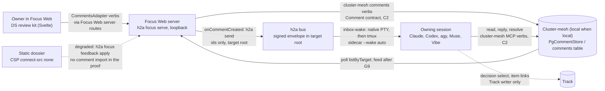
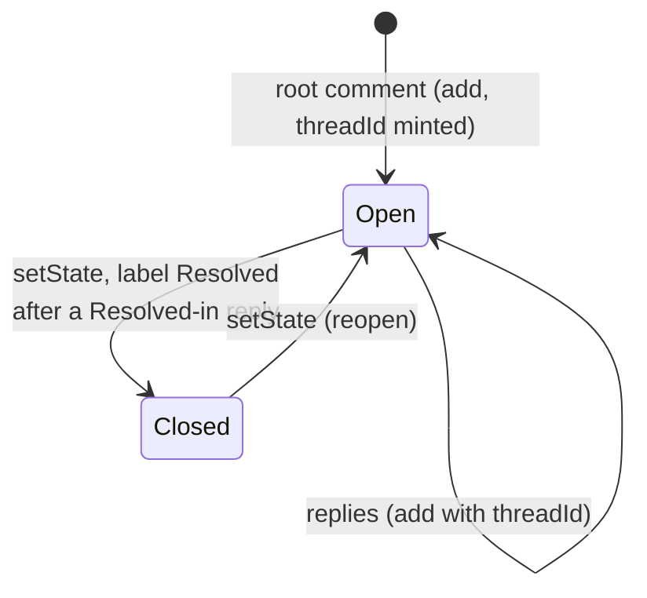

# SPEC EVOL — Local artifact review mode (claude.ai-like comments) over cluster-mesh

| Field | Value |
| --- | --- |
| Status | Specification only, revised after independent review on 2026-11-17. No product code, no test execution, no Track write is claimed by this document. |
| Date | 2026-11-17 |
| Branch | `docs/artifact-review-spec`, cut from h2a `origin/main` `1a99a88f6` |
| Owner need | Verbatim of 2026-11-17 (conductor record `tmp/h-cond/artifact-review/VERBATIM-17-11.md`, untracked): local artifacts with a comment mode as in claude.ai but local and more reactive; the h2a send-message path whatever the CLI; reuse of the comment modules; traceability of comment follow-up, probably around decision dossiers. |
| Owner correction (binding) | « attention a la surcouche: ca doit passer impérativement via cluster-mesh côté api (il y a deja le metamodel de commentaire, ...) ». It replaces the earlier conductor proposal of an h2a-local store per dossier. h2a and Focus Web are **clients** of the cluster-mesh comments API; locally they use a local cluster-mesh. There is no h2a-owned comment store. |
| Governing DS contract | Design system review kit `SPEC-r2.md` (scratchpad, 17/11): section 1 contract, section 4 traceability, h2a lots H1–H5 in section 5. This spec fills every h2a slot from that contract and adds no field to it. A `SPEC-r3.md` exists in the same scratchpad and already folds the sentropic counter-review (state literals, author model, `runId`, anchor cap); which revision governs is gap G18. Where r2 and the code disagree, this spec follows the code and lists the gap. |
| Comment metamodel (binding) | The existing `Comment` type of `@sentropic/comments` (`packages/comments/src/types.ts`), its `CommentStore` port (`packages/comments/src/store.ts:26`), the Postgres adapter `PgCommentStore` (`api/src/services/comments/pg-comment-store.ts`) and the `comments` table (`api/src/db/schema.ts:792`, migration `api/drizzle/0020_add_comments.sql`), sentropic `origin/main` `ad8e685e5`. |
| Sources read | h2a `origin/main` `1a99a88f6`; sentropic `origin/main` `ad8e685e5` (`@sentropic/comments` 0.3.1, `@sentropic/cluster-mesh` 0.27.0-dev.1; h2a pins cluster-mesh 0.25.0 in `packages/h2a/package.json:81` and does not depend on `@sentropic/comments`); DS review kit r2 plus `PEERS.md` counter-review; DS `origin/main` `ec3229f72` for the artifact-shell components that exist today; claude.ai Docs connector guide `topic.comments` (read 2026-11-17). Evidence is listed in Appendix A. |

## 0. The feature in two diagrams

Only `open` and the closed/resolved literal exist in the contract (G3). Sent, answered, source-changed and orphan are **projections computed by the client** (sections 5 and 6), never stored states; gaps G12 and G13 record what that cannot prove after a reload.

## 1. Decisions (proposed contract)

| Id | Decision |
| --- | --- |
| AR-1 | The DS section 1 contract is the only comment contract: existing `Comment`, `target.kind` pinned to `'artifact'`, flat threads grouped by `threadId`, anchor inside `sectionKey` as `'a1:' + base64url(JSON)` (DS section 2), `CommentStore` behind a host `CommentsAdapter`, cluster-mesh as sole backend. h2a adds no wire field, no comment store, no comment index and no outbox holding comment content. Focus Web may hold `Comment[]` in memory as a rebuildable cache fed by `listByTarget`; a browser draft is a draft and is never shown as saved. Read state is the single bounded exception and is handled in AR-10. |
| AR-2 | A second, incompatible revision-based metamodel is co-exported by the same `@sentropic/comments` package (`anchors.ts`, `revisions.ts`, `lifecycle.ts`, `commands.ts`, `submissions.ts`) with a canonical cluster-mesh router and composition (`packages/cluster-mesh/src/hono/comments-router.ts`, `src/compose/comments.ts`). It is **not** the contract of this spec: the owner pointer and DS section 1 both designate `Comment` plus `PgCommentStore`. Capabilities that only the revision metamodel has (version binding, prepared submissions, operation audit, CAS, tombstone) are not used; each missing piece is a gap request (section 4). Which `/comments` generation cluster-mesh exposes for artifacts, and the cutover path if the canonical one supersedes `Comment`, is gap G17. |
| AR-3 | "Local" means a local cluster-mesh endpoint exposing the section 1 verbs (sentropic lot C2). Today the existing HTTP router is product-API only and rejects artifact targets (section 3.3), and no local runnable host is verified. When the endpoint is absent or unreachable, Focus Web shows `comments unavailable (missing binding)` and writes nothing anywhere, mirroring the memory provider refusal (`missing_binding`, `packages/h2a/src/registry/memory-provider.ts:25`). A port-shaped stub, when sentropic supplies one for the proof, is labelled as a stub in the UI, keeps nothing durable, and never satisfies a persistence acceptance line (section 7, H3). |
| AR-4 | Anchor identity joins the two stable keys without inventing a field: DS `aid` (`data-anchor-id`, strongest key in DS section 2) carries the Focus node `targetRef` (`packages/focus/src/model.ts:24`, `:41`). Focus Web renders `data-anchor-id=<targetRef>` on stable blocks (H1) and `target.id` is the Focus document `ref`. Paragraph identity from the editing manifest has no DS payload slot except through `aid`/`sel` conventions; it is not carried separately in the proof. `resolveAnchor` stays kit-side and never writes back; a stored anchor changes only through a reanchor verb that does not exist yet (G7). |
| AR-5 | Republication never rewrites a stored anchor. The anchor payload `v` is the artifact version at capture (Focus document `hash`/`baseHash` of the render the owner saw; the exact value is an H1 slot, section 3.2). On a new version the kit re-resolves: matched, moved or orphan is presentation state. The version that handled a thread is recorded only by the DS section 2 convention: a `Resolved in <version|commit>` reply posted before `setState`. A typed version binding is gap G11. |
| AR-6 | Authorship is whatever the server records from the authenticated caller; the adapter `author` argument is never trusted as evidence (existing HTTP ignores payload authorship and uses the principal). Owner comments are authored by the local owner principal; agent comments by the principal bound to the agent identity, subject to the non-human author gap G5. The Focus relay identity that signs the h2a envelope is a transport signer only and never authors a comment. |
| AR-7 | Delivery to the agent is the signed `h2a send` (existing verb, `packages/h2a/src/cli.ts:454`; local or cluster-mesh messaging backend), deposited in the root the target reads. The message carries identifiers only (Appendix C), never the comment body and never an excerpt: DS section 4 lists an excerpt in the send payload, and this spec deliberately tightens that point so the h2a inbox never becomes a second copy of comment content (deviation to confirm, G18). The agent re-reads the thread through the cluster-mesh MCP verbs (C2) with its own configured endpoint. The unsigned `h2a inbox put` path used by existing Focus routes is not reused (defect F3). |
| AR-8 | The recipient is the owning session, resolved by the existing ladder (section 5.2) with visible ambiguity; every h2a CLI host prefix is accepted (the current Focus Web filter drops `muse:` and `vibe:`, defect F1, fixed in H4). |
| AR-9 | The reply path is the agent writing through the cluster-mesh verbs (MCP for agents, C2). h2a ships no `h2a_comment_*` tools duplicating C2. A host that cannot run those MCP verbs cannot reply in-thread; Focus Web shows the per-host reason (section 5.3) instead of a silent wait. Reply identifiers are minted by the store (`NewComment` has no `id` field), so no reply id is preallocated; the agent replies with `threadId` and Focus Web discovers the row by poll or feed. |
| AR-10 | Read state `(threadId, userId) -> lastReadAt` has no contract field (DS section 2). For the proof it lives in browser-session memory only, is lost on reload, and is labelled as such; it is never persisted in h2a files, which would create the h2a-owned side store the owner correction forbids. A durable home is gap G10 (DS lot C4). |
| AR-11 | No failure is silent: Focus Web shows one of a closed list of states with the next possible move (section 5.4). |
| AR-12 | Traceability follows DS section 4 with existing fields only: flat replies by `createdAt`, `author`, `provenance.toolCallId`/`runId` when present, resolution reply, `assignedTo`. Promotion to a decision or Track item is a reply-body trailer `Ref: decision:<id>` or `Ref: track:<id>`; the Track writer records the link on the Track side. Focus Web never writes `.track`, and comment bodies never enter Track, h2a messages or logs. |
| AR-13 | A D# answer by comment has no typed carrier in the contract (no decision code, question id or option id fields). The proof therefore does **not** claim one: option cards keep the existing response-line path (`packages/focus-interactive/src/response-line.ts`), and a comment thread on a question can be promoted with `Ref: decision:<id>` for follow-up. Recording `track decision select` from a comment is allowed only as the interim convention of section 6.2, executed by the Track writer after checking `author.id`; a typed answer carrier is gap G20 with G5. |
| AR-14 | Static dossiers stay offline (CSP `connect-src 'none'`, `form-action 'none'`): per DS H4 they are degraded only, export/import through the existing `h2a focus feedback apply` path, which applies `focus.return` document edits and does not import comments into cluster-mesh. Comment import for static dossiers is outside H1–H5 (section 7, follow-ups). |
| AR-15 | The UI is the DS review kit only (`review-core` plus Svelte components, DS lots DS-1 to DS-7). The artifact-shell `CommentModeToggle`/`CommentModeStatus` that exist today on DS `origin/main` are a different, earlier shell and are not the kit of this spec; Focus Web builds no parallel widget. A missing kit piece is a DS lot, not a Focus Web component. |

## 2. Surfaces and what each supports

Focus Web is the proof surface (DS section 5). Static dossiers are degraded. The ui-render MCP App is listed only because its `comment` intent already exists in the schema; it is outside H1–H5.

| Capability | Focus Web (`h2a focus serve` / `web`) | Static dossier (`packages/h2a/focus-kit`) | ui-render MCP App |
| --- | --- | --- | --- |
| Network | Loopback server (default `127.0.0.1:5178`, `packages/h2a/src/runtime/focus/serve.ts:20`); the server calls cluster-mesh, the browser never holds cluster-mesh credentials | None: CSP `default-src 'none'; connect-src 'none'; form-action 'none'` (renderer meta CSP) | Host-mediated `postMessage` only |
| Read threads | Live from cluster-mesh via the adapter (`listByTarget`, `listThreadSummaries`) | No live read in the proof | Not in H1–H5 |
| Create, reply, edit, delete | Yes, through adapter verbs; delete is the contract per-row hard delete (section 3.3) | Offline notes/answers only in the existing `focus.return` flow, applied as document edits | `comment` intent exists, consumer not wired (defect F4) |
| Anchors | DS section 2 payload in `sectionKey`; `aid` = `targetRef`; document-level thread = target without `sectionKey` (kit flow is gap G19) | `targetRef` in `FocusReturn.notes[]`, unchanged | The intent `target` string |
| Send to agent | Yes, H4 bridge | No (after an operator imports and reopens in Focus Web, outside the proof) | The MCP host conversation itself |
| Resolve, reopen | `setState` through the adapter, subject to permission gap G8 | No | No |
| Decision dossier | Option cards keep the response line; threads promote with `Ref:` (section 6) | Response line in the page; answers leave in `focus.return` | `choose-option` intent |
| Version shown | Current render version plus per-thread matched/moved/orphan from `resolveAnchor` | Version of the build | Version rendered |

## 3. Comment API and storage through cluster-mesh

### 3.1 Client architecture

- **Seam.** Kit components are controlled (`Comment[]` in, mutations out) and call only the DS `CommentsAdapter`. In Focus Web the adapter runs against new Focus Web server routes (backend-for-frontend): the browser talks to the loopback SvelteKit server (`apps/focus`), the server holds the cluster-mesh endpoint configuration and credentials and calls the cluster-mesh verbs (C2). Credentials never reach the browser, tool arguments or logs. Write routes require `application/json` and an `Origin` equal to the served loopback origin, because "send to agent" places a wake in front of an agent; SvelteKit defaults are a requirement to verify in H3, not an assumed fact.
- **Endpoint slot.** The server reads one configured local cluster-mesh comments endpoint (variable name is an H3 implementation slot, not an existing setting). Missing or unreachable endpoint means AR-3 refusal, never a fallback store.
- **What exists today.** The `CommentStore` port has exactly ten verbs: `add, get, edit, editThread, delete, listByTarget, listThread, listThreadSummaries, setState, assign` (`store.ts:26`). The package HTTP router (`packages/comments/src/hono.ts`, mounted as the product `/comments` namespace in `api/src/routes/namespaces/comments.ts` behind a cluster-mesh cutover author fence) speaks the live snake_case shape (`context_type`, `context_id`, `section_key`, `content`, `thread_id`, `status`), not `Comment` JSON. `PgCommentStore` persists over the live `comments` table and never emits events itself; `InMemoryCommentStore` is the package reference adapter and diverges from `PgCommentStore` on the points in G16. No artifact comment MCP verb exists (only `artifacts_get`/`artifacts_list`, DS `PEERS.md`). These facts make C1/C2 the critical path of H3 and H4.

### 3.2 Field-by-field mapping onto the existing metamodel

Every `Comment` field, its `PgCommentStore` / `comments` table carrier, the h2a slot value, and the verified round-trip status. "Cannot map" rows add no field; each one is a gap in section 4.

| Contract field | Carrier (`PgCommentStore`, table `comments`) | h2a / Focus Web slot | Round-trip status |
| --- | --- | --- | --- |
| `id` | `id` text PK, store-minted (`randomUUID`) | Opaque; never preallocated by Focus Web or the agent | OK |
| `tenant: TenantContext {tenantId, workspaceId, userId, sessionId?, runId?}` (`@sentropic/contracts`) | `workspace_id` only; `tenantId` ignored, tenant echoed from the caller on read | Adapter tenant is a `TenantContext`, not the `tenant: string` written in DS r2 section 1 (correction G18). Locally: `workspaceId` from the local cluster-mesh grant (G2), `userId` = acting principal (H2) | **Partial:** `tenantId`/`sessionId` cannot map (G16) |
| `target.kind` | `context_type` via `targetToLive` (`recordType ?? kind`) | Pinned `'artifact'` on write | **Fails:** `targetFromLive` (`types.ts:151`) always reads back `kind:'record', recordType:'artifact'` (G4). README "no loss" covers only the five record types |
| `target.id` | `context_id` | Focus document `ref` | OK, with one caveat: `PgCommentStore.listByTarget` matches `context_id` only and ignores kind, so equal ids under different kinds collide until G4/G16 settle listing semantics (`InMemoryCommentStore` matches kind + id) |
| `target.sectionKey` | `section_key` text, nullable, no length limit anywhere | DS section 2 anchor: `'a1:' + base64url(JSON)`; text `{t,q,pos?,sel?,aid?,v}`, element `{t,sel,aid?,v}`, region `{t,rect,v}`; `aid` = Focus `targetRef`; `v` = document `hash` at capture | OK as storage; cap and plain-name consumers unverified (G14). No verb updates it later (G7) |
| `target.recordType` | Read-back artifact of `targetFromLive` | Unused for artifacts; consumed by adapter normalisation when G4 is settled adapter-side | See `target.kind` |
| `threadId` | `thread_id`; root mints it in `add`, replies pass it; reply validated against same workspace + context | Flat replies; adapter sets a reply target identical to the root target (the store does not check `sectionKey` equality on replies; inheritance rule is G19) | OK |
| `author.id` | `created_by` text not null | Owner principal id (H2) or agent principal id (H4), always server-recorded from the caller | OK for ids that exist as users; non-human authors are G5 (migration `0020` declares `created_by -> users(id)` cascade; current `schema.ts:800` declares no reference — enforced FK is unverified) |
| `author.kind?` (`human\|agent\|nhi`) | No column; `toComment` rebuilds `author: {id}` only | Kit badge resolved host-side from the live registry when possible (H2), degraded without inference when not (DS r2 Q2) | **Cannot map:** not persisted (G5) |
| `author.displayLabel?` | No column (HTTP list joins host users for display) | Host-resolved label (H2) | **Cannot map:** not persisted (G5) |
| `assignedTo?` | `assigned_to`, cascaded thread-wide by `assign` | Recipient principal id when assignment is recorded (H4) | **Partial:** existing HTTP requires the assignee to be a workspace member and defaults it to the caller, so an agent instance id or a Track id cannot be stored through that router (G8); DS section 4 "assignedTo may hold the Track id" cannot map as written |
| `state` | `status` `'open'\|'closed'`; package `CommentState` is `'open'\|'resolved'` (`types.ts:54`), `PgCommentStore` translates both ways; HTTP wire is `open\|closed` | UI label "Resolved" for the closed side (DS Q1 recommendation); h2a invents no third literal | **To arbitrate:** single wire literal is G3 (DS r3 section 1.1 proposes `open\|closed` everywhere) |
| `body` | `content` text not null; HTTP create requires non-empty, trims; no maximum anywhere in this path | Owner/agent prose; `Resolved in <version\|commit>` reply; `Ref: decision:<id>` / `Ref: track:<id>` trailer as last line | OK; size/thread limits are G15 |
| `provenance.toolCallId?` | `tool_call_id` | Agent tool call that produced the comment, when the C2 create verb accepts provenance | Stored by `PgCommentStore.add`, but the existing HTTP create schema has no provenance field (G1) |
| `provenance.runId?` | **Dropped on write** (`pg-comment-store.ts:112`, no `run_id` column); read back absent. `InMemoryCommentStore` preserves it | Agent run that produced the comment (DS section 4 traceability) | **Cannot map** on Postgres today (G6) |
| `createdAt`, `updatedAt?` | `created_at`, `updated_at` timestamps | Display and ordering (`createdAt ASC, id ASC`) | OK; note `setState`/`assign`/`editThread` bump `updatedAt` on every row of the thread, so `updatedAt` alone never proves who resolved (G11/G12) |

Needs with no contract field at all, and their interim under DS sections 2 and 4:

| Need | Interim (no field added) | Gap |
| --- | --- | --- |
| Version/commit that resolved a thread | `Resolved in <version\|commit>` reply before `setState`; kit renders it as the resolution record | G11 |
| Resolver actor | Author of that reply | G11 (with G5 for durability) |
| Per-user read state | Browser-session memory only (AR-10) | G10 |
| Addressed to the agent / sent / answered (claude.ai parity) | H4 bridge rule (section 5.1) plus client projection: answered = a later row whose host-resolved author is the assignee agent; not provable from stored rows alone while G5 is open | G13 |
| Resolve/reopen/delete history | Current state only; wire events exist as a sink/host concern (`CommentEvent` in `events.ts`, `PgCommentStore` emit-free), no durable audit is specified | G12 |
| Typed decision/Track link, D# option selection | `Ref:` body trailer + Track-side item link (section 6) | G20 |
| Re-anchor a thread to a new `sectionKey` | None. `editThread` must not be used: it cascades one `content` and one `assignedTo` over every row (`store.ts:41`, `pg-comment-store.ts:338`) and never touches `section_key` | G7 |

### 3.3 Verbs: port, existing HTTP, adapter

| Kit action | Port verb (exact signature) | Existing product HTTP today | Adapter slot for h2a (H3) |
| --- | --- | --- | --- |
| Create thread / reply | `add(tenant, NewComment)` | `POST /comments` — but `contextTypeSchema` (`hono.ts:17`) admits only `organization\|folder\|initiative\|usecase\|matrix\|executive_summary`, and product `contextExists` returns false for `artifact`: **artifact create is rejected today** | `create`/`reply` over C2 verbs; reply is `add` with `threadId` and the root target |
| Edit own comment | `edit(tenant, id, {body?})`, per row, last write wins (no CAS) | `PATCH /comments/:id` content-only path, creator-or-admin | `edit(commentId, body)` |
| Re-anchor thread | No verb. DS r2 maps this to `editThread`, which is a different operation (content + assignment cascade) | No `section_key` in the PATCH schema | `reanchor` stays unimplemented and the UI says so until G7; calling `editThread` for it would overwrite every comment body in the thread |
| Resolve / reopen | `setState(tenant, threadId, state)`, thread cascade | `POST /comments/:id/close` and `/reopen`: comment id in the path, thread cascade, **creator-or-admin only** | `setState` by thread: the Focus Web server resolves comment id to `threadId` (`get`) before calling the port-shaped verb; DS adapter `setState(id, state)` granularity is corrected in G18. Agent resolving an owner thread is G8 |
| Delete own | `delete(tenant, id)`, per-row **hard** delete; deleting the root leaves the replies and the earliest surviving row becomes the root | `DELETE /comments/:id`, creator-or-admin | `remove(commentId)`; the UI words it as permanent for that row. No tombstone exists in this contract |
| List artifact threads | `listByTarget(tenant, TargetQuery)`, `listThreadSummaries(tenant, TargetQuery): CommentThreadSummary[]` (shape exists in `types.ts`; DS adapter `unknown` is pinned to it in G18) | `GET /comments` lists live-shaped rows for one record context; no summaries endpoint, no get-by-id endpoint | `list` = `listByTarget`, `threadSummaries` = `listThreadSummaries`, thread view = `listThread` |
| Assign | `assign(tenant, threadId, assigneeId\|null)`, thread cascade | `PATCH` with `assigned_to` (combined with content it routes through `editThread`); workspace-member check | `assign(commentId, assignedTo)` resolves to the thread server-side; membership/FK limits are G8 |
| Record provenance after create | **Not a port verb.** DS r2 and `PEERS.md` list `setProvenance` in the port; only the app-local `PgCommentStore.setProvenance(tenant, id, toolCallId)` exists (`pg-comment-store.ts:370`, tool-call only) | No route | Adapter does not expose it; provenance travels on create once C2 accepts it (G1, G18) |
| Subscribe | No port verb; `CommentEventSink` is a store/host seam, and `PgCommentStore` is emit-free by design | No feed route | Polling `listByTarget` in the proof; feed is G9 (DS C3) |
| Comment created hook | Host-side only (DS `onCommentCreated`) | Product routes emit host event descriptors after writes | Focus Web server fires the H4 bridge after its own create/reply route succeeds |

Permission summary, verified on the existing router and to re-pin for C2 in G8: author from the principal; edit/delete/close/reopen creator-or-admin; reply needs the comment action; assignee must be a workspace member. DS r2 section 1 ("reply/resolve/reopen/assign any authenticated participant") does not describe the existing router.

## 4. Cannot-map list: requests to sentropic (cluster-mesh), the DS and Track

Every entry names the field or behaviour that cannot be carried by the section 1 contract as verified, the addressee, and the h2a lot it blocks. DS lot ids C1–C4 are the sentropic lots of DS section 5. Nothing in this list is worked around by an h2a field or store.

| Id | To | Request (field or behaviour that cannot map today) | Blocks |
| --- | --- | --- | --- |
| G1 | sentropic (C2, owner-assigned 17/11) | Expose the artifact comment verbs in cluster-mesh, HTTP + MCP, wrapping the port 1:1: `context_type='artifact'` admitted end to end (validator, `contextExists` for Focus artifacts), create accepting `provenance`, list/get/thread/summaries reads, instance authentication and server-side permissions. Pin the wire shape (live snake_case or `Comment` JSON) so the adapter codes against one form. | H3, H4 |
| G2 | sentropic (C1/C2) | A runnable local host for those verbs ("cluster-mesh local") with a seeded workspace and local principals: owner user, agent identities, and the `TenantContext` (`workspaceId`, `userId`) each call carries. `PgCommentStore` alone requires the product Postgres schema (`workspaces`, `users`); no local composition is verified. | H3 |
| G3 | sentropic (DS Q1) | One state vocabulary: table/HTTP `open\|closed` vs package `open\|resolved` (`types.ts:54`, guards, README). Pick one wire pair and remove the translation (DS r3 section 1.1 proposes `open\|closed` everywhere, UI label "Resolved"). | H1 labels, H3 |
| G4 | sentropic (C1) | `target.kind='artifact'` round-trip: fix `targetFromLive` to restore non-record kinds, or confirm adapter-side normalisation (`record` + `recordType:'artifact'` ⇒ `artifact`) as the settled locus, including list semantics when ids collide across kinds. | H3 |
| G5 | sentropic (DS Q2) | Author durability: `author.kind` and `displayLabel` are not persisted, and non-human authors may require a `users` row (FK status unverified between migration `0020` and current `schema.ts`). Decide: read-time resolution only, agent users provisioned, or an existing app model reused (DS r3 section 1.3 points at `CollaborationActor` and the `execution_events` actor columns; the decision is sentropic's). | H2, H4 traceability, section 6.2 checks |
| G6 | sentropic | `provenance.runId` persistence (dropped at `pg-comment-store.ts:112`). Without it, DS section 4 run traceability is display-only until reload. | Section 6 traceability |
| G7 | sentropic | A reanchor verb that updates `section_key` for a thread (port + HTTP + MCP). `editThread` cannot serve: it rewrites every row body. Until then, orphaned threads stay replyable/resolvable but cannot be re-anchored. | DS orphan flow, H5 re-anchor case |
| G8 | sentropic (C2) | Artifact permission policy: who may reply, resolve, reopen, assign on artifact threads; whether an agent assignee satisfies membership/FK rules; whether `assignedTo` may hold a non-user id (agent instance). The DS section 4 suggestion that `assignedTo` may hold a Track id cannot map under member checks and is withdrawn on the h2a side unless sentropic rules otherwise. | H4 |
| G9 | sentropic (C3) | Change feed for adapter `subscribe`, or a polling contract (cadence, ordering, summary shape). `CommentThreadSummary` exists in `types.ts`; confirm it as the summaries wire shape. | H3 (polling interim) |
| G10 | sentropic (C4) | Durable per-user read-state home, or explicit confirmation that read state stays ephemeral host state. h2a does not persist it (AR-10). | H3 unread durability |
| G11 | sentropic | Typed resolution record (resolving version/commit + resolver) if the reply-text convention is judged insufficient; until then the `Resolved in …` reply is the record and its absence is shown, not filled in. | Section 6 |
| G12 | sentropic | Durable lifecycle history: resolve/reopen/delete currently leave only current state (`status`, bumped `updated_at`) and hard-deleted rows vanish. Decide whether host wire events are persisted somewhere queryable; h2a claims no history the store cannot show. | Section 6 |
| G13 | sentropic + DS | Addressed-to-agent, sent and answered markers (claude.ai parity): no field distinguishes a comment meant for the agent from a plain comment, and nothing records delivery. Interim is the H4 bridge rule; a durable marker needs a contract decision, not an h2a side record. | H4 |
| G14 | sentropic (DS Q3) | Confirm `sectionKey` as the anchor carrier for artifact targets, any length cap and rejection behaviour, and that no plain-name `section_key` consumer is broken by `a1:` payloads (DS r3 proposes a 2048-char cap). | H1, H3 |
| G15 | sentropic | Limits and write safety on this path: body maximum, threads per artifact, comments per thread, edit conflict behaviour (today last write wins, no CAS, no idempotency key on create — a retried create can duplicate a row and the client cannot tell). | H3 robustness |
| G16 | sentropic (C1) | Port conformance between `PgCommentStore` and `InMemoryCommentStore`: tenant scoping (`tenantId` ignored vs scoped), kind matching in lists, preservation of `author.kind`/`displayLabel`/`runId`. A proof run only on the in-memory adapter passes cases Postgres fails; H5 therefore requires the Postgres-backed C2 endpoint for persistence criteria. | H3, H5 |
| G17 | sentropic | Arbitrate the two `/comments` generations in one package: product legacy router (this contract) vs canonical revision router, both claiming the `/comments` namespace. State which generation C2 exposes for artifacts and the migration path if the canonical model later supersedes `Comment`; the adapter is the intended shock absorber, but its contract would change. | Long term |
| G18 | DS | Correct r2 section 1 to the code and confirm the governing revision (r2 vs r3): `tenant` is `TenantContext`; remove `setProvenance` from the port list; `setState`/`assign` are thread-shaped; `editThread` is not reanchor; `threadSummaries` returns `CommentThreadSummary[]`; state literals follow G3; author model follows G5 (r3 uses `CollaborationActor`); confirm the AR-7 tightening (no excerpt in the h2a send payload). Deliver kit lots DS-1 to DS-7. | H1–H3 |
| G19 | DS | Kit rules with no store enforcement: document-level thread creation (target without `sectionKey`); reply rows inherit the root target/`sectionKey`; rendering/parsing rule for zero, one or several `Ref:` trailers in a thread. | H1, H5 |
| G20 | Track + sentropic | Native decision ↔ thread link and a reopen/supersede path for a settled decision (`go`/`no-go` are terminal, `packages/track/src/model/decision.ts:210`). Item-side links need nothing: link `kind` is a free non-empty string (`assertItemLink`), so `--kind comment-thread` works today. A typed D# answer carrier (decision, question, options) is part of this request, with G5. | Section 6.2 |

## 5. Routing: comment to the owning agent, any CLI

### 5.1 Flow (DS section 4, h2a slots filled)

1. The owner posts in review mode. The Focus Web server creates the comment through the adapter (H3). Only a comment the server has read back (`get` or `listThread`) is shown as saved.
2. The server-side `onCommentCreated` hook fires. Bridge rule for the proof (G13 records that no addressed-to-agent field exists): a **root** comment by the owner, and an owner **reply on a thread assigned to an agent**, trigger delivery; agent-authored rows never trigger it (loop guard), and neither do edits. The rule is stated in the UI next to the composer so the owner is never surprised by a wake.
3. Focus Web resolves the owning session (5.2), then runs the installed h2a binary's signed send verb the way existing Focus routes already execute the binary (`apps/focus/src/lib/server/h2a-bus.ts`): `h2a send <instance> <pointer> --from <focus relay identity> --root <target root>`. The pointer carries Appendix C identifiers only. Provisioning of the relay identity (registered instance, key custody readable by the server process, never by the browser) is an H4 acceptance point, not an assumed fact (Q2).
4. Success of `h2a send` means the envelope is deposited in the root the target reads (and, on the cluster-mesh messaging backend, transport acceptance within the existing 10 s bound, `H2A_SEND_TIMEOUT_MS`). It never means the agent has read anything. A failed send after a saved comment leaves the comment saved and shows the delivery state from 5.4; nothing is recorded in the comment contract (G13).
5. The receiver's MCP sidecar, when running with `--auto-open --wake auto`, sees the new inbox envelope and injects the visible wake line (`[h2a-wake reason=inbox …] … run /h2a receive`, `packages/h2a/src/wake.ts:46`) through the chain native PTY backchannel then local tmux (`chainDriver(...)`, `packages/h2a/src/cli.ts:2550`). A session without that sidecar, or outside the native terminal host and tmux, is not woken: the envelope waits in its inbox.
6. The agent reads the pointer, fetches the thread through the cluster-mesh MCP verbs with its own endpoint (C2), verifies workspace, artifact id and thread id, acts, and replies in the thread (`add` with `threadId`, provenance when C2 accepts it). When it handled the point by republishing, it posts the `Resolved in <version|commit>` reply; closing stays subject to G8. It never edits or deletes the owner's rows.
7. Focus Web shows the reply by polling `listByTarget`/`listThread` (feed after G9), marks the thread unread for the owner (AR-10), and the owner may reply again or resolve/reopen through `setState`.

### 5.2 Owning-session resolution

The existing ladder in `apps/focus/src/lib/server/h2a-target.js` is reused as is: 1. explicit UI choice (`requested`); 2. operator pin `FOCUS_H2A_TARGET`; 3. emitter `FOCUS_EMITTER_INSTANCE` if live; 4. live sessions whose `workspace.path` is this checkout or its main worktree; 5. name match against the live registry; 6. sole live session. An explicit target that is not live is reported, never replaced; several candidates are returned with `ambiguous` and shown as a choice (`GET /api/h2a/targets` already exposes this). The root travels with the presence record and the envelope goes to that root: the dossier include route passes it (`+server.ts:171`), the decision inject route does not (defect F2).

Two h2a slots stay explicitly open rather than invented: the artifact's recorded producer instance is **not** a rung in the proof, because Focus Web has no verified source that maps an arbitrary rendered artifact to its producing instance (`Production.producerId` exists in the retained editing state of `h2a focus feedback retain`, `packages/h2a/src/focus-feedback.ts:92`, which Focus Web does not read); and `assignedTo` is written only when G8 permits the agent principal as assignee, otherwise assignment lives only in the send result shown to the owner.

### 5.3 Wake and reply reality per CLI

How each CLI is actually woken, from `docs/host-integration-matrix.md` and the CLI registry on the base of this spec. "Send reaches inbox" is true for every host once defect F1 is fixed; waking and replying in-thread are narrower.

| CLI | Instance prefix | Focus Web target today | h2a MCP sidecar today | Wake when sidecar runs `--wake auto` | Reply via cluster-mesh MCP verbs (C2) |
| --- | --- | --- | --- | --- | --- |
| Claude | `claude:` | accepted | shipped (`host setup --host claude`) | native PTY, then tmux | First H4 target, once C2 exists |
| Codex | `codex:` | accepted | shipped; in-session attestation still partial in the matrix | same chain | After Claude in H4; live qualification not claimed here |
| agy | `agy:` | accepted | historical direct rendering, not migrated, MCP unqualified, no hook equivalence | chain exists in the sidecar, host path unqualified | Not qualified; Focus Web shows "reply path not qualified for this host" |
| Muse | `muse:` | **dropped by the prefix filter** (F1) | historical direct rendering, not migrated, MCP unqualified | unqualified | Blocked by F1, then unqualified as for agy |
| Vibe | `vibe:` | **dropped by the prefix filter** (F1) | interim direct entry (`host setup --host vibe --write`); native qualification pending | sidecar chain, qualification pending | Blocked by F1, then qualification pending |
| Gemini, Hermes, OpenCode | `gemini:`, `hermes:`, `opencode:` | accepted by the filter | per the matrix, outside owner H4 scope | same chain when equipped | Inbox delivery only in the proof |

Cross-CLI wake timings and paste-framing fixes from in-flight lanes are not re-claimed here: they are not in the code this spec is cut from.

### 5.4 Visible failure states

Closed list of states shown on a thread (12 states)

| State | Trigger | Next move offered |
| --- | --- | --- |
| `comments unavailable` | No endpoint configured, unreachable, or missing binding (AR-3) | Configure the endpoint; draft kept unsaved |
| `not saved` | Adapter write refused (validation, permission, thread not found, over-cap anchor once G14 lands) | Edit or retry; the draft is never shown as saved |
| `saved, not sent` | Comment stored, bridge send not run or failed (no target, send error, timeout) | Send now, pick a session, or leave the comment unsent |
| `no target` | No live session or h2a binary missing (existing `explainNoTarget` remedies) | Launch or pin a session |
| `ambiguous target` | Several live sessions answer for this checkout | Choose one; nothing is sent before the choice |
| `chosen session not live` | Explicit or pinned target not live | Choose another; nothing was redirected |
| `deposited, session dormant` | Send deposited with `recipientLive: false`, or no wake-capable sidecar | Wait, relaunch, or redirect |
| `sent, waiting` | Deposited to a live session, no agent reply row yet | None; projection only, labelled as such (G13) |
| `reply path not qualified` | Target host cannot run the C2 MCP verbs (5.3) | Open the session and treat the thread there, or redirect |
| `resolve refused` | `setState` denied for this caller (G8 policy, creator-or-admin on the existing router) | Owner resolves, or the agent posts the resolution reply without closing |
| `re-anchor unavailable` | Orphaned thread, G7 verb missing | Reply or resolve from the orphan list; anchor stays as stored |
| `orphaned on this version` | `resolveAnchor` finds no match on the current render | Open the orphan list; thread stays readable and replyable |

## 6. Traceability and decision dossiers (DS section 4)

### 6.1 Lifecycle from existing fields only

| Owner-visible reading | Evidence in the contract (nothing else is claimed) |
| --- | --- |
| Open | Thread rows exist and their `state` is open (thread summary `status` follows the same cascade) |
| Replied | Flat rows ordered `createdAt ASC, id ASC`, each with `author.id` and host-resolved kind/label when G5 data is available |
| Answered by the agent | Projection: a row after the triggering owner row whose host-resolved author is the assigned agent; while author kind is not durable (G5) this is a live-registry reading, not stored proof, and the panel shows what it is based on |
| Resolved in a version | The `Resolved in <version\|commit>` reply (its author, `createdAt`, `provenance` when present) followed by `state` closed/resolved. Without that reply, a closed thread shows "closed, no resolution record" |
| Reopened | `state` open again. No prior-state history is stored (G12), so the panel never fabricates a timeline |
| Assigned | `assignedTo` when G8 allows writing it; otherwise the send result displayed at send time only |
| Provenance | `provenance.toolCallId` per row; `runId` only when present (absent on Postgres until G6) |
| Edited | `updatedAt` present and later than `createdAt` (kit "edited" marker); prior body text is not retained by this contract |
| Deleted | The row is gone (hard delete); a thread whose root was deleted continues from its earliest surviving row |

Thread locator used outside the comment system (Track links, h2a pointer): `comments:<workspaceId>/threads/<threadId>` plus the artifact id (`target.id`). It contains no revision hash, because this contract has none.

### 6.2 Decision dossiers and Track

- **Threads on questions and options.** Each Focus question or option node is a commentable block (`data-anchor-id` = its `targetRef`, H1), so a thread attaches to the same node the owner sees as D#. The response line stays computed from the existing selections (`responseLine(...)` in `packages/focus-interactive/src/response-line.ts`); comments do not feed it in the proof, and an unanswered question never implies consent.
- **Promotion.** A reply whose last line is exactly `Ref: decision:<decisionId>` or `Ref: track:<itemId>` promotes the thread: the kit renders a link chip (DS section 4), and the Track writer records the reciprocal link on the Track side: `track item link <item> --kind comment-thread --locator comments:<workspaceId>/threads/<threadId>`. Item links accept that kind today; a native decision-side link is G20. Parsing more than one `Ref:` line, or a `Ref:` in the root body, follows G19 until the DS rules it; h2a treats the last matching reply trailer as current and shows the raw text either way.
- **Recording a D# from a comment (interim, narrow).** Only when all of these hold: the thread is anchored to that decision's question node, an owner-authored row carries the `Ref: decision:<id>` trailer, and the option is named by its visible code in that same row. The Track writer (never Focus Web) re-reads the row through the adapter, checks `author.id` against the owner principal of H2, then runs `track decision select <decisionId> <optionId>`. A refused selection (unknown option, already settled) is answered in the thread. While G5 is open, an agent row that shares the owner id under any fallback arrangement must fail this check: when author origin cannot be separated, no selection is recorded from a comment. A message or a wake never proves consent.
- **Reopening a settled D#.** Track outcomes `go`/`no-go` are terminal; a thread on a settled decision stays a comment thread and the follow-up path is a new decision linked to the settled one, until G20 provides reopen/supersede.
- **Version that handled threads.** When the handling session republishes the dossier, the Track writer may attach the rendered view with the existing verb (`track decision add-artifact <decisionId> --kind rendered-view --view-ref <ref> --source-dossier-hash <hash>`); the per-thread link to that version remains the `Resolved in …` reply (G11). PR links keep the existing `pr-open`/`pr-merged` kinds; a merge never resolves a thread.
- **Single writer.** In h2a the conductor is the Track writer and publishes `.track` on main; no PR branch and no Focus Web process writes `.track`.

## 7. Lots

The h2a lots are H1–H5 of DS section 5, adopted as written; this section adds the h2a slots, dependencies and testable acceptance for each. DS lots DS-1 to DS-7 (kit) and sentropic lots C1 to C4 (cluster-mesh) keep the ids and scopes of DS section 5. Every lot runs targeted test files with temporary directories (lane `TMPDIR`, `XDG_RUNTIME_DIR` under the lane directory); a test that needs the local cluster-mesh endpoint fails with an explicit reason when it is absent, never a silent skip.

### H1 — Focus Web Svelte wiring

DS scope: `CommentLayer` on a `data-review-root`, `data-anchor-id` on stable blocks, toggle/panel chrome. h2a slots: Focus Web (`apps/focus`, SvelteKit, Svelte 5) renders `data-anchor-id=<targetRef>` for every Focus node it already identifies; the review root is the artifact body; mode is host-controlled, `?review=1` is host behaviour; Focus Web pins the DS packages that carry the kit once DS-3 to DS-5 publish (`apps/focus/package.json` today pins `@sentropic/design-system-svelte ^0.34.40`, which has no review kit).

Depends on: DS-1 to DS-5 (+ DS-7 subset for the proof), G3 for state labels, G14 for anchor-cap wording.

Acceptance:
1. With no comments endpoint configured, the toggle still renders, review mode opens, and the panel shows `comments unavailable (missing binding)`; no comment file appears anywhere under the repository or the lane directory.
2. Every rendered Focus node in the fixture dossier carries exactly one `data-anchor-id` equal to its model `targetRef`; duplicate ids fail the H1 test fixture.
3. View mode changes nothing: text selection and option-card clicks behave as on the base, and no pin layer is in the tab order.

### H2 — Current user to comment author

DS scope: `currentUser` from session, instance to `CommentAuthor`. h2a slots (corrected to the code): Focus Web has no login today, so the server builds the acting `TenantContext` and `currentUser` from the local principal configuration of G2 (owner principal for browser writes through the loopback server; the browser never chooses an author id); agent authors come from the authenticated C2 caller, mapped instance → principal server-side. Host enrichment (kind, label) reads the live registry and degrades to id-only display without inference (G5).

Depends on: G2, G5 ruling for durability limits.

Acceptance:
1. A browser payload claiming another `author.id` is ignored: the stored row carries the configured owner principal.
2. An agent reply through the C2 verbs carries the agent principal, visibly distinct from the owner in the panel, or fails with the G5 fallback limit displayed (never silently as the owner).
3. Comment writes are refused when Focus Web is bound to a non-loopback host, because the owner principal is presented by a loopback-only server.

### H3 — CommentsAdapter on cluster-mesh, read state, subscribe/polling

DS scope: adapter on cluster-mesh (or a sentropic-owned port-shaped stub on the two-day path), read-state hosting, subscribe/polling. h2a slots: adapter implemented as Focus Web server routes plus a thin client binding; polling `listByTarget`/`listThread` until G9; read state per AR-10; target-kind normalisation only if G4 settles it adapter-side. The stub, when used, is server-side, in-memory, labelled in the UI, and its data loss on restart is shown in the acceptance record; persistence lines below are run against the Postgres-backed C2 endpoint, not the stub (G16).

Depends on: G1, G2, G4, C1 round-trip verification.

Acceptance:
1. Create a thread on an element and on a text selection, reply, edit own, delete own, resolve, reopen: each result is confirmed by a read-back through the adapter before the UI shows it as saved.
2. Reload the page: threads, order and state come back from cluster-mesh alone; kill the stub (stub mode only) and the UI reports the loss as stub behaviour, never as saved data.
3. A second browser context on the same artifact sees the same threads through polling within the stated polling interval.
4. A reply to an unknown `threadId`, a cross-workspace `get`, and an edit of another author's row are refused and shown as `not saved`.
5. Anchor payloads written by the kit are byte-identical after a store round trip (including the text-quote fields), within the G14 cap once set.
6. Regression: the existing Focus POST routes and the static renderer CSP are unchanged.

### H4 — onCommentCreated to h2a send, agent reply/resolve demo, static degraded path

DS scope: `onCommentCreated` → h2a send bridge + agent reply/resolve demo; static `renderer.html` stays export/import via `h2a focus feedback apply`, degraded only. h2a slots: bridge of section 5.1 with the Appendix C pointer; fix defect F1 (accept `muse:` and `vibe:` in `CLI_HOST_PREFIX`) and use the target root on every delivery (F2 pattern); relay identity provisioning documented as an operator step; demo on Claude first, then Codex, with the 5.3 table governing what is claimed per host.

Depends on: H3, G1 (MCP verbs), G8 policy for assign/resolve, F1 fix.

Acceptance:
1. Posting a root comment on the demo artifact deposits exactly one signed envelope in the owning Claude session's inbox, in that session's root; the envelope text contains the Appendix C ids and no comment body substring.
2. The woken agent replies in the same thread through the MCP verbs; the reply appears in Focus Web as an agent row, and the triggering owner row is unchanged.
3. The agent posts `Resolved in <version>` and the thread closes only as far as G8 allows; otherwise the panel shows the resolution reply and `resolve refused` with the owner-close move.
4. No live session: the comment stays saved, state `saved, not sent` with the `explainNoTarget` remedy, and no envelope is written. Ambiguous sessions send nothing before the owner's choice.
5. An agent-authored reply triggers no further send (loop guard), and an owner reply on the assigned thread triggers exactly one.
6. Target resolution unit tests return `muse:` and `vibe:` sessions; sending to one deposits in its root, and its reply capability is reported per 5.3, not assumed.
7. A pointer naming another workspace or an unknown thread makes the agent-side read refuse and write nothing.
8. Static dossier: the rendered file keeps CSP `connect-src 'none'`, contains no comments endpoint reference, and its feedback still applies through `h2a focus feedback apply` exactly as on the base.

### H5 — Acceptance

DS scope: text + element threads, agent reply, resolve, re-render (one anchor moves, one orphans), Mine filter, keyboard-only, `Ref:` promotion link. Recorded on the Postgres-backed endpoint (G16), against a Focus dossier fixture with stable `targetRef` blocks.

Acceptance:
1. The seven DS scenes pass in a real browser against Focus Web: text thread, element thread, agent reply visible as unread, resolve + reopen, re-render with one moved anchor and one orphan (orphan listed, replyable, `re-anchor unavailable` shown until G7), Mine filter counts, full keyboard-only create/reply/resolve walk.
2. A reply carrying `Ref: decision:<id>` renders the promotion chip, and after the Track writer step of section 6.2 the Track item shows the `comment-thread` link and the thread is reachable from it by the section 6.1 locator.
3. The failure states of section 5.4 are each produced once by setup (endpoint stopped, no session, dormant session, refused resolve) and each shows its next move; no state is presented as success.
4. Nothing outside cluster-mesh holds comment content after the walk: repository tree, h2a inbox envelopes and server logs are searched for a unique comment body string and only the cluster-mesh store matches.

Follow-ups outside H1–H5 (not part of the proof, named so they are not built early): comment import/export for static dossiers through cluster-mesh (needs an import provenance decision under this contract, which has no import record); ui-render `comment` intent consumer (defect F4); diagram-region authoring beyond the DS host-created region payload; Vue parity wiring in Focus once DS-6 lands and the Focus Vue renderer is unblocked.

## 8. Open questions, options and recommendation

DS Q1–Q4 are tracked as gaps G3, G5, G14 and G1 (Q4 is owner-settled: sentropic exposes the verbs). The remaining h2a-side questions:

| Id | Question | Options | Recommendation |
| --- | --- | --- | --- |
| Q1 | What artifact version value fills the anchor `v` slot? | A. Focus document `hash`. B. Editing `baseHash`. C. Render/build id. | **A** for Focus Web dossiers (the document the owner saw); the kit treats `v` as opaque and a version change alone never orphans (DS section 2), so the choice only affects display and the `Resolved in …` text. |
| Q2 | Who signs the "send to agent" envelope? | A. A dedicated Focus relay identity, registered once by the operator. B. The emitter session's identity. C. Unsigned `inbox put` (existing Focus routes). | **A**: transport signer only, never an author. B misattributes; C keeps defect F3. Relay provisioning is an H4 operator step with key custody on the server side. |
| Q3 | Which comments wake the agent while G13 has no addressed marker? | A. The section 5.1 bridge rule (owner roots + owner replies on agent-assigned threads). B. Every created comment (DS section 4 reading). C. An explicit per-comment "send" action with no stored trace. | **A** for the proof, stated in the UI. B wakes on comments never meant for the agent and loops without the author guard; C is closest to claude.ai but its lack of stored trace must be owner-visible before it is chosen. |
| Q4 | Which principal authors owner comments locally? | A. The local owner principal from G2, presented by the loopback Focus Web server. B. The relay identity acting as owner. C. An unauthenticated label such as `focus:local-human` (existing defect F3 pattern). | **A**. B merges transport and authorship; C has no authentication and breaks the section 6.2 author check. |
| Q5 | Can the two-day stub path count toward H5? | A. Demo only; H5 persistence scenes run on the Postgres-backed C2 endpoint. B. Stub counts fully. | **A** (G16): the in-memory adapter preserves fields Postgres drops, so B would certify behaviour the real store does not have. |

## 9. Security and privacy

- Comment bodies and anchor quote text stay inside cluster-mesh. h2a envelopes, wake lines, logs and Track carry identifiers and locators only (Appendix C, section 6.1); wake lines already carry no message text.
- The send pointer never carries an endpoint or a credential, so a forged inbox message cannot redirect an agent to another comments server. Local inbox content is a hint; the agent treats the cluster-mesh rows, read with its own endpoint and principal, as the authority and verifies workspace, artifact and thread before acting.
- Focus Web comment writes are loopback-only (H2 acceptance 3) because the server presents the owner principal. Server routes keep credentials in the server process environment; they are never printed and never reach the browser or tool arguments.
- Deletion is permanent for the deleted row under this contract (hard delete). The UI words it that way; retention or purge policy for comment content is a cluster-mesh host decision, not specified here.

## 10. Not covered

Review/validation workflows (submit, validate, contest) that only the canonical revision model carries; multi-owner sharing and remote access; real-seat cross-CLI qualification beyond the matrix of section 5.3; DS component implementation (DS lots); cluster-mesh implementation (C lots and G1–G17); any Track write (section 6.2 describes the Track writer's steps, this spec performs none); a typed D# answer carrier (G20).

## Appendix A — Evidence

h2a (origin/main 1a99a88f6, base of this branch)

| Fact | Location |
| --- | --- |
| Focus Web default bind `127.0.0.1:5178`, emitter variable, loopback `Host` check | `packages/h2a/src/runtime/focus/serve.ts:20`, `:280`, `:309` |
| Focus routes execute the h2a binary; `putEnvelope` deposits via unsigned `h2a inbox put`, optional `--root` | `apps/focus/src/lib/server/h2a-bus.ts:248` |
| Target ladder; host filter without `muse`/`vibe`; ambiguity and not-live reporting | `apps/focus/src/lib/server/h2a-target.js:28` (`CLI_HOST_PREFIX`), `chooseLiveTarget`, `explainNoTarget` in the same file |
| Live-target read route for the UI | `apps/focus/src/routes/api/h2a/targets/+server.ts` |
| Decision inject deposits without the target root; dossier include passes it | `apps/focus/src/routes/api/decisions/inject/+server.ts:83`; `apps/focus/src/routes/api/dossiers/agent-memory/include/+server.ts:171` |
| h2a CLI hosts include `muse` and `vibe`; `host setup` lines state their interim status | `packages/h2a/src/cli.ts:421` (`CLI_HOSTS`), help text for `host setup` |
| Signed send verb, 64 KiB bound, 10 s timeout, `local\|cluster-mesh` backends | `packages/h2a/src/cli.ts:454`; `packages/h2a/src/runtime/send.ts:23` |
| Wake line shape; wake chain native PTY then tmux for `--wake auto`; wake requires `--auto-open` | `packages/h2a/src/wake.ts:46`; `packages/h2a/src/cli.ts:2550`, `:2485` |
| Per-host MCP/hook qualification | `docs/host-integration-matrix.md:16` |
| Node identity `targetRef`; document `ref`/`hash` | `packages/focus/src/model.ts:24`, `:41`, `:257`, `:261` |
| Response line from selections; unanswered never implies consent | `packages/focus-interactive/src/response-line.ts:1` |
| `FocusReturn` v1 (notes, answers, production) and `freezeReturn`; no renderer calls `freezeReturn` (only the package and its tests) | `packages/focus/src/editing/contract.ts:16`, `:66` |
| Retained editing state keeps whole returns; `focus feedback retain/apply` verbs | `packages/h2a/src/runtime/focus/edit-receipts.ts:5`; `packages/h2a/src/focus-feedback.ts:81` |
| Static renderer CSP | `packages/h2a/focus-kit/renderer.html` line 1 (meta CSP) |
| ui-render intent names include `comment`; consumer is an optional injection | `packages/h2a/src/runtime/mcp/ui-render/tools.ts:47` |
| Track decision verbs exist; `go`/`no-go` terminal; item link kind is a free string | `packages/track/src/cli/index.ts:93`; `packages/track/src/model/decision.ts:210`; `assertItemLink` in `packages/track/src/model/item.ts`; `packages/track/src/track.ts:503` |
| Memory provider `missing_binding` refusal pattern | `packages/h2a/src/registry/memory-provider.ts:25` |
| h2a pins cluster-mesh 0.25.0; no `@sentropic/comments` dependency; Focus Web pins DS Svelte `^0.34.40` | `packages/h2a/package.json:81`; `apps/focus/package.json:31` |

sentropic (origin/main ad8e685e5) and design system

| Fact | Location |
| --- | --- |
| `Comment`, `CommentTarget`, `CommentAuthor`, `CommentState 'open'\|'resolved'`, `CommentProvenance`, `NewComment` (no `id`), `CommentThreadSummary`, `targetFromLive`/`targetToLive` | `packages/comments/src/types.ts:54`, `:151` and the type block of the same file |
| `TenantContext {tenantId, workspaceId, userId, sessionId?, runId?}` | `packages/contracts/src/index.ts:1` |
| Port verbs (ten, no `setProvenance`); flat threads; per-row hard delete; cascading `setState`/`assign`; `editThread {content, assignedTo}` | `packages/comments/src/store.ts:26`, `:41` |
| Wire events and host-bridged transport; state vocabulary note | `packages/comments/src/events.ts`; `packages/comments/README.md:69` |
| HTTP router: live snake_case, `contextTypeSchema` without `artifact`, creator-or-admin edit/delete/close/reopen, assignee member check, author from principal, no provenance on create | `packages/comments/src/hono.ts:17` and the route bodies of the same file; ports in `hono-ports.ts` |
| Product mounting as cluster-mesh `/comments` namespace module behind a cutover author fence; `contextExists` false for `artifact` | `api/src/routes/namespaces/comments.ts`; `comments-cutover.ts`; `comments-ports.ts:23` |
| `PgCommentStore`: `workspaceId` only, `runId` dropped (`:112`), `author:{id}` read-back, list matches `context_id` only, app-local `setProvenance` (`:370`), app-local combined `editThread` (`:338`) | `api/src/services/comments/pg-comment-store.ts` |
| Table shape and indexes; status `open\|closed`; migration declares user FKs, current schema declares none on `created_by`/`assigned_to` | `api/src/db/schema.ts:792`; `api/drizzle/0020_add_comments.sql` |
| In-memory reference adapter preserves target kind, author, provenance; scopes by `tenantId + workspaceId`; matches kind + id | `packages/comments/src/in-memory.ts:38` |
| Second canonical metamodel co-exported (anchors, revisions, lifecycle, commands, submissions) with canonical router/composition and Postgres-only operational registration | `packages/comments/src/index.ts` export blocks; `packages/cluster-mesh/src/hono/comments-router.ts:8`; `packages/cluster-mesh/src/compose/comments.ts:33` |
| DS governing contract, anchor, cannot-fit table, traceability, H1–H5/C1–C4, Q1–Q4 | DS scratchpad `review-kit/SPEC-r2.md` sections 1, 2, 4, 5, 6 |
| Sentropic counter-review round-trip failures; owner answers (C2 to sentropic; reuse app models); `CollaborationActor` and `execution_events` pointers | DS scratchpad `review-kit/PEERS.md` sections "counter-review", "Owner answers", "Existing app models"; folded in `SPEC-r3.md` sections 1.1–1.4 (governing revision is G18) |
| Artifact-shell comment-mode components existing today (different shell, not the review kit); review kit components do not exist yet on DS `origin/main` | DS `packages/artifact-shell/src/lib/CommentModeToggle.svelte`, `CommentModeStatus.svelte`, `types.ts` (`PinDisplay` provision); no `packages/review-core` on `origin/main ec3229f72` |

## Appendix B — claude.ai parity against this contract

Reference behaviour (Docs connector guide, topic.comments) mapped point by point

| claude.ai behaviour | Local equivalent under DS section 1 | Status |
| --- | --- | --- |
| A thread is its first comment; replies sit under the root | Flat rows sharing `threadId`; root is the earliest surviving row; no `parentId` | Covered, with the hard-delete root-recomputation difference stated in section 3.3 |
| Resolve is part of the thread | `setState` cascade + `Resolved in …` reply | Covered as current state; no history (G12) |
| A comment can be born addressed to the agent and shows answered once the agent replied | No addressed/sent/answered field; H4 bridge rule + client projection | **Partial** (G13) |
| A sent comment opens an agent turn naming the thread; the agent reads the thread, acts, always replies in the thread | `h2a send` pointer (ids only); agent reads via C2 MCP and replies with `threadId` | Covered once G1 lands; per-host limits in section 5.3 |
| An edit made for a thread is linked to the version that handled it | `Resolved in <version\|commit>` reply text only | **Partial** (G11) |
| Agents do not resolve on their own | Existing router: closer must be creator or admin; agent posts the resolution reply, owner closes, unless G8 rules a wider policy | Partial, different rule (G8) |
| Anchors are exact text or a block; a whole-document note has no anchor | DS section 2 text/element/region payloads; document-level = no `sectionKey` | Covered except the kit document-level creation flow (G19) |
| Limits (threads per document, comments per thread, body bytes) | No limits verified on this path | **Missing** (G15) |
| Unread/read state per person | Browser-session only in the proof | **Partial** (G10) |

## Appendix C — Pointer carried by `h2a send`, and h2a-side defects

Pointer fields (ordinary signed message text, no new envelope type)

One short readable first line naming the artifact, then machine-readable identifiers only: message kind `h2a.comment-request` v1 (h2a message convention, not a comment-contract field); `workspaceId`; artifact `target.id` (Focus document `ref`) and the version the owner commented on (anchor `v`); `threadId`; triggering `commentId`; actor instance expected to answer (the envelope recipient). No endpoint, no body text, no excerpt, no anchor payload, no credential. The agent must re-read the thread from cluster-mesh and must not act on the readable line alone.

Defects found on the h2a base while grounding this spec (F ids; H ids are the DS lots)

| Id | Defect | Location | Handled in |
| --- | --- | --- | --- |
| F1 | Focus Web drops `muse:` and `vibe:` sessions from target resolution | `apps/focus/src/lib/server/h2a-target.js:28` | H4 |
| F2 | Decision inject deposits without the target root (a multi-root host can report success into an unread store) | `apps/focus/src/routes/api/decisions/inject/+server.ts:83` | Separate fix; H4 deliveries always pass the root |
| F3 | Existing Focus routes deposit unsigned envelopes (`actor: focus:local-human`) | `apps/focus/src/lib/server/h2a-bus.ts:248`; inject envelope in `+server.ts` | H4 uses signed `h2a send` (Q2) |
| F4 | ui-render `comment` intent has no wired consumer effect for comments | `packages/h2a/src/runtime/mcp/ui-render/tools.ts:47` | Follow-up outside H1–H5 |
| F5 | Focus Web has no verified artifact → producing-instance source (`producerId` lives in retained feedback state Focus Web does not read) | `packages/h2a/src/focus-feedback.ts:92` | Not a ladder rung in the proof (5.2) |
| F6 | Retained editing state keeps whole `focus.return` values, notes included; acceptable for document editing, but it must never be presented as a comment store | `packages/h2a/src/runtime/focus/edit-receipts.ts:5` | AR-1, AR-14 |

