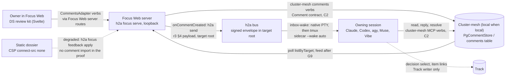
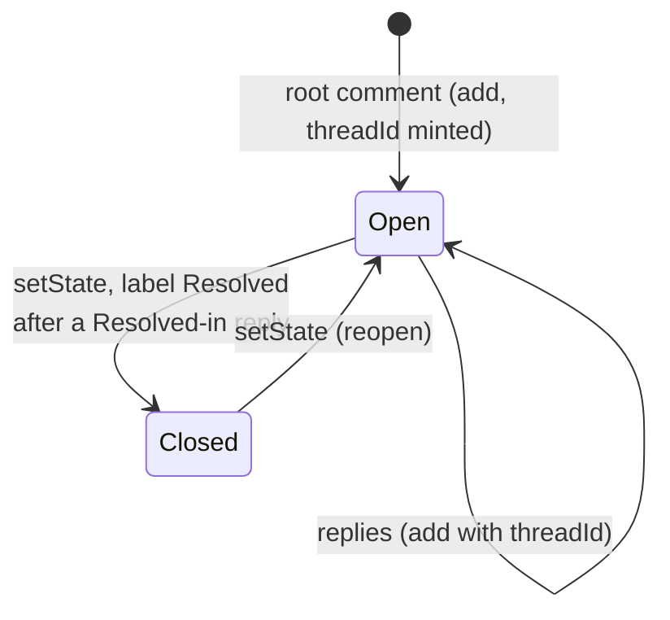

# SPEC EVOL — Local artifact review mode (claude.ai-like comments) over cluster-mesh

| Field | Value |
| --- | --- |
| Status | Specification only, revised after independent review on 2026-11-17 and realigned the same day on DS `SPEC-r3.md` (which replaces r2). No product code, no test execution, no Track write is claimed by this document. |
| Date | 2026-11-17 |
| Branch | `docs/artifact-review-spec`, cut from h2a `origin/main` `1a99a88f6` |
| Owner need | Verbatim of 2026-11-17 (conductor record `tmp/h-cond/artifact-review/VERBATIM-17-11.md`, untracked): local artifacts with a comment mode as in claude.ai but local and more reactive; the h2a send-message path whatever the CLI; reuse of the comment modules; traceability of comment follow-up, probably around decision dossiers. |
| Owner correction (binding) | « attention a la surcouche: ca doit passer impérativement via cluster-mesh côté api (il y a deja le metamodel de commentaire, ...) ». It replaces the earlier conductor proposal of an h2a-local store per dossier. h2a and Focus Web are **clients** of the cluster-mesh comments API; locally they use a local cluster-mesh. There is no h2a-owned comment store. |
| Governing DS contract | Design system review kit `SPEC-r3.md` (scratchpad, 17/11), which **replaces r2**: section 1 contract (§1.1 state, §1.2 target normalisation, §1.3 author, §1.4 provenance), section 4 h2a delivery/traceability, h2a lots H1–H5 in section 5, decisions D1–D3 in section 6. This spec fills every h2a slot from r3 and adds no field to it. The r2-era gap that asked which revision governs (former G18) is closed: r3 governs. |
| Comment metamodel (binding) | The existing `Comment` type of `@sentropic/comments` (`packages/comments/src/types.ts`), its `CommentStore` port (`packages/comments/src/store.ts:26`), the Postgres adapter `PgCommentStore` (`api/src/services/comments/pg-comment-store.ts`) and the `comments` table (`api/src/db/schema.ts:792`, migration `api/drizzle/0020_add_comments.sql`), sentropic `origin/main` `ad8e685e5`. |
| Sources read | h2a `origin/main` `1a99a88f6`; sentropic `origin/main` `ad8e685e5` (`@sentropic/comments` 0.3.1, `@sentropic/cluster-mesh` 0.27.0-dev.1; h2a pins cluster-mesh 0.25.0 in `packages/h2a/package.json:81` and does not depend on `@sentropic/comments`); DS review kit **r3** (replacing r2) plus `PEERS.md` counter-review; DS `origin/main` `ec3229f72` for the artifact-shell components that exist today; claude.ai Docs connector guide `topic.comments` (read 2026-11-17). Evidence is listed in Appendix A. |

## 0. The feature in two diagrams

Only `open|closed` exist in the contract (r3 section 1.1, single truth); `closed` is shown as « Resolved ». Sent, answered, source-changed and orphan are **projections computed by the client** (sections 5 and 6), never stored states.

## 1. Decisions (proposed contract)

| Id | Decision |
| --- | --- |
| AR-1 | The DS r3 section 1 contract is the only comment contract: existing `Comment`, `target.kind` pinned to `'artifact'` (adapter-normalised, AR-4b), state `'open'|'closed'` with « Resolved » shown for `closed` (r3 section 1.1), author view model `CollaborationActor` (AR-6), flat threads grouped by `threadId`, anchor inside `sectionKey` as `'a1:' + base64url(JSON)` (DS section 2), `CommentStore` behind a host `CommentsAdapter`, cluster-mesh as sole backend. h2a adds no wire field, no comment store and no comment index. Focus Web may hold `Comment[]` in memory as a rebuildable cache fed by `listByTarget`; a browser draft is a draft and is never shown as saved. Read state is the single bounded exception and is handled in AR-10. |
| AR-2 | A second, incompatible revision-based metamodel is co-exported by the same `@sentropic/comments` package (`anchors.ts`, `revisions.ts`, `lifecycle.ts`, `commands.ts`, `submissions.ts`) with a canonical cluster-mesh router and composition (`packages/cluster-mesh/src/hono/comments-router.ts`, `src/compose/comments.ts`). It is **not** the contract of this spec: r3 section 1 settles that the DS contract **is** the existing `Comment` type plus `PgCommentStore` ("Removed from r1/r2: invented wire types…"). Capabilities that only the revision metamodel has (version binding, prepared submissions, operation audit, CAS, tombstone) are not used and are not requested (former G17 closed). |
| AR-3 | "Local" means a local cluster-mesh endpoint exposing the section 1 verbs (sentropic lot C2). Today the existing HTTP router is product-API only and rejects artifact targets (section 3.3), and no local runnable host is verified. When the endpoint is absent or unreachable, Focus Web shows `comments unavailable (missing binding)` and writes nothing anywhere, mirroring the memory provider refusal (`missing_binding`, `packages/h2a/src/registry/memory-provider.ts:25`). A port-shaped stub, when sentropic supplies one for the proof, is labelled as a stub in the UI, keeps nothing durable, and never satisfies a persistence acceptance line (section 7, H3). |
| AR-4 | Anchor identity joins the two stable keys without inventing a field: DS `aid` (`data-anchor-id`, strongest key in DS section 2) carries the Focus node `targetRef` (`packages/focus/src/model.ts:24`, `:41`). Focus Web renders `data-anchor-id=<targetRef>` on stable blocks (H1) and `target.id` is the Focus document `ref`. Paragraph identity from the editing manifest has no DS payload slot except through `aid`/`sel` conventions; it is not carried separately in the proof. `resolveAnchor` stays kit-side and never writes back; a stored anchor changes only through the adapter `reanchor` verb (r3 section 1, `editThread` with a new `sectionKey`). |
| AR-4b | Target-kind normalisation is adapter-side, per r3 section 1.2 (default locus): on read, `kind:'record'` with `recordType:'artifact'` becomes `kind:'artifact'` and `recordType` is dropped; the kit only ever sees `kind:'artifact'`. Listing is unaffected (`listByTarget`/`listThreadSummaries` match on `context_id`, kind-agnostic). A source fix in `targetFromLive` remains a sentropic alternative, not a h2a blocker. |
| AR-5 | Republication never rewrites a stored anchor. The anchor payload `v` is the artifact version at capture (Focus document `hash`/`baseHash` of the render the owner saw; the exact value is an H1 slot, section 3.2). On a new version the kit re-resolves: matched, moved or orphan is presentation state. The version that handled a thread is recorded only by the r3 section 2 convention: a `Resolved in <version|commit>` reply posted before `setState('closed')`; a typed version binding is not requested (former G11 closed). |
| AR-6 | The kit author view model is `CollaborationActor {actorId, kind, displayLabel, color}` verbatim (`api/src/services/canvas-live/contracts.ts:3-5`, r3 section 1.3); no kit author type is invented. Mapping: `actorId` ↔ `Comment.author.id` ↔ `comments.created_by`. The wire `author` is still only `{id}` recorded server-side from the authenticated caller; the host enriches it to `CollaborationActor` from the live session/registry before the kit sees it (H2), and `color` is display-only (avatar), never persisted. Package `CommentAuthor {id, kind?, displayLabel?}` stays behind the adapter as wire shape. Until owner decision D1 (G5): **agent comments are posted under the owner's user id**, with `provenance` (`toolCallId`, and `runId` once D2 lands) pointing at the agent run; the panel shows the owner identity of record plus the run link, and the kind badge comes from the live `CollaborationActor` only, degrading without inference when unresolvable. The Focus relay identity that signs the h2a envelope is a transport signer only and never authors a comment. |
| AR-7 | Delivery follows r3 section 4 exactly: post → adapter `create`/`reply` via cluster-mesh → host-side `onCommentCreated` → the h2a client resolves the artifact's owning session and issues the signed `h2a send` (existing verb, `packages/h2a/src/cli.ts:454`; any CLI; local or cluster-mesh messaging backend), deposited in the root the target reads, carrying `tenant, target.id, threadId, comment id, author (CollaborationActor), excerpt, decoded anchor, provenance` (Appendix C). The r2-era h2a tightening to identifiers only is withdrawn: r3 section 4 includes the excerpt and the decoded anchor. The agent then reads/replies/resolves through the same adapter (cluster-mesh MCP verbs, C2) with its own configured endpoint; the envelope is a pointer plus excerpt, never the authority — the cluster-mesh thread is. The unsigned `h2a inbox put` path used by existing Focus routes is not reused (defect F3). |
| AR-8 | The recipient is the owning session, resolved by the existing ladder (section 5.2) with visible ambiguity; every h2a CLI host prefix is accepted (the current Focus Web filter drops `muse:` and `vibe:`, defect F1, fixed in H4). |
| AR-9 | The reply path is the agent writing through the same adapter/cluster-mesh verbs (MCP for agents, C2), under the owner user id with `provenance` to the agent run until D1 (AR-6). h2a ships no `h2a_comment_*` tools duplicating C2. A host that cannot run those MCP verbs cannot reply in-thread; Focus Web shows the per-host reason (section 5.3) instead of a silent wait. Reply identifiers are minted by the store (`NewComment` has no `id` field), so no reply id is preallocated; the agent replies with `threadId` and Focus Web discovers the row by poll or feed. |
| AR-10 | Read state `(threadId, userId) -> lastReadAt` has no contract field (r3 section 2). Per r3 it is **host-held and passed to the kit as a prop**, never a `Comment` field: Focus Web holds it for the proof (lost on reload, labelled as such) and never persists it in h2a files, which would create the h2a-owned side store the owner correction forbids. A durable home is gap G10 (DS lot C4, sentropic to confirm the future store). |
| AR-11 | No failure is silent: Focus Web shows one of a closed list of states with the next possible move (section 5.4). |
| AR-12 | Traceability follows r3 section 4 with existing fields only: `CollaborationActor.kind`/`displayLabel` (host-resolved), flat replies by `createdAt`, `provenance.toolCallId`/`runId`, the resolution reply (version/commit), `assignedTo`. Promotion to a decision or Track item is a reply-body trailer `Ref: decision:<id>` or `Ref: track:<id>` (the dossier/item records `threadId` on its side); the kit renders a link chip, `assignedTo` may hold the Track id while the thread is open, and `state` is unchanged. Focus Web never writes `.track`. Comment bodies never enter Track or logs; the h2a envelope carries only the r3 section 4 payload (identifiers, excerpt, decoded anchor, provenance). |
| AR-13 | A D# answer by comment has no typed carrier in the contract (no decision code, question id or option id fields). The proof therefore does **not** claim one: option cards keep the existing response-line path (`packages/focus-interactive/src/response-line.ts`), and a comment thread on a question can be promoted with `Ref: decision:<id>` for follow-up. Recording `track decision select` from a comment is allowed only as the interim convention of section 6.2, executed by the Track writer after checking the author of record and `provenance` (section 6.2); a typed answer carrier is gap G20 with D1 (G5). |
| AR-14 | Static dossiers stay offline (CSP `connect-src 'none'`, `form-action 'none'`): per DS H4 they are degraded only, export/import through the existing `h2a focus feedback apply` path, which applies `focus.return` document edits and does not import comments into cluster-mesh. Comment import for static dossiers is outside H1–H5 (section 7, follow-ups). |
| AR-15 | The UI is the DS review kit only (`review-core` plus Svelte components, DS lots DS-1 to DS-7). The artifact-shell `CommentModeToggle`/`CommentModeStatus` that exist today on DS `origin/main` are a different, earlier shell and are not the kit of this spec; Focus Web builds no parallel widget. A missing kit piece is a DS lot, not a Focus Web component. |

## 2. Surfaces and what each supports

Focus Web is the proof surface (DS section 5). Static dossiers are degraded. The ui-render MCP App is listed only because its `comment` intent already exists in the schema; it is outside H1–H5.

| Capability | Focus Web (`h2a focus serve` / `web`) | Static dossier (`packages/h2a/focus-kit`) | ui-render MCP App |
| --- | --- | --- | --- |
| Network | Loopback server (default `127.0.0.1:5178`, `packages/h2a/src/runtime/focus/serve.ts:20`); the server calls cluster-mesh, the browser never holds cluster-mesh credentials | None: CSP `default-src 'none'; connect-src 'none'; form-action 'none'` (renderer meta CSP) | Host-mediated `postMessage` only |
| Read threads | Live from cluster-mesh via the adapter (`listByTarget`, `listThreadSummaries`) | No live read in the proof | Not in H1–H5 |
| Create, reply, edit, delete | Yes, through adapter verbs; delete is the contract per-row hard delete (section 3.3) | Offline notes/answers only in the existing `focus.return` flow, applied as document edits | `comment` intent exists, consumer not wired (defect F4) |
| Anchors | DS section 2 payload in `sectionKey`; `aid` = `targetRef`; document-level thread = target without `sectionKey` | `targetRef` in `FocusReturn.notes[]`, unchanged | The intent `target` string |
| Send to agent | Yes, H4 bridge | No (after an operator imports and reopens in Focus Web, outside the proof) | The MCP host conversation itself |
| Resolve, reopen | `setState('closed'\|'open')` through the adapter (« Resolved » for `closed`); C2 implements the r3 participant policy (G8) | No | No |
| Decision dossier | Option cards keep the response line; threads promote with `Ref:` (section 6) | Response line in the page; answers leave in `focus.return` | `choose-option` intent |
| Version shown | Current render version plus per-thread matched/moved/orphan from `resolveAnchor` | Version of the build | Version rendered |

## 3. Comment API and storage through cluster-mesh

### 3.1 Client architecture

- **Seam.** Kit components are controlled (`Comment[]` in, mutations out) and call only the DS `CommentsAdapter`. In Focus Web the adapter runs against new Focus Web server routes (backend-for-frontend): the browser talks to the loopback SvelteKit server (`apps/focus`), the server holds the cluster-mesh endpoint configuration and credentials and calls the cluster-mesh verbs (C2). Credentials never reach the browser, tool arguments or logs. Write routes require `application/json` and an `Origin` equal to the served loopback origin, because "send to agent" places a wake in front of an agent; SvelteKit defaults are a requirement to verify in H3, not an assumed fact.
- **Endpoint slot.** The server reads one configured local cluster-mesh comments endpoint (variable name is an H3 implementation slot, not an existing setting). Missing or unreachable endpoint means AR-3 refusal, never a fallback store.
- **What exists today / target form.** The contract port is r3 section 1: `add, get, edit, editThread, delete, listByTarget, listThread, listThreadSummaries, setState, assign, setProvenance` (`store.ts:26`), with HTTP `GET /comments`, `POST /comments`, `PATCH /comments/:id`, `POST /comments/:id/close`, `POST /comments/:id/reopen`, `DELETE /comments/:id`. The product HTTP mounting today (`packages/comments/src/hono.ts`, mounted as the product `/comments` namespace in `api/src/routes/namespaces/comments.ts`) still has to be exposed for artifacts by C2 (G1): no artifact comment MCP verb exists yet (only `artifacts_get`/`artifacts_list`, DS `PEERS.md`). `PgCommentStore` persists over the live `comments` table; `InMemoryCommentStore` diverges from it on the points in G16, so persistence acceptance runs on the Postgres-backed endpoint. C1/C2 remain the critical path of H3 and H4.

### 3.2 Field-by-field mapping onto the existing metamodel

Every `Comment` field, its `PgCommentStore` / `comments` table carrier, the h2a slot value, and the verified round-trip status. "Cannot map" rows add no field; each one is a gap in section 4.

| Contract field | Carrier (`PgCommentStore`, table `comments`) | h2a / Focus Web slot | Round-trip status |
| --- | --- | --- | --- |
| `id` | `id` text PK, store-minted (`randomUUID`) | Opaque; never preallocated by Focus Web or the agent | OK |
| `tenant` | Only `workspaceId` persists (→ `comments.workspace_id`); `tenantId` is not stored (r3 section 1) | Adapter calls carry `tenant: string` (r3 `CommentsAdapter`); the host resolves it to the local workspace/principal context (G2), `userId` = acting principal (H2) | Settled by r3: no `tenantId` persistence is claimed |
| `target.kind` | `context_type` via `targetToLive` (`recordType ?? kind`); read-back is `kind:'record', recordType:'artifact'` (`targetFromLive`, `types.ts:151`) | Pinned `'artifact'` on write; **adapter normalises on read** (AR-4b, r3 section 1.2) | Settled by r3 section 1.2: kit only sees `kind:'artifact'` (former G4 closed) |
| `target.id` | `context_id` | Focus document `ref` | OK; listing matches on `context_id` only (kind-agnostic, r3 section 1.2), store conformance in G16 |
| `target.sectionKey` | `section_key` text, unbounded, no limit anywhere | DS section 2 anchor: `'a1:' + base64url(JSON)`; text `{t,q,pos?,sel?,aid?,v}`, element `{t,sel,aid?,v}`, region `{t,rect,v}`; `aid` = Focus `targetRef`; `v` = document `hash` at capture | OK as storage; the proposed 2048-char cap and rejection behaviour are decision D3 (G14) |
| `target.recordType` | Read-back artifact of `targetFromLive` | Unused for artifacts; consumed and dropped by the adapter normalisation (AR-4b) | See `target.kind` |
| `threadId` | `thread_id`; root mints it in `add`, replies pass it | Flat replies; the adapter `reply` takes only `threadId` (r3 `CommentsAdapter`), so replies inherit the root target/`sectionKey` | OK |
| `author.id` | `created_by` text not null (→ `users(id)`, migration `0020_add_comments.sql:8`) | `CollaborationActor.actorId` (AR-6): owner id for owner rows; **owner id for agent rows until D1**, with `provenance` to the agent run (AR-6, H4) | OK for the owner; agent as author of record waits on D1 (G5) |
| Author view model (kit only, never wire) | Wire author is `{id}` only; `toComment` rebuilds `author:{id}` from `created_by`; `kind`/`displayLabel` are not persisted | `CollaborationActor {actorId, kind, displayLabel, color}` enriched host-side from the live session/registry (H2); `color` display-only, never persisted; kind badge degrades, never inferred, when unresolvable | r3 section 1.3 view model; durability is D1 (G5) |
| `assignedTo?` | `assigned_to`, cascaded thread-wide by `assign` | Assignee, or the Track id while the thread is open (r3 section 4, state unchanged) | r3 section 4 settles the use; C2 must store it server-side (G8, implementation) |
| `state` | `status` `'open'\|'closed'` (default `'open'`) is the single truth; the package `'open'\|'resolved'` vocabulary and the `PgCommentStore` translations are removed by the r3 section 1.1 fix (types + README, sentropic C1) | Kit state is `'open'\|'closed'` only; `closed` is shown as « Resolved » (reusing « Comment resolved. Reopen to reply. », `ui/src/locales/en.json:1328`) | Settled by r3 section 1.1 (former G3 closed); no third literal anywhere |
| `body` | `content` text not null; HTTP create requires non-empty, trims; no maximum anywhere in this path | Owner/agent prose; `Resolved in <version\|commit>` reply; `Ref: decision:<id>` / `Ref: track:<id>` trailer as last line | OK; size/thread limits are G15 |
| `provenance.toolCallId?` | `tool_call_id` | Agent tool call that produced the comment; under the pre-D1 fallback it is (with `runId`) the pointer from an owner-id agent row to the agent run | Carried on create/`setProvenance` once C2 exposes them (G1) |
| `provenance.runId?` | `runId` = `execution_events.run_id` semantics (r3 section 1.4); **dropped on write today** (`pg-comment-store.ts:112`, insert keeps `toolCallId` only); read back absent | Agent run that produced the comment (r3 section 4 traceability); the kit renders it only when present | Decision D2 (G6): minimal `run_id` column or provenance-path encoding |
| `createdAt`, `updatedAt?` | `created_at`, `updated_at` timestamps | Display and ordering (`createdAt ASC, id ASC`) | OK; `updatedAt` alone never proves who resolved — the resolution reply is the record (section 6.1) |

Needs with no contract field at all, and their interim under DS sections 2 and 4:

| Need | Interim (no field added) | Gap |
| --- | --- | --- |
| Version/commit that resolved a thread | `Resolved in <version\|commit>` reply before `setState('closed')`; kit renders it as the resolution record (r3 section 2) | Settled interim in r3; a typed field is a future sentropic decision only |
| Resolver actor | Author of that reply (`CollaborationActor`, section 1.3) + `updatedAt` (r3 section 2) | Settled interim in r3 (durability under D1) |
| Per-user read state | Host-held `(threadId, userId) -> lastReadAt` passed as a prop (AR-10); never a `Comment` field | G10 (future store to confirm, C4) |
| `author.kind`/`displayLabel` durability; non-human authors | Not persisted; `created_by` FK to `users(id)` blocks agent/nhi ids (r3 section 1.3) | **D1** (G5): `execution_events`-pattern columns, or the owner-id fallback of AR-6 |
| `provenance.runId` durability | Dropped at `pg-comment-store.ts:112` (r3 section 1.4) | **D2** (G6): provenance-path encoding or a minimal `run_id` column |
| Addressed to the agent / sent / answered (claude.ai parity) | No stored marker: delivery is the host-side `onCommentCreated` → `h2a send` flow (r3 section 4, section 5.1); answered is read from the agent's reply row (identified by `provenance` to the agent run until D1) | Settled by r3 section 4 (former G13 closed); no field requested |

### 3.3 Verbs: port, existing HTTP, adapter

| Kit action | Port verb (exact signature) | Existing product HTTP today | Adapter slot for h2a (H3) |
| --- | --- | --- | --- |
| Create thread / reply | `add` (new / existing `threadId`) | `POST /comments` (artifact admission end to end is C2, G1) | `create({tenant, target, body, author: CollaborationActor, provenance?})` (`actorId` → `author.id`) / `reply({threadId, body, author, provenance?})` over the C2 verbs |
| Edit own comment | `edit` | `PATCH /comments/:id` | `edit(commentId, body)` (own rows only) |
| Re-anchor thread | `editThread` (new `sectionKey`) | `PATCH` root | `reanchor(threadId, sectionKey)` (r3 section 1) |
| Resolve / reopen | `setState('closed'\|'open')` | `POST /comments/:id/close` \| `POST /comments/:id/reopen` | `setState(id, 'open'\|'closed')`; `closed` shows « Resolved » |
| Delete own | `delete` (last row deletes the thread) | `DELETE /comments/:id` | `remove(commentId)`; the UI words it as permanent for that row |
| List artifact threads | `listByTarget` + `listThreadSummaries` | `GET /comments` | `list(tenant, target)` (normalised, AR-4b), `threadSummaries(tenant, target)`, thread view = `listThread` |
| Assign / record run | `assign` / `setProvenance` | `PATCH /comments/:id` | `assign(commentId, assignedTo)`, provenance on `create`/`reply` |
| Subscribe | No port verb (adapter `subscribe?`) | No feed route yet | Polling `listByTarget` in the proof; feed is G9 (DS C3) |
| Comment created hook | Host-side only (adapter `onCommentCreated?`) | Host-side | Focus Web server fires the H4 bridge (section 5.1) after its own create/reply succeeds |

Permission summary (r3 section 1, server-side, to be implemented by C2): `author.id` is recorded from the authenticated caller regardless of payload; edit/delete own only; reply/resolve/reopen/assign any authenticated participant; agents are authors (`kind:'agent'|'nhi'` as a view-model badge), never a side channel — under the pre-D1 fallback their rows are recorded under the owner id with `provenance` to the run (AR-6). The narrower creator-or-admin behaviour of the existing product router is superseded for artifact threads by this policy (G8 is now a C2 implementation item, not an open policy question).

## 4. Cannot-map list: requests to sentropic (cluster-mesh), the DS and Track

Status after the r3 realignment: **open** = still requested; **decision** = settled by r3, only the named owner decision (D1–D3) remains; **implementation** = settled by r3, owed by the named lot; **closed** = settled or withdrawn by r3, kept here only so the r2-era id stays traceable. DS lot ids C1–C4 are the sentropic lots of DS r3 section 5. Nothing in this list is worked around by an h2a field or store.

| Id | Status in r3 | To | Request / settled form | Blocks |
| --- | --- | --- | --- | --- |
| G1 | open | sentropic (C2, owner = sentropic, before the proof) | Expose the artifact comment verbs in cluster-mesh, HTTP + MCP, wrapping the port 1:1 (r3 section 1 table, incl. `assign`/`setProvenance` and create carrying `provenance`), `context_type='artifact'` admitted end to end, instance authentication and the r3 section 1 server-side permissions (G8). | H3, H4 (critical path) |
| G2 | open | sentropic (C1/C2) | A runnable local host for those verbs ("cluster-mesh locally is still the only store", r3 section 4) with a seeded workspace and local principals: the owner user and the `tenant`/`workspaceId`/`userId` context each call carries. | H3 |
| G3 | **closed** | sentropic (C1) + DS-1 | Settled by r3 section 1.1: `CommentState = 'open'\|'closed'` everywhere, « Resolved » shown for `closed`; the package/README fix and deletion of the `PgCommentStore` translations are implementation in C1/DS-1, no longer a question. | — |
| G4 | **closed** | h2a (H3) | Settled by r3 section 1.2: adapter-side normalisation (`record` + `recordType:'artifact'` ⇒ `kind:'artifact'`, AR-4b) is the default locus; a `targetFromLive` source fix is a sentropic alternative only. | — |
| G5 | **decision D1** | sentropic (owner decision, r3 section 6 D1) | Author persistence: `kind`/`displayLabel` not persisted, non-human authors blocked by the `created_by` FK. Recommended: minimal migration reusing `execution_events` (`actor_type` + `actor_id`, text, nullable, no FK; `created_by` keeps the sponsoring owner's id). **Until D1, the proof runs the r3 fallback**: agent comments under the owner's user id, `provenance` → agent run, kind badge live-only (AR-6). No DS/h2a lot waits on D1. | Traceability quality only |
| G6 | **decision D2** | sentropic (owner decision, r3 section 6 D2) | `provenance.runId` persistence (dropped at `pg-comment-store.ts:112`). Recommended: minimal `run_id` column; alternative: encode in the existing provenance path (interim only). Until D2 the kit renders `runId` only when present. Bundle with D1 if D1 migrates. | Traceability quality only |
| G7 | **closed** | h2a (H3/H5) | Settled by r3 section 1: re-anchor is `editThread` (new `sectionKey`), `PATCH` root, adapter `reanchor(threadId, sectionKey)`. Round-trip verification rides on C1 (G16). | — |
| G8 | **implementation** | sentropic (C2) | Policy settled by r3 section 1 (author from the caller; edit/delete own; reply/resolve/reopen/assign any authenticated participant; `assignedTo` may hold the Track id while open, r3 section 4). C2 implements it server-side for artifact threads, superseding the existing router's creator-or-admin/member behaviour on this path. | H4 |
| G9 | open | sentropic (C3) | Change feed for adapter `subscribe`, or the polling contract; confirm the `listThreadSummaries` shape. Polling is the proof interim. | H3 (polling interim) |
| G10 | open | sentropic (C4) | Confirm the durable read-state store, or that read state stays host-held (r3 section 2, AR-10). h2a does not persist it. | H3 unread durability |
| G11 | **closed** | — | Settled by r3 section 2: no typed resolution field; the `Resolved in <version\|commit>` reply (author + `updatedAt`) is the record and its absence is shown, not filled in. A typed field is a future sentropic decision only. | — |
| G12 | **closed** | — | Withdrawn by r3 section 4: traceability uses existing fields only and claims current state, never a fabricated timeline (section 6.1). No durable history is requested. | — |
| G13 | **closed** | — | Settled by r3 section 4: no addressed/sent marker field; delivery is the `onCommentCreated` → `h2a send` flow (section 5.1) and answered is read from the agent's reply row (via `provenance` until D1). | — |
| G14 | **decision D3** | sentropic + DS (owner decision, r3 section 6 D3) | `sectionKey` cap: r3 section 2 recommends **2048 chars**, enforced by cluster-mesh on write (400 on over-cap `POST`/`PATCH`) with an adapter/kit compose-time pre-check; the encoder trims quote context first. Only the value is open (alternative 8192). | H1, H3 |
| G15 | open | sentropic | Remaining limits and write safety r3 does not cover: body maximum, threads per artifact, comments per thread, edit conflict behaviour (today last write wins, no CAS, no idempotency key on create — a retried create can duplicate a row). The anchor cap itself moved to D3 (G14). | H3 robustness |
| G16 | open | sentropic (C1) | Verify the `PgCommentStore` round-trip (`tenant`↔`workspace_id`, `artifact`↔`context_type`/`context_id` incl. the section 1.2 locus, `section_key` under the D3 cap, `created_by`↔`author.id`) and land the section 1.1 rename. A proof run only on the in-memory adapter passes cases Postgres fails; H5 therefore requires the Postgres-backed C2 endpoint. | H3, H5 |
| G17 | **closed** | sentropic | Settled by r3 section 1: the DS contract **is** the existing `Comment` type; the revision-based metamodel is out of the contract ("Removed from r1/r2: invented wire types…"). No arbitration is requested; if sentropic later supersedes `Comment`, the adapter is the shock absorber. | — |
| G18 | **closed** | DS | Settled: r3 replaces r2 and folds every r2 correction (state G3, target G4, author G5/`CollaborationActor`, `setProvenance` in the port, excerpt + decoded anchor in the section 4 send payload — the r2-era h2a tightening is withdrawn). Remaining DS work is the kit lots DS-1 to DS-7. | — |
| G19 | **closed** | DS (kit) | Settled by r3 sections 1/3/4: adapter `reply` carries only `threadId` (root target inherited); document-level threads are target without `sectionKey`; `Ref:`promotion renders as a link chip. The h2a parsing slot (last matching reply trailer is current, raw text shown either way) is in section 6.2. | — |
| G20 | open (future) | Track + sentropic | Native decision ↔ thread link, a reopen/supersede path for a settled decision (`go`/`no-go` are terminal, `packages/track/src/model/decision.ts:210`), and a typed D# answer carrier (decision, question, options). Item-side links need nothing today: link `kind` is a free non-empty string (`assertItemLink`), so `--kind comment-thread` works. r3 section 4: "Typed link field = future sentropic decision." | Section 6.2 (non-blocking) |

## 5. Routing: comment to the owning agent, any CLI

### 5.1 Flow (r3 section 4, h2a slots filled)

1. **Post.** The owner posts in review mode: the Focus Web server calls the adapter `create`/`reply` via cluster-mesh (H3). Only a comment the server has read back is shown as saved. Focus Web (Node `127.0.0.1:5178`, SvelteKit `apps/focus`) holds `Comment[]` and feeds `subscribe` (cluster-mesh feed preferred, `listByTarget` polling fallback, G9) into `CommentLayer`; cluster-mesh locally is still the only store.
2. **`onCommentCreated`.** The host-side hook fires on the created row. Agent rows written through the MCP adapter (C2) do not pass through the Focus Web hook, and a row carrying agent `provenance` never re-triggers delivery (loop guard); edits do not trigger it either. The hook is stated in the UI next to the composer so the owner is never surprised by a wake.
3. **h2a send.** The h2a client resolves the artifact's owning session (5.2), then issues the signed `h2a send` (any CLI) the way existing Focus routes execute the installed binary (`apps/focus/src/lib/server/h2a-bus.ts`): `h2a send <instance> <payload> --from <focus relay identity> --root <target root>`, with the r3 section 4 payload: `tenant, target.id, threadId, comment id, author (CollaborationActor), excerpt, decoded anchor, provenance` (Appendix C). Provisioning of the relay identity (registered instance, key custody readable by the server process, never by the browser) is an H4 acceptance point, not an assumed fact (Q2).
4. Success of `h2a send` means the envelope is deposited in the root the target reads (and, on the cluster-mesh messaging backend, transport acceptance within the existing 10 s bound, `H2A_SEND_TIMEOUT_MS`). It never means the agent has read anything. A failed send after a saved comment leaves the comment saved and shows the delivery state from 5.4; delivery is recorded nowhere in the comment contract (r3 section 4 needs no marker, former G13).
5. The receiver's MCP sidecar, when running with `--auto-open --wake auto`, sees the new inbox envelope and injects the visible wake line (`[h2a-wake reason=inbox …] … run /h2a receive`, `packages/h2a/src/wake.ts:46`) through the chain native PTY backchannel then local tmux (`chainDriver(...)`, `packages/h2a/src/cli.ts:2550`). A session without that sidecar, or outside the native terminal host and tmux, is not woken: the envelope waits in its inbox.
6. **Agent reply/resolve.** The agent reads the payload, re-reads the thread through the same adapter (cluster-mesh MCP verbs, C2) with its own endpoint — the thread, not the envelope, is the authority — verifies workspace, artifact id and thread id, acts, and replies in the thread. Its comments are posted **under the owner's user id with `provenance` (`toolCallId`, `runId` once D2 lands) pointing at the agent run**, until D1 (AR-6). When it handled the point by republishing, it posts the `Resolved in <version|commit>` reply, then `setState('closed')` (any authenticated participant, G8 implementation in C2). It never edits or deletes the owner's rows.
7. **Owner follow-up.** Focus Web shows the reply (polling, feed after G9), marks it unread for the owner (AR-10; Focus Web stores only read state), the panel shows the owner identity of record plus the run link and the live kind badge, and the owner may reply (back to step 2) or reopen through `setState('open')`.

### 5.2 Owning-session resolution

The existing ladder in `apps/focus/src/lib/server/h2a-target.js` is reused as is: 1. explicit UI choice (`requested`); 2. operator pin `FOCUS_H2A_TARGET`; 3. emitter `FOCUS_EMITTER_INSTANCE` if live; 4. live sessions whose `workspace.path` is this checkout or its main worktree; 5. name match against the live registry; 6. sole live session. An explicit target that is not live is reported, never replaced; several candidates are returned with `ambiguous` and shown as a choice (`GET /api/h2a/targets` already exposes this). The root travels with the presence record and the envelope goes to that root: the dossier include route passes it (`+server.ts:171`), the decision inject route does not (defect F2).

One h2a slot stays explicitly open rather than invented: the artifact's recorded producer instance is **not** a rung in the proof, because Focus Web has no verified source that maps an arbitrary rendered artifact to its producing instance (`Production.producerId` exists in the retained editing state of `h2a focus feedback retain`, `packages/h2a/src/focus-feedback.ts:92`, which Focus Web does not read). `assignedTo` follows r3 section 4: it may hold the Track id while the thread is open (state unchanged), and holds the assignee when assignment is recorded; server-side storage is C2 (G8 implementation).

### 5.3 Wake and reply reality per CLI

How each CLI is actually woken, from `docs/host-integration-matrix.md` and the CLI registry on the base of this spec. "Send reaches inbox" is true for every host once defect F1 is fixed; waking and replying in-thread are narrower.

| CLI | Instance prefix | Focus Web target today | h2a MCP sidecar today | Wake when sidecar runs `--wake auto` | Reply via cluster-mesh MCP verbs (C2) |
| --- | --- | --- | --- | --- | --- |
| Claude | `claude:` | accepted | shipped (`host setup --host claude`) | native PTY, then tmux | First H4 target, once C2 exists |
| Codex | `codex:` | accepted | shipped; in-session attestation still partial in the matrix | same chain | After Claude in H4; live qualification not claimed here |
| agy | `agy:` | accepted | historical direct rendering, not migrated, MCP unqualified, no hook equivalence | chain exists in the sidecar, host path unqualified | Not qualified; Focus Web shows "reply path not qualified for this host" |
| Muse | `muse:` | **dropped by the prefix filter** (F1) | historical direct rendering, not migrated, MCP unqualified | unqualified | Blocked by F1, then unqualified as for agy |
| Vibe | `vibe:` | **dropped by the prefix filter** (F1) | interim direct entry (`host setup --host vibe --write`); native qualification pending | sidecar chain, qualification pending | Blocked by F1, then qualification pending |
| Gemini, Hermes, OpenCode | `gemini:`, `hermes:`, `opencode:` | accepted by the filter | per the matrix, outside owner H4 scope | same chain when equipped | Inbox delivery only in the proof |

Cross-CLI wake timings and paste-framing fixes from in-flight lanes are not re-claimed here: they are not in the code this spec is cut from.

### 5.4 Visible failure states

Closed list of states shown on a thread (12 states)

| State | Trigger | Next move offered |
| --- | --- | --- |
| `comments unavailable` | No endpoint configured, unreachable, or missing binding (AR-3) | Configure the endpoint; draft kept unsaved |
| `not saved` | Adapter write refused (validation, permission, thread not found, over-cap anchor once D3 lands) | Edit or retry; the draft is never shown as saved |
| `saved, not sent` | Comment stored, bridge send not run or failed (no target, send error, timeout) | Send now, pick a session, or leave the comment unsent |
| `no target` | No live session or h2a binary missing (existing `explainNoTarget` remedies) | Launch or pin a session |
| `ambiguous target` | Several live sessions answer for this checkout | Choose one; nothing is sent before the choice |
| `chosen session not live` | Explicit or pinned target not live | Choose another; nothing was redirected |
| `deposited, session dormant` | Send deposited with `recipientLive: false`, or no wake-capable sidecar | Wait, relaunch, or redirect |
| `sent, waiting` | Deposited to a live session, no agent reply row yet | None; projection only, labelled as such (no stored sent state, r3 section 4) |
| `reply path not qualified` | Target host cannot run the C2 MCP verbs (5.3) | Open the session and treat the thread there, or redirect |
| `resolve refused` | `setState('closed'\|'open')` denied server-side (C2 has not yet implemented the r3 section 1 participant policy, G8) | Owner closes/opens, or the agent posts the resolution reply without closing |
| `re-anchor unavailable` | Orphaned thread and the adapter `reanchor` call fails (C1 round-trip, G16) | Reply or resolve (« Resolved ») from the orphan list; anchor stays as stored |
| `orphaned on this version` | `resolveAnchor` finds no match on the current render | Open the orphan list; thread stays readable and replyable |

## 6. Traceability and decision dossiers (r3 section 4)

### 6.1 Lifecycle from existing fields only

| Owner-visible reading | Evidence in the contract (nothing else is claimed) |
| --- | --- |
| Open | Thread rows exist and their `state` is `'open'`; the pill shows `Open` |
| Replied | Flat rows ordered `createdAt ASC, id ASC`, each row with `author.id` enriched to `CollaborationActor` (`actorId`, `kind`, `displayLabel`, avatar `color`) host-side; the kind badge is shown only when the host resolved it live, never inferred from the id (r3 section 1.3) |
| Answered by the agent | A reply row after the triggering owner row carrying agent `provenance` (`toolCallId`, `runId` when present): until D1 the row's author of record is the owner, so the panel shows the owner identity of record plus the run link (r3 section 4) and does not claim an agent author id |
| Resolved in a version | The `Resolved in <version\|commit>` reply (its author, `createdAt`, `provenance` when present) followed by `setState('closed')`; the pill shows « Resolved ». Without that reply, a `closed` thread shows "Resolved, no resolution record" |
| Reopened | `state` is `'open'` again after `setState('open')`. No prior-state history is stored, so the panel never fabricates a timeline (r3 section 4, former G12) |
| Assigned | `assignedTo`: the assignee, or the Track id while the thread is open (r3 section 4; `state` unchanged); panel shows the assignee when present (C2 storage, G8) |
| Provenance | `provenance.toolCallId` per row; `runId` rendered only when present (absent on Postgres until D2, G6) |
| Edited | `updatedAt` present and later than `createdAt` (kit "edited" marker); prior body text is not retained by this contract |
| Deleted | The row is gone (hard delete); a thread whose root was deleted continues from its earliest surviving row |

Thread locator used outside the comment system (Track links, h2a pointer): `comments:<workspaceId>/threads/<threadId>` plus the artifact id (`target.id`). It contains no revision hash, because this contract has none.

### 6.2 Decision dossiers and Track

- **Threads on questions and options.** Each Focus question or option node is a commentable block (`data-anchor-id` = its `targetRef`, H1), so a thread attaches to the same node the owner sees as D#. The response line stays computed from the existing selections (`responseLine(...)` in `packages/focus-interactive/src/response-line.ts`); comments do not feed it in the proof, and an unanswered question never implies consent.
- **Promotion.** A reply whose last line is exactly `Ref: decision:<decisionId>` or `Ref: track:<itemId>` promotes the thread: the kit renders a link chip (r3 section 4), the dossier/item records the `threadId` on its side, and the Track writer records the reciprocal link: `track item link <item> --kind comment-thread --locator comments:<workspaceId>/threads/<threadId>`. `assignedTo` may hold the Track id while the thread is open, `state` unchanged. Item links accept that kind today; a typed link field is a future sentropic decision (G20). h2a parsing slot: the last matching reply trailer is current, and the raw text is shown either way.
- **Recording a D# from a comment (interim, narrow).** Only when all of these hold: the thread is anchored to that decision's question node, a row carries the `Ref: decision:<id>` trailer, and the option is named by its visible code in that same row. The Track writer (never Focus Web) re-reads the row through the adapter, checks `author.id` against the owner principal of H2 **and that the row carries no agent `provenance`**, then runs `track decision select <decisionId> <optionId>`. A refused selection (unknown option, already settled) is answered in the thread. Until D1, an agent reply is posted under the owner id, so the `provenance` check is what separates it: any row with agent provenance, or whose origin cannot be separated, fails the check and no selection is recorded from it. A message or a wake never proves consent.
- **Reopening a settled D#.** Track outcomes `go`/`no-go` are terminal; a thread on a settled decision stays a comment thread and the follow-up path is a new decision linked to the settled one, until G20 provides reopen/supersede.
- **Version that handled threads.** When the handling session republishes the dossier, the Track writer may attach the rendered view with the existing verb (`track decision add-artifact <decisionId> --kind rendered-view --view-ref <ref> --source-dossier-hash <hash>`); the per-thread link to that version remains the `Resolved in …` reply (r3 section 2, former G11). PR links keep the existing `pr-open`/`pr-merged` kinds; a merge never resolves a thread.
- **Single writer.** In h2a the conductor is the Track writer and publishes `.track` on main; no PR branch and no Focus Web process writes `.track`.

## 7. Lots

The h2a lots are H1–H5 of DS r3 section 5, adopted as written; this section adds the h2a slots, dependencies and testable acceptance for each. DS lots DS-1 to DS-7 (kit) and sentropic lots C1 to C4 (cluster-mesh) keep the ids and scopes of r3 section 5: DS-1 lands the section 1.1–1.3 alignment (`open|closed`, `CollaborationActor`); C1 verifies the round-trip and lands the section 1.1 rename; C2 (owner = sentropic, before the proof) exposes the HTTP + MCP verbs; C3 the feed; C4 read-state/resolution conventions. **No DS or h2a lot waits on D1/D2** — the r3 fallbacks (owner-id agent rows, `runId` rendered only when present) keep the proof unblocked. Every lot runs targeted test files with temporary directories (lane `TMPDIR`, `XDG_RUNTIME_DIR` under the lane directory); a test that needs the local cluster-mesh endpoint fails with an explicit reason when it is absent, never a silent skip.

### H1 — Focus Web Svelte wiring

DS scope: `CommentLayer` on a `data-review-root`, `data-anchor-id` on stable blocks, toggle/panel chrome. h2a slots: Focus Web (`apps/focus`, SvelteKit, Svelte 5) renders `data-anchor-id=<targetRef>` for every Focus node it already identifies; the review root is the artifact body; mode is host-controlled, `?review=1` is host behaviour; Focus Web pins the DS packages that carry the kit once DS-3 to DS-5 publish (`apps/focus/package.json` today pins `@sentropic/design-system-svelte ^0.34.40`, which has no review kit).

Depends on: DS-1 to DS-5 (+ DS-7 subset for the proof); state labels are settled (`closed` → « Resolved », r3 section 1.1); anchor-cap wording is D3 (G14).

Acceptance:
1. With no comments endpoint configured, the toggle still renders, review mode opens, and the panel shows `comments unavailable (missing binding)`; no comment file appears anywhere under the repository or the lane directory.
2. Every rendered Focus node in the fixture dossier carries exactly one `data-anchor-id` equal to its model `targetRef`; duplicate ids fail the H1 test fixture.
3. View mode changes nothing: text selection and option-card clicks behave as on the base, and no pin layer is in the tab order.
4. A `closed` thread renders the pill « Resolved », the check pin at 55% opacity, and the filters `All/Open/Resolved/Mine` count `closed` under Resolved; no `resolved` state literal appears anywhere in the wire or the UI model.

### H2 — Current user: instance to `CollaborationActor`

DS scope (r3 section 5): `currentUser` from session, instance→`CollaborationActor` enrichment (r3 section 1.3). h2a slots: Focus Web has no login today, so the server builds the acting principal and `currentUser: CollaborationActor` from the local principal configuration of G2 and the live session/registry: `actorId` = the principal id (`↔ author.id ↔ created_by`), `kind`/`displayLabel` resolved from the live instance (the instance that produced or owns the session maps to its human/agent actor), `color` assigned for the avatar and never persisted. The browser never chooses an author id. When an actor cannot be resolved live, the enrichment degrades to id-only display and the kind badge is absent — never inferred from the id. Wire authors stay `{id}` behind the adapter; D1 (G5) governs only whether kind/label become durable, and no H2 acceptance waits on it.

Depends on: G2 (local principals); D1 only for durability beyond the live enrichment.

Acceptance:
1. A browser payload claiming another author is ignored: the stored row carries the configured owner principal, and the kit receives it enriched as that owner's `CollaborationActor` (`actorId`, `kind:'human'`, live `displayLabel`, avatar `color`).
2. The owning **instance** is enriched the same way: given a live agent instance, the panel's `currentUser`/author enrichment for that instance shows `kind:'agent'` with its live label and color; with the instance stopped, the same rows degrade to id-only with no kind badge and no inferred kind.
3. Comment writes are refused when Focus Web is bound to a non-loopback host, because the owner principal is presented by a loopback-only server.
4. `color` never reaches the store: after a create/reload round trip, no row carries a color field and the avatar color is re-derived by the enrichment.

### H3 — CommentsAdapter on cluster-mesh, read state, subscribe/polling

DS scope: adapter on cluster-mesh (incl. the section 1.2 normalisation), read-state hosting, subscribe/polling (or a sentropic-owned port-shaped stub on the two-day path — not a DS store, and the adapter is unchanged when C2 lands). h2a slots: the adapter of r3 section 1 (`list, threadSummaries, create, reply, edit, reanchor, setState, remove, assign, subscribe?, onCommentCreated?`) implemented as Focus Web server routes plus a thin client binding; it is the sole kit↔world seam, owns the section 1.2 normalisation (`record` + `recordType:'artifact'` ⇒ `kind:'artifact'`, `recordType` dropped, so the kit only sees `kind:'artifact'`) and the section 1.3 enrichment (wire `{id}` → `CollaborationActor`); polling `listByTarget` until G9; host-held read state per AR-10. The stub, when used, is server-side, in-memory, labelled in the UI, and its data loss on restart is shown in the acceptance record; persistence lines below run against the Postgres-backed C2 endpoint, not the stub (G16).

Depends on: G1, G2, C1 round-trip verification (G16).

Acceptance:
1. Create a thread on an element and on a text selection, reply, edit own, delete own, resolve (`setState('closed')`, shown « Resolved »), reopen (`setState('open')`): each result is confirmed by a read-back through the adapter before the UI shows it as saved.
2. **Normalisation:** a store row read back as `kind:'record', recordType:'artifact'` is delivered to the kit as `kind:'artifact'` with no `recordType`; a row of another kind is never rewritten into an artifact thread, and listing by `target.id` returns the artifact threads unchanged.
3. Reload the page: threads, order and state come back from cluster-mesh alone; kill the stub (stub mode only) and the UI reports the loss as stub behaviour, never as saved data.
4. A second browser context on the same artifact sees the same threads through polling within the stated polling interval.
5. A reply to an unknown `threadId`, a cross-workspace read, and an edit of another author's row are refused and shown as `not saved`.
6. Anchor payloads written by the kit are byte-identical after a store round trip (including the text-quote fields), within the D3 cap once D3 lands; an over-cap anchor is rejected at compose time.
7. Re-anchor: `reanchor(threadId, newSectionKey)` moves an orphaned thread and the next read shows the new anchor; a failed reanchor leaves the stored anchor untouched.
8. Regression: the existing Focus POST routes and the static renderer CSP are unchanged.

### H4 — onCommentCreated to h2a send, agent reply/resolve demo, static degraded path

DS scope: `onCommentCreated` → h2a send bridge + agent reply/resolve demo (r3 section 4 flow, section 5.1); static `renderer.html` CSP `connect-src 'none'` stays export/import via `h2a focus feedback apply`, degraded only. h2a slots: bridge of section 5.1 with the Appendix C (r3 section 4) payload; fix defect F1 (accept `muse:` and `vibe:` in `CLI_HOST_PREFIX`) and use the target root on every delivery (F2 pattern); relay identity provisioning documented as an operator step; demo on Claude first, then Codex, with the 5.3 table governing what is claimed per host. **Authorship in the demo (until D1): agent comments are posted under the owner's user id, with `provenance` (`toolCallId`, `runId` once D2 lands) pointing at the agent run**; the panel shows the owner identity of record plus the run link, and the kind badge comes from the live `CollaborationActor` enrichment only (AR-6). If D1's migration lands, the agent becomes author of record and only that display changes.

Depends on: H3, G1 (MCP verbs), G8 implementation in C2 (participant policy for reply/resolve/assign), F1 fix. D1/D2 are **not** dependencies.

Acceptance:
1. Posting a comment on the demo artifact deposits exactly one signed envelope in the owning Claude session's inbox, in that session's root; the envelope carries the Appendix C payload (`tenant, target.id, threadId, comment id, author, excerpt, decoded anchor, provenance`) and no full comment body beyond the excerpt.
2. The woken agent replies in the same thread through the MCP adapter; the reply appears in Focus Web under the **owner identity of record with the agent run linked from `provenance`**, the triggering owner row is unchanged, and no acceptance line claims an agent `author.id` before D1.
3. The agent posts `Resolved in <version|commit>` and then closes the thread with `setState('closed')` (shown « Resolved »); if the server denies it, the panel shows the resolution reply and `resolve refused` with the owner-close move. The owner can reopen with `setState('open')`.
4. No live session: the comment stays saved, state `saved, not sent` with the `explainNoTarget` remedy, and no envelope is written. Ambiguous sessions send nothing before the owner's choice.
5. A reply carrying agent `provenance` triggers no further send (loop guard), and each owner create/reply through the Focus Web hook triggers exactly one.
6. Target resolution unit tests return `muse:` and `vibe:` sessions; sending to one deposits in its root, and its reply capability is reported per 5.3, not assumed.
7. A payload naming another workspace or an unknown thread makes the agent-side read refuse and write nothing; the agent re-reads the thread from cluster-mesh and does not act on the envelope excerpt alone.
8. Static dossier: the rendered file keeps CSP `connect-src 'none'`, contains no comments endpoint reference, and its feedback still applies through `h2a focus feedback apply` exactly as on the base.

### H5 — Acceptance

DS scope: text + element threads, agent reply, resolve, re-render (one anchor moves, one orphans), Mine filter, keyboard-only, `Ref:` promotion link. Recorded on the Postgres-backed endpoint (G16), against a Focus dossier fixture with stable `targetRef` blocks.

Acceptance:
1. The seven DS scenes pass in a real browser against Focus Web: text thread, element thread, agent reply visible as unread (owner identity of record + run link, per H4), resolve (« Resolved ») + reopen, re-render with one moved anchor and one orphan (orphan listed, replyable, re-anchored through the adapter `reanchor`), Mine filter counts, full keyboard-only create/reply/resolve walk.
2. A reply carrying `Ref: decision:<id>` renders the promotion chip, and after the Track writer step of section 6.2 the Track item shows the `comment-thread` link and the thread is reachable from it by the section 6.1 locator; `assignedTo` holding the Track id while open is shown without changing `state`.
3. The failure states of section 5.4 are each produced once by setup (endpoint stopped, no session, dormant session, refused resolve) and each shows its next move; no state is presented as success.
4. Comment content stays in cluster-mesh except for the r3 section 4 envelope excerpt: repository tree and server logs are searched for a unique comment body string and only the cluster-mesh store matches; h2a inbox envelopes are searched and match at most the bounded excerpt and decoded anchor of Appendix C, never the full body.

Follow-ups outside H1–H5 (not part of the proof, named so they are not built early): comment import/export for static dossiers through cluster-mesh (needs an import provenance decision under this contract, which has no import record); ui-render `comment` intent consumer (defect F4); diagram-region authoring beyond the DS host-created region payload; Vue parity wiring in Focus once DS-6 lands and the Focus Vue renderer is unblocked.

## 8. Open questions, options and recommendation

The DS owner decisions of r3 section 6 are tracked as D1 (G5, author persistence), D2 (G6, `runId`) and D3 (G14, `sectionKey` cap, recommended 2048); the r2 questions on state vocabulary, target kind, governing revision and the send payload are settled by r3 (G3, G4, G18 closed; G8 an implementation item). The remaining h2a-side questions:

| Id | Question | Options | Recommendation |
| --- | --- | --- | --- |
| Q1 | What artifact version value fills the anchor `v` slot? | A. Focus document `hash`. B. Editing `baseHash`. C. Render/build id. | **A** for Focus Web dossiers (the document the owner saw); the kit treats `v` as opaque and a version change alone never orphans (DS section 2), so the choice only affects display and the `Resolved in …` text. |
| Q2 | Who signs the "send to agent" envelope? | A. A dedicated Focus relay identity, registered once by the operator. B. The emitter session's identity. C. Unsigned `inbox put` (existing Focus routes). | **A**: transport signer only, never an author. B misattributes; C keeps defect F3. Relay provisioning is an H4 operator step with key custody on the server side. |
| Q3 | Which comments wake the agent, there being no addressed marker? | A. The r3 section 4 flow: every owner create/reply through the Focus Web `onCommentCreated` hook sends; agent-provenance rows never re-trigger. B. Roots only. C. An explicit per-comment "send" action with no stored trace. | **A**, as published in r3 section 4 and stated in the UI. B drops follow-up replies from the flow; C is closest to claude.ai but its lack of stored trace must be owner-visible before it is chosen. |
| Q4 | Which principal authors owner comments locally? | A. The local owner principal from G2, presented by the loopback Focus Web server. B. The relay identity acting as owner. C. An unauthenticated label such as `focus:local-human` (existing defect F3 pattern). | **A**. B merges transport and authorship; C has no authentication and breaks the section 6.2 author check. |
| Q5 | Can the two-day stub path count toward H5? | A. Demo only; H5 persistence scenes run on the Postgres-backed C2 endpoint. B. Stub counts fully. | **A** (G16): the in-memory adapter preserves fields Postgres drops, so B would certify behaviour the real store does not have. |

## 9. Security and privacy

- Comment bodies stay inside cluster-mesh, with one r3 section 4 exception: the `h2a send` envelope carries a bounded **excerpt** and the **decoded anchor** (which includes quote text) plus identifiers, the `CollaborationActor` author and `provenance` (Appendix C). Wake lines, logs and Track carry identifiers and locators only; the full body never leaves cluster-mesh.
- The send payload never carries an endpoint or a credential, so a forged inbox message cannot redirect an agent to another comments server. Local inbox content (excerpt included) is a hint; the agent treats the cluster-mesh rows, read with its own endpoint and principal, as the authority and verifies workspace, artifact and thread before acting, and never acts on the excerpt alone.
- Focus Web comment writes are loopback-only (H2 acceptance 3) because the server presents the owner principal. Server routes keep credentials in the server process environment; they are never printed and never reach the browser or tool arguments.
- Deletion is permanent for the deleted row under this contract (hard delete). The UI words it that way; retention or purge policy for comment content is a cluster-mesh host decision, not specified here.

## 10. Not covered

Review/validation workflows (submit, validate, contest) that only the canonical revision model carries; multi-owner sharing and remote access; real-seat cross-CLI qualification beyond the matrix of section 5.3; DS component implementation (DS lots); cluster-mesh implementation (C lots; open items G1, G2, G9, G10, G15, G16, decisions D1–D3); any Track write (section 6.2 describes the Track writer's steps, this spec performs none); a typed D# answer carrier (G20).

## Appendix A — Evidence

h2a (origin/main 1a99a88f6, base of this branch)

| Fact | Location |
| --- | --- |
| Focus Web default bind `127.0.0.1:5178`, emitter variable, loopback `Host` check | `packages/h2a/src/runtime/focus/serve.ts:20`, `:280`, `:309` |
| Focus routes execute the h2a binary; `putEnvelope` deposits via unsigned `h2a inbox put`, optional `--root` | `apps/focus/src/lib/server/h2a-bus.ts:248` |
| Target ladder; host filter without `muse`/`vibe`; ambiguity and not-live reporting | `apps/focus/src/lib/server/h2a-target.js:28` (`CLI_HOST_PREFIX`), `chooseLiveTarget`, `explainNoTarget` in the same file |
| Live-target read route for the UI | `apps/focus/src/routes/api/h2a/targets/+server.ts` |
| Decision inject deposits without the target root; dossier include passes it | `apps/focus/src/routes/api/decisions/inject/+server.ts:83`; `apps/focus/src/routes/api/dossiers/agent-memory/include/+server.ts:171` |
| h2a CLI hosts include `muse` and `vibe`; `host setup` lines state their interim status | `packages/h2a/src/cli.ts:421` (`CLI_HOSTS`), help text for `host setup` |
| Signed send verb, 64 KiB bound, 10 s timeout, `local\|cluster-mesh` backends | `packages/h2a/src/cli.ts:454`; `packages/h2a/src/runtime/send.ts:23` |
| Wake line shape; wake chain native PTY then tmux for `--wake auto`; wake requires `--auto-open` | `packages/h2a/src/wake.ts:46`; `packages/h2a/src/cli.ts:2550`, `:2485` |
| Per-host MCP/hook qualification | `docs/host-integration-matrix.md:16` |
| Node identity `targetRef`; document `ref`/`hash` | `packages/focus/src/model.ts:24`, `:41`, `:257`, `:261` |
| Response line from selections; unanswered never implies consent | `packages/focus-interactive/src/response-line.ts:1` |
| `FocusReturn` v1 (notes, answers, production) and `freezeReturn`; no renderer calls `freezeReturn` (only the package and its tests) | `packages/focus/src/editing/contract.ts:16`, `:66` |
| Retained editing state keeps whole returns; `focus feedback retain/apply` verbs | `packages/h2a/src/runtime/focus/edit-receipts.ts:5`; `packages/h2a/src/focus-feedback.ts:81` |
| Static renderer CSP | `packages/h2a/focus-kit/renderer.html` line 1 (meta CSP) |
| ui-render intent names include `comment`; consumer is an optional injection | `packages/h2a/src/runtime/mcp/ui-render/tools.ts:47` |
| Track decision verbs exist; `go`/`no-go` terminal; item link kind is a free string | `packages/track/src/cli/index.ts:93`; `packages/track/src/model/decision.ts:210`; `assertItemLink` in `packages/track/src/model/item.ts`; `packages/track/src/track.ts:503` |
| Memory provider `missing_binding` refusal pattern | `packages/h2a/src/registry/memory-provider.ts:25` |
| h2a pins cluster-mesh 0.25.0; no `@sentropic/comments` dependency; Focus Web pins DS Svelte `^0.34.40` | `packages/h2a/package.json:81`; `apps/focus/package.json:31` |

sentropic (origin/main ad8e685e5) and design system

| Fact | Location |
| --- | --- |
| `Comment`, `CommentTarget`, wire `CommentAuthor`, package `CommentState 'open'\|'resolved'` (renamed `open\|closed` by r3 section 1.1), `CommentProvenance`, `NewComment` (no `id`), `CommentThreadSummary`, `targetFromLive`/`targetToLive` | `packages/comments/src/types.ts:54`, `:151` and the type block of the same file |
| `CollaborationActor {actorId, kind, displayLabel, color}` (kit view model, verbatim) | `api/src/services/canvas-live/contracts.ts:3-5`, cited by r3 section 1.3 |
| `TenantContext {tenantId, workspaceId, userId, sessionId?, runId?}` | `packages/contracts/src/index.ts:1` |
| Port verbs per r3 section 1 (`add, get, edit, editThread, delete, listByTarget, listThread, listThreadSummaries, setState, assign, setProvenance`); flat threads; per-row hard delete (last row deletes the thread) | `packages/comments/src/store.ts:26` |
| Wire events and host-bridged transport; state vocabulary note (superseded by the r3 section 1.1 rename, C1) | `packages/comments/src/events.ts`; `packages/comments/README.md:69` |
| Existing product HTTP mounting, to be exposed for artifacts by C2 (G1) with the r3 section 1 permissions (G8) | `packages/comments/src/hono.ts`; `api/src/routes/namespaces/comments.ts`; `comments-ports.ts:23` |
| `PgCommentStore`: `workspaceId` only, `runId` dropped (`:112`), `author:{id}` read-back, list matches `context_id` only | `api/src/services/comments/pg-comment-store.ts` |
| Table shape and indexes; status `open\|closed`; `created_by` FK to `users(id)` (r3 section 1.3 gap for non-human authors, D1) | `api/src/db/schema.ts:792`; `api/drizzle/0020_add_comments.sql:8` |
| `execution_events` actor columns (`actor_type` + `actor_id`, text, no FK) and `run_id` semantics, cited by r3 sections 1.3/1.4 for D1/D2 | `api/src/db/schema.ts:1124`, `:1128-1129` |
| In-memory reference adapter preserves target kind, author, provenance; scopes by `tenantId + workspaceId`; matches kind + id | `packages/comments/src/in-memory.ts:38` |
| Second canonical metamodel co-exported (anchors, revisions, lifecycle, commands, submissions) with canonical router/composition and Postgres-only operational registration | `packages/comments/src/index.ts` export blocks; `packages/cluster-mesh/src/hono/comments-router.ts:8`; `packages/cluster-mesh/src/compose/comments.ts:33` |
| DS governing contract (r3, replacing r2): contract §1 (§1.1 state, §1.2 normalisation, §1.3 `CollaborationActor`, §1.4 `runId`), anchor + cannot-fit §2, kit §3, h2a delivery/traceability §4, lots H1–H5/C1–C4/DS-1–DS-7 §5, decisions D1–D3 §6 | DS scratchpad `review-kit/SPEC-r3.md` sections 1–6 |
| Sentropic counter-review round-trip failures; owner answers (C2 to sentropic; reuse app models); `CollaborationActor` and `execution_events` pointers | DS scratchpad `review-kit/PEERS.md` sections "counter-review", "Owner answers", "Existing app models"; folded into `SPEC-r3.md` sections 1.1–1.4, whose last three PEERS sections override r2 |
| Artifact-shell comment-mode components existing today (different shell, not the review kit); review kit components do not exist yet on DS `origin/main` | DS `packages/artifact-shell/src/lib/CommentModeToggle.svelte`, `CommentModeStatus.svelte`, `types.ts` (`PinDisplay` provision); no `packages/review-core` on `origin/main ec3229f72` |

## Appendix B — claude.ai parity against this contract

Reference behaviour (Docs connector guide, topic.comments) mapped point by point

| claude.ai behaviour | Local equivalent under DS section 1 | Status |
| --- | --- | --- |
| A thread is its first comment; replies sit under the root | Flat rows sharing `threadId`; root is the earliest surviving row; no `parentId` | Covered, with the hard-delete root-recomputation difference stated in section 3.3 |
| Resolve is part of the thread | `setState('closed')` (shown « Resolved ») + `Resolved in …` reply | Covered as current state; no history is claimed (r3 section 4) |
| A comment can be born addressed to the agent and shows answered once the agent replied | No addressed/sent/answered field; delivery is the `onCommentCreated` → `h2a send` flow, answered is read from the agent's reply row (`provenance` to the run until D1) | **Partial** (r3 section 4; no stored marker) |
| A sent comment opens an agent turn naming the thread; the agent reads the thread, acts, always replies in the thread | r3 section 4 `h2a send` payload (ids, author, excerpt, decoded anchor, provenance); agent re-reads via C2 MCP and replies with `threadId` | Covered once G1 lands; per-host limits in section 5.3 |
| An edit made for a thread is linked to the version that handled it | `Resolved in <version\|commit>` reply text only (r3 section 2) | **Partial** (settled interim in r3) |
| Agents do not resolve on their own | Local rule differs by design: any authenticated participant may resolve/reopen (r3 section 1, C2 in G8); the agent posts the resolution reply before `setState('closed')` | Covered under the r3 policy once C2 lands |
| Anchors are exact text or a block; a whole-document note has no anchor | DS section 2 text/element/region payloads; document-level = no `sectionKey` | Covered |
| Limits (threads per document, comments per thread, body bytes) | No limits verified on this path; the anchor cap is D3 | **Missing** (G15, D3) |
| Unread/read state per person | Host-held in the proof (AR-10) | **Partial** (G10) |

## Appendix C — Payload carried by `h2a send`, and h2a-side defects

Payload fields (r3 section 4; ordinary signed message text, no new envelope type)

One short readable first line naming the artifact, then the r3 section 4 fields: message kind `h2a.comment-request` v1 (h2a message convention, not a comment-contract field); `tenant`; artifact `target.id` (Focus document `ref`); `threadId`; triggering comment id; `author` as the enriched `CollaborationActor {actorId, kind, displayLabel, color}`; a bounded **excerpt** of the comment body; the **decoded anchor** (section 2 payload decoded, including quote text and the version `v` the owner commented on); and `provenance` when present. Plus the actor instance expected to answer (the envelope recipient). No endpoint, no credential, and never the full comment body. The agent must re-read the thread from cluster-mesh and must not act on the excerpt or the readable line alone.

Defects found on the h2a base while grounding this spec (F ids; H ids are the DS lots)

| Id | Defect | Location | Handled in |
| --- | --- | --- | --- |
| F1 | Focus Web drops `muse:` and `vibe:` sessions from target resolution | `apps/focus/src/lib/server/h2a-target.js:28` | H4 |
| F2 | Decision inject deposits without the target root (a multi-root host can report success into an unread store) | `apps/focus/src/routes/api/decisions/inject/+server.ts:83` | Separate fix; H4 deliveries always pass the root |
| F3 | Existing Focus routes deposit unsigned envelopes (`actor: focus:local-human`) | `apps/focus/src/lib/server/h2a-bus.ts:248`; inject envelope in `+server.ts` | H4 uses signed `h2a send` (Q2) |
| F4 | ui-render `comment` intent has no wired consumer effect for comments | `packages/h2a/src/runtime/mcp/ui-render/tools.ts:47` | Follow-up outside H1–H5 |
| F5 | Focus Web has no verified artifact → producing-instance source (`producerId` lives in retained feedback state Focus Web does not read) | `packages/h2a/src/focus-feedback.ts:92` | Not a ladder rung in the proof (5.2) |
| F6 | Retained editing state keeps whole `focus.return` values, notes included; acceptable for document editing, but it must never be presented as a comment store | `packages/h2a/src/runtime/focus/edit-receipts.ts:5` | AR-1, AR-14 |

