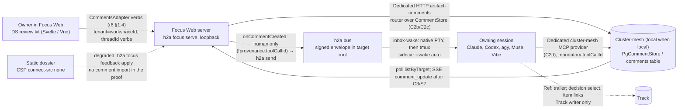
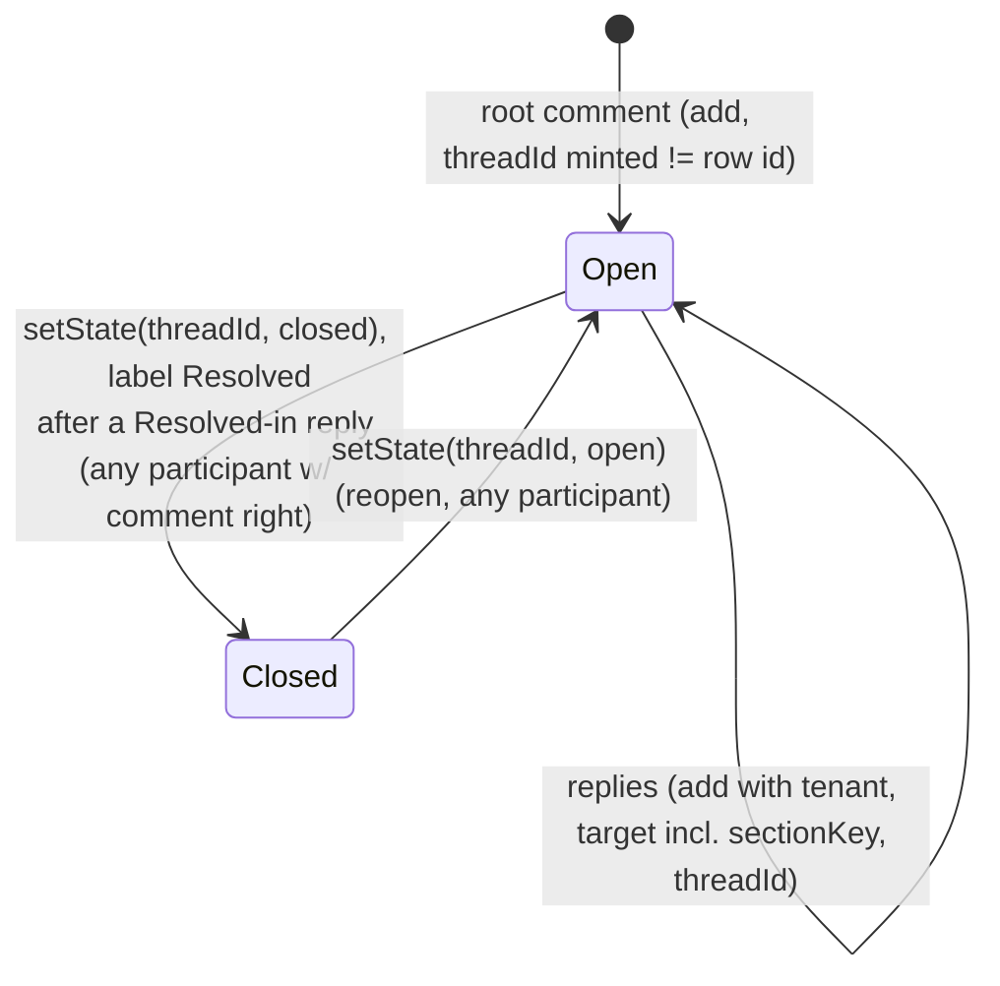

# SPEC EVOL — Local artifact review mode (claude.ai-like comments) over cluster-mesh

| Field | Value |
| --- | --- |
| Status | Specification only, realigned on 2026-11-19 onto DS `SPEC-r6.md` (which replaces r5, r4 and r3 and folds the Carbon r4 counter-review plus the 7 amendments of sentropic's r5 counter-review). No product code, no test execution, no Track write is claimed by this document. |
| Date | 2026-11-17 (realigned r6: 2026-11-19) |
| Branch | `docs/artifact-review-spec`, rebased on h2a `origin/main` `947f7d325` |
| Owner need | Verbatim of 2026-11-17 (conductor record `tmp/h-cond/artifact-review/VERBATIM-17-11.md`, untracked): local artifacts with a comment mode as in claude.ai but local and more reactive; the h2a send-message path whatever the CLI; reuse of the comment modules; traceability of comment follow-up, probably around decision dossiers. |
| Owner correction (binding) | « attention a la surcouche: ca doit passer impérativement via cluster-mesh côté api (il y a deja le metamodel de commentaire, ...) ». It replaces the earlier conductor proposal of an h2a-local store per dossier. h2a and Focus Web are **clients** of the cluster-mesh comments API; locally they use a local cluster-mesh. There is no h2a-owned comment store and no parallel store. |
| Governing DS contract | Design system review kit `SPEC-r6.md` (scratchpad, 19/11), which **replaces r5, r4 and r3**: §1 contract (`Comment`, 10-verb port, C2 artifact verbs, §1.1 `open\|closed` rename & freeze, §1.2 target normalisation & kind filter, §1.3 two-icon authorship + mandatory `provenance.toolCallId` split MCP vs HTTP + A4 FK target, §1.4 `CommentsAdapter`), §2 anchor in `sectionKey` (UTF-8 + 2048 cap decided under D3), §3 UI kit, §4 h2a delivery/traceability, §5 DS-1–DS-7 (starting now on the port-shaped fixture), sentropic C/S lots (0 → C1a → C1b → C2a → C2b → C2c → C2d → S4-db) and h2a lots H1–H5. Owner decisions D1/D2 (NHI identity) are withdrawn from DS and delegated to sentropic (S6); D3 (2048 cap) and C2 (owner = sentropic, before proof) are decided. G15 (body/thread size limits) stays open. |
| Comment metamodel (binding) | The existing `Comment` type of `@sentropic/comments` (`packages/comments/src/types.ts`), its 10-verb `CommentStore` port (`packages/comments/src/store.ts:26`), the Postgres adapter `PgCommentStore` (`api/src/services/comments/pg-comment-store.ts`) and the `comments` table (`api/src/db/schema.ts:792`, migration `api/drizzle/0020_add_comments.sql`, FK target `cm_identity.identity_user_accounts(user_id)` after `api/drizzle/control/0015_app_cm_identity_cutover.sql`), sentropic `origin/main` `bb3f3cefb`. |
| Sources read | h2a `origin/main` `947f7d325` (`@sentropic/cluster-mesh` `0.26.0` in `packages/h2a/package.json:81`, no `@sentropic/comments` dependency; Focus Web pins `@sentropic/design-system-svelte ^0.34.40`); DS review kit **`SPEC-r6.md`** (19/11, replacing r5/r4/r3; citing sentropic `origin/main` `bb3f3cefb` and sentropic's r5 counter-review `ds-review-kit-r5-carbon.md`); DS `origin/main` `ec3229f72`; claude.ai Docs connector guide `topic.comments` (read 2026-11-17). Evidence is listed in Appendix A. |

## 0. The feature in two diagrams

Only `open|closed` exist in the contract (r6 §1.1, single truth; sentropic C1a/C1b runs before C2 so C2 and the adapter carry no `closed↔resolved` mapping); `closed` is shown as « Resolved ». Thread state follows the store rule: **closed if any row is closed**. Sent, answered, source-changed and orphan are **projections computed by the client** (§5 and §6), never stored states.

## 1. Decisions (contract realigned on DS r6)

| Id | Decision |
| --- | --- |
| AR-1 | The DS r6 §1 contract is the only comment contract: existing `Comment` (`packages/comments/src/types.ts`), 10-verb `CommentStore` port (`store.ts:26`, without `setProvenance`), `target.kind` pinned to `'artifact'` (adapter-normalised, AR-4b), state `'open'\|'closed'` with « Resolved » shown for `closed` (r6 §1.1, no state mapping in C2 or the adapter), `ReviewComment` view model carrying `authorship` (AR-6), flat threads grouped by `threadId` (distinct from root row `id`), anchor inside `sectionKey` as `'a1:' + base64url(utf8(JSON))` ≤ 2048 chars (D3, §2), cluster-mesh as sole backend. h2a adds no wire field, no comment store and no parallel store. Focus Web may hold `ReviewComment[]` in memory as a rebuildable cache fed by `listByTarget`; a browser draft is a draft and is never shown as saved. Read state is the single bounded host-held exception (AR-10). |
| AR-2 | Two cluster-mesh surfaces exist in sentropic and must not be conflated: `/comments` in `packages/cluster-mesh` (`compose/comments.ts`, `hono/comments-router.ts`) serves the canonical M2/M3 revision metamodel (`CanonicalCommandStore`), **not** the 10-verb `CommentStore`/`PgCommentStore` port, and `comments-contract-boundaries.spec.ts` forbids undeclared cross-imports. The DS r6 contract is exclusively `Comment` + `PgCommentStore`: C2b/C2c therefore expose a **dedicated artifact-comments HTTP router and namespace** over `CommentStore` (without reusing the M2/M3 router or editing the SHA-256-pinned legacy `hono.ts`), and C2d registers a **dedicated cluster-mesh MCP provider** (separate `RegistryDefinition` outside `sentropic.artifacts` and its pinned `APP_P1_MANIFEST_DIGEST`). Revision-only features (CAS, submissions, tombstone) are not used (G17 closed). |
| AR-3 | "Local" means a local cluster-mesh endpoint exposing the r6 C2 artifact-comments verbs (C2a–C2d). When the endpoint is absent or unreachable, Focus Web shows `comments unavailable (missing binding)` and writes nothing anywhere, mirroring `missing_binding` (`packages/h2a/src/registry/memory-provider.ts:25`). A port-shaped stub, when used before C2/G2 exist, is labelled as a non-durable stub in the UI, keeps nothing durable, and never satisfies an H5 persistence acceptance line (§7, H3). |
| AR-4 | Anchor identity joins the two stable keys without inventing a field: DS `aid` (`data-anchor-id`, strongest key in r6 §2) carries the Focus node `targetRef` (`packages/focus/src/model.ts:24`, `:41`). Focus Web renders `data-anchor-id=<targetRef>` on stable blocks (H1), passes `target: Pick<CommentTarget,'kind'|'id'>` (`kind:'artifact'`, `id` = Focus document `ref`) and `artifactVersion` to `CommentLayer`. JSON is UTF-8 encoded via `TextEncoder` before `base64url` and decoded via `TextDecoder` after (never raw `btoa`). `resolveAnchor` stays kit-side and never writes back. **`ReviewThread.anchor` is derived from the first chronological row carrying `target.sectionKey`** (not the root row alone), so deleting the root keeps the anchor as long as a reply carries it. **Re-anchor is not supported by the port or routes today** (`editThread` patches `{content, assignedTo}` only): `reanchor?` is optional and absent until **S5**; while absent, the kit hides the Re-anchor action and orphans stay replyable/resolvable. |
| AR-4b | Target-kind normalisation is adapter-side (r6 §1.2): write maps `kind:'artifact'` → `context_type='artifact'`; read-back `kind:'record'` + `recordType:'artifact'` becomes `kind:'artifact'` and `recordType` is dropped so the kit only sees `kind:'artifact'`. Because `PgCommentStore.listByTarget` filters `context_id` only in SQL, C2 filters `(row.target.recordType ?? row.target.kind) === 'artifact'` at listing (and passes `kind:'artifact'` on `InMemoryCommentStore`) to prevent cross-context id collisions. |
| AR-5 | Republication never rewrites a stored anchor. The anchor payload `v` is the artifact version at capture (Focus document `hash`, supplied via `CommentLayer.artifactVersion`, Q1). On a new version the kit re-resolves: matched, moved or orphan is presentation state; a version change alone never orphans. The version that handled a thread is recorded only by the r6 §2 convention: a `Resolved in <version\|commit>` reply posted before `setState(tenant, threadId, 'closed')` (G11 closed). |
| AR-6 | **Authorship (r6 §1.3; D1/D2 withdrawn from DS, delegated to sentropic S6).** The kit consumes `ReviewComment extends Comment { authorship: { author: CollaborationActor; sponsor?: CollaborationActor; runId?: string } }` (redeclaring `CollaborationActor {actorId, kind, displayLabel, color}` in `review-core`, no import from `api/`). Under the proof fallback (zero migration): an agent comment is written under the sponsoring owner's id (`created_by` = owner) with a **mandatory non-empty `provenance.toolCallId`** (`agent:<sessionId>:<seq>` outside an MCP tool call). Because `PgCommentStore.add` drops `runId` **at the write itself** (`pg-comment-store.ts:112-119,432-434`), `runId` alone returns `provenance: undefined` and silently degrades the row into a human owner comment; `authorship.runId` is therefore enriched host-side from the live session and never read back from Postgres. The adapter derives `authorship`: rows with `provenance.toolCallId` get `sponsor` = owner and `author` = resolved agent (or generic « Agent » fallback; kind is never inferred from an id), rendered with **two icons** (`CommentAuthorship` on `AvatarGroup`, single `role="img"`, « `<agent label>` · on behalf of `<owner label>` »); rows without `provenance.toolCallId` are human (`author` = owner, no `sponsor`, single avatar). « Mine » and unread rules compare `authorship.author.actorId`, so an agent reply under the owner's id is neither « Mine » nor self-read for that owner. The Focus relay identity that signs the h2a envelope is a transport signer only and never authors a comment. |
| AR-6b | **Where mandatory `provenance.toolCallId` is enforced (r6 §1.3, split MCP vs HTTP).** `toolCallId` stays optional in `types.ts:58`; enforcement is per transport: (1) **MCP (C2d)**: every call is non-human, so the server **systematically** requires or injects a non-empty `provenance.toolCallId` (`z.string().trim().min(1)`, rejecting `""`); (2) **HTTP (C2b)**: an agent outside MCP shares the owner's human principal, so the server validates `toolCallId` as `trim().min(1)` **whenever `provenance` is supplied**, and rejects a write without it **only when the caller declares itself non-human** (explicit request discriminant such as `actor_kind: 'agent'\|'nhi'` field/header, or a non-human OAuth `clientId` such as `H2A_CLI_CLIENT_ID`). The Focus Web adapter rejects a non-human write without `toolCallId` **before sending**; outside MCP the writer sends `agent:<sessionId>:<seq>`. Until S6, an undeclared HTTP agent without provenance is recorded as human (stated fallback limit). |
| AR-7 | Delivery follows r6 §4: post → adapter `create`/`reply` via cluster-mesh → host-side `onCommentCreated(c)` → **only when `c` is a human comment (`!c.provenance?.toolCallId`)**, the h2a client resolves the artifact's owning session and issues the signed `h2a send` (`packages/h2a/src/cli.ts:454`; any CLI; local or cluster-mesh messaging backend), deposited in the root the target reads, carrying `tenant, target.id, threadId, comment id, authorship, excerpt, decoded anchor, provenance` (Appendix C). Because `reply` propagates `target.sectionKey` (and C2c inherits it), the decoded anchor is available on replies too. Agent/NHI writes (`c.provenance?.toolCallId` present) **never** trigger `h2a send` (loop guard). The agent reads, replies and resolves through the **dedicated cluster-mesh MCP provider (C2d)** with its own configured endpoint; the envelope is a pointer plus excerpt, never the authority — the cluster-mesh thread is. The unsigned `h2a inbox put` path is not reused (defect F3). |
| AR-8 | The recipient is the owning session, resolved by the existing ladder (§5.2) with visible ambiguity; every h2a CLI host prefix is accepted (defect F1 drops `muse:` and `vibe:`, fixed in H4). |
| AR-9 | The reply path is the agent writing through the **dedicated cluster-mesh MCP provider (C2d)** (separate `RegistryDefinition`, outside `sentropic.artifacts` / `APP_P1_MANIFEST_DIGEST`), every write carrying a non-empty `provenance.toolCallId` (AR-6b). h2a ships no `h2a_comment_*` tools duplicating C2d. A host that cannot run C2d MCP verbs cannot reply in-thread; Focus Web shows the per-host reason (§5.3) instead of a silent wait. Reply ids are store-minted (`NewComment` has no `id`). |
| AR-10 | Read state `(threadId, userId) -> lastReadAt` has no contract field (r6 §2). It is **host-held and passed to the kit as a prop**, never a `Comment` field and never persisted in h2a server files (no parallel store). A durable home is gap G10 (sentropic lot C4/S8). |
| AR-11 | No failure is silent: Focus Web shows one of a closed list of states with the next possible move (§5.4); optimistic UI mutations roll back with `role="alert"` on adapter rejection. |
| AR-12 | Traceability follows r6 §4 with existing fields only: `authorship` (§1.3), flat replies by `createdAt`, `provenance.toolCallId` (+ host-enriched live `runId`), the `Resolved in <version\|commit>` reply, and `assignedTo` (**workspace member only**; `null` unassigns). **Promotion to a decision or Track item uses the reply-body trailer `Ref: decision:<id>` / `Ref: track:<id>` only** (the r3 option of storing a Track id in `assignedTo` is **removed** because `hono.ts:231-235` requires a workspace member); the dossier/item records `threadId` on its side, the kit renders a link chip, and `state` is unchanged. Focus Web never writes `.track`. Comment bodies never enter Track or logs; the h2a envelope carries only the r6 §4 payload. |
| AR-13 | A D# answer by comment has no typed carrier in the contract. Option cards keep the existing response-line path (`packages/focus-interactive/src/response-line.ts`), and a comment thread on a question promotes via `Ref: decision:<id>`. Recording `track decision select` from a comment is allowed only as the narrow interim convention of §6.2, executed by the Track writer after checking `author.id` against the owner principal **and verifying `!comment.provenance?.toolCallId`**; a typed answer carrier is gap G20 (with S6). |
| AR-14 | Static dossiers stay offline (CSP `connect-src 'none'`, `form-action 'none'`): per DS H4 they are degraded only, export/import through `h2a focus feedback apply`, which applies `focus.return` document edits and does not import comments into cluster-mesh. Comment import for static dossiers is outside H1–H5 (§7, follow-ups). |
| AR-15 | The UI is the DS review kit only (`@sentropic/design-system-review-core` + Svelte 5 components in DS-1–DS-5, Vue 3 parity in DS-6, smoke-pack gate in DS-7). `ThreadPanel` is a **non-modal anchored `<aside>` at ≥48rem** (pins stay selectable while the panel is open) and uses `Drawer side="bottom"` at `<48rem` only, with `Escape` scoped to the active layer. `CommentAuthorship` is composed on `AvatarGroup` (two icons, single `role="img"`). DS-1–DS-7 build in parallel on the port-shaped fixture; Focus Web builds no permanent parallel widget. |

## 2. Surfaces and what each supports

Focus Web is the proof surface (DS r6 §4–§5). Static dossiers are degraded. The ui-render MCP App is listed only because its `comment` intent already exists in the schema; it is outside H1–H5.

| Capability | Focus Web (`h2a focus serve` / `web`) | Static dossier (`packages/h2a/focus-kit`) | ui-render MCP App |
| --- | --- | --- | --- |
| Network | Loopback server (default `127.0.0.1:5178`, `packages/h2a/src/runtime/focus/serve.ts:20`); server calls cluster-mesh C2b/C2c, browser never holds cluster-mesh credentials | None: CSP `default-src 'none'; connect-src 'none'; form-action 'none'` (renderer meta CSP) | Host-mediated `postMessage` only |
| Read threads | Live from cluster-mesh via `CommentsAdapter` (`list` over `listByTarget`, `listThread`) | No live read in the proof | Not in H1–H5 |
| Create, reply, edit, delete | Yes, through `CommentsAdapter` (`create`, `reply` with `tenant` + `target` incl. `sectionKey`, `edit`/`remove` by comment `id` for own human rows; hard delete) | Offline notes/answers only in `focus.return`, applied as document edits | `comment` intent exists, consumer not wired (defect F4) |
| Anchors | r6 §2 payload (`"a1:" + base64url(utf8(JSON))`, ≤ 2048 chars); `aid` = `targetRef`; document-level = no `sectionKey`; re-anchor hidden until S5 | `targetRef` in `FocusReturn.notes[]`, unchanged | The intent `target` string |
| Send to agent | Yes, H4 bridge (`onCommentCreated`, human comments only: `!c.provenance?.toolCallId`) | No (outside the proof) | The MCP host conversation itself |
| Resolve, reopen, assign | `setState(tenant, threadId, 'closed'\|'open')` (« Resolved » for `closed`) and `assign(tenant, threadId, assigneeId \| null)` by **`threadId`**, any authenticated participant with the per-artifact `comment` right (C2a) | No | No |
| Decision dossier | Option cards keep the response line; threads promote via `Ref:` trailer only (§6; no Track id in `assignedTo`) | Response line in the page; answers leave in `focus.return` | `choose-option` intent |
| Version shown | Current render version (`artifactVersion`) plus per-thread matched/moved/orphan from `resolveAnchor` | Version of the build | Version rendered |

## 3. Comment API and storage through cluster-mesh

### 3.1 Client architecture

- **Seam.** Kit components are controlled (`ReviewComment[]` in, mutations out) and call only the DS `CommentsAdapter` (r6 §1.4). In Focus Web the adapter binds to loopback SvelteKit backend-for-frontend routes (`apps/focus`): the server holds the cluster-mesh endpoint configuration and credentials and calls the **C2b/C2c dedicated artifact-comments HTTP router** (never the M2/M3 `/comments` router, never editing the pinned legacy `hono.ts`). Credentials never reach the browser, tool arguments or logs. Write routes require `content-type: application/json` and a loopback `Origin`.
- **Endpoint slot.** The server reads one configured local cluster-mesh comments endpoint (`FOCUS_COMMENTS_URL`, H3 implementation slot). Missing or unreachable endpoint means AR-3 refusal (`comments unavailable (missing binding)`), never a parallel or fallback store.
- **Port vs legacy HTTP vs C2 target surface.** The contract port (`packages/comments/src/store.ts:26`) has **10 verbs**: `add, get, edit, editThread, delete, listByTarget, listThread, listThreadSummaries, setState, assign` (**no `setProvenance`**, G18 confirmed). Eight facts in r6 §1 constrain C2:
  1. Legacy `hono.ts` (`contextTypeSchema`) rejects `'artifact'` and `contextExists` returns `false` → **404**.
  2. Legacy `updateSchema` accepts only `content` / `assigned_to`.
  3. Legacy `PATCH/close/reopen` resolve `:id` as a **row id**, not a `threadId` → **404** when given a `threadId`.
  4. Legacy `assign`/`close`/`reopen` are **creator-or-admin** (403 for other participants), and **no per-artifact `comment` right exists today** (`authorization.ts` knows only `'read' | 'mutate'`; `commenter` equals `viewer`). **C2a creates the per-artifact `comment` right** and the artifact existence check.
  5. Legacy `hono.ts:231` turns `assigned_to: null` into reassignment to creator, and `hono.ts:170` auto-assigns new roots to creator. C2 preserves `null` down to `store.assign(tenant, threadId, null)` and leaves new roots unassigned when `assigned_to` is omitted.
  6. `store.add` requires `tenant` and `target` on every call (replies included), and neither `PgCommentStore.add` nor `hono.ts` copies `section_key` onto a reply. Under r6, the adapter sends `target.sectionKey` on `reply`, and C2c also inherits `section_key` at insert from the first surviving row (`createdAt ASC, id ASC`) carrying one.
  7. `/comments` in `packages/cluster-mesh` is already taken by the M2/M3 `CanonicalCommandStore` router — C2b/C2c expose a **dedicated artifact-comments HTTP router and namespace** over `CommentStore`.
  8. MCP provider `sentropic.artifacts` is digest-pinned (`APP_P1_MANIFEST_DIGEST`) — C2d registers a **dedicated cluster-mesh MCP provider** (`RegistryDefinition` via `options.registrations`) with read verbs in `READ_ONLY_TOOL_ALLOWLIST`.
- **Order of delivery.** Sentropic lands **C1a → C1b** (`open|closed` rename + SHA-256 contract freeze pin update) **before** C2a–C2d, so C2 and the Focus Web adapter carry **no `closed↔resolved` mapping** (r6 §1.1, §1.4). Persistence acceptance (H5) runs against the Postgres-backed C2 endpoint (`PgCommentStore`), never an in-memory stub alone (G16).

### 3.2 Field-by-field mapping onto the existing metamodel

Every `Comment` field, its `PgCommentStore` / `comments` table carrier, the h2a slot value, and the r6 round-trip status. No column is added (the sole schema-level migration is the S4-db `CHECK (char_length(section_key) <= 2048)` constraint).

| Contract field | Carrier (`PgCommentStore`, table `comments`) | h2a / Focus Web slot | Round-trip status (r6) |
| --- | --- | --- | --- |
| `id` | `id` text PK, store-minted (`randomUUID`) | Opaque; row-verb key (`edit`, `remove`); never preallocated | OK |
| `tenant` | Only `workspaceId` persists (`comments.workspace_id`); `tenantId` is not stored | Adapter passes `tenant: string` (`= workspaceId`) on every verb; server rebuilds `TenantContext { tenantId, workspaceId, userId }` after membership check (`reconcileCmTenantId`); raw client `tenantId` never trusted | Settled by r6 §1.4 |
| `target.kind` | `context_type` via `targetToLive`; read-back is `kind:'record', recordType:'artifact'` (`targetFromLive`, `types.ts:151`) | Pinned `'artifact'` on write; **adapter normalises on read** (AR-4b); C2 filters listing on `(recordType ?? kind) === 'artifact'` | Settled by r6 §1.2 (G4 closed) |
| `target.id` | `context_id` | Focus document `ref` (also supplied to `CommentLayer.target`) | OK; kind-filtered in C2 (§1.2) |
| `target.sectionKey` | `section_key` text; **2048-char cap decided (D3)**, enforced by C2b/C2d route validation (`z.string().max(2048)`, proposed 400 `{ code: 'section_key_too_long', maxLength: 2048 }`) and S4-db SQL `CHECK` | r6 §2 anchor: `"a1:" + base64url(utf8(JSON))` (UTF-8 via `TextEncoder`/`TextDecoder`); `aid` = Focus `targetRef`; `v` = `artifactVersion` (document `hash`, Q1); propagated on every `reply` (r6 §1.4) | Decided (D3 closed → S4-route in C2b/C2d, S4-db lot 7) |
| `target.recordType` | Read-back artifact of `targetFromLive` | Consumed and dropped by adapter normalisation (AR-4b) | See `target.kind` |
| `threadId` | `thread_id`; **minted distinct from root row `id`** (`pg-comment-store.ts:96,99`) | Thread-verb key (`setState`, `assign`, `listThread`); replies pass `{ tenant, target (incl. sectionKey), threadId, body, provenance? }` | Settled by r6 §1, §1.4 |
| `author.id` | `created_by` text not null; FK target after control/0015 is **`cm_identity.identity_user_accounts(user_id)`** (`ON DELETE CASCADE`; deployed state checked in S3) | Owner principal id (`↔ CollaborationActor.actorId`); under the fallback, agent rows also carry the sponsoring owner's id with mandatory `provenance.toolCallId` (AR-6) | OK for owner; agent native identity is sentropic **S6** (D1 withdrawn from DS) |
| `authorship` (view model on `ReviewComment`, never wire) | Wire `toComment` rebuilds `author: { id }` only; `kind`/`displayLabel` not persisted | `{ author: CollaborationActor, sponsor?: CollaborationActor, runId?: string }` built by adapter (H2/H3): if `provenance?.toolCallId`, `sponsor` = owner and `author` = agent (or generic « Agent »), rendered as **two icons** (`CommentAuthorship` on `AvatarGroup`); `runId` enriched host-side from live session | r6 §1.3 view model; durability = sentropic **S6** |
| `assignedTo?` | `assigned_to` (FK target `cm_identity.identity_user_accounts(user_id)` `ON DELETE SET NULL`), cascaded thread-wide by `assign(tenant, threadId, string \| null)` | **Workspace member only** (Track id in `assignedTo` removed in r4/r6); `null` unassigns; root creation without `assignedTo` stays unassigned | Settled by r6 §1 (C2c implements `null` unassign & no auto-assign) |
| `state` | `status` `'open'\|'closed'` single truth; C1a/C1b removes `'resolved'` from `@sentropic/comments` + `api/` and updates the 6 SHA-256 pins in `contract-v1.json` | `'open'\|'closed'` only; **no state mapping in C2 or adapter** (C1 precedes C2); `closed` shown as « Resolved »; thread closed if **any** row is closed | Settled by r6 §1.1 (C1a → C1b) |
| `body` | `content` text not null; **unbounded today** (`hono.ts:36,41`, `schema.ts:805`) | Owner/agent markdown-lite prose; `Resolved in <version\|commit>` reply; `Ref: decision:<id>` / `Ref: track:<id>` trailer | OK; **body/thread size limits remain open gap G15** |
| `provenance.toolCallId?` | `tool_call_id` (only surviving provenance column; `pg-comment-store.ts:432` tests `!== null`) | Optional in `types.ts:58`, **mandatory non-empty (`trim().min(1)`) on every non-human write** (`agent:<sessionId>:<seq>` outside MCP); enforced systematically on MCP (C2d) and conditionally on HTTP (C2b + adapter pre-check, AR-6b); discriminator for `authorship` and `onCommentCreated` | Settled by r6 §1.3 |
| `provenance.runId?` | **Dropped at `INSERT`** (`pg-comment-store.ts:112-119,432-434` ignores `runId` and re-reads via `toComment`) | **Never read back from `PgCommentStore`**; `authorship.runId` is enriched host-side from the live session (run link is live-only until S6) | Stated fallback limit (r6 §1.3; durability = sentropic **S6**) |
| `createdAt`, `updatedAt?` | `created_at`, `updated_at` timestamps | Ordering (`createdAt ASC, id ASC`), `edited` badge, `isUnread` | OK |

Needs with no contract field (no column added; interim under r6 §2):

| Need | Interim (no field added) | Gap / Lot |
| --- | --- | --- |
| Version/commit that resolved a thread | `Resolved in <version\|commit>` reply before `setState(tenant, threadId, 'closed')`; kit renders it as resolution record | Settled interim (G11 closed) |
| Resolver actor | Author of the resolving reply (`authorship`, §1.3) + `updatedAt` | Settled interim (durability in S6) |
| Per-user read state | Host-held `(threadId, userId) -> lastReadAt` prop (AR-10); never a `Comment` field, never persisted in h2a server files | G10 (C4/S8) |
| True author / sponsor / `runId` durability | Owner-id fallback + mandatory `provenance.toolCallId` + adapter `authorship` (live host-side `runId`) | Sentropic **S6** (NHI identity model) |
| Re-anchor | No port/route verb modifies `section_key`; `reanchor?` absent ⇒ kit hides Re-anchor; orphans stay replyable/resolvable | Sentropic **S5** (non-blocking) |
| Addressed / sent / answered | No stored marker: delivery = `onCommentCreated` (`!c.provenance?.toolCallId`) → `h2a send`; answered = agent reply row (`provenance.toolCallId` present) | Settled by r6 §4 (G13 closed) |

### 3.3 Verbs: 10-verb port, C2 artifact verbs, `CommentsAdapter` (r6 §1, §1.4)

| Kit action | 10-verb Port (`store.ts:26`) | C2 artifact verb key (HTTP C2b/C2c + MCP C2d) | `CommentsAdapter` (r6 §1.4, H3) |
| --- | --- | --- | --- |
| Create thread | `add(tenant, input)` (`tenant` + `target` required) | target (`artifact`), provenance + `toolCallId` rule (AR-6b), 2048 cap, no auto-assign | `create({ tenant, target, body, provenance? }): Promise<ReviewComment>` |
| Reply to thread | `add(tenant, input)` (`tenant` + `target` + `threadId`) | `threadId` + target; C2c inherits `section_key` from first surviving row carrying one if omitted; `comment` right | **`reply({ tenant, target, threadId, body, provenance? }): Promise<ReviewComment>`** (`target.sectionKey` = thread's anchor row) |
| Edit own comment | `edit(tenant, commentId, body)` | comment **`id`** (author-or-admin) | `edit(tenant, commentId, body): Promise<ReviewComment>` |
| Resolve / reopen thread | `setState(tenant, threadId, 'open'\|'closed')` | **`threadId`** (any authenticated participant with per-artifact `comment` right, C2a) | `setState(tenant, threadId, 'open'\|'closed'): Promise<void>` (no state mapping) |
| Delete own row | `delete(tenant, commentId)` (hard delete; deleting root leaves replies) | comment **`id`** (author-or-admin) | `remove(tenant, commentId): Promise<void>` |
| List artifact threads | `listByTarget` + `listThread` + `listThreadSummaries` | target (kind-filtered to `'artifact'`), `listThread` by `threadId` | `list(tenant, target): Promise<ReviewComment[]>`, optional `threadSummaries?(tenant, target)` |
| Assign / unassign thread | `assign(tenant, threadId, assigneeId \| null)` | **`threadId`**, workspace member only, **`null` unassigns**, any participant with `comment` right | `assign(tenant, threadId, assigneeId: string \| null): Promise<void>` |
| Re-anchor thread | **none** (`editThread` patches `{content, assignedTo}` only) | **none** until S5 | `reanchor?(tenant, threadId, sectionKey): Promise<void>` (absent until S5) |
| Subscribe | No port verb | Polling `listByTarget`; SSE `comment_update` after C3/S7 (`canObserve` for `'artifact'`) | `subscribe?(tenant, target, cb): () => void` |
| Comment created hook | Host-side only | Host-side | `onCommentCreated?: (cb:(c:ReviewComment)=>void) => () => void` (H4 filters `!c.provenance?.toolCallId`) |

Permission summary (r6 §1, server-side, implemented by C2a–C2d): `author.id` is recorded from the authenticated caller regardless of payload; `edit`/`delete` are author-or-admin only (kit offers them on own human comments only); `reply`/`close`/`reopen`/`assign` are allowed to **any authenticated participant holding the per-artifact `comment` right** created by C2a (approved `commenter`/`editor`/`admin` members with access to the artifact).

## 4. Cannot-map list: requests to sentropic (cluster-mesh), the DS and Track

Status after the r6 realignment: **open** = still requested; **lot <id>** = settled by r6 and assigned to a named sentropic lot (§7 / DS r6 §5); **closed** = settled or withdrawn by r6, kept here for traceability. Nothing in this list is worked around by an h2a parallel store.

| Id | Status in r6 | To | Request / settled form | Blocks |
| --- | --- | --- | --- | --- |
| G1 | **lot C2a–C2d** (blocking) | sentropic (owner = sentropic, before proof) | Expose the artifact comment verbs wrapping the 10-verb port 1:1: **C2a** per-artifact `comment` right + artifact existence check; **C2b/C2c** dedicated artifact-comments HTTP router & namespace (no M2/M3 reuse, no edit to pinned `hono.ts`), `threadId`-keyed `setState`/`assign`/`listThread`, `artifact` context + kind filter at listing, `null` unassign + no auto-assign, `section_key` inheritance on reply, provenance with HTTP `toolCallId` rule, 2048 cap + stable 400 code; **C2d** dedicated cluster-mesh MCP provider outside `APP_P1_MANIFEST_DIGEST` with systematic non-empty `toolCallId` and `READ_ONLY_TOOL_ALLOWLIST`. | H3, H4 (critical path) |
| G2 | **open** (blocking) | sentropic (C2 local host) | Runnable local cluster-mesh host exposing C2a–C2d ("cluster-mesh locally is still the only store") with a seeded workspace (`workspaceId` ↔ `tenant`) and local principals (owner + a second participant for H5). | H3, H5 |
| G3 | **lot C1a–C1b** (blocking by order) | sentropic | `CommentState = 'open'\|'closed'` single truth over exact r6 §1.1 scope (`comment-summary-mapper.ts:47` only keeping `:73`, `tool-service.ts:1299,1429`, 7 test files incl. `domain-schema.spec.ts:36,71`, no locales/UI change) + **contract freeze update of the 6 SHA-256-pinned files in C1a**. Runs **before C2** so C2 and adapter carry no state mapping. | C2 (not DS lots) |
| G4 | **closed** | h2a (H3) + C2b | Settled by r6 §1.2: adapter normalises `record` + `recordType:'artifact'` ⇒ `kind:'artifact'`; C2 filters listing on the artifact context type. | — |
| G5 | **lot S6** (non-blocking) | sentropic | D1 withdrawn from DS: NHI identity model (true author `kind`/`id`/`label`, sponsoring owner) is designed by sentropic (**S6**). Proof uses the owner-id fallback + mandatory `provenance.toolCallId` + two-icon `authorship` (AR-6). S3 (lot 0) checks real-DB FK state on `cm_identity.identity_user_accounts(user_id)`. | Traceability durability only |
| G6 | **lot S6** (non-blocking) | sentropic | D2 withdrawn from DS: `provenance.runId` is lost at `PgCommentStore.add` (`pg-comment-store.ts:112-119`); `authorship.runId` is enriched host-side from the live session until sentropic defines durable run references in **S6**. | Run-link durability only |
| G7 | **lot S5** (non-blocking) | sentropic | r3 `editThread` re-anchor **withdrawn** (`editThread` patches `{content, assignedTo}` only). Re-anchor is optional capability **S5**; `reanchor?` absent ⇒ kit hides the action; orphans stay replyable/resolvable. | Orphan re-anchor only |
| G8 | **lot C2a–C2c** (blocking) | sentropic | Policy settled by r6 §1: **C2a** creates the per-artifact `comment` right (`commenter`/`editor`/`admin`); `reply`/`close`/`reopen`/`assign` open to any participant with `comment`; `edit`/`delete` author-or-admin; `assigned_to: null` unassigns (workspace member only; Track id in `assignedTo` removed). | H4, H5 |
| G9 | **lot C3/S7** (non-blocking) | sentropic | Change feed (`subscribe`) or polling contract; confirm `listThreadSummaries`. Existing SSE `comment_update` (`streams.ts:573-585`, `PgNotifyCommentEventSink`) can be reused once `ports.comments.canObserve` admits `context_type = 'artifact'`. Polling `listByTarget` is the proof interim. | Reactivity only |
| G10 | **lot C4/S8** (non-blocking) | sentropic | Confirm durable read-state store and resolution-reply convention. Host-held in the proof (AR-10); h2a never persists read state on disk. | Cross-device unread only |
| G11 | **closed** | — | Settled interim: `Resolved in <version\|commit>` reply before `setState(tenant, threadId, 'closed')`. | — |
| G12 | **closed** | — | Withdrawn: no fabricated timeline; current state from existing fields only. | — |
| G13 | **closed** | — | Settled: no stored addressed/sent marker; delivery = `onCommentCreated` (`!c.provenance?.toolCallId`) → `h2a send`; answered = agent reply row. | — |
| G14 | **lot S4** (D3 decided) | sentropic (C2b/C2d + S4-db) + DS-2 | **D3 decided: 2048 chars** on final UTF-8 + `base64url` `sectionKey`. Enforced in **C2b** (HTTP) and **C2d** (MCP) from first delivery (400, proposed `{ code: 'section_key_too_long', maxLength: 2048 }`, legacy `hono.ts` untouched) and at DB via **S4-db** (`CHECK (char_length(section_key) <= 2048)`) after lot 0 over-cap count (**S4-audit**). Kit/adapter pre-check at compose time. | H1, H3 (route check in C2b/C2d) |
| G15 | **open (not covered by DS r6)** | sentropic (later explicit lot) | **Body and thread size limits + write safety not yet covered by DS r6**: `comments.content` has no `.max(...)` today (`hono.ts:36,41`, `schema.ts:805`), no threads-per-artifact or comments-per-thread ceiling, no edit conflict CAS or create idempotency key (retried create can duplicate a row). Kept explicitly open for a dedicated sentropic lot (`SPEC-r6.md` §5 owner row). | H3 robustness / production hardening |
| G16 | **lot 0 + C1a–C1b** (blocking) | sentropic | Lot 0 (**S3 + S4-audit**) verifies real-DB FK target (`cm_identity.identity_user_accounts(user_id)`) and over-cap `section_key` count; C1a–C1b land `open\|closed` + Postgres round-trip tests (`pg-comment-store.test.ts`). H5 requires the Postgres-backed C2 endpoint. | H3, H5 |
| G17 | **closed** | sentropic | Settled: DS contract is `Comment` + `PgCommentStore`; M2/M3 `CanonicalCommandStore` router is not reused (AR-2). | — |
| G18 | **closed (confirmed)** | DS + sentropic | Confirmed by r4/r6: `CommentStore` has **10 verbs**, `setProvenance` is **not** a port method (app-local on `PgCommentStore` only). Kit and adapter never call it. | — |
| G19 | **closed (revised in r5/r6)** | DS + h2a | Settled by r6 §1.4: `reply` is typed **`{ tenant, target, threadId, body, provenance? }`** with thread's `sectionKey` propagated (superseding r3's `threadId`-only reply); document-level = no `sectionKey`; `Ref:` trailer renders as link chip. | — |
| G20 | **open (future)** | Track + sentropic | Native decision ↔ thread link, reopen/supersede for settled `go`/`no-go` decisions (`packages/track/src/model/decision.ts:210`), and typed D# answer carrier. Item-side `--kind comment-thread` works today. | §6.2 (non-blocking) |

## 5. Routing: comment to the owning agent, any CLI

### 5.1 Flow (r6 §4, h2a slots filled)

1. **Post.** The owner posts in review mode: Focus Web calls `CommentsAdapter.create` or `reply({ tenant, target, threadId, body, provenance? })` over the C2b/C2c HTTP router (H3). Only a comment confirmed by read-back is shown as saved. Focus Web holds `ReviewComment[]`, fed by `subscribe` (C3/S7 SSE `comment_update` preferred, `listByTarget` polling in the interim) into `CommentLayer`; cluster-mesh locally is the only store.
2. **`onCommentCreated` (human-only filter).** The host-side hook fires for every created row, and the h2a bridge triggers `h2a send` **ONLY when `c` is a human comment (`!c.provenance?.toolCallId`)**. Agent/NHI writes (`c.provenance?.toolCallId` non-empty) never trigger `h2a send` (loop guard), and edits never trigger it. The hook behaviour is stated next to the composer so the owner is never surprised by a wake.
3. **`h2a send`.** The h2a client resolves the artifact's owning session (§5.2), then issues the signed `h2a send` (any CLI): `h2a send <instance> <payload> --from <focus relay identity> --root <target root>`, carrying the r6 §4 payload: `tenant, target.id, threadId, comment id, authorship, excerpt, decoded anchor, provenance` (Appendix C). Because every reply propagates `target.sectionKey` (and C2c inherits it), the decoded anchor is available on replies too. Provisioning of the relay identity (registered instance, server-side key custody) is an H4 acceptance point (Q2).
4. Success of `h2a send` means the envelope is deposited in the root the target reads (within `H2A_SEND_TIMEOUT_MS`, 10 s). It never means the agent has read anything. A failed send after a saved comment leaves the comment saved and surfaces the error with `saved: true` (never retried into a duplicate) and the state from §5.4; delivery is recorded nowhere in the comment contract (G13 closed).
5. The receiver's MCP sidecar (`--auto-open --wake auto`) sees the inbox envelope and injects the visible wake line (`[h2a-wake reason=inbox …]`, `packages/h2a/src/wake.ts:46`) through native PTY then tmux (`chainDriver(...)`, `packages/h2a/src/cli.ts:2550`). Without that sidecar, the envelope waits in its inbox.
6. **Agent reply/resolve via dedicated cluster-mesh MCP provider (C2d).** The agent reads the payload, re-reads the thread through the **C2d MCP provider** with its own endpoint — the cluster-mesh thread, not the envelope, is the authority — verifies workspace, artifact id and thread id, acts, and replies in the thread. Every non-human write carries a **non-empty `provenance.toolCallId`** (systematically required/injected by C2d on MCP; synthetic `agent:<sessionId>:<seq>` over HTTP outside an MCP tool call, pre-checked by the adapter, AR-6b). When it handled the point by republishing, it posts a `Resolved in <version|commit>` reply, then calls `setState(tenant, threadId, 'closed')` — permitted to the agent's sponsoring identity as any participant holding the per-artifact `comment` right (C2a). It never edits or deletes the owner's rows.
7. **Owner follow-up.** Focus Web shows the reply (polling, or SSE after C3/S7), enriches `authorship` (`author` = agent, `sponsor` = owner, live `runId` host-side), renders **two icons** (`CommentAuthorship`), marks the thread **unread** for the owner (`authorship.author.actorId !== currentUser.actorId`), and excludes the agent reply from « Mine ». The owner may reply (back to step 2) or reopen via `setState(tenant, threadId, 'open')`.

### 5.2 Owning-session resolution

The existing ladder in `apps/focus/src/lib/server/h2a-target.js` is reused as is: 1. explicit UI choice (`requested`); 2. operator pin `FOCUS_H2A_TARGET`; 3. emitter `FOCUS_EMITTER_INSTANCE` if live; 4. live sessions whose `workspace.path` is this checkout or its main worktree; 5. name match against the live registry; 6. sole live session. An explicit target that is not live is reported, never replaced; several candidates return `ambiguous` (`GET /api/h2a/targets`). The root travels with the presence record and the envelope goes to that root (`include/+server.ts:171`; `inject/+server.ts:83` omits it — defect F2).

The artifact's recorded producer instance is **not** a rung in the proof (`Production.producerId` lives in retained feedback state Focus Web does not read, defect F5). `assignedTo` holds a **workspace member only** (or `null` when unassigned); it never holds a Track id (AR-12).

### 5.3 Wake and reply reality per CLI

How each CLI is woken and replies, from `docs/host-integration-matrix.md` and `CLI_HOSTS` on the base of this spec. "Send reaches inbox" holds for every host once defect F1 is fixed; waking and replying via C2d MCP are narrower.

| CLI | Instance prefix | Focus Web target today | h2a MCP sidecar today | Wake when sidecar runs `--wake auto` | Reply via dedicated cluster-mesh MCP provider (C2d) |
| --- | --- | --- | --- | --- | --- |
| Claude | `claude:` | accepted | shipped (`host setup --host claude`) | native PTY, then tmux | First H4 target, once C2d exists |
| Codex | `codex:` | accepted | shipped; in-session attestation partial in matrix | same chain | After Claude in H4; live qualification not claimed here |
| agy | `agy:` | accepted | historical direct rendering, MCP unqualified, no hook equivalence | chain in sidecar, host path unqualified | Not qualified; Focus Web shows "reply path not qualified for this host" |
| Muse | `muse:` | **dropped by prefix filter** (F1) | historical direct rendering, MCP unqualified | unqualified | Blocked by F1, then unqualified as for agy |
| Vibe | `vibe:` | **dropped by prefix filter** (F1) | interim direct entry (`host setup --host vibe --write`); native qualification pending | sidecar chain, qualification pending | Blocked by F1, then qualification pending |
| Gemini, Hermes, OpenCode | `gemini:`, `hermes:`, `opencode:` | accepted by filter | per matrix, outside owner H4 scope | same chain when equipped | Inbox delivery only in the proof |

### 5.4 Visible failure states

Closed list of states shown on a thread (12 states)

| State | Trigger | Next move offered |
| --- | --- | --- |
| `comments unavailable` | No endpoint configured, unreachable, or missing binding (AR-3) | Configure the endpoint; draft kept unsaved |
| `not saved` | Adapter write refused (validation, permission, thread not found, over-cap anchor `section_key_too_long`, missing `toolCallId` on non-human write) | Edit or retry; draft is never shown as saved |
| `saved, not sent` | Comment stored, bridge send not run or failed (no target, send error, timeout); error carries `saved: true` | Send now, pick a session, or leave unsent (never retry into a duplicate) |
| `no target` | No live session or h2a binary missing (`explainNoTarget` remedies) | Launch or pin a session |
| `ambiguous target` | Several live sessions answer for this checkout | Choose one; nothing is sent before choice |
| `chosen session not live` | Explicit or pinned target not live | Choose another; nothing was redirected |
| `deposited, session dormant` | Send deposited with `recipientLive: false`, or no wake-capable sidecar | Wait, relaunch, or redirect |
| `sent, waiting` | Deposited to a live session, no agent reply row yet | None; projection only, labelled as such (no stored sent state) |
| `reply path not qualified` | Target host cannot run C2d MCP verbs (§5.3) | Open the session and treat the thread there, or redirect |
| `resolve refused` | `setState(tenant, threadId, 'closed'\|'open')` denied server-side (missing per-artifact `comment` right, C2a) | Owner closes/reopens, or agent posts resolution reply without closing |
| `orphaned on this version` | `resolveAnchor` finds no match on current render (or no surviving row carries `sectionKey`) | Open `OrphanList`; thread stays readable, replyable and resolvable (Re-anchor hidden until S5) |
| `re-anchor unavailable` | Only if `reanchor?` is bound (post-S5) and fails | Reply or resolve (« Resolved ») from `OrphanList`; stored anchor stays untouched |

## 6. Traceability and decision dossiers (r6 §4)

### 6.1 Lifecycle from existing fields only

| Owner-visible reading | Evidence in the contract (nothing else is claimed) |
| --- | --- |
| Open | Thread rows exist and **no** row is `closed`; pill shows `Open` |
| Replied | Flat rows ordered `createdAt ASC, id ASC`, each enriched to `ReviewComment.authorship` host-side; human rows show single avatar; kind is never inferred from an id |
| Answered by the agent | A reply row carrying non-empty `provenance.toolCallId`: `authorship.author` = agent (or generic « Agent »), `authorship.sponsor` = owner of record, live `authorship.runId` enriched host-side; rendered with **two icons** (`CommentAuthorship`), unread for the owner and excluded from « Mine » |
| Resolved in a version | The `Resolved in <version\|commit>` reply (`authorship`, `createdAt`, `provenance`) followed by `setState(tenant, threadId, 'closed')`; thread closed if any row is closed; pill shows « Resolved ». Without that reply, a `closed` thread shows "Resolved, no resolution record" |
| Reopened | `state` is `'open'` again after `setState(tenant, threadId, 'open')` by any participant with `comment` right. No prior-state history is stored (G12 closed) |
| Assigned / unassigned | `assignedTo`: workspace member id (never a Track id), or absent/unassigned after `assign(tenant, threadId, null)` or root creation without `assignedTo` |
| Provenance | `provenance.toolCallId` persisted per row (mandatory on agent writes); `runId` live-only host-side until sentropic S6 |
| Edited | `updatedAt` present and later than `createdAt` (kit "edited" marker); prior body text is not retained |
| Deleted | Per-row hard delete; deleting the root row leaves replies intact and `ReviewThread.anchor` resolves from the first surviving chronological row carrying `target.sectionKey` |

Thread locator used outside the comment system (Track links, h2a pointer): `comments:<workspaceId>/threads/<threadId>` plus the artifact id (`target.id`). It contains no revision hash.

### 6.2 Decision dossiers and Track

- **Threads on questions and options.** Each Focus question or option node is a commentable block (`data-anchor-id` = its `targetRef`, H1), attaching threads to the same node the owner sees as D#. The response line stays computed from selections (`packages/focus-interactive/src/response-line.ts`); comments do not feed it in the proof, and an unanswered question never implies consent.
- **Promotion (`Ref:` trailer only).** A reply whose last line is exactly `Ref: decision:<decisionId>` or `Ref: track:<itemId>` promotes the thread: the kit renders a link chip (r6 §4), the dossier/item records `threadId` on its side, and the Track writer records the reciprocal link: `track item link <item> --kind comment-thread --locator comments:<workspaceId>/threads/<threadId>`. **`assignedTo` is NOT used for Track ids** (workspace members only, r6 §1/§4); `state` is unchanged. h2a parsing slot: the last matching reply trailer is current, and raw text is shown either way.
- **Recording a D# from a comment (interim, narrow).** Only when all hold: thread anchored to that decision's question node, a row carries `Ref: decision:<id>`, and the option is named by its visible code in that same row. The Track writer (never Focus Web) re-reads the row through the adapter, checks `author.id` against the owner principal (H2) **and verifies `!row.provenance?.toolCallId`** (separating human owner rows from sponsored agent rows under the fallback), then runs `track decision select <decisionId> <optionId>`. Any row carrying `provenance.toolCallId`, or whose origin cannot be separated, fails the check. A message or wake never proves consent.
- **Reopening a settled D#.** Track outcomes `go`/`no-go` are terminal; a thread on a settled decision stays a comment thread and the follow-up is a new decision linked to the settled one until G20.
- **Version that handled threads.** When the handling session republishes the dossier, the Track writer may attach the rendered view via `track decision add-artifact <decisionId> --kind rendered-view --view-ref <ref> --source-dossier-hash <hash>`; per-thread resolution remains the `Resolved in …` reply. PR links keep `pr-open`/`pr-merged`; a merge never resolves a thread.
- **Single writer.** In h2a the conductor is the sole Track writer and publishes `.track` on `main`; no PR branch and no Focus Web process writes `.track`.

## 7. Lots (r6 §5)

### Cross-repo dependency sequence (r6 §5)

- **DS lots (DS-1–DS-7, 76 h total; proof subset ≈ 57 h):** start immediately in parallel on the port-shaped fixture (which implements r6 C2 semantics: `open|closed`, `threadId`-keyed thread verbs, participant permissions, `null` unassign + no auto-assign, `sectionKey` on replies, non-empty `toolCallId` on non-human writes). No DS lot waits on C1/C2/S3/S5/S6. DS-7 registers `@sentropic/design-system-review-core` in `scripts/smoke-pack.mjs`.
- **Sentropic lots (≤150 LOC each, tests first, Make-only, in order):** **0: S3 + S4-audit** (FK check on `cm_identity.identity_user_accounts(user_id)` + over-cap `section_key` count) → **1: C1a** (`@sentropic/comments` `open|closed` + 6 SHA-256 contract pins) → **2: C1b** (`api/` aligned on `open|closed`) → **3: C2a** (per-artifact `comment` right + artifact existence) → **4: C2b + S4-route** (dedicated artifact-comments HTTP router + HTTP `toolCallId` rule + 2048 cap + stable 400 code) → **5: C2c** (`api/` namespace mount, `section_key` inheritance, `null` unassign, `PgNotifyCommentEventSink`) → **6: C2d** (dedicated cluster-mesh MCP provider outside `APP_P1_MANIFEST_DIGEST`, systematic non-empty `toolCallId`, `READ_ONLY_TOOL_ALLOWLIST`, 2048 cap) → **7: S4-db** (`CHECK (char_length(section_key) <= 2048)`). Non-blocking: **S5** (re-anchor), **S6** (NHI identity), **C3/S7** (SSE `comment_update`), **C4/S8** (read state), and a future lot for **G15** (body/thread size limits).
- **h2a lots (H1–H5):** adopt DS r6 §5 as written. Every lot runs targeted test files with temporary directories (`TMPDIR`, `XDG_RUNTIME_DIR` under the lane dir); a test needing the local cluster-mesh endpoint fails explicitly when absent, never silently skips.

### H1 — Focus Web Svelte wiring

DS scope (r6 §5): `CommentLayer` on `data-review-root` with `target` (`Pick<CommentTarget,'kind'|'id'>`) and `artifactVersion`, `data-anchor-id` on stable blocks, toggle/panel chrome (non-modal `<aside>` ≥48rem, `Drawer side="bottom"` <48rem, active-layer `Escape`). h2a slots: Focus Web (`apps/focus`, SvelteKit, Svelte 5) renders `data-anchor-id=<targetRef>` on every identified Focus node; mode is host-controlled (`?review=1`); pins `@sentropic/design-system-review-core` + Svelte kit once DS-1–DS-5 publish (`apps/focus/package.json` currently pins `@sentropic/design-system-svelte ^0.34.40`).

Depends on: DS-1 to DS-5 (+ DS-7 smoke-pack registration).

Acceptance:
1. With no comments endpoint configured, the toggle renders, review mode opens, and the panel shows `comments unavailable (missing binding)`; no comment file is written anywhere.
2. Every rendered Focus node in the fixture carries one unique `data-anchor-id` equal to its `targetRef`.
3. View mode changes nothing (text selection, option-card clicks, tab order untouched).
4. `CommentLayer` receives `target` and `artifactVersion`; a `closed` thread shows « Resolved » + check pin at 55% opacity; no `'resolved'` state literal exists in wire or UI model.
5. At ≥48rem the panel is a non-modal `<aside>` and artifact pins stay clickable while it is open; at <48rem it renders as `Drawer side="bottom"`; `Escape` closes only the topmost active layer.

### H2 — Current user and `authorship` enrichment

DS scope (r6 §5): `currentUser` from session; session → `CollaborationActor` enrichment (`ReviewComment.authorship: { author, sponsor?, runId? }`). h2a slots: Focus Web builds `currentUser: CollaborationActor` from the local principal configuration (G2) and live session/registry; the browser never chooses an author id. For rows carrying a non-empty `provenance.toolCallId`, the adapter derives `sponsor` = owner `CollaborationActor`, `author` = resolved agent `CollaborationActor` (or generic « Agent » fallback; kind never inferred from id), and enriches `runId` host-side from the live session (never read back from Postgres). Rows without `provenance.toolCallId` are human (`author` = owner, no `sponsor`).

Depends on: G2 (local principals); S6 only for durable native agent authorship beyond the fallback.

Acceptance:
1. A browser payload claiming another author is ignored: the stored row carries the authenticated owner principal, enriched as human `CollaborationActor`.
2. An agent row (owner `created_by` + non-empty `provenance.toolCallId`) is enriched with `author` (agent `CollaborationActor`, or generic « Agent » when the session is stopped) + `sponsor` (owner) + live host-side `runId`; it renders **two icons** (`CommentAuthorship` on `AvatarGroup`, single `role="img"`) and « `<agent label>` · on behalf of `<owner label>` ».
3. Comment writes are refused when Focus Web is bound to a non-loopback host.
4. `color` never reaches the store; re-derived on read.

### H3 — `CommentsAdapter` on C2 artifact-comments surface, read state, subscribe/polling

DS scope (r6 §5): `CommentsAdapter` on the C2 dedicated artifact-comments HTTP router (and MCP provider for agents): `tenant` (`= workspaceId`) on every verb; thread verbs (`setState`, `assign`, `listThread`) by **`threadId`**; row verbs (`edit`, `remove`) by comment **`id`**; **`reply` typed `{ tenant, target, threadId, body, provenance? }`** with thread `sectionKey` propagated; **no `closed↔resolved` state mapping** (C1 precedes C2); pre-send rejection of non-human writes lacking non-empty `provenance.toolCallId`; §1.2 normalisation (`record`+`recordType:'artifact'` ⇒ `kind:'artifact'`); §1.3 `authorship` + host-side `runId`; `assign(..., null)` unassigns; `reanchor?` omitted until S5; host-held read state (AR-10); polling `listByTarget` until C3/S7. A stub, when used before C2/G2, is server-side, in-memory, labelled in the UI, and never satisfies H5 persistence lines.

Depends on: lot 0 (S3 + S4-audit), C1a–C1b, C2a–C2c, G2.

Acceptance:
1. Create (element + text), reply (propagating `target.sectionKey`), edit own, delete own, resolve (`setState(tenant, threadId, 'closed')`), reopen (`setState(tenant, threadId, 'open')`), assign workspace member, unassign (`assign(tenant, threadId, null)`): every result confirmed by read-back before shown as saved.
2. **Normalisation & kind filter:** `kind:'record', recordType:'artifact'` read-back normalises to `kind:'artifact'` (`recordType` dropped); non-artifact rows sharing the same `context_id` are excluded.
3. **Root-row delete preserves anchor:** deleting the root row leaves replies intact, and `ReviewThread.anchor` resolves from the first surviving chronological row carrying `target.sectionKey`.
4. **Non-human `toolCallId` pre-check:** an adapter write flagged as non-human without a non-empty `provenance.toolCallId` is rejected before sending; empty `""` is rejected.
5. **Over-cap anchor (D3):** `sectionKey` > 2048 chars (UTF-8 + `base64url`, incl. non-ASCII quotes) is shortened (`prefix`/`suffix` first, then `exact` with `pos` kept) or refused inline at compose time; a server 400 (`section_key_too_long`) surfaces the same error.
6. Reload the page: threads, order, state and assignee (`null` included) come back from cluster-mesh alone; a second browser context sees updates within the polling interval.
7. Reply to unknown `threadId`, cross-workspace read, edit/delete of another author's row, and `assignedTo` with a non-member (e.g. a Track id) are refused and shown as `not saved`.
8. Regression: existing Focus POST routes and static renderer CSP are unchanged.

### H4 — `onCommentCreated` to `h2a send`, C2d MCP agent reply/resolve demo, static degraded path

DS scope (r6 §5): `onCommentCreated` → `h2a send` bridge **fired on human comments only (`!c.provenance?.toolCallId`)**; agent reads, replies and resolves via the **dedicated cluster-mesh MCP provider (C2d)** under the fallback (owner id + mandatory non-empty `provenance.toolCallId`; synthetic `agent:<sessionId>:<seq>` outside an MCP tool call); static `renderer.html` keeps CSP `connect-src 'none'` and `h2a focus feedback apply` degraded path. h2a slots: Appendix C payload (r6 §4); fix defect F1 (`muse:` and `vibe:` accepted in `CLI_HOST_PREFIX`) and pass target root on every delivery (F2 pattern); relay identity provisioning documented (Q2); demo on Claude first, then Codex (§5.3 table governs host claims).

Depends on: H3, C2a (per-artifact `comment` right), C2d (dedicated MCP provider), F1 fix. S5/S6 are **not** dependencies.

Acceptance:
1. Posting a human comment (`!c.provenance?.toolCallId`) deposits exactly one signed envelope in the owning Claude session's inbox, in that session's root, carrying the Appendix C payload (`tenant, target.id, threadId, comment id, authorship, excerpt, decoded anchor, provenance`) and no full body beyond the excerpt; replies also carry the decoded anchor.
2. An agent write carrying non-empty `provenance.toolCallId` triggers **zero** `h2a send` calls (loop guard on `provenance.toolCallId`, verified even when `runId` is absent after Postgres round-trip).
3. The woken agent reads the thread and replies through the **C2d MCP provider** (non-empty `provenance.toolCallId` enforced/injected by C2d); Focus Web displays the reply with **two icons** (agent + sponsoring owner), live host-side run link, and marks it **unread** for the owner.
4. The agent posts `Resolved in <version|commit>` and closes via `setState(tenant, threadId, 'closed')` (allowed as a participant with the C2a `comment` right); the owner reopens via `setState(tenant, threadId, 'open')`.
5. No live session → saved (`saved: true`), state `saved, not sent` with `explainNoTarget`, zero envelopes; ambiguous sessions send nothing before choice.
6. Target resolution unit tests return `muse:` and `vibe:` sessions; delivery uses their root; reply capability reported per §5.3.
7. A payload naming another workspace or unknown thread causes C2d read refusal; the agent acts only on the cluster-mesh thread, never on the envelope excerpt alone.
8. Static dossier keeps CSP `connect-src 'none'`, no comments endpoint, and `h2a focus feedback apply` unchanged.

### H5 — Acceptance (r6 §5)

Recorded on the **Postgres-backed C2 endpoint** (G16), against a Focus dossier fixture with stable `targetRef` blocks and at least two workspace participants holding the C2a `comment` right.

Acceptance:
1. **Core review & two-icon authorship:** text + element threads created and read back; agent reply via C2d MCP shown with **two icons** (agent icon + sponsoring owner avatar, « `<agent label>` · on behalf of `<owner label>` »), **unread** for the owner, excluded from « Mine », and triggers **no `h2a send`**.
2. **Participant lifecycle & `null` unassign:** **resolve (`closed`, shown « Resolved ») + reopen (`open`) performed by a non-creator participant** holding the `comment` right; assign to a workspace member, then **unassign with `null`** (verified persisted as unassigned after reload, not reassigned to creator).
3. **Re-render, moved anchor, orphan & root deletion:** artifact re-rendered with **one moved anchor** (re-resolved without write-back) and **one orphan** (listed in `OrphanList` as "No longer attached", still replyable/resolvable, Re-anchor hidden while S5 absent); deleting the root row of a multi-comment thread **preserves the thread's anchor** from the first surviving row carrying `sectionKey`.
4. **Encoding, cap & layout/a11y:** non-ASCII quote anchored and round-tripped byte-identically (UTF-8 + `base64url`); over-cap anchor (>2048 chars) refused at compose time and by server 400; pins remain selectable with the panel open at **≥48rem** (non-modal `<aside>`); Mine filter counts accurate; full keyboard-only walk (`Alt+Shift+C`, `Cmd/Ctrl+Enter`, active-layer `Esc`).
5. **Promotion & Track:** a reply carrying `Ref: decision:<id>` renders the link chip (without writing a Track id into `assignedTo`), and after the Track writer step (§6.2) the Track item carries the `comment-thread` link pointing to `comments:<workspaceId>/threads/<threadId>`.
6. **Failure states & zero parallel store:** each key failure state of §5.4 (endpoint stopped, no session, dormant session, refused resolve) produced once and shows its next move; repository tree and server logs searched for a unique comment body string match **only** cluster-mesh; h2a inbox envelopes match at most the bounded excerpt and decoded anchor, never the full body.

Follow-ups outside H1–H5: comment import/export for static dossiers; ui-render `comment` intent consumer (F4); diagram-region authoring beyond host-created region payloads; Focus Vue renderer wiring once DS-6 lands and PR #451/PR #468 realign; G15 body/thread size limits (sentropic follow-up lot).

## 8. Open questions, options and recommendation

Owner decisions D1/D2 (withdrawn from DS → sentropic S6), D3 (decided: 2048 chars → S4), and C2 (owner = sentropic, before proof) are settled in r6. Open gap G15 (body/thread size limits) is tracked as a later explicit sentropic lot. The remaining h2a-side implementation slots:

| Id | Question | Options | Recommendation |
| --- | --- | --- | --- |
| Q1 | What artifact version value fills `CommentLayer.artifactVersion` / anchor `v`? | A. Focus document `hash`. B. Editing `baseHash`. C. Render/build id. | **A** for Focus Web dossiers; `v` is opaque to the kit and a version change alone never orphans (r6 §2). |
| Q2 | Who signs the `h2a send` envelope? | A. Dedicated Focus relay identity (registered per root, server-side key custody). B. Emitter session's identity. C. Unsigned `inbox put`. | **A**: transport signer only, never an author. B misattributes; C keeps defect F3. |
| Q3 | Which comments wake the agent, there being no addressed marker? | A. r6 §4 flow: every human create/reply (`!c.provenance?.toolCallId`) through Focus Web's `onCommentCreated` sends (or explicit UI opt-in when offered); agent writes never trigger. B. Roots only. | **A**, with the `!c.provenance?.toolCallId` guard mandatory and stated in the UI. |
| Q4 | Which principal authors owner comments locally? | A. Local owner principal from G2, presented by loopback Focus Web. B. Relay identity acting as owner. C. Unauthenticated label. | **A**. B merges transport and authorship; C breaks §6.2 author checks. |
| Q5 | Can an in-memory stub count toward H5? | A. Demo/L0 only; H5 persistence and permission acceptance run on Postgres-backed C2a–C2d. B. Stub counts fully. | **A** (G16): `InMemoryCommentStore` preserves `runId` and skips Postgres FK/SQL behaviour, so B would certify behaviour Postgres does not have. |

## 9. Security and privacy

- Comment bodies stay inside cluster-mesh, with one r6 §4 exception: the `h2a send` envelope carries a bounded **excerpt** and the **decoded anchor** (including quote text) plus identifiers, `authorship` and `provenance` (Appendix C). Wake lines, logs and Track carry identifiers and locators only; the full body never leaves cluster-mesh.
- The send payload never carries an endpoint or credential, so a forged inbox message cannot redirect an agent. Inbox content is a hint; the agent reads cluster-mesh via its configured C2d MCP provider as the authority, verifies workspace, artifact and thread, and never acts on the excerpt alone.
- Focus Web comment writes are loopback-only (H2 acceptance 3) with `content-type: application/json` and loopback `Origin` check. Cluster-mesh credentials stay in the server environment and never reach the browser, tool arguments or logs.
- Deletion is per-row hard delete; retention/purge policy is a cluster-mesh host concern.

## 10. Not covered

M2/M3 canonical revision workflows (submit, validate, contest, CAS, tombstones); multi-owner remote access; live cross-CLI qualification beyond §5.3; DS component implementation (DS-1–DS-7); cluster-mesh implementation (lots 0, C1a–C1b, C2a–C2d, S4-db, S5, S6, C3/S7, C4/S8); **body/thread size limits and create idempotency (G15, open gap not covered by DS r6)**; any Track write (§6.2 describes the Track writer's steps, this spec performs none); typed D# answer carrier (G20).

## Appendix A — Evidence

h2a (origin/main 947f7d325, base of this branch)

| Fact | Location |
| --- | --- |
| Focus Web default bind `127.0.0.1:5178`, emitter variable, loopback `Host` check | `packages/h2a/src/runtime/focus/serve.ts:20`, `:280`, `:309` |
| Focus routes execute h2a binary; `putEnvelope` deposits via unsigned `h2a inbox put` | `apps/focus/src/lib/server/h2a-bus.ts:248` |
| Target ladder; `CLI_HOST_PREFIX` without `muse`/`vibe`; ambiguity & not-live reporting | `apps/focus/src/lib/server/h2a-target.js:28` |
| Live-target read route | `apps/focus/src/routes/api/h2a/targets/+server.ts` |
| Decision inject omits target root; dossier include passes it | `apps/focus/src/routes/api/decisions/inject/+server.ts:83`; `apps/focus/src/routes/api/dossiers/agent-memory/include/+server.ts:171` |
| h2a `CLI_HOSTS` includes `muse` and `vibe`; signed `send` verb, 64 KiB, 10 s timeout | `packages/h2a/src/cli.ts:421`, `:454`; `packages/h2a/src/runtime/send.ts:23` |
| Wake line shape; native PTY then tmux (`--wake auto` + `--auto-open`) | `packages/h2a/src/wake.ts:46`; `packages/h2a/src/cli.ts:2550`, `:2485` |
| Per-host MCP/hook qualification | `docs/host-integration-matrix.md:16` |
| Focus node identity `targetRef`; document `ref`/`hash` | `packages/focus/src/model.ts:24`, `:41`, `:257`, `:261` |
| Response line from selections | `packages/focus-interactive/src/response-line.ts:1` |
| `FocusReturn` v1; retained editing state (`edit-receipts`, `focus feedback retain/apply`) | `packages/focus/src/editing/contract.ts:16`; `packages/h2a/src/runtime/focus/edit-receipts.ts:5`; `packages/h2a/src/focus-feedback.ts:81` |
| Static renderer CSP (`connect-src 'none'`) | `packages/h2a/focus-kit/renderer.html:1` |
| ui-render `comment` intent | `packages/h2a/src/runtime/mcp/ui-render/tools.ts:47` |
| Track decision verbs (`go`/`no-go` terminal); free item link kind | `packages/track/src/cli/index.ts:93`; `packages/track/src/model/decision.ts:210`; `packages/track/src/model/item.ts`; `packages/track/src/track.ts:503` |
| Memory provider `missing_binding` refusal pattern | `packages/h2a/src/registry/memory-provider.ts:25` |
| h2a pins `@sentropic/cluster-mesh` `0.26.0`, no `@sentropic/comments`; Focus Web pins DS Svelte `^0.34.40` | `packages/h2a/package.json:81`; `apps/focus/package.json:31` |

sentropic (origin/main bb3f3cefb, as cited by DS SPEC-r6.md) and design system

| Fact | Location |
| --- | --- |
| `Comment`, `CommentTarget`, `CommentAuthor`, `CommentState` (`open\|closed` after C1a), `CommentProvenance` (`toolCallId` optional at `types.ts:58`), `targetFromLive` (`types.ts:151`) | `packages/comments/src/types.ts` |
| **10-verb** `CommentStore` port (no `setProvenance`, G18); `setState` at `store.ts:69`; `add` requires `tenant` + `target` (`store.ts:28`) | `packages/comments/src/store.ts:26` |
| `PgCommentStore`: `threadId != id` (`:96,99`), `runId` dropped and re-read via `toComment` (`:112-119,432-434`), `listByTarget` SQL `context_id`-only (`:176`), `setProvenance` app-local (`:370`) | `api/src/services/comments/pg-comment-store.ts` |
| Legacy HTTP router (`hono.ts`): `:id` row-keyed (`:220,278,301`), creator-or-admin (`:222,280,303`), `assigned_to: null` → creator (`:231`), auto-assign on root (`:170`), `content` unbounded (`:36,41`) | `packages/comments/src/hono.ts`; `api/src/routes/namespaces/comments.ts`; `comments-ports.ts:23-50` |
| SHA-256 contract freeze pinning the 6 files of `packages/comments/src/` (updated in C1a) | `docs/comments-annotations/contract/contract-v1.json:932-1006`, `freeze-receipt.md`, `storage-module-v1.json`; checked by `packages/cluster-mesh/tests/comments-contract-boundaries.spec.ts` |
| Exact C1a/C1b rename scope: `comment-summary-mapper.ts:47` only (`:73` kept), `tool-service.ts:1299,1429`, 7 test files incl. `domain-schema.spec.ts:36,71`; UI/locales already `open\|closed` | `SPEC-r6.md` §1.1 |
| Per-artifact `comment` right absent today (`'read' \| 'mutate'` only; `commenter` = `viewer`); created by C2a | `packages/artifacts/src/server/authorization.ts:10`; `api/src/services/artifacts/authorization.ts:48-51`; `api/src/services/workspace-access.ts:57-61` |
| `/comments` in `packages/cluster-mesh` occupied by M2/M3 `CanonicalCommandStore`; `sentropic.artifacts` MCP digest-pinned (`APP_P1_MANIFEST_DIGEST`); C2d uses separate `RegistryDefinition` + `READ_ONLY_TOOL_ALLOWLIST` | `packages/cluster-mesh/src/compose/comments.ts:22-53`; `hono/comments-router.ts:8-66`; `api/src/services/mcp/cluster-registry.ts:9-17,43-49`; `client-policy.ts:11-30` |
| A4 identity cutover drops `public.users` (`control/0015:173`) and rebinds `comments` FKs to `cm_identity.identity_user_accounts(user_id)` (`cm-cutover-references.ts:7,26-58`); deployed state `unknown` until S3 | `api/drizzle/0020_add_comments.sql:8-9`; `api/src/db/schema.ts:792-805`; `api/drizzle/control/0015_app_cm_identity_cutover.sql:173` |
| Existing SSE `comment_update` on `NOTIFY comment_events` (`PgNotifyCommentEventSink`); reuse for C3/S7 needs `canObserve` admitting `'artifact'` | `api/src/routes/namespaces/streams.ts:573-585` |
| `CollaborationActor {actorId, kind, displayLabel, color}` (redeclared in `review-core`, zero `api/` import) | `api/src/services/canvas-live/contracts.ts:3-5` |
| Governing DS spec r6 (replaces r5, r4, r3; folds Carbon r4 + sentropic r5 counter-review `ds-review-kit-r5-carbon.md`) | `/home/antoinefa/src/sent-tech-design-system/scratchpad/review-kit/SPEC-r6.md` |
| Existing DS `Drawer` (modal scrim) & `Avatar` (`tone` only) constraints driving non-modal `<aside>` ≥48rem and `CommentAuthorship` on `AvatarGroup`; `smoke-pack.mjs` gate | `SPEC-r6.md` §3, §5 (DS-3, DS-5, DS-7) |

## Appendix B — claude.ai parity against this contract

Reference behaviour (Docs connector guide, topic.comments) mapped point by point

| claude.ai behaviour | Local equivalent under DS r6 §1 | Status |
| --- | --- | --- |
| A thread is its first comment; replies sit under the root | Flat rows sharing `threadId` (`threadId != root.id`); `ReviewThread.anchor` derived from first chronological row carrying `sectionKey` | Covered (survives root hard delete) |
| Resolve is part of the thread | `setState(tenant, threadId, 'closed')` (shown « Resolved ») + `Resolved in …` reply | Covered as current state (no history claimed) |
| Comment addressed to agent, shows answered once agent replied | No stored marker: delivery = `onCommentCreated` (`!c.provenance?.toolCallId`) → `h2a send`; answered = agent reply row (`provenance.toolCallId` non-empty, two icons) | **Partial** (r6 §4; no stored marker) |
| Sent comment opens agent turn; agent reads thread, acts, replies in thread | r6 §4 `h2a send` payload; agent reads & replies via dedicated C2d MCP provider with mandatory `provenance.toolCallId` | Covered once C2a–C2d land; per-host limits in §5.3 |
| Edit linked to resolving version | `Resolved in <version\|commit>` reply text only (r6 §2) | **Partial** (settled interim) |
| Agents do not resolve on their own | Local rule differs by design: any authenticated participant with C2a `comment` right may resolve/reopen (`threadId`-keyed); agent posts resolution reply before `setState('closed')` | Covered once C2a–C2d land |
| Anchors are exact text or block; whole-document note has no anchor | r6 §2 UTF-8 + `base64url` text/element/region payloads ≤ 2048 chars (D3); document-level = no `sectionKey`; re-anchor hidden until S5 | Covered |
| Limits (threads per document, comments per thread, body bytes) | Anchor cap decided (2048 chars, S4); **body/thread size limits and create idempotency remain missing** | **Open gap (G15)** |
| Unread/read state per person | Host-held in the proof (AR-10); uses `authorship.author.actorId` | **Partial** (G10 / C4) |

## Appendix C — Payload carried by `h2a send`, and h2a-side defects

Payload fields (r6 §4; ordinary signed message text, no new envelope type)

One short readable first line naming the artifact, then the r6 §4 fields: message kind `h2a.comment-request` v1 (h2a message convention, not a comment-contract field); `tenant` (`= workspaceId`); artifact `target.id` (Focus document `ref`); `threadId`; triggering comment id; `authorship` (`{ author: CollaborationActor, sponsor?, runId? }`); a bounded **excerpt** of the comment body; the **decoded anchor** (r6 §2 payload decoded, present on replies too because `reply` propagates `target.sectionKey`); and `provenance` when present. Plus the recipient instance expected to answer. **Never** sent when `c.provenance?.toolCallId` is present (human comments only). No endpoint, no credential, and never the full comment body. The agent must re-read the thread through the **C2d MCP provider** and must not act on the excerpt alone.

Defects found on the h2a base while grounding this spec (F ids; H ids are the DS lots)

| Id | Defect | Location | Handled in |
| --- | --- | --- | --- |
| F1 | Focus Web drops `muse:` and `vibe:` sessions from target resolution | `apps/focus/src/lib/server/h2a-target.js:28` | H4 |
| F2 | Decision inject deposits without the target root | `apps/focus/src/routes/api/decisions/inject/+server.ts:83` | Separate fix; H4 always passes target root |
| F3 | Existing Focus routes deposit unsigned envelopes (`actor: focus:local-human`) | `apps/focus/src/lib/server/h2a-bus.ts:248` | H4 uses signed `h2a send` (Q2) |
| F4 | ui-render `comment` intent has no wired consumer effect | `packages/h2a/src/runtime/mcp/ui-render/tools.ts:47` | Follow-up outside H1–H5 |
| F5 | Focus Web has no verified artifact → producing-instance source (`producerId` in retained feedback) | `packages/h2a/src/focus-feedback.ts:92` | Not a ladder rung in the proof (§5.2) |
| F6 | Retained editing state keeps whole `focus.return` values; must never be presented as a comment store | `packages/h2a/src/runtime/focus/edit-receipts.ts:5` | AR-1, AR-14 |

