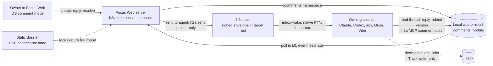
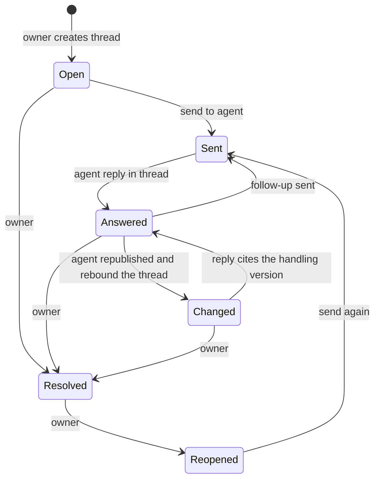

# SPEC EVOL — Local artifact review mode (claude.ai-like comments) over cluster-mesh

| Field | Value |
| --- | --- |
| Status | Specification only. No product code, no test execution, no Track write is claimed by this document. |
| Date | 2026-11-17 |
| Branch | `docs/artifact-review-spec`, cut from h2a `origin/main` `1a99a88f6` |
| Owner need | Verbatim of 2026-11-17 (conductor record `tmp/h-cond/artifact-review/VERBATIM-17-11.md`, untracked): « j'ai demandé d'avoir des artefact locaux avec un mode commentaire au desisng system assez vite pour reproduire le mode claude mais en local et avoir un peu plus de réactivité. cela devrait implique le sendmessage version h2a quelque soti la cli, l'usage des modules commentaire et la tracabilité du suivi des commentaire probablement faut probablement réfléchir a un truc autour des decision dossier pour le suivi des commentaires comme dans claude.ai » |
| Owner correction (binding) | « attention a la surcouche: ca doit passer impérativement via cluster-mesh côté api (il y a deja le metamodel de commentaire, ...) ». It replaces the earlier conductor proposal of an h2a-local store per dossier (edit-receipts pattern). h2a and Focus Web are **clients** of the cluster-mesh comments API; locally they use a local cluster-mesh. There is no h2a-owned comment store. |
| Sources read | h2a `origin/main` `1a99a88f6`; sentropic `origin/main` `ad8e685e5` (`@sentropic/comments` 0.3.1, `@sentropic/cluster-mesh` 0.27.0-dev.1; h2a pins cluster-mesh 0.25.0, whose comments module exists since 0.19.0); design system `origin/main` `ec3229f72`; claude.ai Docs connector guide `topic.comments` (read 2026-11-17). Evidence is listed in Appendix A. |

## 0. The feature in two diagrams

The lifecycle is a projection of three independent axes, each backed by canonical records (section 5): discussion state (`open` / `resolved`, audited), delivery (`sent` / `answered`), and source applicability (`exact`, `source-changed`, or retired from the current version), shown as a badge on any state.

## 1. Decisions (proposed contract)

| Id | Decision |
| --- | --- |
| AR-1 | The cluster-mesh comments module (`/comments` namespace) is the only system of record for threads, comments, versions, authorship and discussion state. h2a ships no comment store, no comment index, and no outbox holding comment content. A browser draft is a draft: it is never shown as saved. |
| AR-2 | "Local" means an explicitly configured local cluster-mesh comments endpoint. When it is absent or unreachable, Focus Web shows `comments unavailable (missing binding)` and writes nothing anywhere, mirroring the memory provider refusal (`packages/h2a/src/registry/memory-provider.ts`). There is no fallback store. |
| AR-3 | h2a reuses the host mapping that Sentropic already specified for its deployed overlay (`spec/SPEC_EVOL_UI_ANNOTATE_OVERLAY.md` §4): one annotation revision, one initial thread structure revision and one comment revision per new thread; human attribution for the owner, AI attribution for agents; discussion state in the operation-audit chain; anchor evidence in a host semantic profile. It does not fork that mapping. |
| AR-4 | Anchor authority is the Focus node identity (`targetRef`, h2a #378), the same "block" identity the DS carries opaquely (DS spec Appendix A). Each anchored node is a `ResourceRef`; the document is a secondary resource. Text quotes and paragraph ids are profile evidence until a geometry-free anchor slot exists (request R10). Diagram regions use the canonical box/circle visual anchors. |
| AR-5 | A republished artifact never silently re-attaches a thread. The resolver outcome is shown. The session that handled a thread rebinds it explicitly to the new version (structural trigger `resource-rebinding`), which is the link "thread → version that handled it". |
| AR-6 | The owner writes as the verified local owner principal (attribution `human`). An agent writes as the principal bound to its own h2a identity (attribution `ai`). The Focus relay identity that signs the h2a envelope is a transport signer only and never authors a comment. |
| AR-7 | "Send to agent" is `h2a send` (signed, `local` or `cluster-mesh` backend), deposited in the root the target reads. The message carries identifiers and hashes only, never the comment body; the agent re-reads the thread from cluster-mesh with its own configured endpoint. The unsigned `h2a inbox put` path used by existing Focus routes is not reused. |
| AR-8 | The recipient is the owning session, resolved by an explicit ladder with visible ambiguity; every h2a CLI host prefix is accepted (the current Focus Web filter drops `muse:` and `vibe:`, defect H1). |
| AR-9 | The reply path is the agent writing into cluster-mesh through h2a MCP comment tools that are thin API clients. In L0 the reply id is preallocated by Focus Web; listing and an event feed replace that once cluster-mesh exposes them. |
| AR-10 | No failure is silent: Focus Web shows one of a closed list of states with the next possible move (section 4.5). |
| AR-11 | Traceability is computed from canonical records. Track receives selections and links from the repository's Track writer; Focus Web never writes `.track`. |
| AR-12 | A D# answer is an owner comment whose body carries the decision-answer profile; the response line is a projection of those comments. The Track writer records `track decision select` only after checking the comment's principal and attribution in cluster-mesh. A message never proves consent. |
| AR-13 | Static dossiers stay offline (CSP `connect-src 'none'`, `form-action 'none'`): they embed a read-only snapshot at build time and export a `focus.return` file whose notes and answers are imported into cluster-mesh with import provenance. |
| AR-14 | The UI is the design-system kit only (artifact shell AS-1 and comment/annotate blocks). Focus Web is the dossier binding of owner decision G3 (adapter from model to DS props); it builds no parallel widget. A missing DS block is a DS request. |

## 2. Surfaces and what each supports

Focus Web comes first (read and write). Static dossiers come second (import and export of a comment file). The ui-render MCP App is listed because its `comment` intent already exists in the schema.

| Capability | Focus Web (`h2a focus serve` / `web`) | Static dossier (`packages/h2a/focus-kit`) | ui-render MCP App |
| --- | --- | --- | --- |
| Network | Loopback server (default `127.0.0.1:5178`, non-loopback `Host` rejected); the server calls cluster-mesh, the browser never does | None: CSP `default-src 'none'; connect-src 'none'; form-action 'none'` | Host-mediated `postMessage` only |
| Read threads | Live from cluster-mesh | Read-only snapshot embedded at build, labelled with its capture time and per-thread applicability | Not in scope before L6 |
| Create, reply, edit, delete | Yes (delete = tombstone) | Write notes and answers offline, export a `focus.return` file (to build: the contract and `freezeReturn` exist in `@sentropic/focus/editing`, no renderer calls them today) | `comment` intent consumer (L6) |
| Anchors | Node (`targetRef`), document; text quote and paragraph as evidence; diagram box/circle | Node (`targetRef`) and document, as in `FocusReturn.notes[].targetRef` | The intent `target` string |
| Send to agent | Yes | After import (`h2a focus feedback` import, then send from Focus Web) | The MCP host conversation itself (`ui/message`) |
| Resolve, reopen | Owner only | No | No |
| Decision dossier answers | Option cards and comment boxes write answer comments; response line projected | Response line in the page; answers leave in the `focus.return` file (L5) | `choose-option` intent |
| Version shown | Current version plus per-thread applicability badge | Version of the build | Version rendered |

## 3. Comment API and storage through cluster-mesh

### 3.1 Client architecture

- **Endpoint.** Focus Web reads one configured local cluster-mesh comments endpoint (proposed variable `H2A_COMMENTS_ENDPOINT`, plus a credential reference resolved from the environment, never printed, never passed as a tool argument). The browser talks only to new Focus Web routes; those routes call the cluster-mesh router. Write routes require `application/json`, keep SvelteKit's default origin check and compare `Origin` with the served loopback origin, because "send to agent" places text in front of an agent.
- **What exists today.** The canonical router (sentropic `packages/cluster-mesh/src/hono/comments-router.ts`) serves, for annotations, threads and comments: `GET /:id`, `GET /:id/revisions`, `POST /` (create), `POST /:id/revisions` (revise, with CAS and an idempotency key), and `POST /:id/lifecycle` (archive, restore, tombstone, purge intent). Reads are by identifier only. The operational storage registration exists for PostgreSQL only (`createCommentsPostgresRegistration`); the SQLite backend does not register comments operations (its Lot 1 durable profiles are `atomic-units-v1` and `immutable-chains-v1`). No runnable local comments host ships in the package (no `bin`). These facts make R1 the critical dependency of every lot that persists a comment.
- **Ports the host supplies.** The router refuses to start without an operational store and injected `capabilities`, `resolver` and `decisions` ports; the namespace composition (`createCanonicalCommentsNamespaceModule`) also needs a verified invocation context and a host grant resolver. Locally, the resolver for h2a artifacts is supplied by h2a as resource owner (the metamodel gives the host its resource registry and source-to-version mapping, sentropic `SPEC_EVOL_COMMENTS_ANNOTATIONS.md` §4.2), loaded by the local host as a trusted module, the same seam pattern as `H2A_CLUSTER_MESH_MODULE` for messaging (spec `2026-09-15-SPEC_EVOL_cluster-mesh-send.md` D3). This is request R8.
- **Decision evidence.** Ordinary comments carry an empty `decisionRef`; the router checks decision evidence only when one is supplied (sentropic `packages/cluster-mesh/src/comments/http-authority.ts:17`). G4 evidence binds review and revision execution; it is not used to carry D# answers.

### 3.2 Mapping onto the existing metamodel

Every row cites the canonical carrier. "h2a value" lists only values of existing fields (namespaces, kinds and ids are host-chosen strings); no field is added to canonical records. `anchors.ts`, `revisions.ts`, `lifecycle.ts`, `commands.ts` and `submissions.ts` are in sentropic `packages/comments/src/`; `postgres.ts` is in sentropic `packages/cluster-mesh/src/comments/`.

| Need | Canonical carrier | h2a value or rule | Status |
| --- | --- | --- | --- |
| Scope | `CanonicalScope {tenantId, workspaceId}` (`anchors.ts:17`) | From the local host grant; never chosen by the browser | Exists; local grant is R7 |
| Artifact | `ResourceRef {scope, namespace, kind, id}` | `namespace: h2a.focus`, `kind: dossier` or `report`, `id` = document `ref` | Exists |
| Anchored node | `ResourceRef` | `kind: dossier-node`, `id` = `<document ref>#<targetRef>`; annotation primary = node, `secondary` = [document] | Exists (node-as-resource, Q9) |
| Artifact version | `SourceVersionIndicator` `observed` (`anchors.ts:28`) | `sourceVersion` = digest of the node's canonical content; `evidence` names the Focus client version and the document `baseHash` | Exists |
| New thread | `AnnotationRevisionRecord` + `ThreadStructureRevisionRecord` (trigger `initial-registration`) + `CommentRevisionRecord` (`revisions.ts:434`, `:449`, `:462`) | Overlay §4 shape; annotation `body.text` is deterministic, non-secret text; owner prose only in the comment body | Exists; atomic create over HTTP is R2 |
| Reply | `CommentRevisionRecord.parentCommentId` (immutable) | Parent = root comment, flat like claude.ai replies under the root | Exists |
| Edit | New comment revision, CAS on the head hash | Owner edits own comments only | Exists |
| Delete | Lifecycle `tombstone` (irreversible) | Never a hard delete; a deleted root never promotes a reply | Exists |
| Owner authorship | `registration.principal` (verified grant) + `DocumentaryAttribution` `human` (`revisions.ts:37`) | Local owner principal | Exists; principal is R7 |
| Agent authorship | `DocumentaryAttribution` `ai`, `sourceLocalId` | `sourceLocalId` = h2a instance id; `evidence` = h2a envelope id; never impersonates the owner (overlay §4) | Exists; principal is R7 |
| Anchor evidence | `RevisionBody.profile` (`SemanticProfile`, `revisions.ts:157`) on the annotation revision | Host profile `h2a.focus-annotation` v1: `targetRef`, `paragraphId`, anchor label, quote/prefix/suffix, render version; scalars and nested objects only (overlay rule: no arrays) | Mechanism exists; admission is R9 |
| D# answer | `RevisionBody.profile` on the comment revision | Host profile `h2a.focus-decision-answer` v1: decision code, question id, option ids (an ordered nested object, since profiles reject arrays), Track decision id; `body.text` holds the readable line and the note | Mechanism exists; admission is R9 |
| Sent (exact content) | `PreparedSubmissionManifest` + receipt (`submissions.ts:43`), capability `submit-to-ai` (`commands.ts:29`) | Pins the annotation revision and the selected comment revisions sent | Model exists; route is R5 |
| Recipient and delivery | Operation audit, subject `assignment` (`lifecycle.ts:182`), `detail` | Assignee = agent principal; `detail` = instance, root, envelope id, deposit outcome | Model exists; route is R4 |
| Resolved, reopened | Operation audit, subject `discussion-state`; capability `resolve-discussion` (`commands.ts:20`) | Owner only; never a validation (sentropic F5) | Model exists; route is R4 |
| Diagram region | `visualAnchors[]`: box/circle on a capture frame (`revisions.ts:112`) | DS lasso points and "note" markers stay profile evidence (overlay precedent) | Exists |
| List by artifact or thread | Storage query `by-resource` (`postgres.ts:50`), thread→comment coverage relation | Not exposed by the router | Gap R3 |
| Live updates | `CommentEvent` wire taxonomy in `@sentropic/comments` | No feed on the canonical module | Gap R6 |

### 3.3 Anchors stable across rebuilds

1. The producer keeps node identity: `targetRef` is authored and stable; paragraph ids are carried explicitly across revisions by the editing manifest (`carryManifest`, "never matches by text similarity", `packages/focus/src/editing/anchors.ts`).
2. The router admits reads and writes only when every target resolves to `exact` or `source-changed` (`http-authority.ts`); `unresolved` and `unavailable` deny. The h2a resolver behind that authority port therefore answers for the retained node resource, as the overlay rule R5 does for pages: same node digest gives `exact`, any other digest gives `source-changed`, including a node retired from the current version, so its thread stays readable and answerable. `unavailable` is reserved for a real authorization or retention denial. Whether the node is present, changed or retired in the current render is UI evidence computed by Focus Web, never an input of the authority port.
3. Re-anchoring is explicit: a new structure revision (`reanchoring` or `resource-rebinding`, `revisions.ts:17`) is written by the session that handled the thread or by the owner. Old comments keep their pinned structure hash; new replies pin the new one.
4. Selectors, coordinates and URLs are hints only (sentropic §4.2). The DS returns an opaque block key and Focus Web maps it to the node; the DS never resolves anchors (DS spec §0.3 and §13).

### 3.4 Requests to sentropic, cluster-mesh, the DS and Track

Gap list (13 requests), each with the lot it blocks

| Id | To | Request | Blocks |
| --- | --- | --- | --- |
| R1 | cluster-mesh | A runnable local comments host ("cluster-mesh local"): `/comments` namespace composition, a local storage profile (SQLite comments operations, the C3 lot of the sentropic spec; or a documented local PostgreSQL profile), local ports and a stable URL. | L0 and all persistence |
| R2 | cluster-mesh | Atomic creation of annotation + thread + first comment in one request (the overlay commit flow already requires one module transaction). L0 interim: three requests with preallocated ids, "saved" shown only when all three read back. | L0 (interim exists) |
| R3 | cluster-mesh | List threads and annotations by resource (expose the existing `by-resource` query; secondary targets included) and list comments by thread. | L1 (L0 uses id probing) |
| R4 | cluster-mesh | Discussion operations: resolve and reopen (`discussion-state` audit, `resolve-discussion` capability) and assignment. | L1 |
| R5 | cluster-mesh | Prepared submission route (`submit-to-ai`) with recoverable receipt; the router already reserves the `submissions` path segment. | L1 |
| R6 | cluster-mesh | Change feed (server-sent events) of comment events for a scope or resource. | L1 (L0 polls) |
| R7 | cluster-mesh | Local principals: evidence for the local owner, and for h2a instance identities (Ed25519 keys, as the messaging custody signer D4), mapped to agent principals. | L0 |
| R8 | cluster-mesh | Injectable `ResourceResolverPort` and `CapabilityCheckPort` for `h2a.focus` resources (owner: all capabilities including `resolve-discussion`; agents: `read`, `comment`). | L0 minimal, L3 full |
| R9 | cluster-mesh | Admission of the host profiles `h2a.focus-annotation` v1 and `h2a.focus-decision-answer` v1 (digest-pinned schemas). | L4 |
| R10 | sentropic comments | A geometry-free binding for field, text and UI anchors in annotation revisions (today anchors live only in `VisualAnchorBinding`, which requires a frame and a shape), through the contract amendment procedure; or confirmation that node-as-resource is the intended form. | L6 |
| R11 | cluster-mesh | Optional: a comments MCP builtin, as for the engram memory builtin, so agents use cluster-mesh tools instead of h2a client tools. | Optional |
| DS-1 | design system | `CommentListItem`, thread panel, pins (`PinDisplay` provision), version select (artifact shell AS-2 and later). L0 composes AS-1 with the existing `UtilityPanel`/`ContextPanel`. | L1 |
| TR-1 | Track | A native link between a decision and a comment thread, and a reopen or supersede path for a settled decision (`go` and `no-go` are terminal). | L4 (Q7) |

## 4. Routing: "send to agent"

### 4.1 Flow

1. The owner presses "Send to agent" on a saved thread (never on a draft).
2. Focus Web resolves the owning session (4.2), preallocates the reply comment id, and runs `h2a send <instance> <pointer> --root <target root>` signed by the Focus relay identity (Q2). The message carries the pointer fields of Appendix B only.
3. The receiver's MCP sidecar sees the new inbox envelope and injects the signed, visible wake line (`[h2a-wake reason=inbox …] … run /h2a receive`) through the `auto` chain: native PTY backchannel, then local tmux (`packages/h2a/src/cli.ts:2550`). Success of `h2a send` means deposit (and, for the cluster-mesh backend, transport acceptance), not reading.
4. The agent reads the pointer, fetches the thread from cluster-mesh with its own endpoint, checks scope and hashes, acts, and replies with the preallocated id (attribution `ai`). If it republished the artifact, it first rebinds the thread to the new version and then replies, so the reply pins the handling version (the local analogue of claude.ai `answering: <root id>`).
5. Focus Web shows the reply (polling in L0, feed after R6).

### 4.2 Owning session resolution

The existing ladder in `apps/focus/src/lib/server/h2a-target.js` is reused, with one rung added and one defect fixed:

1. explicit choice in the UI; 2. operator pin `FOCUS_H2A_TARGET`; 3. **new:** the artifact's recorded producer instance (the `Production.producerId` correlation already retained by `h2a focus feedback retain`), if live; 4. the emitter `FOCUS_EMITTER_INSTANCE`, if live; 5. live sessions whose `workspace.path` is this checkout or its main worktree; 6. name match; 7. sole live session.

An explicit target that is not live is reported, never replaced. Several candidates are shown as a choice. The root travels with the instance and the envelope goes to that root (the include route passes it, the decision inject route does not: defect H2). The host filter must accept every h2a CLI host (`claude`, `codex`, `gemini`, `agy`, `hermes`, `opencode`, `muse`, `vibe`), not the current six (defect H1).

### 4.3 Wake per CLI

| CLI | Instance prefix | Focus Web target (main) | h2a MCP sidecar (main) | Wake transport | State |
| --- | --- | --- | --- | --- | --- |
| Claude | `claude:` | accepted | shipped (`host setup`; central by default on Linux) | sidecar `--wake auto`: native PTY, then tmux | L0 target. The send spec acceptance covers PTY and tmux. |
| Codex | `codex:` | accepted | shipped | same chain | L2; live qualification pending |
| agy | `agy:` | accepted | historical direct rendering, unqualified; no hook | PTY in the in-flight cross-CLI lane (PR #379, not on main); measured 6.3 to 27.5 s there | L2; unqualified |
| Muse | `muse:` | **dropped** (H1) | historical direct rendering, unqualified | PTY needs paste framing, fixed only in PR #379 (R36) | L2; blocked by H1 and #379 |
| Vibe | `vibe:` | **dropped** (H1) | interim direct entry (`host setup --host vibe --write`) | sidecar chain; native qualification pending | L2; blocked by H1 |

A session that is not under the native terminal host and not in tmux is not woken: the envelope waits in its inbox (`dormant`).

### 4.4 Reply path

- **Agent tools (Q8).** `h2a_comment_read` (thread by pointer) and `h2a_comment_reply` (create the preallocated comment, optional rebinding to a version digest) are h2a MCP tools acting as cluster-mesh clients. They keep nothing locally. A host whose h2a MCP tools are not installed cannot reply; Focus Web then shows `sent, no reply` and the per-host reason from 4.3.
- **No resolve by agents.** As in claude.ai, an agent does not resolve a thread the owner wrote in; it may say in its reply that the point is handled. The local capability policy grants `resolve-discussion` to the owner only (R8).

### 4.5 Visible failure states

Closed list of states shown on a thread (11 states)

| State | Trigger | Next move offered |
| --- | --- | --- |
| `comments unavailable` | No endpoint configured, unreachable, or missing binding | Configure the endpoint; draft kept unsaved |
| `not saved` | cluster-mesh refused (`400`, `403`, `409`) | Edit or retry; on `409` reload the head |
| `no target` | No live session or h2a binary missing (existing `explainNoTarget`) | Pick a live session or launch one |
| `ambiguous target` | Several sessions answer for this artifact | Choose one |
| `chosen session not live` | Explicit choice not live | Choose another; nothing was redirected |
| `deposited, session dormant` | `recipientLive: false` | Wait, relaunch or redirect |
| `send timeout` | cluster-mesh messaging backend did not acknowledge within 10 s | Retry (same pointer, idempotent) |
| `sent, waiting` | Within the receiver wake bound | None |
| `sent, no reply yet` | Bound exceeded (in-flight calibration: Claude 10 s, agy 30 s, Muse 10 s; unverified on main) | Resend, redirect, open the session |
| `reply refused` | Agent tool denied (scope, capability, hash mismatch), reported by the agent | Fix scope or ask the owner |
| `source changed` / `retired in current version` | Resolver outcome and Focus Web comparison on read | Open the commented version; ask for rebinding |

## 5. Traceability

### 5.1 Lifecycle to canonical records

| State | Canonical evidence | Actor |
| --- | --- | --- |
| Open | Structure revision `initial-registration` and root comment; no `discussion-state` event, or the last one is `reopen` | Owner |
| Sent | Submission manifest (exact revisions) and `assignment` audit (recipient, envelope id, deposit outcome), from L1; in L0 only the deposit result is shown | Owner action, Focus relay transport |
| Answered | A comment with attribution `ai` by the assignee principal after the last sent record (projection) | Agent |
| Changed | Either the resolver reports `source-changed` since the comment, or the agent wrote a `resource-rebinding` structure revision to the handling version | Agent or owner |
| Resolved | `discussion-state` audit `resolve` | Owner |
| Reopened | `discussion-state` audit `reopen`; history keeps every prior event | Owner |

The link to the version that handled a thread is the structure revision's `primary.source.sourceVersion` together with the reply's `structureRevision` pin. Archive, assignment and resolution never change content hashes (sentropic §4.4).

### 5.2 Decision dossiers

- **Option cards and comment boxes.** Each comment box of the existing response kit becomes a thread anchored to the question node or the option node (today `data-note-field` anchors such as `D1` and `D1A` in the conductor dossiers). Choosing an option card writes a decision-answer comment on the question thread. The response line ("D1 B — label · D2 — …") is a projection of the latest owner decision-answer comment per question; an unanswered question never implies consent (`packages/focus-interactive/src/response-line.ts`). Copy and export stay as the fallback, as the agent-memory dossier route already states.
- **Recording.** After the send, the owning session or the conductor (the Track writer) reads the answer comment, checks principal and attribution, then runs `track decision select <decision> <option>`. A refused selection (already selected, unknown option) is replied in the thread. This matches the order "record, then inform" of the native right panel proposal (PR #463), adapted to the single-writer rule.
- **Reopening a D#.** A thread on a settled decision cannot reopen it in Track (`go` and `no-go` are terminal, `packages/track/src/model/decision.ts:210`). The proposed path is a new decision linked to the settled one (Q7, TR-1).

### 5.3 Track records

| Event | Track record | Writer |
| --- | --- | --- |
| Owner comment answering a D# | `track decision select`, plus the thread locator linked on the decision's target item (`track item link --kind comment-thread`) | Track writer (conductor in h2a) |
| Owner comment without a D# | Link of the thread locator on the concerned item (h-cond rule: a link with the verbatim) | Track writer |
| Artifact version that handled threads | `track decision add-artifact <decision> --kind rendered-view --view-ref <rendered dossier> --source-dossier-hash <version digest>` (the `h2a-decision-dossier` kind requires a negotiation reference, which Focus dossiers do not have); item link for other artifacts | Track writer |
| PR that implements a thread | Existing `pr-open` / `pr-merged` links; a merge never resolves a thread (overlay §4) | Track writer |

Comment bodies never enter Track, h2a messages or logs; only locators and hashes do. The locator format is `cluster-mesh:comments/<workspaceId>/threads/<threadId>@<structureRevisionHash>`.

## 6. Lots, smallest first

Every lot runs targeted test files with temporary directories (`TMPDIR`, `XDG_RUNTIME_DIR` under the lane directory). A test that needs the local cluster-mesh endpoint fails with an explicit reason when it is absent; it never skips silently.

### L0 — Focus Web overlay, threads in the local cluster-mesh, send to the owning Claude session

"Locally" means the local cluster-mesh endpoint (owner correction), not an h2a store.

- **Scope.** Focus Web comments client and routes (create thread, reply, read, send); DS AS-1 comment mode (`CommentModeToggle`, `CommentModeStatus`, `BlockHighlightOverlay`, `BlockCandidateList`) and a thread panel composed from `UtilityPanel` and `ContextPanel` (Focus Web pins `@sentropic/design-system-svelte` `^0.34.40` today: the lot raises it and adds `@sentropic/design-system-artifact-shell` once its release is verified on the registry); node anchors only; discovery by deterministic id probing (Q4); `h2a send` to `claude:` sessions; agent tools `h2a_comment_read` and `h2a_comment_reply`; reply polling.
- **Blocking dependencies.** R1 and R7; R8 minimal.
- **Acceptance.**
  1. No endpoint: the banner reads `comments unavailable (missing binding)`; no file is created under the repository, `.h2a` or the lane directory.
  2. Create a thread on node `D3`: annotation, structure and comment revisions read back by id; the UI shows "saved" only after the three reads; a kill between two writes is repaired on reload from the preallocated ids.
  3. Send: one signed envelope lands in the Claude session inbox inside the session's own root; its text contains no comment body; the result shows recipient, root and `recipientLive`.
  4. No live Claude session: `no target` with remedy; no envelope is written; the thread is unchanged.
  5. The agent replies through `h2a_comment_reply`: the reply shows in Focus Web with attribution `ai` and the agent principal; the owner comment is unchanged.
  6. A pointer naming another scope or a wrong hash: the agent tool refuses (non-enumerating `404` or `403`) and writes nothing.
  7. Regression: the static renderer CSP and the existing decision inject and include routes are unchanged.

### L1 — Persistent lifecycle

Resolve and reopen (owner only), sent records, answered projection, listing and feed. Needs R3, R4, R5, R6 and DS-1. Acceptance: reload keeps every state; an agent's resolve is denied; reopen keeps history; a resend after a failed send reuses the same submission manifest; probing and polling are removed.

### L2 — Every CLI

Fix H1; per-host wake bound and `sent, no reply yet`; per-host reason when reply tools are absent. Acceptance: target resolution returns `muse:` and `vibe:` sessions; fake-driver tests per host; real-seat evidence is taken from the cross-CLI lane once merged, not claimed here.

### L3 — Versions and republication

h2a resolver module (R8 full); explicit rebinding by the handling session; per-version history view. Acceptance: rebuild without node change gives `exact`; a changed node gives `source-changed`; a retired `targetRef` shows `retired in current version` while the thread stays readable and answerable (authority outcome `source-changed`); paragraph ids follow the manifest and never text similarity.

### L4 — Decision dossiers

Answer comments with the decision-answer profile (R9), response line projection, Track selection by the writer, reopen through a linked decision (TR-1 or Q7 option A). Acceptance: the projected response line equals the latest owner answers; Track selection happens only after the principal check; a second selection is refused and replied in the thread.

### L5 — Static dossiers import and export

Build-time snapshot embed (read-only); a renderer export of notes and answers as a `focus.return` file (existing `FocusReturn` v1 contract: `source.baseHash`, `notes[].targetRef`, `answers[]`, produced through `freezeReturn`, which no renderer calls yet); import into cluster-mesh with `ImportExecution` provenance (source record = `returnId`, source digest = return `digest`), each note becoming its own thread when no reply relation is evidenced (sentropic §4.1). Optional: the importer also reads the conductor response-kit JSON (`ownerComments[]` with `anchor`, `kind`, `label`, `when`, `text`), which today leaves only by copy and paste. Acceptance: the CSP is unchanged; importing the same return twice creates nothing new; a tampered digest is refused; a note on a retired `targetRef` is reported, not dropped.

### L6 — Text ranges, diagrams, ui-render

Text-range anchors after R10; diagram regions with box/circle and lasso evidence; ui-render `comment` intent consumer (the DecisionDossier catalog entry permits only `choose-option` today; DS-2) with attribution recorded as host-relayed.

## 7. Open questions, options and recommendation

| Id | Question | Options | Recommendation |
| --- | --- | --- | --- |
| Q1 | Where does the local comments host come from, on which storage? | A. Sentropic ships a runnable local host on SQLite comments operations (C3). B. Same host on a local PostgreSQL (none on the reference machine's `PATH`). C. h2a composes the cluster-mesh module inside `h2a focus serve` (h2a becomes the host). D. An h2a store. | **A**, with **B** as interim where PostgreSQL exists. C only on explicit owner GO, because it moves h2a from client to host. D is excluded by the owner correction. |
| Q2 | Who signs the "send to agent" envelope? | A. A dedicated Focus relay identity, registered explicitly once. B. The emitter session's identity. C. Unsigned `inbox put`. | **A**: transport signer only, never an author. B misattributes; C contradicts the send spec (no unsigned fallback). |
| Q3 | Which principal authors owner comments locally? | A. A local owner principal issued by the local host, presented by the Focus Web server (loopback only). B. The relay identity acting as owner. C. An unauthenticated `focus:local-human` label. | **A**. B impersonates; C has no authentication. Focus Web refuses comment writes when bound to a non-loopback host. |
| Q4 | How does L0 find threads without a listing API? | A. Deterministic ids probed until `404`: thread `<sha256 of the resource key>.t<n>`, comment `<thread id>.c<n>` (one URL path segment; the router refuses empty ids and reserved words such as `threads`), with creation CAS refusing duplicates. B. An h2a index of ids. C. Wait for R3. | **A** as interim, removed by R3. B is an overlay index the owner warned about. |
| Q5 | What records "sent"? | A. Submission manifest plus `assignment` audit. B. `assignment` audit only. C. The h2a envelope only. | **A**: exact content and recipient both canonical. |
| Q6 | Who writes Track for comment-borne answers? | A. The Track writer after checking the comment. B. Focus Web writes `.track`. C. No Track record. | **A** (single writer; no `.track` write from a PR branch or from Focus Web). |
| Q7 | How does a thread reopen a settled D#? | A. A new decision linked to the settled one. B. A Track reopen or supersede verb (TR-1). C. Comment only. | **A** now, **B** requested. |
| Q8 | Which tools do agents use to read and reply? | A. h2a MCP tools as thin clients. B. A cluster-mesh comments MCP builtin (R11). C. A CLI verb. | **A** now, **B** as target. C is blocked by the Claude guard on manual `h2a` shell use. |
| Q9 | How is a node anchored without a geometry-free slot? | A. Node as resource, document as secondary. B. Wait for R10. | **A** now; R10 decides the long-term form. |

## 8. Security and privacy

- Comment bodies stay inside cluster-mesh; h2a envelopes, wake lines, logs and Track carry identifiers and hashes only. Wake lines already carry no message text.
- Local inbox content is not authenticated on read (owner-gate spec); the agent treats the pointer as a hint and the cluster-mesh records as the authority.
- The pointer never carries an endpoint, so a forged message cannot redirect an agent to another server.
- Credentials for the local host stay in the environment of the Focus Web server and the MCP sidecar, are never printed, and never reach the browser or tool arguments.

## 9. Not covered

Review and validation of annotations (submit, validate, contest), which claude.ai does not have; multi-owner sharing and remote access; real-seat cross-CLI qualification (owned by PR #379); DS component implementation; cluster-mesh implementation; any Track write.

## Appendix A — Evidence

h2a (origin/main 1a99a88f6)

| Fact | Location |
| --- | --- |
| Focus Web bind, loopback `Host` check, emitter variable | `packages/h2a/src/runtime/focus/serve.ts:20-21`, `:309-322`, `:369-375`, `:280` |
| Focus routes deposit unsigned envelopes through `h2a inbox put` | `apps/focus/src/lib/server/h2a-bus.ts:248-276` |
| Decision inject omits the target root; include passes it | `apps/focus/src/routes/api/decisions/inject/+server.ts:83`; `apps/focus/src/routes/api/dossiers/agent-memory/include/+server.ts:171` |
| Target ladder and host filter without `muse`/`vibe` | `apps/focus/src/lib/server/h2a-target.js:14-22`, `:28` |
| h2a CLI hosts include `muse` and `vibe` | `packages/h2a/src/cli.ts:421-430` |
| Static renderer CSP | `packages/h2a/focus-kit/renderer.html` (meta CSP) |
| Edit-receipts atomic write and writer lock; retained returns | `packages/h2a/src/runtime/focus/edit-receipts.ts:11-29`; `packages/h2a/src/focus-feedback.ts:51` |
| `FocusReturn` v1 (source hashes, notes, answers) | `packages/focus/src/editing/contract.ts:16-24` |
| Node identity `targetRef` | `packages/focus/src/model.ts:19-24`, `:39-44` |
| Signed send, 64 KiB, backends | `packages/h2a/src/runtime/send.ts:23`, `:239-281`; `docs/specs/2026-09-15-SPEC_EVOL_h2a-send.md` D3, D7, D8 |
| Wake line and wake chain | `packages/h2a/src/wake.ts:46-56`; `packages/h2a/src/cli.ts:2550` |
| ui-render intents and `comment` forwarding | `packages/h2a/src/runtime/mcp/ui-render/tools.ts:47`; `resources.ts:211`; vendored catalog `DecisionDossier` events `["choose-option"]` |
| Track decision verbs, artifact kinds, terminal outcomes, item links | `packages/track/src/cli/index.ts:139`, `:1016-1121`, `:771-794`; `packages/track/src/model/decision.ts:210-215`; `packages/track/src/track.ts:503-504` |
| Memory provider refusal pattern | `packages/h2a/src/registry/memory-provider.ts` |
| Host matrix (MCP and hooks per CLI) | `docs/host-integration-matrix.md` |

sentropic (origin/main ad8e685e5) and design system (origin/main ec3229f72)

| Fact | Location |
| --- | --- |
| Model ownership F1–F5 (comments owns the model, cluster-mesh owns storage and API, no second annotation package, resolution is not validation) | sentropic `spec/SPEC_EVOL_COMMENTS_ANNOTATIONS.md` §1 |
| Records, anchors, applicability, proposed routes and the "Prepare/send to AI" flow | same, §4.1, §4.2, §5, §7.1 |
| Host mapping precedent (page resource, UI anchor, three records per thread, discussion state in audit, delivery metadata only, no second store) | sentropic `spec/SPEC_EVOL_UI_ANNOTATE_OVERLAY.md` §1 (S6), §4 |
| Anchors and outcomes | `packages/comments/src/anchors.ts:17`, `:28`, `:52`, `:88`, `:113` |
| Revisions, triggers, attribution, profile, visual anchors | `packages/comments/src/revisions.ts:17`, `:37`, `:112`, `:157`, `:434`, `:449`, `:462` |
| Lifecycle and operation-audit subjects | `packages/comments/src/lifecycle.ts:182` |
| Capabilities incl. `resolve-discussion`, `submit-to-ai` | `packages/comments/src/commands.ts:20`, `:29` |
| Submission manifest | `packages/comments/src/submissions.ts:43` |
| Canonical router routes; id rule and reserved segments | `packages/cluster-mesh/src/hono/comments-router.ts:18-47`; `packages/cluster-mesh/src/comments/http-boundary.ts:48-61` |
| Decision evidence only when supplied | `packages/cluster-mesh/src/comments/http-authority.ts:17` |
| PostgreSQL-only operational registration; `by-resource` query | `packages/cluster-mesh/src/comments/postgres.ts:50`; `postgres-queries.ts:26-34` |
| SQLite Lot 1 durable profiles | `packages/cluster-mesh/src/storage/sqlite/index.ts:60` |
| Namespace composition | `packages/cluster-mesh/src/compose/comments.ts` |
| Comments module since 0.19.0 | `packages/cluster-mesh/CHANGELOG.md` |
| Legacy application table (`context_type`, `context_id`, `section_key`, `status`, `thread_id`, `tool_call_id`) and its cutover to the cluster-mesh namespace | `api/drizzle/0020_add_comments.sql`; `api/src/routes/namespaces/comments-cutover.ts` |
| Ownership G3: DS presentation only, sentropic data model, Focus/h2a dossier binding; opaque anchor; Appendix A anchor fields | DS `spec/SPEC_EVOL_DS_COMMENT_ANNOTATE_BLOCKS.md` §0.2, §0.3, §13, Appendix A |
| Artifact shell AS-1 components and `PinDisplay` provision | DS `packages/artifact-shell/src/lib/types.ts` (`@sentropic/design-system-artifact-shell` 0.1.0) |
| Panels and labelled icon button available; `CommentListItem` not yet | DS `packages/components-svelte/src/lib/` (`@sentropic/design-system-svelte` 0.41.5) |

claude.ai reference behaviour (Docs connector guide, topic.comments)

| Behaviour | Local equivalent |
| --- | --- |
| A thread is its first comment; replies have the root as parent; a resolve is a row of the thread | Root comment; `parentCommentId` = root; `discussion-state` audit |
| A comment born "to Claude" carries `answered` once Claude replied | Sent record, then answered projection |
| A sent comment opens a turn naming the thread root; the agent reads the thread to its end, acts, and always replies under the root | Pointer with thread id; agent reads from cluster-mesh and replies with the preallocated id |
| An edit made for a thread is linked to it (`answering: <root id>`) | Explicit `resource-rebinding` to the handling version, pinned by the reply |
| Agents resolve only when the person asked in chat | `resolve-discussion` held by the owner only |
| Anchors are exact words or a block; a whole-document note has no anchor | Node or document resource; quote as profile evidence |
| Limits: 1000 threads per document, 100 comments per thread, 4096-byte bodies | Local limits come from the cluster-mesh capacity descriptor, not from h2a |

## Appendix B — Pointer carried by `h2a send`, and h2a-side defects

Pointer fields (ordinary signed message body, no new envelope type)

`kind` = `h2a.comment-request` v1; `scope` (tenant and workspace ids); `threadId`; `commentId` and its revision hash; `annotationId` and revision hash; artifact `documentRef` and version digest; `replyCommentId` (preallocated); `submissionReceipt` from L1. No endpoint, no body text, no credential. The first line is a short readable sentence naming the artifact and the anchor label; the agent must not act on that sentence alone.

Defects found on h2a main while grounding this spec

| Id | Defect | Location | Lot |
| --- | --- | --- | --- |
| H1 | Focus Web drops `muse:` and `vibe:` sessions from target resolution | `apps/focus/src/lib/server/h2a-target.js:28` | L2 |
| H2 | Decision inject deposits without the target root (a multi-root host can report success into an unread store) | `apps/focus/src/routes/api/decisions/inject/+server.ts:83` | separate fix |
| H3 | Existing Focus routes deposit unsigned envelopes (`actor: focus:local-human`) | `apps/focus/src/lib/server/h2a-bus.ts:248-276` | comments use `h2a send` |
| H4 | ui-render `onIntent` is not wired; no catalog component permits `comment` | `packages/h2a/src/runtime/mcp/ui-render/tools.ts:71-82` | L6 |
| H5 | Muse wake paste framing exists only in the cross-CLI lane | PR #379 (R36) | L2 |
| H6 | The edit-receipts state retains whole returns, notes included | `packages/h2a/src/focus-feedback.ts:51` | L5: comments are read from cluster-mesh only |

