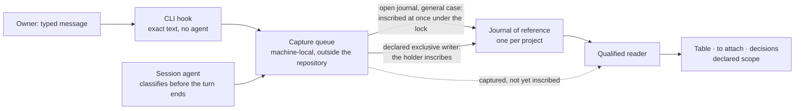

# SPEC EVOL — A Track owner table that works on its own, in every repository and every CLI

Date: 2026-11-20 · Delivery lot: **S** (specification) of the converged proposal on the Track owner table.
Status: specification only. This document adds no product code and no test code. Lot S ships two read-only scripts beside it (`scripts/owner-table-measure.mjs`, `scripts/owner-table-spec-check.mjs`) and one build plan per delivery lot under `plan/`.
Owner source: verbatim of 2026-11-19, relayed word for word — « pour le tableau track faut proposer qqchose, et puis si ça doit poser un pb partout ça doit être généraliste et fonctionner tout seul ». The verbatim stays authoritative over this spec wherever the two conflict.
Decision basis: proposal r2 by the architect, reviewed twice by an independent reviewer (round 1: accept with changes, 6 blocking findings; round 2: accept, no doubt left for the owner). Owner rule of 2026-11-20: a convergent consensus decides, only an unresolved doubt goes to the owner. Questions Q1 to Q6 are therefore **settled** (§2) and are not reopened here.
Review of this spec: one independent read of the spec and the plans against the code, folded in before merge (its findings are listed in the pull request).
Base: `origin/main` = `f7e89392f`. Every file cited in annex D is unchanged since the measurement base `e66d85c34`, so each `file:line` reference holds on both.
Layout rule (owner, 2026-11-16): schema first, no wall of text, long technical tables folded in annexes, no code in the body.
Conventions: **[FACT]** = verified, source cited. **[JUDGEMENT]** = the architect's assessment. `unknown` = not verified, listed in annex E.

## Overview



Three sentences carry the design. **The reader says what it knows and what it does not**: a gap about one element qualifies that element instead of refusing the whole table. **Something writes the demands**: the CLI captures the owner's words, the session classifies them, Track inscribes them. **The table says which journal it read**: one journal of reference per project, never the copy that happens to sit in the current folder.

## 1. Request and criteria

| Criterion | Source | Covered by | Accepted gap |
|---|---|---|---|
| « proposer qqchose » | owner, 2026-11-19 | Three options weighed; option C retained by convergence (§2) | — |
| « pb partout » | owner, 2026-11-19 | Measured: 22 of 23 main journals refuse, 1 renders (annex C) | — |
| « généraliste » | owner, 2026-11-19 | One mechanism for every folder and every CLI (§6, §7) | One CLI has a message hook known to deliver the text; two are to qualify, one is deferred, two are not covered (§7.7) |
| « fonctionner tout seul » | owner, 2026-11-19 | No step per repository or per session; inscription needs neither a looping conductor nor h2a (§7.3) | One installation per machine and per CLI. One designation for a project with several separate clones. Classifying a message stays an agent's judgement; its delay is counted and displayed. Where nothing proves a human session, a captured text is tracked but shown unquoted (§7.6) |
| The table never states something false; no false « aucune décision » | requester's instruction | V1: the absolute sentence is reserved to a complete scope (§3) | The absolute sentence is written nowhere by this evolution (§3, decision DS-1) |

## 2. Settled decisions — not reopened here

| Question | Decision | Rule in force that it amends |
|---|---|---|
| Q1 — approach | **C**: capture at the source, qualified rendering, journal of reference | — |
| Q2 — reach of a refusal | **B**: refusal per element; four global refusals; `--strict` keeps the global refusal for conductors and CI | Global refusal ratified on 2026-11-14 and 15; display of unnumbered demands outside the table; the absolute sentences become reserved |
| Q3 — capture | **A**, under five conditions: owner-only queue, secrets masked at capture, bounded purge, purge at classification, private terms masked at inscription | Manual inscription by the conductor (2026-11-07); freeze of `demand.*` writes (2026-11-19), lifted at lot 2 |
| Q4 — folders without a journal | **A**: automatic journal outside the repository, created at the first inscription | `track init` as the only creating command — still true inside a repository tree |
| Q5 — inheritance | **A**: everything is displayed at once, with its age | — |
| Q6 — decision numbers | **A**: stable number recorded at creation, at lot 2 | The contiguous `D1…Dn` sequence of the skill |

Six precisions were settled while the review findings were handled: the absolute sentence is reserved to a complete scope; write exclusivity is carried by the journal, in two modes; a project is recognised by its git identity and a local index designates its journal; numbering and reading always cover the entire journal; the queue is protected; one accountable actor per lot.

**Decisions taken by lot S** inside that frame. Each one applies a guard the second review asked lot S to integrate, closes a point the proposal left to this spec, or settles a contradiction the review of this spec found.

| Id | Decision | Origin |
|---|---|---|
| DS-1 | Condition (f) of V1 — agent questions asked in free text — is **declared not qualified by this evolution**. No lot of this spec emits the absolute sentences. Reopening needs a spec amendment that defines a mechanical qualification, reviewed like this one. | Left open by the proposal (its annex of unknowns). [JUDGEMENT] An agent's own attestation is not a detection; treating it as one would let the table state « aucune décision » on the agent's word. |
| DS-2 | An active capture queue **is a readable source**: the fourth global refusal does not fire, the table renders its header, the captured items and the partial-scope sentence with exit code 0, and no empty journal is created on disk. | Review round 2, guard 2 |
| DS-3 | An expired, unclassified trace can be **acknowledged** by an explicit command, so one expired message never freezes the gap counter. | Review round 2, guard 3 |
| DS-4 | **Activation sequence**: lots 3a and 3b precede 3c; the holder of this repository's journal declares itself as soon as lot 3a ships and before lot 3c activates any hook; the lift of the write freeze at lot 2 applies to other journals only. | Review round 2, guard 1 |
| DS-5 | In the default mode **only G1 to G4 refuse**. Every other check of the strict audit qualifies the element it concerns (annex B classifies all of them). The number registry gate concerns numbers from 1 up: a row without a number is always class E1. | Makes « each class of refusal » total |
| DS-6 | The journal of reference is resolved by **one new resolver**, used by the owner table and by every command this spec introduces, from the lot that introduces it. Existing verbs keep their resolver; unifying them is an open question, never a silent change. The resolver keeps the temporary-root ceiling of the existing one (§6.1). | Bounds the amendment of the resolution rule to what was converged |
| DS-7 | Document references are resolved **against the folder of the project that owns the item**, never against the current directory. Where that folder is not known, the reference is not checked and is counted. | Finding F-2 below |
| DS-8 | The journal-integrity refusal G1 **has to be built**: the owner-table read path does not check integrity today. | Finding F-1 below |
| DS-9 | **Attribution has three outcomes.** A capture is `owner` only on positive proof of a human session; with no proof and no sign of the contrary it is `doubtful`. A doubtful capture may become a demand; it is marked and never quoted. An injected line, a sub-agent and a background session never become a demand. | Review of this spec: the two rules written for Track alone and for h2a contradicted each other |
| DS-10 | **Capturing native agent questions is not built by the eleven lots.** Lot 3q qualifies whether the native question tool can be hooked on each CLI; the capture and its inscription as a pending decision are decided on that result, by an amendment of this spec. | Review of this spec: the payload of that tool is `unknown` per CLI and the existing write boundary needs fields no hook can supply |

**Two findings made while writing this spec.** Both are corrections of fact; neither changes a settled decision.

- **F-1 — the table renders a tampered journal.** [FACT] The owner-table read path only fails on an unparsable line (`events/store.ts:46-61`, `read/contract.ts:1258-1272`); it never runs the integrity check that `track validate` runs. Replayed on disposable copies of the one journal that renders: a `head.json` that disagrees with the stream, then an event whose content no longer matches its hash, both render with exit code 0 while `track validate` reports one integrity finding. The proposal listed journal integrity among the refusals that are *kept*; it is kept as a requirement and built at lot 1 (test T1-f).
- **F-2 — a desynchronisation finding depends on the caller's directory.** [FACT] `track validate` resolves document references against the current directory (`cli/index.ts:1873`, `cli/desync.ts:49`). The same journal validates clean from its own folder and shows one desynchronisation finding from another folder. The proposal reported that finding as a property of the journal; it is a property of where the command was run. The design consequence stands — a desynchronisation finding is a gap about one element, never a global refusal — and DS-7 is added so that reading a journal of reference from another folder cannot invent or hide such a finding.

## 3. Invariants

V1 to V3 come from the proposal. V4 to V11 were rules stated in its sections on resolution and capture; they are promoted to invariants here so that each one names its tests (annex A).

**V1 — nothing false.**

- No ✅ and no 🔵 without recorded proof.
- The strings `Aucune décision en attente` and `Réponse : aucune décision en attente` are **reserved to a complete scope**. Where no decision is listed, the table writes `Aucune décision enregistrée au journal (périmètre partiel : <motifs>)` and no `Réponse` line.
- The scope is complete only if all of these hold:
  - (a) the journal of reference is resolved, intact and designated without ambiguity;
  - (b) at least one active demand is tracked;
  - (c) no unsettled decision, pending or deferred, with or without options; no open OWNER GATE; no dossier question without an answer;
  - (d) the capture queue holds no unclassified message, no expired unclassified trace, no captured item waiting for inscription;
  - (e) every CLI registered on the machine is in qualified direct capture, and at least one is registered;
  - (f) the channel « question asked in free text by an agent » is qualified.
- **Consequence (DS-1).** (f) is false by decision, so the scope is complete nowhere and the reserved strings are emitted by no lot, in no mode. Before lot 3c, (e) is false as well.

**V2 — nothing omitted.** Every known element appears: in the table when it conforms, otherwise under « À rattacher » or in the decisions section with what it lacks. Decisions include OWNER GATE records and the count of dossier questions without an answer. Each header counter equals the number of elements it names in the sections; the qualifiers of one decision may overlap and are never summed.

**V3 — declared scope.** The header names the journal that was read and how it was resolved, the date of its last event, the write mode and the capture state per CLI (both from lot 3a), and every motif that keeps the scope partial. Run from a copy that holds events absent from the journal of reference, the table says so.

**V4 — a read writes nothing.** No read creates a journal, an index entry, a queue entry, a lock or a side file.

**V5 — one journal of reference per project, never guessed.** Designation is explicit (§6.3). Numbering and reading always cover the entire journal; no path of the table filters by `workspace`. A folder under the temporary root never resolves to a journal above that root.

**V6 — writes are serialised; exclusivity is declared.** Appends to a journal are serialised across processes by the existing lock. A journal is open by default; an exclusive writer exists only by declaration, and no takeover is ever automatic (§7.4).

**V7 — verbatim.** A text in the journal is copied by the tool from the queue, never retyped by an agent. The reader puts between quotation marks only a captured text attributed to the owner; a short title written by an agent is never quoted; any text that was not captured carries `(non capté)`. The reader never rewrites and never invents a number, a cause or a text; cutting a long text for display is marked.

**V8 — confidentiality.** A secret is masked at capture and written nowhere. A private term is never written into a versioned journal. The queue is readable and writable by its user only. An unclassified text is kept for a bounded time; nothing disappears silently (§7.5).

**V9 — attribution.** A capture is attributed to the owner only on positive proof of a human session and with no sign of an injected line, a sub-agent or a background session. Those three never become a demand. An origin that nothing proves is `doubtful`: it is marked and never quoted (§7.6).

**V10 — Track stands alone.** Capture, classification, inscription, designation and reading are Track commands. None depends on h2a; no skill shipped with Track carries a rule that is specific to h2a.

**V11 — stable numbers.** A demand number is registered once and never reassigned. From lot 2 a decision number is registered at creation and never changes when another decision is settled. An OWNER GATE never receives a `D` number.

## 4. Refusals

**Global refusal is kept for four gates.** Each one makes the table refuse entirely, in every mode, with exit code 1.

| Gate | Fires when | Tests |
|---|---|---|
| **G1 — journal integrity** | The hash chain, the head record or a line of the journal is broken (the findings of the existing integrity check). Code `journal-integrity`. Built at lot 1 (DS-8). | T1-f |
| **G2 — number registry** | For a number from 1 up: a registered demand number has no row and no archive event; or one number is held by two rows; or a number is missing below the highest one. | T1-n, T2-d |
| **G3 — unproven status** | A row would show ✅ or 🔵 without its recorded proof. The projection never produces such a row; the gate guards the renderer against a defect. | T1-o |
| **G4 — no readable source** | No journal resolves **and** no capture is active for the folder (§7.1). The message says « non couvert » and why. | T1-s, T3a-h |

**Everything else is demoted to a refusal per element.** The element stays visible, in a qualified form, and is counted in the header.

| Class | Gap | Default rendering | Tests |
|---|---|---|---|
| E1 | Demand without a number, and every check a row without a number trips | Listed under « À rattacher » with what is missing | T1-a |
| E2 | Journal without a demand, or whose demands are all archived | Rendered with its header: `0 demande enregistrée`, or `0 demande active, N archivées` | T1-c, T1-i |
| E3 | Row-level gap: 🔴 without a cause, ETA without a target stage or a source, demand title with fewer than two lots, missing text, and every other row check of annex B | Row kept, flagged in the cell concerned, counted as `lignes à compléter` | T1-t |
| E4 | Decision attached to no row | Listed as `hors demande` | T1-a |
| E5 | Decision without options, question or recommendation | Listed as `à instruire`: no number, no letters, absent from the `Réponse` line | T0-a, T1-d |
| E6 | Decision without a dossier link | `Dossier : absent` | T1-a |
| E7 | Text carrying a hash, an internal identifier, jargon, a banned word or a private term | Cell masked with its motif; the offending text is never shown and never rewritten | T1-h |
| E8 | Desynchronisation finding (a referenced document is missing or differs) | Rendered; counted in the header | T1-f, T1-k, T4a-j |
| E9 | From lot 2: structured decision without a registered number | Listed as `à numéroter`, absent from the `Réponse` line | T2-g |

An OWNER GATE is not a gap: it is listed in its own form (§5), carries no qualifier of classes E4 to E6, and only keeps the scope partial.

**`--strict`.** The table refuses when at least one gap of classes E1 to E9 exists.

- Its refusal text is the one the strict reader of lot 0 produces for the same gaps, in the same order. Two gaps that reader does not know add their own line after it: `[document-desync]` for class E8, `[decision-unnumbered]` for class E9.
- **Byte identity (T1-b)** is claimed for a journal that is intact, has no desynchronisation finding and no OWNER GATE, rendered with a fixed clock, a fixed baseline commit and no policy variable set. It holds until lot 2 changes decision references; lot 2 regenerates the frozen expectation once, the difference being decision references only.
- When no gap exists, `--strict` renders exactly what the default mode renders. `--strict` changes the refusal policy only: V1 applies to it, so it never emits the reserved strings either.

**Exit codes.** 0: rendered, with or without per-element gaps. 1: a global refusal, any gap under `--strict`, or invalid arguments, as today.

## 5. Rendering

Every owner-facing string, its order, its singular and plural forms, the date format and the derivation of labels are fixed by the **closed table of annex F**. A string that is not in that table is not rendered. The rules below say what the table means.

**Header** — up to four lines, then the sections.

```text
Journal : <label> · <how it was resolved> · dernier événement <date>
Captation : <cli> <state> · <cli> <state> …          (from lot 3a)
Périmètre partiel : <scope motif> · … · <gap count> · …
Copie locale : N événements absents du journal de référence   (only from a divergent copy)
```

- Motifs are of two kinds, always in the fixed order of annex F: **scope motifs** say why the journal may not tell everything (journal not designated, capture state, private-term policy absent); **gap counts** say what the journal lacks.
- The partial-scope sentence repeats the scope motifs only.
- With no journal and an active capture (DS-2), the first line says so and names the folder.

**Sections.** The table of numbered demands; « À rattacher »; from lot 3a « Captées, pas encore inscrites »; « Décisions qui t'attendent ».

- **« À rattacher »** lists each demand known without a number: its date, `non capté` or `capté`, then its text or the motif that masks it.
- **« Décisions qui t'attendent »** opens with its total, its qualifier counts — `hors demande`, `sans dossier`, `à instruire`, and `à numéroter` from lot 2 — and the number of dossier questions without an answer with the number of decisions that hold them. Each decision line gives its number when it has one, its qualifiers, its age, its subject, and its dossier or `Dossier : absent`. A deferred decision says `reportée`.
- **Dossier questions.** A dossier question counts as unanswered when its answer is absent or blank, on a decision that is pending or deferred. The count is displayed; the questions are not listed.
- **OWNER GATE.** A pending or deferred decision whose title starts with `OWNER GATE` is rendered `à répondre dans la session <name>`, with no `D` number and outside the `Réponse` line. `<name>` is the value of the first line of the recorded context of the form `Target instance and session: <value>` — the field name of the 2026-11-07 spec, matched without regard to case. When that line is absent the form of annex F for an unnamed session is used. The 2026-11-07 spec may later append ` · question <evidence level>`; nothing else is appended.
- **`Réponse` line.** It lists only decisions that carry a number and a recorded recommendation, in number order. It is omitted when there is none.
- **Decision numbers before lot 2.** Numbers stay positional. The JSON form carries each decision's identifier; the Markdown and text forms never print it. The skill requires an answer to be recorded by the identifier taken from the JSON form of the rendering shown to the owner.
- **Decision numbers from lot 2.** A decision carries the number registered at its creation. A structured decision that has none yet is class E9.

**The « Ta demande » cell** (V7).

| Demand | Cell |
|---|---|
| Captured, origin `owner` | the short title when there is one, then the captured text between quotation marks |
| Captured, origin `doubtful` | the short title when there is one, then the captured text, unquoted, followed by `(capté, origine non prouvée)` |
| Not captured | the owner summary, else the recorded title, else the recorded text — as the projection orders them today — followed by `(non capté)` |
| Any of the above failing a text gate | the mask of class E7 for the part that fails; the title and the text are judged separately |

A demand is captured when its `demand.raised` event carries the `capture` provenance of lot 3a. A captured text longer than the display cut of annex F is cut and marked; the JSON form carries it whole.

**JSON form.** The same content, with identifiers: header, scope and its motifs, rows, demands to attach, decisions, gaps with their class, and counts. Lot 1's plan fixes the field list.

<details>
<summary>Mock-ups (counts measured on this repository's journal, after its dry run)</summary>

```text
Journal : h2a · dépôt principal · dernier événement 19/11
Périmètre partiel : captation inactive · 13 demandes à rattacher · 18 décisions à compléter · 30 questions de dossier sans réponse

| # | Statut | Étape | ETA (étape cible) | Ta demande | Fait | À faire (qui) | Décision |
| 1 | 🔴 bloqué | dev | pr → — (inconnu) | <text> (non capté) | … | … | — |
… 14 rows

À rattacher — 13 demandes connues, sans numéro
- 21/10 · non capté · <text>
- 08/11 · texte masqué (identifiant interne), à réécrire

Décisions qui t'attendent — 18 (16 hors demande, 15 sans dossier, 1 à instruire) · 30 questions de dossier sans réponse (1 décision)
- D13 · hors demande · attend depuis 90 jours · <subject> · Dossier : absent
- à instruire · reportée, attend depuis 162 jours · <subject> · pas d'options enregistrées
`Réponse : D1 A · D2 B …`
```

Journal without a demand or a decision, lot 1:

```text
Journal : <label> · dépôt principal · dernier événement 12/11
Périmètre partiel : captation inactive · 0 demande enregistrée

Décisions qui t'attendent

Aucune décision enregistrée au journal (périmètre partiel : captation inactive).
```

</details>

## 6. Journal of reference, identities and index

**Principle: every folder has a journal, and the table says which one it read.**

### 6.1 Resolution order

1. `--track-dir` or `TRACK_DIR`, as today. It designates the journal for that invocation only.
2. **Linked worktree → the main checkout.** This step rewrites the starting folder; steps 3 to 6 then apply to the main checkout. The copy inside a worktree is never read as the journal of reference, even when the main checkout has no journal.
3. **Journal designated for the project**, read in the local index. This is the case of a secondary clone.
4. **Attached satellite →** the journal of its conductor, on a one-time declaration recorded in the same index. Without a declaration the resolution continues with step 5.
5. **The `.track` of the folder**, found as today by the nearest ancestor. It is the journal of reference when it is the only known copy of the project. When several copies are known and none is designated, the table reads the local copy, announces `copie non désignée (N copies connues)`, and nothing is inscribed into a copy.
6. **No journal →** a journal outside the repository, in the user state directory, created at the first inscribed demand. Nothing is added to the repository.
7. **Nothing readable and no active capture →** G4.

- **Temporary-root ceiling.** When the starting folder is under the temporary root, the resolution never looks above that root: git discovery is capped there and the ancestor walk stops there. This is the rule the existing resolver already applies; without it a test folder created inside a checkout would resolve to that checkout's real journal.
- **Who builds what.** Lot 1 builds steps 1, 2, 5 and 7 and the ceiling, for the owner table. Lot 2's two commands use that resolver from the day they exist. Lot 4a builds steps 3, 4 and 6 and the rule on several copies. Per DS-6 existing verbs keep `resolveTrackDir`.

### 6.2 Identities

- **Project identity.** The existing `computeDurableWorkspaceId(roots, '')`: a digest of the sorted root commits, independent of the path, of the worktree and of the machine. Every clone and every worktree of a repository shares it. It keeps its `ws:` prefix. It is not the per-worktree identifier that `durableWorkspaceId` returns.
- **Folder identity, outside git.** Track computes none today, by a written choice, so as not to diverge from the conformance vectors of `ws:`. This spec does not touch `ws:`. A folder outside git receives `dir:` followed by the digest of its real path. It is local to the machine, like the journal outside the repository. The folder is exactly the directory the capture reports; no ancestor is adopted.
- **Origin label.** A demand inscribed by a command of this spec carries the identity of the folder it comes from as its `workspace`. The reader derives a short label from the index. A satellite's rows show that label.

### 6.3 Index

- **Where.** `journals.json` in the user state directory: `TRACK_STATE_HOME` when set, else `sentropic/track` under `XDG_STATE_HOME`, else under `.local/state` of the home directory. Directory mode 0700, file mode 0600. Its schema is versioned and is a contract: h2a reads it (lot 4b) without calling Track.
- **What.** Per identity: the root folder of the project; the designated journal of reference, if any, with who designated it and when; the known copies; the conductor identity a satellite is attached to.
- **Known copy.** A copy becomes known when a capture, an inscription or a designation command resolves it at step 5 — whether or not the command then writes. A refused inscription makes its copy known. A read never does.
- **Designation is never guessed.** It comes from an explicit flag or environment variable for one invocation, or it is persisted by the designation command — called by a conductor's claim (lot 4b) or as a one-time declaration. [JUDGEMENT] A « first copy seen » rule would designate a review clone as soon as a session passes there before the main checkout.
- **Numbering.** The next number is the highest registered number of the entire journal plus one, taken under the lock. A satellite takes the next numbers of its conductor's journal.
- **Diagnostic.** `track journal which` prints the identity, each resolution step tried, the journal retained and why; its JSON form is fixed by lot 4a's plan.

**Not covered by this spec.** Sessions on another machine: a routing principle is stated, the design is to do. Two distinct projects grown from one git history share a project identity: a known limit (annex E).

## 7. Capture, queue and writing

**The mechanical gesture is separated from the judgement.** Capture is automatic and takes no decision. Classification is a judgement, and its delay shows.

| Gesture | Who | When | Writes where |
|---|---|---|---|
| Capture | the CLI hook, no agent | when the message is sent | the project's capture queue: exact text, time, session, CLI, folder |
| Classify | the session's agent | before its turn ends; the end-of-turn hook reminds it | queue: new demand · follow-up of #N · answer to a decision · not a demand; a short title |
| Inscribe — open journal | the classification command itself | at classification, under the journal lock | the journal of reference, created if absent; next number taken under the lock |
| Inscribe — declared exclusive writer | the holder only | at its beat and before its reports | the journal; other sessions write to the queue only |
| Show | any session | at each report | nothing: « inscrites » and « captées, pas encore inscrites » |

### 7.1 Queue and capture registry

- **Where.** Under the user state directory, one folder per identity. One file per captured message; directory mode 0700, file mode 0600.
- **What a capture records.** The text, the time, the CLI, the CLI's session identifier, the folder, and a pointer to the CLI's transcript when the hook gives one. The capture command reads them from the hook payload itself; a flag overrides.
- **States.** `captured` → `classified` → `inscribed`, or `dismissed` when classified « not a demand », or `expired` when its text was purged before classification, then `acknowledged`.
- **A capture never blocks the CLI and prints nothing on standard output.** A hook's output can be injected into the conversation; a capture failure is reported on the error stream and the hook still succeeds.
- **Replayable.** The capture identifier is the idempotency key: inscribing twice writes nothing more.
- **Capture registry.** One file in the user state directory lists, per CLI of the machine: its version, its capture mode — `direct`, `deferred` or `not-covered` — and the time of its last capture. The installer of lot 3c registers each CLI, including the ones it cannot cover. A CLI that was never registered is unknown to Track.
- **Active capture.** Capture is active for a folder when the registry lists at least one CLI as `direct` or `deferred`, or when the folder's queue holds an entry that is not closed.

### 7.2 What enters the journal

| Class | Inscription | Purge of the queue text |
|---|---|---|
| New demand | The demand and its number in one command, under the lock; its text is the captured text; its short title is the one given at classification | once inscribed |
| Follow-up of #N | An additional owner message on demand N | once inscribed |
| Answer to a decision | The owner's words recorded on the decision. It does **not** settle the decision: settling stays the existing explicit verb | once inscribed |
| Not a demand | Nothing | at classification |

A question asked in free text by an agent is not detectable: this is condition (f). A question asked through the native question tool is not captured by these lots (DS-10); it reaches the journal when the session records it as a decision, as today.

### 7.3 Open journal, the default

Any session inscribes through the classification command. Neither a looping conductor nor h2a is required, and a journal outside the repository is created at that moment (§6.1, step 6).

### 7.4 Write policy

- **Serialisation, every journal.** [FACT] Track already serialises appends across processes with a lock file beside `events.jsonl`. A journal never has two writers at the same instant, from whichever folder the write comes.
- **Exclusive writer, on declaration.** A journal may declare a holder. The declaration lives beside the journal, on the model already ratified for the lease side file: a small side file holding the mode, the holder's name, an epoch and the digest of a token. The token is handed once to the declarer, who presents it on each write through an environment variable or a token file.
- **Every write re-checks under the lock.** In exclusive mode a write that does not present the current token is refused and the captured item stays in the queue. This holds for every path that changes the journal: appending, and re-chaining it in place.
- **Takeover is never automatic.** A takeover is an explicit act that raises the epoch and issues a new token; the former holder is refused at its next write. A silent holder is therefore never doubled by a second writer. This is the doctrine the lock already follows.
- **This repository.** Its journal declares the conductor as holder — owner rule of 2026-11-07, limited to this repository by the rule of 2026-11-08. Other journals stay open unless their own conductor declares otherwise.
- **Sequence (DS-4).** The declaration is made as soon as lot 3a ships and before lot 3c activates a hook, so that no session falls into the open mode on this journal in between. The freeze of `demand.*` writes lifted at lot 2 stays in force on this journal.

### 7.5 Text and confidentiality

- **Secrets.** A secret pattern is masked at capture and written nowhere. The pattern list is fixed by the `cyber` review, with one test fixture per token format.
- **Private terms.** At inscription into a versioned journal the text passes the same policy as the rendering; a private term is masked and the demand carries `masqué`. A journal is versioned when its `events.jsonl` sits in a git work tree and is not ignored. The policy is looked up beside the journal, then in the user state directory.
- **Retention.** An unclassified message loses its text after a bounded delay — 72 hours proposed, the value is fixed by the `cyber` review. Its trace stays: time, session, CLI, size, and the pointer to the CLI's own transcript. The header counts it.
- **How the bound is enforced.** Every write to a queue on the machine sweeps expired texts. The reader treats an over-age text as expired whether or not its bytes are still on disk, and writes nothing (V4).
- **Acknowledgement (DS-3).** `track capture acknowledge` closes an expired trace in one of three ways: a demand inscribed late from a text the session supplies, labelled as not captured; « not a demand »; or « already recorded elsewhere ».

### 7.6 Attribution (DS-9)

| Origin | When | May become a demand | Quoted |
|---|---|---|---|
| `owner` | Positive proof of a human session, and none of the three signs below | yes | yes |
| `doubtful` | No positive proof and none of the three signs below, or evidence that contradicts itself | yes, marked `origine non prouvée` | never |
| `injected` | The text carries an injection marker, or matches a line the runtime recorded as injected | no | never |
| `subagent` | The CLI's qualified marker of a sub-agent call | no | never |
| `background` | A session launched as a background or delegated run | no | never |

- **Positive proof** is one of: the session class set by the launcher that started the session; the sign of an interactive session that lot 3q qualified for that CLI; an explicit declaration by whoever installed the hook by hand.
- **Track alone** applies only what it can know: an injection marker makes a capture `injected`; otherwise the origin is what the hook declares, and `doubtful` when it declares nothing. The finer rules are computed by h2a's hook and passed to the Track command (lot 3b).
- [FACT] The human-activity signal of the native terminal cannot serve as proof: an injection is counted as human there.
- A prompt passed on the command line of a launch is delivered by injection and is therefore `injected`: the owner's first words given that way are not captured as a demand. A stated limit.

### 7.7 Coverage per CLI

| CLI | Hook verified in this repository | Capture |
|---|---|---|
| Claude Code | Message hook written by an explicit command, per instance; this repository already reads the message text there | direct, after one installation per machine |
| Codex | Same hook file; loaded through a plugin and a manual trust step; delivery of the text `unknown` | to qualify (lot 3q); else deferred |
| Gemini CLI | Hooks in the Claude format, then migrated; actual execution `unknown` | to qualify (lot 3q); else deferred |
| Vibe | End-of-turn hook only, no message hook | deferred, if the transcript is readable |
| AGY | Scope hooks only | not covered, displayed |
| Muse | Scope hooks, in a file per working folder | not covered, displayed; a file per repository would contradict « nothing in the repository » |

A CLI is `direct` only when lot 3q proves both that its hook delivers the exact text and that a sub-agent call can be told from a top-level message.

## 8. Delivery lots

Accountable actors follow `docs/governance/RACI.md`, which has no authority until it is ratified: the attribution is proposed and the conductor dispatches. **One accountable actor per lot.** Reviews before a merge: the rule in force on the day of the merge. ETA: `unknown`, to be committed by each accountable actor.

| Lot | Content | A | R | Consulted | Plan |
|---|---|---|---|---|---|
| S | This contract | `arch` | `arch` | `track`, `cond`, `cyber`, `harness`, `plugins`, `runtime`, `agents` | — |
| 0 | Follow-up fix: decisions without options counted; refusal messages citing only commands that exist | `track` | `track`, `harness` for the skill | `cond` | `plan/01-…` |
| D | Same skill and same binary on the six CLIs; binary resolved without a local build or an interactive shell; stale copies and `/track` commands purged; `doctor` check | `plugins` | `plugins`, `harness` for the skill | `cond` | `plan/02-…` |
| 3q | Per CLI and version: proof that a hook delivers the exact text, or that an end-of-turn transcript is readable; signs of a human session and of a sub-agent call | `plugins` | `plugins` | `agents`, `runtime`, `cyber` | `plan/03-…` |
| 1 | Qualified reader (§4, §5, §6.1 steps 1, 2, 5, 7) | `track` | `track`, `harness` for the skill | `cond` | `plan/04-…` |
| 2 | Demand created and numbered in one command; stable decision number; `demand` verb in the h2a facade | `track` | `track`, `plugins` for the facade | `cond` | `plan/05-…` |
| 4a | Identities, index, journal outside the repository, diagnostic | `track` | `track` | `cond`, `cyber` | `plan/06-…` |
| 3a | Protected queue and capture registry; capture, classification, inscription and acknowledgement commands; write policy; masking at inscription | `track` | `track` | `cyber` blocking, `cond` | `plan/07-…` |
| 3b | Attribution: owner message, injected line, sub-agent, background session | `runtime` | `runtime` | `agents`, `coop`, `cyber` | `plan/08-…` |
| 3c | One installation per machine and per CLI; end-of-turn reminder | `plugins` | `plugins` | `agents`, `harness`, `cyber` | `plan/09-…` |
| 4b | Designation at a conductor's claim; `TRACK_DIR` given to launched sessions; declared holder for this repository's journal | `plugins` | `plugins`, `runtime` | `track`, `cond` | `plan/10-…` |
| 5a | Adoption of a journal: dry run, then application | `track` | `track` | `cond` | `plan/11-…` |
| 5b | Adoption executed, journal by journal — an operation, not a build lot | the journal's conductor | the journal's conductor | owner for substantive arbitration | — |

**Order.** S; then 0, D and 3q in parallel; then 1; then 2 and 4a; then 3a, then 3b; then 3c; then 4b. Lot 4a may start beside lot 2 and rebases on it; lot 3b consumes the origin classes of 3a and the table of 3q. Lot 5a runs from lot 1 on. Lot 3c does not start before 3a and 3b are merged and the declaration of §7.4 is made (DS-4).

**What touches what.** Track code: lots 0, 1, 2, 3a, 4a, 5a. The `harness/track-report` skill: lots 0, D, 1, 2, 3c. Host CLIs: lots D, 3q, 3c on the six. h2a code: lots 2 (facade), 3b, 4b.

**Two packages that cannot import each other.** [FACT] The h2a core package must stay a leaf and the runtime package does not depend on it or on Track. Wherever a lot needs both sides to agree — the record of injected lines (lot 3b), the journal given to a launched session (lot 4b) — the agreement is a **file contract** with its own conformance test on each side, never a shared import.

## 9. Acceptance of lot S

| Criterion | How it is checked |
|---|---|
| The spec is under `docs/specs` | This file |
| Each invariant and each class of refusal names a test of a lot | Annex A; `node scripts/owner-table-spec-check.mjs` fails when an identifier of §3 or §4 has no test, or when a test named here is defined by no plan |
| The text passes the private-term gate | The same script runs the reader's own gate over this spec and the plans, with the local policy when one is configured |
| The commands of the measurement annex ship as a read-only script whose output reproduces A1 to A4 | `scripts/owner-table-measure.mjs`; annex C gives the figures it reproduces |
| One plan per build lot, applicable as written | `plan/01-…` to `plan/11-…` |

---

## Annexes

### A. Traceability: invariants and refusal classes to named tests

Test identifiers are defined, with their file and title, in the plan of the lot they belong to.

<details>
<summary>Traceability table</summary>

| Id | Statement | Tests |
|---|---|---|
| V1 | Nothing false; reserved strings never emitted | T0-a, T1-c, T1-d, T1-j, T1-o, T3a-h |
| V2 | Nothing omitted; counters equal what they name | T1-a, T1-d, T1-e, T1-i, T1-m |
| V3 | Declared scope | T1-c, T1-g, T3a-c, T3a-n, T4a-d, T4a-g |
| V4 | A read writes nothing | T1-p, T4a-h |
| V5 | One journal of reference, never guessed; entire journal; ceiling | T1-g, T1-u, T2-h, T4a-b, T4a-c, T4a-d, T4a-e, T4a-f, T4a-i, T4b-a |
| V6 | Serialised writes; declared exclusivity; no automatic takeover | T2-b, T3a-g, T3a-m, T4b-b |
| V7 | Verbatim | T1-h, T1-r, T3a-d, T5a-c |
| V8 | Confidentiality | T1-l, T3a-a, T3a-b, T3a-c, T3a-e, T3a-i, T3a-k |
| V9 | Attribution | T3a-o, T3b-a, T3b-b, T3b-c, T3b-d, T3b-e |
| V10 | Track stands alone | T3a-f, T4a-a |
| V11 | Stable numbers | T2-a, T2-c, T2-d, T2-e, T2-g |
| G1 | Journal integrity | T1-f |
| G2 | Number registry | T1-n, T2-d |
| G3 | Unproven status | T1-o |
| G4 | No readable source | T1-s, T3a-h |
| E1 | Demand without a number | T1-a |
| E2 | No demand, or all archived | T1-c, T1-i |
| E3 | Row-level gap | T1-t |
| E4 | Decision attached to no row | T1-a |
| E5 | Decision to instruct | T0-a, T1-d |
| E6 | Decision without a dossier | T1-a |
| E7 | Masked text | T1-h |
| E8 | Desynchronisation | T1-f, T1-k, T4a-j |
| E9 | Decision to number | T2-g |
| `--strict` | Byte-identical refusal | T1-b |

Other tests, by subject:

- Refusal messages: all-archived message — T0-b; quoted commands are runnable — T0-c.
- Distribution — TD-a, TD-b, TD-c, TD-d, TD-e.
- Hook qualification — T3q-a, T3q-b, T3q-c.
- Queue: capture never blocks — T3a-l; idempotent inscription — T3a-j.
- Hooks — T3c-a, T3c-b, T3c-c, T3c-d, T3c-e.
- Decision identifier before lot 2 — T1-q. Facade — T2-f. Wiring — T4b-c.
- Adoption — T5a-a, T5a-b, T5a-d, T5a-e.
- Owner's words: « tout seul » — T3a-f, T4a-a; « généraliste » — T4b-d, the matrix of six CLIs by four kinds of folder in which every cell renders or refuses with a motif.

</details>

### B. Classification of every check of the strict audit

Per DS-5. The message of each check is the one emitted today by `auditOwnerTable`; `--strict` keeps all of them as refusals. To attribute a gap to the right element, each violation carries, besides its code and message, a stable check identifier, the identifier of its row or decision, and the cell concerned.

<details>
<summary>Classification table</summary>

| Code today | Check | Class |
|---|---|---|
| `no-owner-demands` | No numbered demand in the journal | E2 |
| `no-owner-demands` | Every numbered demand is archived | E2 |
| `missing-row` | Row without a positive number | E1 |
| `missing-row` | One number carried by two rows, or rows not in ascending order — **when the number is 0** (rows without a number all carry 0 today) | E1 |
| `missing-row` | One number from 1 up carried by two rows | **G2** |
| `missing-row` | Registered number without a row and without an archive event | **G2** |
| `missing-row` | Number missing below the highest one | **G2** |
| `missing-row` | Rows from 1 up not in ascending order | E3 — a defect of the projection, not of a journal |
| `missing-row` | Lot row not following its title row; title row with fewer than two lots | E3 |
| `missing-row` | Row without its request text; lot row not in the `↳ lot N —` form | E3 |
| `missing-witness` | Title row carrying a status, a stage, a cell or a witness | E3 |
| `missing-witness` | Invalid status or stage value | E3 |
| `missing-witness` | Stage `done` while the status is not ✅ | E3 |
| `missing-witness` | ✅ without stage `done` or without a witness; 🔵 without a witness | **G3** |
| `missing-witness` | ⚫ without a reason | E3 |
| `blocked-without-cause` | 🔴 without a cause; blocking decision without 🔴 or without « bloqué par » | E3 |
| `invalid-eta` | Every ETA check | E3 |
| `invalid-decision` | Row pointing to a decision that is not listed; inconsistent « sans objet » marks | E3 |
| `invalid-decision` | Decision referenced by no row | E4 |
| `invalid-decision` | Decision without a question, two options or a valid recommendation | E5 |
| `invalid-decision` | Decision without a dossier link | E6 |
| `invalid-decision` | Duplicate decision reference; « sans objet » and blocking at once | E3, flagged on the decision |
| `internal-jargon` | Commit hash, internal identifier or jargon in an owner text | E7 |
| `banned-word` | Banned word, private term, private path or private digest | E7 |
| `journal-integrity` (new) | Integrity finding — not checked on this path today | **G1** |
| `document-desync` (new) | Desynchronisation finding | E8 |
| `decision-unnumbered` (new, lot 2) | Structured decision without a registered number | E9 |
| — | No journal resolved | **G4**, unless capture is active (DS-2) |

</details>

### C. Measurements, read-only, 2026-11-20

Reproduce with `scripts/owner-table-measure.mjs`. The script fingerprints every journal before and after and exits 3 when one changed; it never prints a path unless asked. Journals are designated by a list kept outside the repository; the labels below are neutral on purpose.

```bash
node scripts/owner-table-measure.mjs --track-bin <track>/dist/cli/bin.js \
  --journals <list> --a3 <label> --scratch <dir> --a4 <main> <copy>
```

Build measured: 0.98.11, from sources identical to `origin/main`.

<details>
<summary>A1 — 23 main journals</summary>

| Journal | Events | `demand.*` | Pending (no options) | Deferred (no options) | Open dossier questions | Exit | Violations |
|---|---:|---:|---:|---:|---:|---:|---:|
| J1 — this repository, main checkout | 2 830 | 0 | 13 (0) | 5 (1) | 30 | 1 | 75 |
| J2 | 936 | 0 | 9 (4) | 1 (0) | 0 | 1 | 14 |
| J3 | 194 | 0 | 0 | 1 (0) | 0 | 1 | 3 |
| J4 | 15 | 0 | 1 (0) | 0 | 0 | 1 | 2 |
| J5 | 367 | 0 | 1 (1) | 0 | 0 | 1 | 1 |
| J6 | 101 | 0 | 1 (1) | 0 | 0 | 1 | 1 |
| J7 | 583 | 0 | 0 | 1 (1) | 0 | 1 | 1 |
| J8 — the only one that renders | 998 | 40 | 0 | 0 | 0 | 0 | 0 |
| J9 | 1 504 | 0 | 0 | 0 | 0 | 1 | 1 |
| J10 — folder outside git | 55 | 0 | 1 (0) | 0 | 0 | 1 | 3 |
| 13 others | 13 to 21 327 | 0 | 0 | 0 | 0 | 1 | 1 each |

- 22 refusals, 1 rendering. The first violation of every refusal is `[no-owner-demands]`.
- On the 20 main git repositories: **33 unsettled decisions in 7 journals**, 25 with options and 8 without. On the 23 journals: 34 in 8.
- Oldest unsettled decision: created on 2026-06-08, deferred, without options.
- The 30 open dossier questions of J1 sit in a single decision.
- `OWNER GATE`: 0 occurrence in the 23 journals.
- `workspace` labels: 7 distinct values in J1, 34 in J8.
- `track validate`, run from each journal's own folder: clean on the 23 (see F-2).
- J1 was measured in the main checkout as it stood: 2 830 events. The copy versioned at the base commit holds 2 856. The same repository, two folders, two journals: the mechanism §6 removes.

</details>

**A2 — the only journal that holds demands.** 8 `demand.raised` within 18 seconds, by import, without an idempotency key; for all 8 the text is identical to the title, 28 to 59 characters. 40 `demand.*` events, 8 of each type. [JUDGEMENT] These are reconstructed titles, not captured words: the reason for V7.

**A3 — the fail-open hole, replayed on a disposable copy.** On a journal without a demand and with one unsettled decision without options: the table refuses with `[no-owner-demands]`. After one demand is ingested and numbered, the table renders with exit code 0 and both reserved strings, while `track decision ls` still lists the decision. Of the three commands the refusal message quotes, two fail as written: `track demand raise` is a usage error, `track demand number <id> <n>` lacks `--number`. The copy is removed and the source journal is unchanged. This is the red starting test of lot 0.

**A4 — divergent copies, in event lines.**

| Pair | Main | Copy | Common | Only in main | Only in copy | Last event |
|---|---:|---:|---:|---:|---:|---|
| J8 and a clone | 998 | 1 062 | 785 | 213 | 277 | main 16/11, copy 04/10 |
| J9 and a worktree copy | 1 504 | 1 713 | 1 436 | 68 | 277 | main 20/11, copy 07/11 |

- The worktree copies of J9 are identical to each other; each holds 4 pending decisions none of whose identifiers appears in the main journal.
- J9 holds 11 event identifiers on two lines each, in the main journal and in its copies; 1 436 common lines are 1 425 distinct identifiers. `unknown`: the origin of those duplicates.

### D. Code references (`origin/main` = `f7e89392f`)

<details>
<summary>Reference table</summary>

| Subject | Location |
|---|---|
| Gates ratified on 2026-11-14 and 15 | `packages/track/src/report/owner-table.ts:502-505`; skill `packages/h2a/skills/harness/track-report/SKILL.md:20, 40-41` |
| Global refusal | `owner-table.ts:964-968` |
| `no-owner-demands` guard and its messages | `owner-table.ts:139-155, 515-526` |
| Row without a number; several rows carrying 0 flagged as duplicates | `owner-table.ts:1240-1243`, gates `:534-540`, `:564-570` |
| Registered number missing; contiguity | `owner-table.ts:597-619` |
| Violation shape: code, row number, decision reference, message | `owner-table.ts:157-162` |
| Decision without a row, without a dossier | `owner-table.ts:889-896`, `:918-924` |
| Decision without options skipped | `owner-table.ts:1317-1330` |
| Positional decision numbers; `Réponse` line; absolute sentence | `owner-table.ts:1334-1336`, `:1915-1920`, `:995-996` |
| Request cell: owner summary before the recorded text | `owner-table.ts:1886-1898` |
| `workspace` filter accepted by the reader, not passed by the CLI | `owner-table.ts:1137, 1172, 1207, 1320`; `cli/index.ts:1505-1511` |
| Reader forbidden to rewrite or invent | `owner-table.ts:1058-1061`, `:1112-1116` |
| Private-term policy; text gates | `owner-table.ts:176-262`, `:264-273`, `:360-403`; `cli/index.ts:1498-1504` |
| Owner-table read path, no integrity check (F-1); where the JSON form is assembled | `read/contract.ts:1258-1272`; `events/store.ts:46-61`; `read/commands.ts:484-499` |
| Integrity check and desynchronisation check (F-2) | `events/validate.ts`; `cli/index.ts:1854-1882`; `cli/desync.ts:49, 65` |
| `track demand`: four sub-commands | `cli/index.ts:1267-1335` |
| `demand.raise` non-binding; `workspace` required | `ingest/contract.ts:110, 449-466`; `track.ts:870-897` |
| Number unique across the journal | `track.ts:1050-1085` |
| Dossier questions; unanswered count | `model/decision.ts:23-31, 85`; `report/build.ts:423-424` |
| Write boundary refuses a decision without two options | `model/decision.ts:141-197` |
| Nearest-ancestor resolution with its temporary-root ceiling; `init` the only creator | `cli/resolve.ts:12-13, 45-68`; `cli/index.ts:552-558` |
| Workspace identity; git capped at the temporary root; outside git excluded | `workspace-id.ts:7-27`, `:43-54`, `:65-67`, `:78-92` |
| Cross-process append lock; no stealing; in-place re-chaining | `events/lock.ts:6-31, 93-134`; `events/store.ts:119, 222` |
| Lease side file | `lease/store.ts:1-16`; `packages/track/docs/plan/demand-lifecycle-modeA-DESIGN.md:99-103` |
| h2a facade verbs, and their duplicate for light routing | `packages/h2a/src/cli.ts:7897-7933`; `packages/h2a/src/bin-routing.ts:18-23` |
| The core package must stay a leaf | `scripts/check-public-contract.sh:37-41` |
| Message hook: command, text read, ordinary messages ignored | `packages/h2a/src/hosts/plugin.ts:197-199, 232-239`; `cli.ts:4378-4399, 4714-4744` |
| Hook files written for Claude and Codex | `cli.ts:5190-5249, 5257-5302, 5321-5402` |
| Vibe, AGY, Muse hooks | `hosts/plugin.ts:107-113, 128-142` |
| Session class | `packages/h2a-runtime/src/session-class.ts:7-31` |
| Human activity of the native terminal | `packages/h2a-runtime/src/native-terminal/op.ts:303-314`, `server.ts:131-136`, `host.ts:1225, 1276, 1291` |
| Skill installation per host; track's own installer and its `/track` command | `cli.ts:7136-7251, 7434-7503, 7517-7657`; `packages/track/src/cli/install-skills.ts:39, 101-137, 250-263` |
| Skill bootstrap of the track binary | `packages/h2a/skills/harness/track-report/SKILL.md:131-147` |
| Conductor resolution and claim | `packages/h2a/src/runtime/governance/conductor.ts:59-66, 86-100`; `cli.ts:5743-5803` |
| OWNER GATE: a Track decision; its recorded fields; expected rendering | `docs/specs/2026-11-07-SPEC_EVOL_owner-gate-native-question.md:132-134, 144, 175, 205-206, 530` |
| Journal of record, specified and not built | `docs/specs/2026-11-17-SPEC_EVOL_native-right-panel.md:199-200` |
| One accountable actor; reviews; not ratified | `docs/governance/RACI.md:3-6, 32, 42, 49`; `docs/governance/working-mode.md:11, 20` |

</details>

### E. Unknown or not verified

- Delivery of the message text by a hook on Codex and on Gemini CLI; access to the text on AGY and Muse. Object of lot 3q.
- Whether the native question tool can be hooked on each CLI, and the shape of its payload (DS-10).
- What, on each CLI, proves an interactive session, and what marks a sub-agent call (DS-9). Object of lot 3q.
- The transcript format per CLI, for deferred collection and for the pointer kept after a purge.
- The retention delay — 72 hours proposed — and the list of secret patterns: both fixed by the `cyber` review.
- A mechanism that would qualify the free-text question channel: none (DS-1).
- Whether AGY lists skills from a directory of its own: to establish by probe at lot D.
- Two distinct projects grown from one git history share a project identity: not handled.
- Sessions on another machine: outside this spec.
- The origin of the events held only by the copies of annex C, and of the duplicate event identifiers of J9.
- Open question OQ-1: whether the existing write verbs should adopt the resolver of §6.1 (DS-6). Until it is decided, a write verb that existed before this spec, run from a linked worktree, still writes into that worktree's copy.
- Open question OQ-2: the documented reach of the single-writer rule differs between `working-mode.md` (three repositories) and the more recent owner rule (this repository only). This spec applies the more recent rule and leaves other journals open.

### F. Closed table of owner-facing strings

Normative for lots 1, 2, 3a and 4a. `N`, `M` are counts; a form with `(s)` below stands for the two forms given in the plural rule.

<details>
<summary>Header, motifs, sections, cells</summary>

**Plural rule.** A count of 0 or 1 takes the singular, any other the plural; adjectives and participles agree (`1 demande connue`, `2 demandes connues`).

**Dates.** `JJ/MM`, from the UTC date of the event. The year is appended as `JJ/MM/AAAA` when it differs from the year of the rendering clock. **Age.** Whole days between the creation of the decision and the rendering clock: `moins d'un jour`, `1 jour`, `N jours`.

**Label.** The last segment of the path of the folder that holds the journal; for a journal outside the repository, the last segment of the root folder recorded for its identity. A label that fails a text gate is replaced by `journal`.

**Display cut.** A captured text longer than 160 characters is cut at 160 and followed by `…` in the Markdown and text forms.

| Where | String |
|---|---|
| Header, line 1 | `Journal : <label> · <resolution> · dernier événement <date>` |
| Header, line 1, journal without an event | `Journal : <label> · <resolution> · aucun événement` |
| Header, line 1, no journal and active capture | `Journal : aucun · dossier <label> · créé à la première inscription` |
| Header, line 1, write mode, appended from lot 3a | ` · journal ouvert` or ` · rédacteur exclusif : <holder>` |
| `<resolution>` | `--track-dir`, `TRACK_DIR`, `dépôt principal`, `dossier`; from lot 4a `journal désigné`, `satellite de <label>`, `copie non désignée (N copies connues)`, `journal hors dépôt` |
| Header, capture line, from lot 3a | `Captation : <cli> <state> · …`, states `directe`, `différée`, `non couverte`, `non qualifiée`; with an empty registry `Captation : aucune CLI recensée` |
| Header, motifs line | `Périmètre partiel : <motif> · <motif> · …` |
| Header, divergent copy | `Copie locale : N événement(s) absent(s) du journal de référence` |

| Order | Motif | Kind | When |
|---:|---|---|---|
| 1 | `journal de référence non désigné` | scope | several copies known, none designated |
| 2 | `captation inactive` | scope | no CLI is `direct` or `deferred` — always the case before lot 3a; it replaces motifs 3 and 4 |
| 3 | `captation partielle` | scope | at least one registered CLI is not `direct` |
| 4 | `questions en texte libre non suivies` | scope | condition (f), whenever capture is not inactive |
| 5 | `politique de termes privés absente` | scope | no policy found |
| 6 | `N message(s) non classé(s)` | gap | from lot 3a |
| 7 | `N expiré(s) non classé(s)` | gap | from lot 3a |
| 8 | `N capté(s) non inscrit(s)` | gap | from lot 3a |
| 9 | `0 demande enregistrée` | gap | no demand in the journal |
| 10 | `0 demande active, N archivée(s)` | gap | every demand archived |
| 11 | `N demande(s) à rattacher` | gap | class E1 |
| 12 | `N ligne(s) à compléter` | gap | rows carrying at least one flag of class E3 |
| 13 | `N décision(s) à compléter` | gap | decisions carrying at least one qualifier of classes E4, E5, E6, E9 |
| 14 | `N décision(s) en attente` | gap | unsettled decisions carrying no qualifier |
| 15 | `N OWNER GATE ouverte(s)` | gap | — |
| 16 | `N question(s) de dossier sans réponse` | gap | — |
| 17 | `N cellule(s) masquée(s)` | gap | class E7 |
| 18 | `N document(s) désynchronisé(s)` | gap | class E8 |
| 19 | `N document(s) non vérifié(s)` | gap | from lot 4a, a reference whose project folder is not known |

| Where | String |
|---|---|
| Partial-scope sentence, on its own line under the decisions heading | `Aucune décision enregistrée au journal (périmètre partiel : <scope motifs>).` |
| « À rattacher » heading | `À rattacher — N demande(s) connue(s), sans numéro` |
| « À rattacher » line | `- <date> · non capté · <text>` · `- <date> · capté · « <text> »` · `- <date> · texte masqué (<mask motif>), à réécrire` |
| Captured-not-inscribed heading, from lot 3a | `Captées, pas encore inscrites — N` |
| Captured-not-inscribed line | `- <date> · <class> · <short title>`, classes `nouvelle demande`, `suite de #N`, `réponse à D<n>` |
| Decisions heading | `Décisions qui t'attendent — N (A hors demande, B sans dossier, C à instruire, D à numéroter) · Q question(s) de dossier sans réponse (M décision(s))` — a qualifier whose count is 0 is omitted, the parenthesis is omitted when all are 0, the questions part is omitted when Q is 0; with no decision the heading is `Décisions qui t'attendent` |
| Decision line | `- <ref> · <qualifiers> · <age clause> · <subject> · <dossier>`, followed by its option lines and recommendation as today |
| `<ref>` | `D<n>`; absent for `à instruire`, `à numéroter` and an OWNER GATE |
| `<age clause>` | `attend depuis <age>`; deferred: `reportée, attend depuis <age>` |
| `<dossier>` | `Dossier : <link>` or `Dossier : absent` |
| Decision to instruct, last part | `pas d'options enregistrées` |
| OWNER GATE line | `- OWNER GATE <id> · à répondre dans la session <name> · attend depuis <age> · <action>` |
| OWNER GATE, session not named | `à répondre dans la session requise (non nommée dans l'enregistrement)` |
| `Réponse` line | `Réponse : D<n> <letter> · D<n> <letter> …`, in a code span as today |
| Request cell, not captured | `<text> (non capté)` |
| Request cell, captured, origin `owner` | `<title> — « <text> »`, or `« <text> »` without a title |
| Request cell, captured, origin `doubtful` | `<title> — <text> (capté, origine non prouvée)`, or without the title |
| Mask, class E7 | `texte masqué (<mask motif>), à réécrire`, mask motifs `empreinte de commit`, `identifiant interne`, `jargon interne`, `terme réservé` |
| Flag, class E3, appended to the cell concerned | ` ⚠ <flag motif>`, flag motifs `cause absente`, `ETA incomplète`, `texte absent`, `moins de deux lots`, `motif de retrait absent`, `étape et statut incohérents`, `décision absente`, `structure` |
| Inscribed demand whose text was masked at inscription | `masqué` |

</details>
