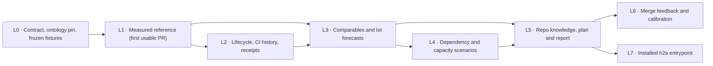

# SPEC EVOL — Delivery-time estimator from measured agent velocity

Status: EVOL spec for reconciliation and double review. No code is authorized by
this document alone. Every decision carries its source tag; propositions are
never owner requirements.

Sources used:

- Owner verbatim in `/home/antoinefa/.cache-tmp/claude-1000/-home-antoinefa-src-h2a/902cb8f7-eb8e-4897-9640-8b9653fc7d0e/scratchpad/0985/brief-velo-common.txt`.
- Owner decisions in `/home/antoinefa/.cache-tmp/claude-1000/-home-antoinefa-src-h2a/902cb8f7-eb8e-4897-9640-8b9653fc7d0e/scratchpad/0985/DECISIONS-owner.md`.
- Independent analysis Astra: `/home/antoinefa/.cache-tmp/claude-1000/-home-antoinefa-src-h2a/902cb8f7-eb8e-4897-9640-8b9653fc7d0e/scratchpad/0985/velo/analysis-astra.md`.
- Independent analysis Sol: `/home/antoinefa/.cache-tmp/claude-1000/-home-antoinefa-src-h2a/902cb8f7-eb8e-4897-9640-8b9653fc7d0e/scratchpad/0985/velo/analysis-sol.md`.
- Engram timings export: `/home/antoinefa/src/graphify/.graphify/scratch/design/velocity/engram-pr-timings.json`.
- Engram pipeline journal: `/home/antoinefa/src/graphify/.graphify/scratch/design/memory-finalization/PIPELINE.md`.

Source tags: `OWNER-VERBATIM`, `OWNER-DECISION`, `BOTH-ANALYSES`,
`PROPOSITION-NOT-VALIDATED`.

## 1. Owner requirements versus propositions

### 1.1 Owner requirements

| Item | Verbatim or decision | Tag |
| --- | --- | --- |
| Build via h2a an AI delivery-time estimator from effective velocity | "Il faut développer via h2a un estimateur de délai avec l'IA sur la base de la vélocité effective que nous avons. Donne-lui la mission." (18/10, via gr-conductor) | OWNER-VERBATIM |
| Stop nominal human-day estimates for AI dev work | "arrêter les estimations de délai débiles de 45 j pour des trucs dev par l'IA… c'est lassant" | OWNER-VERBATIM |
| Estimate in agent hours and review rounds, anchored on measured durations | 12/10 decision: human engineer-days "n'ont aucun sens"; estimate in agent hours and review rounds on measured durations (MH-L0 estimated 6–9 d, done in ~1 h) | OWNER-DECISION |
| Merge date and installed date shown separately | 18/10 ~10:20 decision: "Fusion et installé, séparés" | OWNER-DECISION |
| Timing reference is capitalized repository knowledge | Sentropic owner request: "la référence des temps estimée … connaissance … capitalisée pour le repo"; conductor uses it to optimize integration plans and improve the planning skill; CI/CD and architecture graphs committed as a typed subgraph | OWNER-VERBATIM (via sentropic study) |
| Engram is guardian of all dev ontologies | 18/10 ~09:50: "Tu fais un knowledge transfert dans engram. Il doit etre le gardien de toutes les ontologies de dev" (transferred to gr-conductor, engram #400; h2a #372 closed) | OWNER-DECISION |
| Tracked under existing item, no new WP | Item `01M57KSPC5VJN455J69W4A4ZH3` "Estimateur de délai à partir de la vélocité mesurée des agents", parent `01KWWXCD9PYZZBZR5E6JQAK6T6` (WP8) | OWNER-DECISION (recorded) |

### 1.2 Propositions, not owner requirements

The following come from the gr-conductor mission proposal and the two
analyses. They are candidate scope, not ratified requirements:

- Per-lot and critical-path P50/P80/P95 in agent wall-clock with traceable
  comparables.
- Collecting first commit, PR open, merge, review rounds, author changes,
  CI cycle time per repo and job set, lot size and kind, author and reviewer
  models, owner GO waits, quota and rate-limit stalls.
- Estimate-versus-actual feedback at each merge.
- Any specific home for the algorithm (Track, harness skill, engram), any new
  Track event, any new service, any daily job, any new npm package.
- The first data point "engram memory chain ~21 h wall-clock contracts →
  0.20.0; PR open→merge 14–60 min small lots, 2.5–3.5 h large" is a relayed
  observation to qualify, not a measured distribution. Both analyses refute
  reading it as a universal ceiling (see §3.6).

### 1.3 Explicitly excluded

Source: BOTH-ANALYSES, consistent with owner scope discipline.

- Converting human-days by an arbitrary "AI factor"; LOC/hour or
  commits/hour as universal productivity; any secret model multiplier.
- Using first commit as lot start, commit count as review-round count, or
  the GitHub author account as model identity.
- Subtracting owner waits inferred from silence; replacing unknown time
  with zero; deleting slow PRs as outliers without a versioned rule.
- Summing per-lot P80/P95 into a plan P95; summing parallel CI jobs;
  adding CI time to a PR-open→merge duration that already contains it.
- Using final diff size, actual retry counts, or future CI failures as
  inputs known at forecast time (hindsight leakage).
- Replacing Track WSJF job size with estimated hours; turning a forecast
  into a merge, deploy, model-routing, or acceptance authorization.
- Adding timing fields to the closed memory MCP DTOs; expanding scope to
  report redesign, orchestrator redesign, CI optimization, or a new
  telemetry service.
- Reading the owner NO-GO on PR #372 ("chronométrage") as a veto on this
  estimator: #372 concerned 20 read-side live investigations with a 30%
  gain threshold, a different perimeter, now closed after engram #400.

## 2. Existing capital respected

Source: BOTH-ANALYSES unless noted. Reviewed base: h2a
`origin/main = 46b82b42781709f2a2ab1bec6707ba58131248f0` (package 0.98.7).

| Surface (repo, path) | Verified capital | Role under this spec |
| --- | --- | --- |
| h2a `packages/agent-stats` (`src/types.ts`, `correlate.ts`, `track-join.ts`, `vendor/pr.ts`, `src/cli.ts`, `SessionFact`, `CorrelationLink`, injected `CommandRunner`) | F12 module imported from engram; h2a owns it; session normalization, Git/PR/Track correlation with confidence, redacted excerpts, isolated tests. `private: true`, 0.1.0; `registerAgentStatsCommands` exported but no wiring to the installed h2a CLI was found | Acquire and normalize observations, hold comparables, compute distributions and calibration. The velocity engine is new code here; no parallel session or correlation system |
| h2a `packages/track` (`src/events/types.ts`, `src/model/blocker.ts`, `src/model/priority.ts`, report and `report --period`, WP/decisions/blockers) | Append-only single-writer log; pure readers; order is position + seq; `EventCore.at` is informative; blocker carries `targetId`, `ref`, `scope: intra\|extra`, `engagementRef`, resolution rules; WSJF = `(value + criticality + risk reduction) / jobSize` with no time unit (0 `priority.assessed` in the journal read) | System of record for work, decisions, blockers, WP linkage. Consumes forecast references. The algorithm is not a realization authority; no new event at bootstrap |
| h2a `packages/h2a/skills/harness/plan/SKILL.md`, `packages/h2a/skills/harness/track-report/SKILL.md`, `packages/track/skills/track-report/SKILL.md` | Lot-based planning; deterministic report plus agent contextual synthesis; validated report with WP, expected outcomes, periods, golden tests | Read the pinned timing reference, explain comparables, record assumptions, present sourced forecasts. Integrate on top of the report contract version merged from PR #374, never the superseded table |
| h2a `packages/h2a/src/runtime/governance/conductor.ts`, conductor tooling | Resolves conductor of a workspace by claim/presence | Supplies real capacity and decisions, receives the forecast in its planning packet. Not a forecast engine, not a second scheduler |
| sentropic `.tmp/ci-knowledge-study/` (`OWNER-REQUEST.md`, `study.md`, `reconciliation.md`); engram `repo-knowledge-sol.out` | Design capital, not deployed. Review corrected "three independent profiles" into one `repo-knowledge@1` with CI, architecture, timing modules; `knowledge-lock.json`; regime fingerprints; applicability `applicable / conditional-historical / incomplete`; `TimingObservation`, `TimingSeries`, `TimingEstimate`, `PlanPrediction` | The timing module of the single profile. Do not fork three competing ontologies; do not rename the study's p90 silently into p80/p95; study human-day budgets are not a velocity reference |
| engram (`rhanka/engram`, D3/D10, six frozen memory MCP tools, engram #400) | Canonical memory journal; graph projection filtered and authorization-bound; profiles and ontologies extensible | Guardian of dev ontologies (owner direction): velocity ontology and profile definitions are owned and versioned in engram, h2a consumes them (D13). Graph import is not memory admission; no arbitrary DTO fields |
| h2a `packages/h2a` (`src/cli.ts`, `cli-contract.ts`, `cli-command-map.ts`, `bin-routing.ts`, `scripts/check-focus-vendor.mjs`) | CLI facades, contract tests, verified vendor-bundle pattern (focus) | Distribution path for an installed estimate entrypoint only in L7; a checkout pilot must not be announced as an installed command |

Non-negotiable constraints carried into every lot: 0 Python; tests in
temporary dirs only (`mkdtemp`, `XDG_RUNTIME_DIR` on a created temp dir);
targeted test files only (full suite runs once in CI per owner rule of
16/10); normal merges only, never squash (owner rule 12/10); conventional
English commit subjects with no attribution trailer; no touch to `main`;
no installed `h2a` binary, native host, or real agent state touched by
tests; red-before/green-after proof per regression with command and output.

## 3. Measured evidence and reconciliation of the two analyses

### 3.1 Agreed facts (BOTH-ANALYSES)

- Same checkout pin (`46b82b4…`), same Track journal (1,919 events), same
  item `01M57KSPC5VJN455J69W4A4ZH3`, same quantile convention
  (nearest-rank, `Q(p) = x[ceil(n × p)]`, 1-indexed), same P50 for
  PR-open→merge on 20 h2a PRs: 2 h 45 min 18 s (9,918 s), checked via PR
  [#367](https://github.com/rhanka/h2a/pull/367) and the auditable tables in
  both analyses.
- First commit is not lot start (rebase rewrites committer dates; author
  dates can predate the lot). Zero GitHub reviews is not zero reviews
  (all 20 PRs show `reviews` empty while conductor journals show real
  review rounds). The GitHub account `rhanka` on all 20 PRs is not a model
  identity. Skipped checks with end-before-start exist and must never
  become zero-duration successes. Residual gaps (e.g. last CI end → merge,
  8 h 44 min 50 s on [#350](https://github.com/rhanka/h2a/pull/350)) are
  unexplained, not owner waits.
- CI on the final head is fast and stable while PR-open→merge has a long
  tail: the tail is review, correction, queueing, and unattributed gaps,
  not the final CI run.

### 3.2 Divergence 1 — Sample selection drives the tail

| Axis | Astra | Sol |
| --- | --- | --- |
| Collection rule | `merged:>=2026-10-01`, limit 100 → 65 PRs, sorted by `mergedAt` desc, top 20 | `gh pr list --state merged --limit 20` (creation order as returned) |
| Fusion window | 17/10 04:53Z → 18/10 07:48Z | 17/10 04:32Z → 18/10 07:48Z |
| PRs included | Includes [#327](https://github.com/rhanka/h2a/pull/327) (117 h 49), [#343](https://github.com/rhanka/h2a/pull/343) (23 h 21), [#342](https://github.com/rhanka/h2a/pull/342) (21 h 28) | Includes [#347](https://github.com/rhanka/h2a/pull/347), [#349](https://github.com/rhanka/h2a/pull/349), [#351](https://github.com/rhanka/h2a/pull/351); excludes #327 |
| PR-open→merge quantiles | P50 2:45:18, P80 12:59:30, P95 30:02:57, max 117:49:24 | P50 2:45:18, P80 3:40:40, P95 12:59:30, max 30:02:57 |
| First committer-date after PR open | 13/20 | 10/20 (lists #348, #357–#359, #362, #364–#368) |

Reconciliation: neither row is "the" velocity reference. On n=20 from
~2 days, P80 and P95 move by inclusion or exclusion of two or three long
PRs. Both analyses agree the values are descriptive only. This spec
therefore mandates one versioned collection rule with cutoff and manifest
(D11): L0 freezes the union evidence as fixture; L1 computes Astra-rule
and Sol-rule quantiles side by side and labels both descriptive. Any later
forecast names its rule, window, and digest. The 13/20 versus 10/20 gap is
the same sample effect, not a factual conflict; the claim itself
(first-commit clock is unreliable) holds in both samples.

### 3.3 Divergence 2 — CI metric

Astra measured all final-head checks (285 checks over 20 heads):
longest-job Q50 15:00; full envelope Q50 19:11, Q80 27:15, Q95 34:03;
last-check-end → merge Q95 5 h 24 min 51 s. Sol measured only workflow
`ci`, attempt 1 (19 eligible runs; [#349](https://github.com/rhanka/h2a/pull/349)
attempt 2 quarantined because reused jobs start before their own
`created_at`): trigger → last job end P50 21:47, P80 31:15, P95 37:15;
job-span P50 18:46. Reconciliation: both are recorded, as distinct
metrics (D3). L1 stores run, attempt, workflow path, job, matrix tuple,
runner, and conclusion per observation, computes per-job service,
all-checks envelope, and per-workflow span, and quarantines reused or
incoherent attempts instead of averaging them in. Neither value is "CI
time" without its metric identity. Full history across heads (Astra found
[#365](https://github.com/rhanka/h2a/pull/365) with 5 `ci` runs on 5 heads,
3 failures, all `run_attempt = 1`) belongs to L2.

### 3.4 Divergence 3 — First-increment sizing

Astra sizes L1 by single analogue: #365 full cycle 1 h 54 min 53 s
(author-log birthtime → merge), hence "T0 + 2 h", low confidence, not a
P80/P95. Sol convolves 3 start→open proxies (4.06, 9.93, 17.07 min) with
the 20 open→merge durations into 60 sums: P50 ≈ 2 h 57, P80 ≈ 3 h 58,
P95 ≈ 13 h 17, with independence and transferability assumed, not
observed. Reconciliation: adopt Sol's explicit scenario as the planning
target because it sizes start→merge, which is what a lot costs, and shows
its assumptions; keep Astra's #365 analogue as a named comparable inside
that scenario. L1 planning target: first reviewable PR merged at T0 + ~4 h
(scenario P80), tail exposure T0 + ~13 h shown, no calibrated claim. The
#365 analogue carries a quality caveat both analyses note: #365 later
required corrective evolution #374, so it evidences technical handover
speed, not accepted delivery.

### 3.5 Divergence 4 — Lot map

Astra proposes L1–L7 (spec embedded in L1; explicit L7 distribution via
packaged `h2a estimate`). Sol proposes L0–L6 (explicit L0 contract lot;
distribution left as a consumption check inside L5, with a warning not to
promise a public CLI verb). Reconciliation: this spec adopts L0–L7 (§6).
L0 is kept because the ontology, clocks, and fixture contract need
freezing before code; L7 is kept because owner decision "Fusion et
installé, séparés" makes the installed surface a first-class endpoint,
but L7 is gated on L5 consumption proof so Sol's warning holds: no
installed date is claimed from a checkout import.

### 3.6 Engram data reconciliation

The engram export `/home/antoinefa/src/graphify/.graphify/scratch/design/velocity/engram-pr-timings.json`
holds 60 enriched PRs (opened 24/09 → 18/10, with `first_commit`,
additions, deletions, files, commits) and 121 older PRs (opened 14/06 →
24/09, open→merge only). Nearest-rank quantiles computed from the file
during spec writing:

| Series | n | P50 | P80 | P95 | Max |
| --- | ---: | ---: | ---: | ---: | ---: |
| enriched, open→merge (h) | 60 | 0.49 | 1.00 | 6.66 | 290.35 |
| enriched, first_commit→merge (h) | 60 | 0.49 | 1.00 | 4.32 | 91.00 |
| older, open→merge (h) | 121 | 0.24 | 3.51 | 67.87 | 633.52 |
| enriched <500 changed lines, open→merge | 22 | 0.38 | 0.66 | — | — |
| enriched ≥1000 changed lines, open→merge | 29 | 0.52 | 1.50 | — | — |

Consequences, binding on this spec:

- The file's `fields` note ("hours_first_commit_to_merge includes
  authoring") does not survive §3.1: `first_commit` is git-artifact
  evidence (join and diagnostic), never a lot-start clock. L1 ingests the
  export as open→merge observations only; the first-commit series is kept
  as a named, low-quality proxy, excluded from forecasts by default.
- The older cohort's tail (P95 67.87 h) versus enriched (P95 6.66 h)
  proves regime drift: pooling the two cohorts would fabricate a
  distribution no regime ever produced. Regime fingerprints and cohort
  separation are mandatory (D6, D9).
- The relayed "14–60 min small, 2.5–3.5 h large" summary understates the
  measured tail: large-lot P80 is 1.50 h but the enriched P95 is 6.66 h,
  and engram [#387](https://github.com/rhanka/engram/pull/387) alone took
  6 h 39 min 52 s open→merge. No universal ceiling exists.
- Size separates medians weakly (0.38 vs 0.52 h) relative to the tail;
  h2a shows the same pattern (#368: 49 files, 5,842 lines, 1 h 26;
  #343: 23 files, 1,340 lines, 23 h 21). Size is a candidate covariate,
  not a duration law, and final size is hindsight at forecast time.
- `/home/antoinefa/src/graphify/.graphify/scratch/design/memory-finalization/PIPELINE.md`
  (408 lines) is prose evidence of quota 429s, author and model
  replacements, review caps, and waits, with approximate local times at
  20–30 min tick cadence. It calibrates wait causes qualitatively; it is
  not a clock source. The "~21 h contracts → 0.20.0" chain stays an
  observation to qualify: its start event and its publish/install proof
  (journal: preparation 02:05, publication 03:28, post-publish check
  04:02 on 18/10, times not UTC-stamped) must be pinned before it can be
  a chain-level comparable.

## 4. Decisions

**D1 — Metric identity before numbers.** Every observation and forecast
names start event, end event, unit (seconds, UTC instants), scope, source,
and quality; distinct metrics stay distinct: `start_to_pr_open`,
`pr_open_to_merge`, `merge_to_installed`, `agent_run_elapsed`,
`agent_work_seconds`, `ci_job_service`, `ci_envelope`, `ci_workflow_span`,
`wait_interval`. PR-open→merge is never rendered as agent active time,
remaining dev time, or an installed date. Unknown or inconsistent
timestamps are never replaced with zero; skipped checks are never
successful service samples. Source: BOTH-ANALYSES.

**D2 — Two delivery milestones, always separate.** Every lot view shows
`mergedAt` and `installedAt` as separate fields: merge measured from the
pilot onward; installed shown as `unknown` (explicit value, not blank)
until the publish/install proof is instrumented in L7. The chain
(start → merge → installed) is never collapsed into one date, and no
publish is ever triggered by a forecast. Source: OWNER-DECISION
("Fusion et installé, séparés", 18/10 ~10:20); option C of both analyses.

**D3 — CI recorded to lineages.** CI observations key on
repo + workflow path + job + matrix tuple + runner + run + attempt +
head SHA, with pagination proof (`total_count`, `pageInfo`). Service time,
pre-service delay (which may be a workflow dependency, never auto-named
"runner shortage"), and DAG makespan are separate. Reused or incoherent
attempts are quarantined with reason. Job display names alone are not
identity. Source: BOTH-ANALYSES (3.3).

**D4 — Attribution only on proven evidence.** Agent, model, and reviewer
attribution comes from session/run facts via `packages/agent-stats`,
with requested and observed model distinct and confidence recorded.
Git/GitHub authorship, prompt mentions, and empty GitHub reviews prove
nothing about identity or review rounds. Unsupported hosts (Muse and
Vibe today) stay `unattributed`, never defaulted to Claude/Codex.
Source: BOTH-ANALYSES.

**D5 — AI proposes comparables, deterministic code computes.** The AI in
the planning workflow classifies the lot on information known at forecast
time and proposes comparable IDs with inclusion/exclusion reasons. A
versioned deterministic engine validates IDs, phases, metrics, and cutoffs,
then computes numbers reproducibly. No LLM-only number, no embedded second
LLM call, no numeric adjustment invented by the model. Selected and
excluded sets, weights, and the unselected local baseline are inspectable.
Source: BOTH-ANALYSES.

**D6 — Support tiers, no calibrated claims without support.** Outputs
distinguish `descriptive` (empirical quantile of a named cohort),
`uncalibrated-conditional`, `calibrated`, and `insufficient-evidence`.
Quantile method `nearest-rank/1` is versioned. Tail readability policy:
display a calibrated quantile only with at least 5 effective observations
beyond it (≈100 for P95, ≈25 for P80), reporting `nEff = (sum w)^2 /
sum(w^2)` under weighting plus the number of independent campaigns;
otherwise the field is `unavailable` with reason. A P95 is a predicted
quantile, never a 95% confidence interval. Source: threshold values
PROPOSITION-NOT-VALIDATED (Astra policy proposal); tiering itself
BOTH-ANALYSES.

**D7 — Scheduling quantiles come from full trials.** A completion date
requires explicit start instant, precedence DAG (execution, qualification,
release, exclusive-writer), capacity scenario (authors, reviewers,
runners, locks, quotas, owner gates), endpoint, seed, draw count, policy
version, and capacity fingerprint for replay. Quantiles are taken over
simulated schedule outcomes, never summed per-lot quantiles. WP
containment and `IMPLEMENTS` are not precedences. Unknown capacity yields
an unconstrained scenario, not a promised date; unresolved external gates
stay named unknowns, never zero duration. Remaining time conditions on
current phase and survival; `P80 − elapsed` is forbidden as a calibrated
residual. Lifecycle-historical and phase-additive forecasts are
alternatives, never summed. Source: BOTH-ANALYSES.

**D8 — Predictions are immutable; feedback is chronological.** A forecast
record is frozen before work with `predictedAt`, input revision,
reference digest, estimator and policy versions, comparable IDs, and
assumptions. Actuals reuse the same events and join idempotently on
`(repo, lot occurrence, forecast revision, merge SHA)`; corrections and
reforecasts reference prior records without rewriting them. Evaluation is
temporal (forecast evaluated only with evidence closed before it),
grouped by campaign, publishing coverage, quantile loss, absolute error,
bias, abstention and missingness rates. Open work is right-censored;
abandonment is a distinct outcome. Source: BOTH-ANALYSES.

**D9 — Regimes are fingerprinted, history is never erased.** Each
observation carries a regime fingerprint: observed model/effort when
attested, review policy, workflow path and transitive configuration,
runner, toolchain, suite/shard set, job set. Applicability is
`applicable / conditional-historical / incomplete` (sentropic study
vocabulary, adopted). A fingerprint change invalidates applicability, not
history. Cross-repo borrowing is declared and labelled, never silent
pooling — in particular never for CI. Source: BOTH-ANALYSES.

**D10 — Waits are evidenced intervals or unknown.** Wait intervals carry
start, end, cause, and source; overlaps are unioned before any
subtraction, and a net duration exists only under a stated coverage
contract. A silent gap is `unclassified`, never an owner wait, quota
stall, or pause. Source: BOTH-ANALYSES.

**D11 — One versioned collection rule with manifest.** Because sample
selection moves the tail (§3.2), every reference pins: rule and version,
repo, page-size and pagination proof, cutoff instant, inclusion and
exclusion lists, quarantine list, source SHAs/URLs, and snapshot digest.
The legacy Astra-rule and Sol-rule 20-PR cohorts are preserved in L0 as
frozen fixtures and reproduced exactly by L1 tests. Live collection is
read-only through an injected runner; count mismatches forbid a
"complete" claim. Source: PROPOSITION-NOT-VALIDATED (derived from
Divergence 1; rule details fixed in L0 review).

**D12 — Track stays record-only; reports stay offline and unchanged in
shape.** No GitHub call, LLM call, or implicit writer in Track reads or
reports; `.track` gains no second writer. Forecast cards live beside the
plan and are referenced by ULID and digest; Track report keeps its four
validated sections, WP linkage, period selectors, stage/status columns
(owner decision 18/10 ~04:05), "non qualifié" without colour for
never-qualified conformity, and neutral metric/status IDs with
user-language rendering (no hardcoded language). WSJF is untouched.
Source: OWNER-DECISION (report shape) + BOTH-ANALYSES (offline boundary).

**D13 — Ontology owned by engram, facts in Git, lessons via admission.**
The velocity ontology (clock types, phase types, profile `repo-knowledge@1`
timing module, applicability vocabulary) is defined and versioned under
engram as guardian of dev ontologies; h2a consumes a pinned version of
it and proposes changes upstream, never a parallel local ontology.
Numeric snapshots, forecasts, and knowledge-locks are versioned Git
artifacts with digests; their typed-graph projection is repository
knowledge, not memory. Engram receives only bounded, sourced lessons
through its existing scoped capture/admission lifecycle; graph import,
denied, stale, or superseded memory never changes numeric facts.
Unavailable memory never blocks reading pinned Git facts. Source:
OWNER-DECISION (engram guardian) + BOTH-ANALYSES (authorities split).

**D14 — Engine lives in `packages/agent-stats`.** Acquisition,
normalization, comparables, forecasting, scheduling, and calibration are
pure modules under `packages/agent-stats/src/velocity/*` reusing
`correlate.ts`, `track-join.ts`, redaction, and `SessionFact` identity.
Collectors take explicitly supplied inputs and injected clock/process/IO
ports; global discovery of homes, transcripts, or the native registry is
forbidden in velocity code paths. No new service, no autonomous merge,
no model-routing change. Source: BOTH-ANALYSES.

**D15 — Installed entrypoint is its own gated lot.** A checkout import
proves nothing installed. Distribution via a lightweight `h2a estimate`
facade over the agent-stats API, keeping the package private and reusing
the verified vendor-bundle pattern (`scripts/check-focus-vendor.mjs`
class), ships only in L7 after L5 proves a clean consumer reads the
knowledge-lock and forecasts. Exact verb and exit codes follow the h2a
CLI contract and are fixed in L0/L7 review. Source:
PROPOSITION-NOT-VALIDATED (Astra L7), constrained by Sol's warning.

## 5. Output contract (proposed, frozen in L0)

Source: PROPOSITION-NOT-VALIDATED, aligned with the knowledge study's
`TimingEstimate` / `PlanPrediction` before freeze.

Per-forecast record (machine-readable, language-neutral IDs):
`schema`, `forecastId`, `revision`, `parentForecastId`, `lotRef` (Track
ULID), `repo`, `metric`, `startEvent`, `endEvent`, `predictedAt`,
`inputRevision`, `referenceDigest`, `estimatorVersion`, `policyVersion`,
`quantileMethod`, `support`, `sampleCount`, `nEff`, `window`,
`fingerprint`, `applicability`, `p50Seconds`, `p80Seconds`,
`p95Seconds` (fields may be `null` with `tailQualification`),
`activeSeconds`, `ownerWaitSeconds`, `quotaWaitSeconds` (`null` when
unknown), `capacityScenario` (+ fingerprint, seed, draws),
`completionAt` (only when computable), `mergedAt`, `installedAt`
(`unknown` until instrumented, per D2), `comparables:[id, url, sha,
weight, reason]`, `excluded:[id, reason]`, `baseline`,
`phaseCoverage`, `unknowns:[...]`, `nextObservation`.

Conductor lot view: goal · metric/phase · P50/P80/P95 elapsed ·
conditional date · support n/window · top-3 comparables · unknowns ·
next observation. Programme view: milestone, precedence graph, resources,
bottlenecks, per-scenario critical path, schedule quantiles, external
waits. Owner-facing dates render in the user's timezone; evidence keeps
UTC instants. Example bootstrap card (Sol analysis, h2a 20-PR cohort):
`pr-opened → pr-merged`, `historical-bootstrap`, `calibrated: false`,
P50 9,918 / P80 13,240 / P95 46,770 s under the Sol rule, `activeSeconds:
null`, unknowns `["pre-PR work", "unclassified waits", "attribution"]`.
Under the Astra rule the same metric reads 9,918 / 46,770 / 108,177 s;
both are descriptive (§3.2) and L1 must emit both with their rule IDs.

## 6. Lots

RED tests first in every code lot: each RED is observed failing for the
stated behaviour (wrong number, wrong label, silent skip) before the fix,
with command and output kept. All test commands are targeted files run
by package-local Vitest, e.g. `rtk npx --no-install vitest run --config
vitest.config.ts tests/<file>.test.ts` from `packages/agent-stats`.

Minimal order: L0 → L1 → L2 → L3 → L5 → L6. L4 after L3; L7 after L5.

### L0 — Contract, ontology pin, frozen fixtures (no behaviour code)

Repos and exact files:

- engram: ontology source change under its profile/ontology files
  (exact paths from the in-force profile contract, pinned by version in
  this lot; vehicle is engram #400 follow-up, owned by gr-conductor).
- h2a: `docs/specs/2026-10-18-SPEC_EVOL_agent-velocity.md` (this spec,
  post-review), `BRANCH.md`, fixture
  `packages/agent-stats/tests/fixtures/velocity/github-sample.json`
  (minimized, redacted), plus fixture copies of the engram timings
  cohorts and the skipped-check anomalies of §3.1.

RED: none for a document; instead a review gate (two independent spec
reviews, Astra max + Sol 6.1 max per standing rule) and a fixture
integrity check: digest of each fixture recorded in `BRANCH.md`.
Gate: contract frozen — clocks (D1), collection rule (D11), ontology
version pin (D13), CLI verb candidate (D15) — and knowledge-contract
names (`TimingObservation` family) reconciled with the sentropic study
owner before L1 starts.

### L1 — Measured reference, replayable (first usable deliverable)

Repo h2a. New `packages/agent-stats/src/velocity/types.ts`,
`observations.ts`, `github.ts`, `measure.ts`, `index.ts`; exports in
`packages/agent-stats/src/index.ts`; thin entry `scripts/velocity.mjs`
(no statistic duplicated); `packages/agent-stats/src/cli.ts` surface.
Tests: `packages/agent-stats/tests/velocity-observations.test.ts`,
`packages/agent-stats/tests/velocity-github.test.ts`.

RED tests:

- **T-V01 Replay the observed cohorts.** Frozen fixtures produce:
  h2a Astra-rule 20 PRs, 285 final checks, open→merge quantiles
  9,918 / 46,770 / 108,177 s; h2a Sol-rule 9,918 / 13,240 / 46,770 s;
  engram enriched (n=60) P50/P80/P95 0.49/1.00/6.66 h and older
  (n=121) 0.24/3.51/67.87 h, all `nearest-rank/1`, all labelled
  `descriptive`, `calibrated: false`.
- **T-V02 Preserve missingness.** Missing merge time, unfinished,
  skipped, or end-before-start checks (engram #399: 3 skipped, end = start
  − 1 s; sentropic #697: 16 such) stay incomplete/quarantined; never a
  zero-duration success, never a negative duration.
- **T-V03 Detect incomplete acquisition.** Remaining page, API error, or
  `total_count` mismatch forbids a complete-reference claim; duplicate
  pages never double n; a run with `pull_requests: []` is still joined
  via head SHA (run 39107663703 case).
- **T-V04 Keep metrics separate.** Parallel-job fixture distinguishes
  service sum, longest job, all-checks envelope, and workflow span
  (§3.3 values); CI time is never added to open→merge.
- **T-V05 Stay read-only and isolated.** Fixture replay makes no network
  call and mutates neither Git nor Track; live collection uses only the
  injected runner on explicit inputs; tests run in `mkdtemp` +
  temp `XDG_RUNTIME_DIR` and fail (never skip) when injected fixtures
  are absent.
- **T-V06 Two milestones.** Every emitted record carries `mergedAt` and
  `installedAt: "unknown"` as separate fields (D2).

Gate: T-V01..T-V06 RED-then-GREEN with commands and outputs; one bounded
live collection shown with its manifest and deltas; the planning agent
can already cite the reference and its unknowns. No new npm publication.

Planning target (measured, §3.4): one author lane + reviewer lanes per
standing policy, same CI regime, L1 scope only → first merged PR at
T0 + ~4 h (scenario P80 ≈ 3 h 58), P50 scenario ≈ 2 h 57, tail
exposure ≈ 13 h 17. If T0 = 18/10 16:00Z (12:00 America/Toronto), that
is ~18/10 19:58Z — a scenario, not a reserved lane nor a calibrated
claim. L1's own start, review rounds, waits, and handover are measured
and become the first prospective calibration point.

### L2 — Execution evidence, lifecycle, full CI history

Repo h2a. New `packages/agent-stats/src/velocity/lifecycle.ts`,
`ci.ts`, `join.ts`, `intervals.ts`, `run-receipt.ts`; bounded extension
of `types.ts`; reuse `correlate.ts`, `track-join.ts`, `redact.ts`
without changing their existing meanings. Tests:
`packages/agent-stats/tests/velocity-evidence.test.ts`,
`velocity-ci.test.ts`, `velocity-attribution.test.ts`.

Receipt (D4, D10): `runId, repoId, lotRef, role, startedAt, finishedAt,
outcome, requestedModel, observedModel, evidenceRefs`; wait markers
with start/end/cause/source, emitted by the conductor wrapper on new
lots. Historical reconstruction keeps a lower evidence grade; filesystem
birthtime and `.done` mtime are proxies, labelled as such.

RED tests:

- **T-V07 Rebased dates are not work starts.** Committer date after PR
  open (10/20 or 13/20 per cohort) yields no negative coding duration
  and no silent lot-start reset; engram `first_commit` stays proxy-only.
- **T-V08 Attribute only proven roles.** A PR with zero GitHub reviews
  and an evidenced external review keeps that review; shared author
  `rhanka` never becomes an agent/model; Track 55 ms `in-progress →
  done` couples are documentation stamps, not dev velocity.
- **T-V09 Count cycles across heads.** #365 fixture preserves 5 `ci`
  runs on 5 heads including 3 failures, all attempt 1; #349 reused
  attempt-2 jobs stay quarantined while its open→merge stays valid.
- **T-V10 Preserve incomplete runs and overlapping waits.** Orphan start
  stays censored; overlapping quota/owner intervals are unioned once;
  undocumented gaps stay `unclassified`.
- **T-V11 Keep identity.** Equal PR numbers in different repos never
  collide; one PR serving two lots never duplicates its full elapsed
  time onto both.
- **T-V12 No relabelling of unsupported hosts.** Muse/Vibe evidence
  without a supported parser or explicit receipt stays unattributed;
  no native-home discovery in this code path.

Gate: #360 (~19 min 55 s launch-proxy → merge) and #365 (~1 h 54 min
53 s, with its 11 min 39 s review and 6 min 59 s correction runs)
reproduced with evidence grades; one new receipt at exact resolution;
attribution-collateral suites `tests/agent-stats.test.ts` and
`tests/agent-stats-h2a-evidence.test.ts` still green. No stall model
before wait coverage is displayed.

### L3 — Comparable-based forecasts with AI-assisted selection

Repo h2a. New `packages/agent-stats/src/velocity/comparables.ts`,
`cohort.ts`, `forecast.ts`, `estimate.ts`. Tests:
`packages/agent-stats/tests/velocity-forecast.test.ts`,
`velocity-estimate.test.ts`, `velocity-matching.test.ts`.

RED tests:

- **T-V13 Replay a frozen selection.** Same observations, selected IDs,
  weights, and estimator version reproduce the exact numbers; reproduces
  the B-cohort quantiles of T-V01.
- **T-V14 Reject hindsight and invented evidence.** Future merge,
  nonexistent PR, wrong metric, final diff size, or any post-outcome
  field cannot enter a forecast dated earlier; the AI port (injected,
  never a real model in deterministic tests) cannot inject a number.
- **T-V15 Expose sparse support.** n=0 yields `insufficient-evidence`,
  never 0 min; unsupported P95 stays `unavailable` as a calibrated claim
  while descriptive quantiles remain displayable (D6).
- **T-V16 Show selection effects.** Selected-cohort result and
  unselected local baseline both emitted, exclusions explained.
- **T-V17 Fail visibly on regime mismatch.** Changed CI/model/review
  fingerprint marks historical applicability
  (`conditional-historical` / `incomplete`), never silently recycles.

Gate: one real lot forecast citing comparables and exclusion reasons,
recomputable without the model; engram and sentropic cohorts usable only
as declared cross-repo priors, never pooled (D9).

### L4 — Dependency and capacity scenarios

Repo h2a. New `packages/agent-stats/src/velocity/schedule.ts`,
`plan-input.ts`. Test:
`packages/agent-stats/tests/velocity-schedule.test.ts`. The plan port
receives explicit node IDs, precedence edges, and capacities; it never
re-folds the Track journal nor invents edges from titles. Track blocker
semantics (`scope`, `engagementRef`, `linked-done|linked-accepted|manual`)
are inputs, read-only.

RED tests:

- **T-V18 Schedule the whole graph.** 10 min and 8 min lots then 3 min:
  13 min at capacity 2, 21 min at capacity 1; a dependency edge forces
  the serial result regardless of capacity.
- **T-V19 Respect shared capacity.** Parallel authors sharing one
  reviewer queue for review; one shared quota outage is one common
  shock, not one independent outage per lot.
- **T-V20 Plan quantiles from trials.** Seeded fixture differs from
  summed per-lot quantiles where distributions require it; phase vectors
  from one cycle stay correlated.
- **T-V21 Gates and start stay explicit.** Graph cycle is invalid;
  WP parent is not a predecessor; missing capacity or an unresolved
  owner gate yields no unconditional completion timestamp.
- **T-V22 Condition remaining time.** An in-progress phase never yields
  a negative remainder via `quantile − age`.

Gate: a real mini-plan under 1-lane and 2-lane scenarios with real
reviewer availability; identical qualification policy in every compared
scenario. Simulation output never claims calibration by itself.

### L5 — Repository knowledge, planning, contextual reporting

Repos h2a + engram (ontology consumption only). New
`packages/agent-stats/src/velocity/knowledge.ts`, `report.ts`; tests
`packages/agent-stats/tests/velocity-knowledge.test.ts`,
`velocity-planning.test.ts`. Edits: both SKILL surfaces in source only
(never the plugin cache). Artifacts (paths proposed, names frozen in L0
with the knowledge-study owner, no parallel ontology per D13):
`knowledge/manifest.json`, `knowledge/profiles/repo-knowledge.json`,
`knowledge/velocity/observations.json`, `knowledge/velocity/series.json`,
`knowledge/velocity/graph.json`, `plan/velocity-pilot/knowledge-lock.json`,
`plan/velocity-pilot/forecasts/F001.json`. Raw session logs are never
committed; bulky evidence lives in retention with manifest + digest.

RED tests:

- **T-V23 Pin applicability.** Digest or fingerprint change marks
  applicability; history kept; an old snapshot never bounds a new regime.
- **T-V24 Separate authorities.** Knowledge export/import never admits an
  engram memory and never mutates Track realization; stale, denied, or
  superseded memory never alters numbers; reads work with memory absent.
- **T-V25 Preserve the report contract.** Forecast input never replaces
  the four sections, WP linkage, period selectors, stage/status columns,
  or existing handles; report stays offline (no GitHub, no model, no
  writer); open→merge never renders as remaining dev or installed date.
- **T-V26 Preserve language neutrality.** Metric/status IDs stay neutral;
  user-language catalogues supply prose; no hardcoded language in data.
- **T-V27 No second realization state.** Planning writes only forecast
  cards + knowledge-lock beside the lot plan; `item report-set` semantics
  (full replacement) are never used in a way that drops non-velocity
  metadata.

Gate: clean-consumer proof — a fresh checkout reads the knowledge-lock
and a forecast card and reproduces its numbers; Track collateral green:
`packages/track/src/read/commands.period.test.ts`,
`src/report/validated-report-shape.test.ts`,
`src/wp-codes-golden.test.ts` on the integrated post-#374 base; plus a
cold planning UAT (reference present/absent/stale × capacity
known/unknown) restoring comparables and conditional dates without
altering the validated report. A SKILL.md text assertion alone is not
proof the agent follows it.

### L6 — Merge feedback, calibration, engram lessons

Repo h2a (+ engram via its own MCP lifecycle only). New
`packages/agent-stats/src/velocity/actuals.ts`, `calibration.ts`;
`packages/agent-stats/src/cli.ts` surface; tests
`velocity-actuals.test.ts`, `velocity-calibration.test.ts`.

RED tests:

- **T-V28 Never rewrite a prediction.** Actual or reforecast leaves the
  original record, cutoff, and inputs byte-identical.
- **T-V29 Ingest a merge once.** Duplicate delivery of the same
  `(repo, PR, merge SHA)` changes no sample and no prior forecast.
- **T-V30 Adverse outcomes stay visible.** Open stays censored;
  abandonment differs from fast success; reopening keeps prior delivery
  and subsequent rework (#374 corrective after #365 is the fixture).
- **T-V31 No future leakage in replay.** A backtest fed future evidence
  is rejected; on the bootstrap cohorts, backtests respect that at the
  7 oldest PRs' openings no sample peer was yet merged.
- **T-V32 Coverage with abstention.** Calibration report publishes
  denominators, interval coverage, quantile loss, MAE, bias, interval
  width, and abstention rate per repo/type/regime; high coverage by
  universal refusal is flagged, not scored as success.

Gate: forecast → merge → actual → calibration replayable end to end;
baseline versus AI-matching compared on the same future lots, AI kept
only if it improves loss/coverage at equal abstention; bounded engram
lesson emitted with immutable refs and correct handling of denied,
stale, superseded admission outcomes. Shadow mode until the first
prospective calibration report is produced (D6).

### L7 — Installed h2a entrypoint and install instrumentation

Repo h2a. New `packages/h2a/src/velocity-cli.ts`; edits
`packages/h2a/src/cli.ts`, `cli-contract.ts`, `cli-command-map.ts`,
`bin-routing.ts`, `packages/h2a/package.json` (build/prepack hooks);
new `scripts/vendor-agent-stats.mjs`,
`scripts/check-agent-stats-vendor.mjs` with the generated closure under
`packages/h2a/src/vendor/agent-stats/` bound by manifest (generated
files never hand-edited). Tests:
`packages/h2a/test/velocity-cli.test.js`, plus targeted
`cli-contract.test.js`, `cli-command-map.test.js`, `bin-routing.test.js`,
`install-skills-hosts.test.js`. This lot also instruments the installed
endpoint (npm `next` rc + clean-runner smoke per the 16/10 release
rules) so `installedAt` can move from `unknown` (D2) to a measured
`merge_to_installed` series.

RED tests:

- **T-V33 Reach the packaged entrypoint.** A clean tarball install
  executes the estimate fixture through the h2a command, not via an
  internal import.
- **T-V34 Preserve CLI contracts and lazy boundaries.** Existing verbs
  keep output/exit semantics; the estimate path starts neither runtime,
  gateway, nor memory service.
- **T-V35 Detect bundle drift.** Changed agent-stats source with an
  unchanged embedded bundle fails packaging verification; packaged
  results match the source API exactly.

Gate: publish rehearsal (dry-run) + pack smoke in existing CI
environments; no release-policy change, no gate bypass for speed.
An existing published export discovered at that time replaces vendoring.

## 7. Global gates

- G1 Double review: spec by two independent max reviews before code;
  code by two independent reviews before merge (standing owner rule
  18/10 ~03:25); max 3 review rounds per lot, then stop and present
  options (PIPELINE standing rule, 12/10).
- G2 Per lot: RED observed → GREEN observed on the same targeted files,
  with command, output, exit code, and skip count (skip > 0 = failure).
- G3 Tests confined: `mkdtemp` + temp `XDG_RUNTIME_DIR`, injected inputs;
  never the installed binary, native host, real config/state, or a
  process the agent did not start; never `pkill -f` / `killall`.
- G4 Full suites only in CI; targeted files locally (owner rule 16/10).
  Transient "bwrap: No permissions to create a new namespace": retry the
  identical command a few times with a short pause before concluding.
- G5 Normal merges only (`gh pr merge --merge`), branches rebased on
  `main` with `--force-with-lease`, own branch only, fast-forward, never
  force; conventional English subjects, zero attribution trailers.
- G6 No Python anywhere in shipped code, tests, or CI. Node + existing
  native binaries only.
- G7 Calibration honesty: until L6's first prospective report, every
  number carries its support tier (D6); a green claim without command
  and output is invalid.

## 8. NOT covered

- Active agent time, token/CPU cost, and throughput statistics until
  phase receipts accumulate (L2 starts measurement; history is proxy).
- Owner GO waits, quota stalls, author handoffs as quantified series
  until evidenced intervals exist; until then `null` / `unclassified`.
- Full CI history before L2 (all heads, all attempts, branch-protection
  and required-check policy reconstruction, deployment jobs outside
  Actions, GitHub retention limits); L1 covers final-head only.
- Muse/Vibe/host-specific session parsers beyond receipts; per-model
  speed ranking or any causal model multiplier at any lot.
- Quantile regression, survival, or hierarchical models; deferred until
  a qualified corpus proves gain over comparables (both analyses).
- Production deployment events outside the L7 npm install path,
  self-hosted/grouped runners, and provider-side quota instrumentation.
- Engram memory-host qualification and any change to D3/D10 or the six
  frozen memory MCP tools; ontology changes are engram-side decisions.
- The sentropic knowledge programme's own deployment and the governance
  unification study; this spec consumes their contracts, does not
  deliver them.

## 9. Open questions for the owner (to file, not to re-vote settled points)

- Q1 (E2 of both analyses): first prospective forecast target — (A) next
  bounded h2a lot [recommended, qualifies the tool fast], (B) the PTY
  lots whose agent-hour costing the owner already requested 17/10,
  (C) a cross-repo integration chain. Pilot runs A first; B receives a
  sourced provisional estimate in parallel if the owner needs it sooner.
- Q2: capacity authority — which capacity source may a plan freeze as
  its scenario (conductor snapshot at forecast time, or a named standing
  lane allocation)? Absent an answer, plans stay unconstrained-scenario
  (D7). No model or spend policy is decided by the estimator.
- Q3: pilot expansion order after h2a — engram then sentropic cohorts
  operational, or contract-only until h2a calibration report #1
  (D6/L6 exit)? Recommended: contract shared immediately (D13),
  operational cohorts after calibration report #1.
- Settled, not to re-ask: agent hours + review rounds (12/10); merged
  vs installed separate (18/10); engram guardian of ontologies (18/10);
  capitalized repo knowledge (sentropic owner request); 0 Python.

Ends of line: a forecast never authorizes merge, publish, deploy,
model substitution, quota spend, or acceptance. It makes the next
observation cheaper, and its own error visible.
