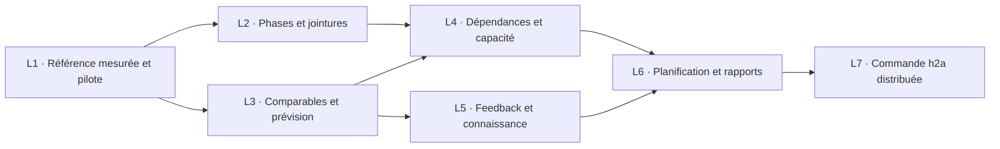

# Analyse indépendante — estimation des délais à partir de la vélocité observée

18 octobre 2026. Analyse pour h-cond / gr-conductor. Français pour l'analyse ; anglais pour le texte de spécification proposé.

**Recommandation : commencer par une référence de durées reproductible, propre au dépôt et à la phase de travail, puis faire choisir et expliquer les comparables par l'IA. Le calcul, les preuves et la calibration doivent rester déterministes. Réutiliser `packages/agent-stats`, Track et les skills du harness ; ne pas construire un second système de suivi.**

Le contrôle effectué ici porte sur **20 PR fusionnées de h2a et 285 checks finaux**. Pour ouverture → fusion, les quantiles empiriques sont **2 h 45 / 12 h 59 / 30 h 03** à 50/80/95 %. Pour l'enveloppe des checks du dernier head, ils sont **19 / 27 / 34 minutes**. Ces deux horloges ne mesurent pas la même chose. Les longues durées existent et ne doivent pas disparaître pour satisfaire l'attente de rapidité ; elles ne constituent pas davantage des jours de développement humain.

**Statut de ce document :** contribution indépendante, aucune consultation de l'autre analyse de cette mission, aucune réconciliation prétendue. Aucun code produit, aucun commit, aucune mutation de Track ou GitHub. Seul ce fichier est écrit. Les commandes de lecture et calculs ne constituent pas une implémentation de l'estimateur.

## A. Demande de l'owner, propositions et limites

### Ce qui est demandé

Les deux demandes relayées le 18/10 sont conservées verbatim :

> « Il faut développer via h2a un estimateur de délai avec l'IA sur la base de la vélocité effective que nous avons. Donne-lui la mission. »

> « arrêter les estimations de délai débiles de 45 j pour des trucs dev par l'IA… c'est lassant »

La demande liée, plus complète dans le capital sentropic [S2], est :

> séparément: track et lance l'étude suivante : la référence des temps estimée devra être une connaissance utilisée par le conductor pour l'optimisation des plan d'intégration et ameliorre la skill de planification. idéalement voir comment avec gr-conductor comment gérer ce type de knowledge spécifique a capitaliser pour le repo. poru moi CI CD et graphes d'archi devraient être commités et intégrés au graphe de connaissance (committés comme sous-graphe typé - pour le diag voir le meta model du design system aussi)

Le journal owner donne déjà, au 12/10, la règle d'estimer « en heures d'agent et en tours de revue, calés sur les durées mesurées », avec MH-L0 annoncé 6–9 jours puis réalisé en environ une heure [S1:16]. **Il n'y a donc pas à lui redemander s'il veut des jours-ingénieur.**

La demande est déjà enregistrée dans le Track local : item `01M57KSPC5VJN455J69W4A4ZH3`, créé le 18/10 à 13:39:10.343Z, titre « Estimateur de délai à partir de la vélocité mesurée des agents », parent `01KWWXCD9PYZZBZR5E6JQAK6T6`, identifié WP8 par le journal owner. Ne pas créer un doublon de cette demande. L'étude sentropic de capitalisation existe séparément sous WP9 ; son rattachement n'autorise pas à déplacer automatiquement l'item h2a.

| Élément | Statut |
|---|---|
| Un estimateur de délai développé via h2a, aidé par l'IA, fondé sur la vélocité effective | Demande explicite |
| Référence réutilisable par dépôt et consommée par le conducteur / la planification | Demande explicite liée |
| Heures réelles d'agents et revues ; abandon des jours-ingénieur nominaux | Règle owner déjà documentée |
| Collecter précisément premier commit, ouverture, fusion, taille, modèles, waits, CI | Proposition du conducteur ; chaque champ doit prouver son sens et sa disponibilité |
| P50/P80/P95, chemin critique, comparaison à chaque merge | Proposition pertinente, pas exigences owner verbatim |
| Faire vivre l'algorithme dans Track, imposer un nouvel événement ou un nouveau service | Décision technique à justifier ; rien de cela n'a été demandé |
| Engram comme stockage canonique obligatoire de toutes les mesures | Non demandé ; ne découle pas de « capitaliser » |
| Lancer des jobs quotidiens, modifier les politiques de CI ou changer les priorités | Hors demande de cet estimateur |

### Ce qu'il faut éviter

- Convertir un chiffrage humain en heures avec un « facteur IA » arbitraire ; promettre quelques heures sans comparable pour faire plaisir à l'owner.
- Confondre délai écoulé, somme des durées de plusieurs agents, temps CPU/jetons et temps actif. Deux relecteurs de 20 minutes en parallèle représentent environ 20 minutes de délai, éventuellement 40 minutes de sessions cumulées.
- Utiliser le premier commit comme début de développement, le nombre de commits comme nombre de tours de revue, ou l'auteur GitHub comme identité du modèle.
- Retrancher des « attentes owner » déduites du silence, remplacer une donnée absente par zéro, supprimer les PR lentes comme « outliers » sans règle annoncée.
- Additionner des P80/P95 de lots, additionner les jobs CI parallèles, ou ajouter la CI à une durée ouverture → fusion qui la contient déjà.
- Faire des tailles finales de diff, tours de revue réellement survenus ou échecs CI futurs des variables disponibles au moment de prévoir.
- Retoucher WSJF pour y substituer des heures estimées ; transformer une prévision en priorité, autorisation de fusion ou preuve d'acceptation.
- Élargir cette mission à la refonte des rapports, de l'orchestrateur, du stockage mémoire ou à l'optimisation de la CI.
- Assimiler le NO-GO owner sur le « chronométrage » de la PR #372 à un veto sur cet estimateur : #372 concerne les **20 investigations du read-side live**, avec seuil de gain de 30 %, et non les délais de réalisation des lots [S1:171 ; S9]. Son veto reste attaché à son propre périmètre.

## B. Données : faisabilité prouvée, qualité et lacunes

### Base examinée et méthode

Le checkout actif est ancien et comporte de nombreuses modifications préexistantes. L'analyse du code actuel utilise **`origin/main = 46b82b42781709f2a2ab1bec6707ba58131248f0`**, confirmé par l'API GitHub ; le package h2a y est en 0.98.7. Les lectures de `.track/events.jsonl` concernent le journal local courant, distinct de cette révision Git.

Collecte de preuve le 18/10/2026 à partir de 13:40 UTC. La requête :

```bash
rtk gh pr list --repo rhanka/h2a --state merged   --search 'merged:>=2026-10-01' --limit 100   --json number,title,createdAt,mergedAt,additions,deletions,changedFiles,headRefOid,baseRefName,headRefName,url,author,labels
```

renvoie **65 PR**, donc moins que la limite 100. Tri explicite sur `mergedAt` décroissant, puis sélection des 20 dernières ; aucun tri par durée ou taille. Leurs fusions vont du **17/10 04:53:08Z au 18/10 07:48:57Z**. Il s'agit d'une fenêtre courte et d'une cohorte de PR fusionnées, pas d'un échantillon représentatif de tous les travaux.

Pour chaque head retourné :

```bash
rtk gh api 'repos/rhanka/h2a/commits/<headRefOid>/check-runs?per_page=100'
```

Les 20 réponses contiennent 13 à 15 checks, toujours `total_count == nombre retourné`, soit 285 au total, tous terminés et réussis dans cette sélection finale. Les commits et revues ont également été lus par GraphQL, `commits(first:100)` et `reviews(first:100)`, avec `totalCount` et `pageInfo.hasNextPage` : aucune pagination restante pour ces PR. Le plus gros historique contient 85 commits.

**Convention de calcul de tout ce rapport :** quantile empirique par rang supérieur, `Q(p) = x[ceil(n × p)]` dans la série triée, indexée à partir de 1. Pour n = 20, les rangs sont 10, 16 et 19. Ce P50 n'est donc pas la moyenne des deux valeurs centrales ; celle-ci donnerait 2 h 50 min 02 s pour ouverture → fusion. Cette convention doit être versionnée, pas laissée au choix de chaque agent.

| Mesure, n = 20 | Minimum | Q50 empirique | Q80 empirique | Q95 empirique | Maximum |
|---|---:|---:|---:|---:|---:|
| Ouverture PR → fusion | 15 min 52 s | 2 h 45 min 18 s | 12 h 59 min 30 s | 30 h 02 min 57 s | 117 h 49 min 24 s |
| Plus long job parmi les checks du head final | 13 min 06 s | 15 min 00 s | 15 min 42 s | 16 min 02 s | 16 min 07 s |
| Premier démarrage → dernière fin des checks du head final | 13 min 39 s | 19 min 11 s | 27 min 15 s | 34 min 03 s | 41 min 54 s |
| Dernière fin de ces checks → fusion | 8 s | 4 min 44 s | 17 min 42 s | 5 h 24 min 51 s | 8 h 44 min 50 s |

La troisième ligne est une **enveloppe observée des checks du dernier head**, tous workflows retournés confondus. Elle n'inclut pas toute la file avant le premier job, ni les anciennes versions de la PR, ni les reruns historiques omis par la sélection par défaut. La quatrième ligne n'est **pas** une mesure d'attente owner : ses causes restent à établir.

Ces Q95 sont des descriptions de 20 observations ; **ils ne prouvent pas une couverture prédictive de 95 %**. Le rang 19 repose sur un seul cas au-delà de lui. Le plus long cas n'est ni effacé ni plafonné.

### Échantillon auditable

Dates UTC, année 2026. La durée est exprimée en heures:minutes:secondes, sans conversion en journées de travail. `Job max` et `Enveloppe` sont en secondes. Chaque lien de head vise l'endpoint des checks du SHA complet.

| PR | Ouverture UTC | Fusion UTC | Ouverture → fusion | Job max, s | Enveloppe, s | Head / source CI |
|---|---|---|---:|---:|---:|---|
| [#373](https://github.com/rhanka/h2a/pull/373) | 10-18 06:58:10 | 10-18 07:48:57 | 0:50:47 | 901 | 1033 | [532ddee5f885](https://api.github.com/repos/rhanka/h2a/commits/532ddee5f88515d74575232e94389536b7e4087f/check-runs?per_page=100) |
| [#348](https://github.com/rhanka/h2a/pull/348) | 10-17 00:50:30 | 10-18 06:53:27 | 30:02:57 | 967 | 1635 | [e5f5237fb0cf](https://api.github.com/repos/rhanka/h2a/commits/e5f5237fb0cfe410b5ae69803c2362c717db9043/check-runs?per_page=100) |
| [#367](https://github.com/rhanka/h2a/pull/367) | 10-17 22:53:50 | 10-18 01:39:08 | 2:45:18 | 936 | 2043 | [9dfd24989f5d](https://api.github.com/repos/rhanka/h2a/commits/9dfd24989f5d7953fb47acea19b4bb8c74cfe97d/check-runs?per_page=100) |
| [#368](https://github.com/rhanka/h2a/pull/368) | 10-17 23:23:08 | 10-18 00:49:06 | 1:25:58 | 891 | 1187 | [baf0a62f7d0e](https://api.github.com/repos/rhanka/h2a/commits/baf0a62f7d0e88ab3fcad83d9491a3bd3f47125d/check-runs?per_page=100) |
| [#364](https://github.com/rhanka/h2a/pull/364) | 10-17 20:41:10 | 10-17 23:46:01 | 3:04:51 | 945 | 1351 | [f25ee46fdd60](https://api.github.com/repos/rhanka/h2a/commits/f25ee46fdd60db95d062f59afbb2ded7f4108b60/check-runs?per_page=100) |
| [#366](https://github.com/rhanka/h2a/pull/366) | 10-17 21:30:17 | 10-17 23:25:50 | 1:55:33 | 935 | 1106 | [f451df3dacf7](https://api.github.com/repos/rhanka/h2a/commits/f451df3dacf70e67634746213e5536498c097f56/check-runs?per_page=100) |
| [#365](https://github.com/rhanka/h2a/pull/365) | 10-17 21:20:53 | 10-17 23:05:50 | 1:44:57 | 942 | 1850 | [fd036cf33f91](https://api.github.com/repos/rhanka/h2a/commits/fd036cf33f9126232ba05c9ac598c3887afabe5e/check-runs?per_page=100) |
| [#362](https://github.com/rhanka/h2a/pull/362) | 10-17 19:49:37 | 10-17 21:43:55 | 1:54:18 | 962 | 1453 | [fc524c673ad8](https://api.github.com/repos/rhanka/h2a/commits/fc524c673ad837893445f7894e3c96940d3e24b4/check-runs?per_page=100) |
| [#363](https://github.com/rhanka/h2a/pull/363) | 10-17 20:20:23 | 10-17 20:44:20 | 0:23:57 | 820 | 1143 | [62e999e90c76](https://api.github.com/repos/rhanka/h2a/commits/62e999e90c76b8958ce8c6f7241ac4fd631dfdba/check-runs?per_page=100) |
| [#327](https://github.com/rhanka/h2a/pull/327) | 10-12 22:27:31 | 10-17 20:16:55 | 117:49:24 | 957 | 971 | [f428753fd8f2](https://api.github.com/repos/rhanka/h2a/commits/f428753fd8f208e6650699c5be31f5534bc03b50/check-runs?per_page=100) |
| [#359](https://github.com/rhanka/h2a/pull/359) | 10-17 15:25:20 | 10-17 19:06:00 | 3:40:40 | 901 | 1077 | [1fbcb9af51ae](https://api.github.com/repos/rhanka/h2a/commits/1fbcb9af51ae0a0d443e1f64fb35ece53b603e67/check-runs?per_page=100) |
| [#357](https://github.com/rhanka/h2a/pull/357) | 10-17 15:13:23 | 10-17 18:49:27 | 3:36:04 | 898 | 1017 | [2719fc8b0056](https://api.github.com/repos/rhanka/h2a/commits/2719fc8b0056542b4499b4db51142402b2a24fba/check-runs?per_page=100) |
| [#343](https://github.com/rhanka/h2a/pull/343) | 10-16 19:25:17 | 10-17 18:46:07 | 23:20:50 | 930 | 1036 | [cc75dd081b35](https://api.github.com/repos/rhanka/h2a/commits/cc75dd081b358dafc2ac389b79255cff5b903225/check-runs?per_page=100) |
| [#360](https://github.com/rhanka/h2a/pull/360) | 10-17 18:08:38 | 10-17 18:24:30 | 0:15:52 | 818 | 819 | [ddb2982465d4](https://api.github.com/repos/rhanka/h2a/commits/ddb2982465d4034e1b83895feb7c0bd0ddad1f34/check-runs?per_page=100) |
| [#342](https://github.com/rhanka/h2a/pull/342) | 10-16 19:22:25 | 10-17 16:49:59 | 21:27:34 | 831 | 2514 | [cefc2ecffbb4](https://api.github.com/repos/rhanka/h2a/commits/cefc2ecffbb402e63ebc77264f7c8d04d103abbf/check-runs?per_page=100) |
| [#358](https://github.com/rhanka/h2a/pull/358) | 10-17 15:22:20 | 10-17 16:38:33 | 1:16:13 | 898 | 1937 | [570d0b2e1f6e](https://api.github.com/repos/rhanka/h2a/commits/570d0b2e1f6e73e7228f4c80c3dd86647b68f1e5/check-runs?per_page=100) |
| [#356](https://github.com/rhanka/h2a/pull/356) | 10-17 14:36:38 | 10-17 15:52:59 | 1:16:21 | 900 | 1184 | [3b2599dab027](https://api.github.com/repos/rhanka/h2a/commits/3b2599dab027f98ea2972c19d001bf18b16332b3/check-runs?per_page=100) |
| [#350](https://github.com/rhanka/h2a/pull/350) | 10-17 01:35:40 | 10-17 14:35:10 | 12:59:30 | 867 | 929 | [808c5b6bb064](https://api.github.com/repos/rhanka/h2a/commits/808c5b6bb0646cb56d71db814e8e9604bf2a8da5/check-runs?per_page=100) |
| [#346](https://github.com/rhanka/h2a/pull/346) | 10-16 23:55:38 | 10-17 05:32:47 | 5:37:09 | 786 | 1151 | [fd914a211628](https://api.github.com/repos/rhanka/h2a/commits/fd914a211628d499d0489022c1af670edbcfe04f/check-runs?per_page=100) |
| [#352](https://github.com/rhanka/h2a/pull/352) | 10-17 01:58:22 | 10-17 04:53:08 | 2:54:46 | 791 | 1195 | [ea995b6b4286](https://api.github.com/repos/rhanka/h2a/commits/ea995b6b4286aed999da207f46765633938889e1/check-runs?per_page=100) |

Les sommes de lignes ajoutées/supprimées ne donnent pas une loi de durée : #368 touche 49 fichiers et 5 842 lignes pour 1 h 26 entre ouverture et fusion ; #343 touche 23 fichiers et 1 340 lignes pour 23 h 21. Les modèles et la disponibilité ne sont pas contrôlés : ce constat ne démontre aucun effet causal de la taille.

### CI : ce qui est déjà mesurable exactement

Quelques distributions par nom de job, toujours sur le head final et avec la convention ci-dessus :

| Job h2a | n | Q50 service | Q80 service | Q95 service |
|---|---:|---:|---:|---:|
| `build-and-test (ubuntu-latest, 22)` | 20 | 14 min 51 s | 15 min 42 s | 15 min 57 s |
| `build-and-test (ubuntu-latest, 24)` | 20 | 14 min 02 s | 15 min 14 s | 15 min 36 s |
| `npm-test-trust-root` | 20 | 13 min 39 s | 14 min 27 s | 14 min 46 s |
| `smoke-install (windows-latest)` | 20 | 3 min 46 s | 4 min 07 s | 4 min 27 s |
| `Publish rehearsal (dry-run)` | 20 | 1 min 12 s | 1 min 18 s | 1 min 20 s |

Les job sets diffèrent déjà : `zero-python` apparaît 19 fois, `portable-focus` 4 fois et `native-namespaces` 2 fois. Ces dernières familles ne permettent pas une distribution utile. Une référence CI doit donc porter le dépôt, le workflow, la matrice, le runner, le job set et la révision applicable, plutôt qu'un « temps CI h2a » universel.

**Vérification de la file d'attente.** Le run [39107663703](https://github.com/rhanka/h2a/actions/runs/39107663703), head de #373, expose `created_at = run_started_at = 07:26:26Z`, `run_attempt = 1`, workflow `.github/workflows/ci.yml`. L'API jobs donne, pour `build-and-test (ubuntu-latest, 22)`, création 07:26:27Z, début 07:30:54Z, fin 07:43:46Z : **4 min 27 s création → début**, puis **12 min 52 s service**. Le run annoncé « démarré » n'est donc pas le début effectif de chaque job. Le délai création → début peut aussi inclure une dépendance de workflow ; ne pas le baptiser automatiquement « manque de runner ».

**Vérification des reprises.** La requête des runs de la branche de #365 retourne 25 runs, dont cinq du workflow `ci`, sur cinq heads distincts : trois échecs, puis deux succès. Tous portent `run_attempt = 1`. Compter seulement `run_attempt` oublierait les relances provoquées par de nouveaux commits. Le run final [39075326978](https://github.com/rhanka/h2a/actions/runs/39075326978) ne représente pas ce coût historique. Pour une collecte complète : parcourir les heads / runs de la PR, les tentatives et les pages ; conserver échecs, annulations et chevauchements, avec leurs identifiants.

Autre piège de jointure réellement rencontré : le run 39107663703 porte `event: pull_request` mais `pull_requests: []`. Exiger un numéro de PR dans cette liste perdrait donc une mesure valide. Utiliser les SHAs et les preuves de heads de la PR ; une recherche par nom de branche fournit des candidats, mais ce nom seul ne suffit pas si la branche a été réutilisée.

### Premier commit, revues, modèles : trois faux raccourcis démontrés

1. **Premier commit ≠ commencement du lot.** Dans l'échantillon, le Q50 premier `authoredDate` → ouverture vaut **25 secondes**. Pour 13 PR sur 20, la plus ancienne `committedDate` des commits actuellement présents est **postérieure à l'ouverture** : les rebases ont déplacé ces dates. Pour #373, le premier commit a été écrit le 17/10 à 01:59:57Z et recommité le 18/10 à 06:56:18Z ; le lot a aussi été extrait d'un travail préalable. Ni choix de timestamp ne donne mécaniquement son effort. Les dates Git restent des preuves d'artefacts, utiles à la jointure et au diagnostic, pas un chronomètre actif.
2. **Zéro revue GitHub ≠ zéro revue.** `reviews.totalCount == 0` pour les 20 PR. Le journal `revtrackstatus.log` contient pourtant une revue indépendante « NON-FUSIONNABLE », suivie d'une correction `trackstatus2`. Les tours de revue passent ici largement hors de l'objet GitHub Review.
3. **Auteur GitHub ≠ modèle.** Les 20 PR sont attribuées au compte `rhanka`. Les headers de `cibudget.log` et `trackstatus.log` donnent en revanche `gpt-6.1-sol`, effort `high`, et des identifiants de session. Le modèle demandé, le modèle observé et un éventuel repli doivent rester distincts. Le `PIPELINE.md` signale même des runs dont le modèle effectif est `unverified`.

### Journaux locaux : deux cycles concrets et leur niveau de preuve

Le système de fichiers expose un birth time sur les fichiers observés. Les URLs de PR présentes dans les logs permettent les jointures suivantes [S6] :

| Preuve locale | Début proxy, UTC | Fin observée | Durée | Interprétation |
|---|---|---|---:|---|
| `cibudget.log` → GitHub #360 | birth 17/10 18:04:34.536 | fusion 18:24:30Z | **19 min 55 s** | Cycle lancement proxy → fusion, petit correctif CI |
| `trackstatus.log` → GitHub #365 | birth 17/10 21:10:56.961 | fusion 23:05:50Z | **1 h 54 min 53 s** | Cycle d'une fonctionnalité de rapport, avec revue/correction et reprises CI |
| `trackstatus.log` → `trackstatus.done` | même début | mtime 21:27:03.775Z | 16 min 07 s | Durée d'un run, pas de tout le lot |
| `revtrackstatus.log` → `.done` | birth 22:04:29.387Z | mtime 22:16:08.744Z | 11 min 39 s | Une revue observée |
| `trackstatus2.log` → `.done` | birth 22:24:35.139Z | mtime 22:31:34.615Z | 6 min 59 s | Une correction observée |

**Confiance limitée aux horloges locales :** le birth time est un proxy de lancement, pas un événement métier signé ; une copie, réutilisation ou réécriture de log peut le rendre inapplicable. Les fichiers `.done` inspectés contiennent seulement `done`, pas un timestamp ni un résultat métier structuré. Leur mtime donne une borne de fin de wrapper, pas une preuve de succès de livraison. Le run `cibudget` inclut du suivi de CI ; l'appeler « 19 minutes de code actif » serait faux.

Ces durées ne s'additionnent pas naïvement : l'auteur peut attendre une CI déjà en cours, et d'autres sessions peuvent intervenir entre les fichiers. Les trous restent **non attribués** jusqu'à preuve.

### Faisabilité sur les autres dépôts

Lecture GitHub réussie sur `rhanka/engram` et `rhanka/sentropic`, pas seulement supposée.

| Dépôt / preuve | Ouverture → fusion | Vérification CI sur un head final |
|---|---|---|
| engram #398 / #399, corrections de contrats | 14 min 06 s / 19 min 53 s | #399 : 15 checks, dont 12 réussis et 3 skipped ; plus long service réussi 5 min 21 s, enveloppe réussie 10 min 08 s |
| engram #394, cycle de vie mémoire | 3 h 19 min 34 s | Lien PR et head disponibles |
| engram #395, projection mémoire | 2 h 39 min 52 s | Lien PR et head disponibles |
| engram #387, gel des contrats | **6 h 39 min 52 s** | Contre-exemple à un plafond universel de 3,5 h |
| sentropic #697, transport MCP mémoire | 5 h 08 min 49 s | 84 checks, dont 57 réussis et 27 skipped ; plus long service réussi 10 min 14 s, enveloppe réussie 20 min 39 s |

Ces mesures CI concernent un seul head par dépôt hors h2a : **aucun percentile inter-dépôts n'en est déduit**. La collecte sentropic a également retourné dix PR fusionnées depuis le 16/10, avec des cycles allant de quelques heures à plusieurs dizaines d'heures.

Cas réel à couvrir par le parseur : engram #399 comporte **3 checks skipped dont la fin précède le début d'une seconde** ; sentropic #697 en comporte 16. Ils ne doivent devenir ni des durées négatives, ni des succès de durée nulle.

Le point « chaîne mémoire ~21 h, contrats → 0.20.0 » est conservé comme **observation relayée à qualifier**, pas comme échantillon homogène d'un lot. Le journal distingue préparation de version, publication CI et vérification d'installation : le 18/10, préparation constatée à 02:05, publication à 03:28, contrôle post-publication à 04:02, heures du journal [S7]. GitHub n'a pas de Release v0.20.0 visible lors de la lecture : cela n'invalide pas une publication npm par tag. Il faut épingler le début retenu et la preuve de publication/installation pour transformer les « ~21 h » en mesure comparable. Il serait incorrect de remplacer ces bornes par celles d'une seule PR.

### Sources, fiabilité et lacunes

| Source | Fiable pour | Limite à exposer |
|---|---|---|
| GitHub PR, runs, jobs, checks | Horodatages de ces objets, état, SHA, matrices, reprises connues, URLs de preuve | Rétention, pagination, objets supprimés, jobs hors Actions ; la politique de checks requise historiquement n'est pas déduite de tous les checks visibles |
| Git | Identités de commits, contenu, parenté et diffs | Auteur/committer ne mesurent ni agent ni début de travail ; squash/rebase/extraction modifient les repères |
| Track | Identité des demandes, WP, réalisation, décisions, blockers, provenance et liens | `EventCore.at` est explicitement informatif ; l'ordre est position + seq. Une saisie/import tardif n'est pas l'événement d'exécution original |
| `agent-stats` | Sessions normalisées, timestamps observés, modèles, liens Git/PR/Track avec confiance, rédaction des extraits | Hosts typés actuellement Claude/Codex/agy, pas Muse/Vibe ; premier/dernier message ≠ temps actif ; stockage local reconstituable |
| Journaux de conducteur | Raison d'un arrêt, revue hors GitHub, reprise, changement d'auteur/modèle | Prose, heures parfois approximatives, cadence de tick de 20–30 min, fuseaux non toujours explicites, attribution à confirmer |
| Captures structurées de lancement/fin et de wait | Future mesure directe par lot, rôle, run et intervalle | À ajouter de manière bornée ; ne pas prétendre qu'elles existent partout aujourd'hui |

Le journal Track local comptait **1 919 événements**, dont 264 transitions de réalisation, 94 ouvertures et 71 résolutions de blockers, 76 créations et 64 outcomes de décisions. Il n'y avait **aucun `priority.assessed`** dans cette lecture. Cela offre des jointures et certaines durées de blockers enregistrés, pas un jeu universel de temps de travail ou de job sizes. Ne pas assimiler tout intervalle décision créée → résolue à un arrêt du chemin critique.

Les quotas/429, pauses owner, reprises après crash et changements d'auteur sont **partiellement documentés en prose**, pas uniformément absents. Par exemple, `PIPELINE.md` décrit des 429, des replis et des attentes explicites. Leur couverture et leurs bornes restent insuffisantes pour les soustraire systématiquement. L'absence d'une telle annotation signifie `unknown`.

## C. Conception et réemploi du capital

### Répartition recommandée

| Surface | Capital vérifié | Responsabilité proposée |
|---|---|---|
| `packages/agent-stats` | Import F12 depuis engram ; h2a propriétaire. Parseurs, `SessionFact`, `CorrelationLink`, `CommandRunner` injecté, jointure Track, tests isolés | Acquisition/normalisation des observations, comparables, calcul des distributions et calibration |
| Track | Journal append-only à writer unique, lecteurs purs, WP/decisions/blockers/WSJF, rapports et `--period` | Référence des travaux et de leur état ; consommation de références de prévision sans faire de l'algorithme une autorité de réalisation |
| `harness/plan` et `harness/track-report` | Plan par lots ; synthèse contextuelle par l'agent au-dessus d'un rapport déterministe | Lire la référence, faire expliquer les comparables par l'IA, inscrire les hypothèses, présenter une prévision sourcée |
| `knowledge/` du dépôt | Convention proposée dans l'étude sentropic, pas fonctionnalité déjà livrée | Manifestes, références numériques versionnées et sous-graphe typé ; sélection épinglée par un knowledge lock |
| Engram | Profil/ontologie extensible et graphe dérivé ; mémoire canonique séparée, D3/D10 | Projection/recherche de la connaissance ; admission mémorielle seulement via le mécanisme existant si nécessaire |
| Conducteur h2a | Résolution de présence/claim et lancement des lanes | Fournir la capacité réelle et les décisions ; appeler les surfaces existantes, pas recevoir un second ordonnanceur autonome |

**Découverte structurante :** le module `agent-stats` est déjà propriétaire de l'attribution par preuves, avec déduplication des squash et résiduel non attribué [S3]. Refaire cela dans Track ou dans un script autonome serait une perte de capital. En revanche, son helper PR actuel ne recueille pas toutes les bornes temporelles et son agrégation compte surtout sessions/jetons/commits. L'estimateur reste bien une capacité nouvelle.

**Limite de distribution vérifiée :** `@sentropic/agent-stats` est aujourd'hui `private: true`, version 0.1.0, avec `registerAgentStatsCommands` exporté ; aucun branchement de cette API dans le CLI h2a courant n'a été trouvé. Ne pas annoncer une commande installée `h2a agent-stats estimate` déjà existante. Un pilote depuis ce checkout est possible ; la livraison dans le paquet h2a constitue un lot distinct.

Le `conductor.ts` existant résout le conducteur d'un workspace, par claim/présence. Ce n'est pas un ordonnanceur de réalisation ni un moteur de prévision. Ce fichier n'a pas à héberger les statistiques.

### Trois options d'estimation

| Option | Atout réel | Limite réelle | Position |
|---|---|---|---|
| Comparables statistiques déterministes, sans matching IA | Très auditable, fonctionne avec peu de données, baseline de contrôle | Les critères structurels ne voient pas toutes les ressemblances fonctionnelles | Baseline obligatoire |
| Matching assisté par l'IA + calcul déterministe | Explique pourquoi un ancien lot ressemble au nouveau ; utilise specs, critères et périmètre | Risque de sélection opportuniste ou de faux comparable ; trace et évaluation nécessaires | **Cible recommandée** |
| Régression/quantiles hiérarchiques ou survie avec davantage de données | Mutualisation contrôlée et traitement des censures ; modélisation plus fine | Trop de dimensions pour vingt PR, dérive rapide des modèles/CI, maintenance | Évolution après preuve hors échantillon, pas prérequis du pilote |

Une estimation LLM libre à laquelle on ajoute trois nombres « P50/P80/P95 » ne constitue pas une quatrième option acceptable. Les nombres doivent être reproductibles à partir des observations sélectionnées.

### Horloges explicites

La première livraison peut mesurer `pr_open_to_merge`. Elle ne doit pas le renommer `agent_active_time`.

Pour les nouveaux lots, conserver simultanément :

- **Cycle de livraison** : commencement explicite du lot → fusion ; puis fusion → publication/installation qualifiée si ce second endpoint est demandé.
- **Durée de run** : lancement → fin d'une session auteur/relecteur, avec chevauchements et phases de CI éventuellement incluses. La somme des runs est une consommation de sessions, pas le délai du lot.
- **Intervalles d'attente** : owner, dépendance, quota, disponibilité de reviewer, pause explicite, avec début/fin et preuve. Leur union évite le double comptage.
- **Durée nette hors attentes documentées** : seulement si la couverture des intervalles est suffisante ; sinon inconnue. Une activité silencieuse ne prouve pas une pause.
- **CI** : service par job, délais avant service et makespan du DAG ; tentatives échouées/annulées restent des observations séparées.

Afficher une durée en minutes/heures réelles ne suffit pas à la rendre « active ». La date calendaire dépend en outre de l'heure de départ, des lanes disponibles et des attentes encore ouvertes.

### Sélection de comparables et petits effectifs

1. Figer la description du lot au moment de prévoir : dépôt/composant, type de changement, contrats touchés, tests prévus, dépendances, taille anticipée et sa provenance, politique de revue et environnement CI.
2. Filtrer d'abord les références incompatibles en phase, endpoint ou régime. Le nombre de lignes final et le nombre réel de reprises restent des sorties d'évaluation.
3. L'IA propose des identifiants de comparables, motifs d'inclusion/exclusion et éventuelles pondérations. Elle cite les specs/PR, distingue connaissance observée et hypothèse. Le moteur valide les références et exécute la règle de calcul versionnée.
4. Afficher la baseline locale non sélectionnée à côté de l'estimation assistée. Cela rend visible un matching qui ne retiendrait que les réussites rapides.
5. Si la cohorte exacte est trop petite, élargir de manière annoncée : composant → dépôt → autre dépôt compatible. Une référence engram n'est pas importée silencieusement dans h2a, en particulier pour la CI.
6. Avec aucune référence applicable, rendre `insufficient-evidence` et proposer la mesure courte qui manque. Ni zéro, ni 45 jours par défaut.

Distinguer **quantile empirique**, **prévision conditionnelle non calibrée** et **prévision calibrée**. Un seuil initial raisonnable de lisibilité de la queue serait au moins cinq observations effectives au-delà du quantile affiché : environ 100 pour P95 et 25 pour P80. C'est une **politique proposée**, non un théorème de suffisance. Avec pondération, afficher aussi `n_eff = (sum w)^2 / sum(w^2)`, et le nombre de campagnes indépendantes. Cent observations d'une seule vague corrélée ne valent pas cent essais indépendants.

Le sample actuel peut donc montrer Q50/Q80/Q95 **descriptifs** et une hypothèse de travail ; il ne peut revendiquer une garantie P95 sur un nouveau lot.

### Chemin critique : après les durées, un scénario de capacité

Construire un DAG de lots à partir des dépendances attestées, des gates Track et du plan, sans inventer les arêtes à partir de prose ambiguë. Le capital existe dans `packages/track/src/model/blocker.ts` : `targetId`, `ref`, `scope: intra|extra`, `engagementRef` et règles `linked-done|linked-accepted|manual`. Une dépendance extra n'a pas de `ref` local et ne se résout pas comme un lot local. Une décision non prise est une condition ou une branche de scénario, jamais une durée nulle.

Pour un scénario de capacité fixé, simuler les durées de cycles comparables, les dépendances et la contention des sièges/reviewers/runners. Calculer à chaque tirage les dates de disponibilité et le makespan ; **prendre les quantiles des makespans obtenus**, pas les sommes des quantiles individuels. Le chemin critique peut changer d'un tirage à l'autre.

Quand les phases sont mesurées, rééchantillonner des vecteurs de phases issus d'un même cycle pour conserver les corrélations code/revue/CI. Les chocs partagés de quota, de file CI ou de conducteur doivent être communs aux lots concernés ; ne pas donner à chaque lot une machine indépendante fictive. En l'absence de telles données, montrer les scénarios séquentiel et parallèle sous hypothèses, sans les nommer P95 calibrés.

Un lot déjà âgé de deux heures se traite comme un restant conditionné à sa phase et à sa survie jusque-là. `P80 initial - temps écoulé` ne constitue pas une loi du temps restant.

### Capitalisation : raccord à l'étude existante

L'étude sentropic [S2] recommande déjà un paquet de connaissances commité, un `knowledge-lock.json`, des empreintes du régime CI et une distinction `applicable / conditional-historical / incomplete`. Sa revue a **remplacé la proposition de trois profils indépendants par un seul `repo-knowledge@1` à modules CI/architecture/timing**. Repartir sur trois ontologies concurrentes ignorerait cette correction.

Proposition : ajouter un module de durées de réalisation à cette convention, sans dupliquer le module CI. Épingler dépôt canonique, sources, fenêtre, versions du collecteur et de l'estimateur, métrique, méthode de quantile, effectif, qualité et causes d'inapplicabilité. Les quantiles existants de l'étude, dont p90, ne sont pas renommés silencieusement en p80/p95.

Trois autorités à maintenir :

- Git/Actions/receipts pour les observations et leur provenance ; snapshot curé et versionné pour reproduire une estimation.
- Track pour ce qui a été demandé, décidé et réalisé.
- Le journal canonique Engram pour les souvenirs admis. Le sous-graphe commité est une projection/connaissance de dépôt ; importer ce graphe n'admet pas une mémoire.

Le cache `.graphify/agents/facts.jsonl` existant est reconstituable et réécrit/dédupliqué par factId ; ce n'est pas un journal canonique immuable de prévisions. Ne pas l'utiliser seul pour prouver ce qui était annoncé avant un merge. Ne pas commiter les logs bruts de session. Réutiliser les extraits rédigés et les références autorisées.

Le contrat mémoire MCP est fermé : aucun champ de timing ajouté à ses DTO par commodité. Le Sol cité par gr-conductor indique que l'extraction via profils / relations de graphe est possible, mais que l'ingestion métier et sa consommation par le conducteur restent à définir [S8]. Ce raccord ne doit pas bloquer un pilote local reproductible.

### Boucle de calibration

- Avant travail : enregistrer une prévision immuable, `predictedAt`, état du périmètre, endpoints, données disponibles à cet instant, comparables, règle/version, capacité et incertitudes.
- Au merge : rattacher l'actual au même lot/endpoint et aux mêmes bornes. Une PR couvrant plusieurs lots ou un lot couvrant plusieurs PR exige une jointure explicite ; la durée complète n'est pas copiée sur chaque sous-lot.
- Conserver toutes les versions : un reforecast après changement de scope ou de modèle n'efface pas la prévision initiale. Réouverture/rejet ne signifie pas « délai zéro ».
- Évaluer couverture empirique des intervalles, perte quantile, erreur absolue et biais de surestimation/sous-estimation, par dépôt/type/régime. Comparer matching IA et baseline aveugle.
- Valider en ordre temporel, avec regroupement par campagne pour éviter la fuite entre lots d'une même chaîne. Un comparable doit être achevé et disponible **avant** la prévision rejouée.
- Collecter aussi les PR ouvertes et les travaux abandonnés ; les premières sont censurées à droite, les seconds ont un outcome distinct. La baseline des vingt fusionnées est explicitement conditionnée à la fusion, pas à toutes les demandes.
- Changement de modèle, politique de double revue ou CI : marquer la référence historique conditionnelle et mesurer le nouveau régime. Ne pas proclamer une amélioration de modèle sur des tailles ou types de travaux différents.
- À chaque merge, mise à jour idempotente des observations ; publication de la référence par le writer/intégrateur désigné. Le calcul d'un rapport ne déclenche ni réseau, ni modèle, ni écriture implicite dans Track.

### Proposed specification text — English, not owner-ratified

> **V1 — Purpose.** The system shall forecast elapsed delivery time for AI-assisted repository work from observed, traceable execution history. It shall not convert nominal human-days into agent time.
>
> **V2 — Metric identity.** Every observation and forecast shall name its start event, end event, unit, scope and inclusion of waits. PR-open-to-merge, agent-run elapsed, CI service, CI makespan and start-to-delivery shall be distinct metrics.
>
> **V3 — Evidence.** Every numeric observation shall carry a repository identity, source identifiers, event timestamps, collection time and measurement quality. Unknown or inconsistent timestamps shall not be replaced with zero. Skipped checks shall not become successful service-time samples.
>
> **V4 — Attribution.** Agent, model and reviewer attribution shall use explicit session/run evidence. Git authorship and missing GitHub reviews shall not establish agent identity or review count. Requested and observed models shall be distinguishable.
>
> **V5 — Estimation.** The AI may propose and explain comparable selection using the information available at prediction time. A deterministic, versioned engine shall validate that selection and compute its numerical result. Comparable identifiers, weights, exclusions and a local baseline shall be inspectable.
>
> **V6 — Support.** Results shall distinguish descriptive empirical quantiles, uncalibrated conditional forecasts, calibrated forecasts and insufficient evidence. Requested P50/P80/P95 fields may be unavailable with an explicit reason; unsupported confidence claims are forbidden.
>
> **V7 — Scheduling.** Completion dates shall require an explicit start instant, dependency graph, capacity scenario and endpoint. Plan quantiles shall be derived from complete scheduling trials, not sums of task quantiles. Unresolved external gates shall remain visible.
>
> **V8 — Missing waits.** Wait intervals shall carry their own evidence and may overlap. Net durations shall subtract their union only within a defined coverage contract. Unobserved time shall remain unclassified.
>
> **V9 — Replay and feedback.** Predictions shall be immutable and versioned. Actuals, corrections and reforecasts shall reference prior records without rewriting them. Temporal evaluation shall exclude future evidence and account for censored or abandoned work.
>
> **V10 — Ownership.** Track shall remain the work-state system of record and its reports shall remain deterministic and locally readable. The activity/forecast engine shall reuse agent-stats. Repository knowledge shall be versioned and must not become a second authority for canonical Engram memory.
>
> **V11 — Planning integration.** Planning shall consume a pinned timing reference and preserve its assumptions beside the lot plan. Contextual reporting may explain forecasts without changing accepted report sections, WP identities, priorities or acceptance gates. Language selection shall follow the existing user-language contract.
>
> **V12 — Non-goals.** The initial capability shall not introduce autonomous merging, provider/model substitution policy, a new telemetry service, a new memory MCP tool, changes to CI qualification policy, or automatic WSJF reassessment.

Example output for the **observed reference**, not a new-lot prediction:

```text
Repository: rhanka/h2a
Metric: pr_open_to_merge
Reference: latest 20 merged PRs at the collection cutoff
Unit: elapsed_seconds
Quantile method: empirical_nearest_rank_v1
Reference Q50: 9918
Reference Q80: 46770
Reference Q95: 108177
Sample size: 20
Calibration: descriptive_only
Agent active time: unavailable
Owner wait time: unknown
New-lot P95: unavailable — insufficient comparable tail support
Completion date: unavailable — no launch/capacity scenario supplied
Evidence: PR URLs, head SHAs and the collection manifest
```

Pour une vraie prévision, ajouter `forecastId/revision`, `lotRef`, `predictedAt`, `inputRevision`, `referenceDigest`, `estimatorVersion`, `metric`, `support`, `sampleCount/nEff`, `comparables`, `assumptions`, `phaseCoverage`, `capacityScenario` et `completionAt` lorsqu'il est calculable. Les dates affichées à l'owner utilisent son fuseau ; les preuves gardent leurs instants UTC.

## D. Lots proposés, preuves RED et première livraison

Les chemins ci-dessous sont **une proposition de périmètre futur**, relative à la racine h2a ; « nouveau » signifie absent de la base examinée. Aucun de ces fichiers n'a été modifié par cette analyse. Le conducteur doit réconcilier les deux analyses avant de figer l'EVOL ; les règles de double revue déjà décidées restent applicables. Aucun chantier supplémentaire n'est lancé ici.

Dépendances proposées :



Ce DAG décrit les dépendances de construction, pas un engagement à disposer de plusieurs auteurs simultanément. L1 rend déjà le travail utile ; les lots suivants ne sont pas des conditions préalables à la mesure.

### L1 — Measured reference and first usable pilot

**Résultat borné :** une référence rejouable de vingt PR de h2a, leurs heads/checks finaux, les bornes et la couverture, les quantiles empiriques explicitement non calibrés. Une petite entrée de dépôt appelle le module ; aucune publication d'un nouveau paquet npm n'est nécessaire. L'agent de planification peut déjà lire cette référence, citer ses analogues et signaler les durées non connues.

Fichiers proposés :

- Nouveau `docs/specs/2026-10-18-SPEC_EVOL_agent-velocity.md` : contrat après réconciliation, distinction entre demandes et choix techniques.
- Nouveaux `packages/agent-stats/src/velocity/types.ts`, `github.ts`, `measure.ts`, `index.ts`.
- Exports dans `packages/agent-stats/src/index.ts`.
- Nouveau `scripts/velocity.mjs` : adaptateur mince du module compilé ; aucune règle statistique dupliquée.
- Nouveaux `packages/agent-stats/tests/velocity-observations.test.ts` et `packages/agent-stats/tests/fixtures/velocity/h2a-2026-10-18.json`. Ajouter au même jeu de fixtures les trois checks skipped/inversés d'engram observés ici.

**RED requirements (English):**

- **T-V01 — Replay the observed cohort.** The fixed twenty-PR fixture must produce 20 PRs, 285 final checks and PR elapsed quantiles 9918 / 46770 / 108177 seconds, with the declared nearest-rank method.
- **T-V02 — Preserve missingness.** A missing merge time or an unfinished check must remain incomplete; skipped or reversed timestamps must not become successful zero-duration measurements.
- **T-V03 — Detect incomplete acquisition.** A remaining page, API error or count mismatch must prevent a complete-reference claim. Duplicate pages must not double the sample count.
- **T-V04 — Keep metrics separate.** A parallel-job fixture must distinguish service sum, longest job and elapsed envelope; PR elapsed must not have CI elapsed added again.
- **T-V05 — Stay read-only.** Fixture replay must make no network call and mutate neither Git nor Track. Live collection must use an injected read-only runner and report its cutoff.

Gate : les RED échouent d'abord pour la raison prévue, puis passent ; rejouer exactement le tableau de ce rapport ; montrer une acquisition live bornée avec les écarts de collecte déclarés. La fixture est un test d'un comportement observable, pas une recopie du calcul interne.

### L2 — Execution evidence, lifecycle and CI history

Fichiers : nouveaux `packages/agent-stats/src/velocity/lifecycle.ts`, `ci.ts`, `run-receipt.ts`, `packages/agent-stats/tests/velocity-evidence.test.ts`, `velocity-ci.test.ts` ; évolution bornée de `velocity/types.ts`. Réutiliser `correlate.ts`, `track-join.ts`, `redact.ts` et les identités existantes plutôt que réécrire leurs logiques.

Un receipt neutre porte `runId, repoId, lotRef, role, startedAt, finishedAt, outcome, requestedModel, observedModel, evidenceRefs`. Les marqueurs de wait portent début/fin/cause et source. Le conducteur ou un wrapper de lancement les fournit ; une reconstitution historique incertaine garde un niveau de preuve inférieur. L'API de receipt n'autorise pas une lecture globale des profils ni une nouvelle télémétrie réseau.

**RED requirements (English):**

- **T-V06 — Rebased dates are not work starts.** A commit timestamp after PR creation must not yield a negative coding duration or silently reset the lot start.
- **T-V07 — Attribute only proven roles.** A PR with zero GitHub reviews and an evidenced external review must retain that review. A shared human Git author must not become an agent/model identity.
- **T-V08 — Count cycles across heads.** The #365 fixture must preserve five CI runs on distinct heads, including three failures, even though every run has attempt 1.
- **T-V09 — Preserve incomplete runs and overlapping waits.** An orphan start remains censored; overlapping quota/owner intervals are unioned before any subtraction; an undocumented gap remains unknown.
- **T-V10 — Keep repository and lot identity.** Equal PR numbers in different repositories must not collide. One PR linked to two lots must not duplicate its entire elapsed time onto both.
- **T-V11 — Do not relabel unsupported hosts.** Muse/Vibe evidence lacking a supported parser or explicit receipt remains unattributed, not Claude/Codex by default.

Gate : montrer les deux cycles #360/#365 avec les preuves et limites de leurs bornes, puis un receipt neuf à résolution exacte. Aucun modèle de stalls ne se construit avant d'afficher sa couverture.

### L3 — Comparable-based forecasts with AI-assisted selection

Fichiers : nouveaux `packages/agent-stats/src/velocity/comparables.ts`, `forecast.ts`, `packages/agent-stats/tests/velocity-forecast.test.ts` ; exports du module.

Le moteur reçoit une proposition de comparables structurée, préparée par l'agent déjà présent dans le workflow. Il n'embarque pas un second appel LLM ni une nouvelle politique de choix de modèles.

**RED requirements (English):**

- **T-V12 — Replay a frozen selection.** The same observations, selected IDs, weights and estimator version must reproduce the same numerical result.
- **T-V13 — Reject hindsight and invented evidence.** A future merge, nonexistent PR, wrong metric or post-outcome feature must not enter a forecast at an earlier prediction time.
- **T-V14 — Expose sparse support.** Unsupported P95 must remain unavailable as a calibrated claim; empirical reference quantiles may still be displayed as descriptive.
- **T-V15 — Show selection effects.** The selected-cohort forecast and the unselected local baseline must both be available, with exclusions explained.
- **T-V16 — Fail visibly on regime mismatch.** A changed CI/model/review regime must mark historical applicability explicitly rather than silently recycle the old estimate.

Gate : une prévision d'un lot réel cite ses analogues et les raisons d'exclusion ; une relecture peut reproduire chaque nombre sans interroger le modèle.

### L4 — Dependency and capacity scenarios

Fichiers : nouveaux `packages/agent-stats/src/velocity/schedule.ts`, `plan-input.ts`, `packages/agent-stats/tests/velocity-schedule.test.ts`. Le port de planification reçoit des IDs/arêtes/capacités explicites ; il ne refait pas le fold du journal Track et n'invente pas des dépendances à partir des titres.

**RED requirements (English):**

- **T-V17 — Schedule the whole graph.** Two independent 60-minute lots with two free lanes take 60 minutes; the same lots with one lane or a dependency take 120 minutes.
- **T-V18 — Respect shared capacity.** Parallel authors sharing one reviewer must queue review; one shared quota outage must not be sampled as independent outages.
- **T-V19 — Compute plan quantiles from trials.** A fixed seeded fixture must differ from summing per-lot quantiles where the distributions require it.
- **T-V20 — Keep gates and start time explicit.** Cycles in the dependency graph are invalid; absent capacity or an unresolved owner gate must not produce an unconditional completion timestamp.
- **T-V21 — Condition remaining time.** An in-progress phase cannot produce a negative remaining duration by subtracting its age from an initial quantile.

Gate : un mini-plan réel et les scénarios un/deux auteurs, disponibilité réelle des relecteurs incluse ; même politique de qualification dans toutes les comparaisons. La simulation ne prouve pas à elle seule la calibration.

### L5 — Merge feedback and repository knowledge

Fichiers : nouveaux `packages/agent-stats/src/velocity/calibration.ts`, `knowledge.ts`, `packages/agent-stats/tests/velocity-calibration.test.ts`, `velocity-knowledge.test.ts`.

Artefacts métier proposés, à raccorder à la convention sentropic déjà étudiée : `knowledge/manifest.json`, `knowledge/profiles/repo-knowledge.json`, `knowledge/velocity/timings.json`, `knowledge/velocity/graph.json`. Ce sont des **chemins proposés**, pas l'annonce d'un contrat déjà adopté ; le nom final du fichier de profil est à aligner avec l'intégrateur de l'étude [S2], sans nouvelle ontologie parallèle.

**RED requirements (English):**

- **T-V22 — Never rewrite a prediction.** Actuals, corrections and reforecasts must preserve the original prediction and its original evidence cutoff.
- **T-V23 — Ingest a merge once.** Repeated delivery of the same repository/PR/merge record must not duplicate a sample or change historical forecasts.
- **T-V24 — Include adverse outcomes honestly.** Open work remains censored; abandonment is distinct from fast success; reopening retains its previous delivery and subsequent rework.
- **T-V25 — Separate knowledge authorities.** Exporting/importing a typed knowledge graph must not admit an Engram memory or mutate Track realization.
- **T-V26 — Invalidate applicability, not history.** A fingerprint change marks applicability; it does not erase earlier measurements or claim an old interval bounds the new regime.
- **T-V27 — Publish a reproducible reference.** The snapshot digest and knowledge lock must bind inputs and versions without a self-referential publication commit; private transcript bodies must not be exported.

Gate : forecast → merge → actual → calibration rejouables ; référence commitable curée et vérifiable. L'intégrateur publie la projection après composition des changements, au lieu de résoudre à la main un conflit entre deux snapshots générés. Pas de nouveau writer de `.track`.

### L6 — Planning and contextual reporting

Fichiers existants : `packages/h2a/skills/harness/plan/SKILL.md`, `packages/h2a/skills/harness/track-report/SKILL.md`, `packages/track/skills/track-report/SKILL.md`. Ajouter le branchement au **contrat de rapport en cours de correction**, en tenant compte de #374 et de la décision owner du 18/10 ; ne pas restaurer le tableau séparé déjà contesté.

Artefacts de pilote : `plan/velocity-pilot/knowledge-lock.json` et `plan/velocity-pilot/forecasts/F001.json`, plus le plan par checkboxes selon le template existant. Nouveau test d'intégration `packages/agent-stats/tests/velocity-planning.test.ts` pour le paquet d'entrées/sorties de planification.

**RED requirements (English):**

- **T-V28 — Preserve the accepted report contract.** Forecast input must not replace the four sections, WP linkage, period selectors, owner decisions or existing handles.
- **T-V29 — Keep the deterministic report offline.** Reading the same report inputs must not invoke GitHub, a model or an implicit writer. Unknown forecast data remains unknown.
- **T-V30 — Present the correct clock.** A PR-open-to-merge reference must not be rendered as remaining development time or as an installed-delivery date.
- **T-V31 — Preserve language neutrality.** Metric/status IDs remain language-neutral; the user-language mechanism supplies prose rather than hardcoded French in the data.

Validation : rejouer notamment `packages/track/src/read/commands.period.test.ts`, `packages/track/src/report/validated-report-shape.test.ts`, `packages/track/src/wp-codes-golden.test.ts` et les tests de rapport pertinents après réconciliation avec #374. **Une assertion sur le contenu d'un SKILL.md ne prouve pas que l'agent le suit.** Ajouter une UAT de planification à froid : même lot, référence présente/absente/périmée, capacité connue/inconnue, puis restitution des comparables et de la date conditionnelle sans altérer le rapport validé.

### L7 — Distribution through the existing h2a entrypoint

Ce lot est nécessaire avant de prétendre que la capacité est installée chez un utilisateur de h2a. Il ne conditionne pas L1.

Proposition technique : une façade légère `h2a estimate` sur l'API locale de prévision, dans le style des façades existantes. Conserver le paquet agent-stats privé ; réutiliser le patron de bundle vérifié déjà employé pour les modules embarqués plutôt que créer une publication npm séparée par défaut.

Fichiers proposés : nouveau `packages/h2a/src/velocity-cli.ts` ; `packages/h2a/src/cli.ts`, `cli-contract.ts`, `cli-command-map.ts`, `bin-routing.ts` ; nouveau `packages/h2a/test/velocity-cli.test.js`. Pour le bundle, nouveaux `scripts/vendor-agent-stats.mjs` et `scripts/check-agent-stats-vendor.mjs`, avec manifeste de la fermeture des fichiers générés sous `packages/h2a/src/vendor/agent-stats/` ; raccord au build/prepack dans `packages/h2a/package.json`. Les fichiers générés se déduisent du manifeste et ne sont pas édités manuellement. Le choix précis d'emballage est réversible et relève des mainteneurs ; un export publié existant découvert à ce moment doit être préféré à une nouvelle copie.

Mettre à jour les références de contrat/goldens effectivement désignées par `packages/h2a/test/cli-contract.test.js`, puis tester également `bin-routing.test.js`, `cli-command-map.test.js` et le transport des skills via `install-skills-hosts.test.js`. Le contrat exact de sortie et les codes de sortie restent ceux de la façade h2a, avec ajout explicite du nouveau verbe.

**RED requirements (English):**

- **T-V32 — Reach the actual packaged entrypoint.** A clean tarball installation must execute the estimate fixture through the h2a command, not merely through an internal import.
- **T-V33 — Preserve CLI contracts and lazy boundaries.** Existing verbs keep their output/exit semantics; the new estimate path must not eagerly start the runtime, gateway or memory service.
- **T-V34 — Detect bundle drift.** A changed source with an unchanged embedded bundle must fail packaging verification; packaged results must match the source API.

Gate : répétition de publication/pack et smoke dans l'environnement CI existant, avec fixtures isolées. Ni nouvelle politique de release ni contournement de gate pour accélérer la mesure.

### Vérification proportionnée et découpage

Les suites ciblées s'exécutent via le package déjà doté de Vitest, par exemple :

```bash
rtk npm test -w @sentropic/agent-stats -- tests/velocity-observations.test.ts
```

C'est une **commande future**, pas un test exécuté dans cette analyse. Les gates complets restent en CI selon la règle owner [S1]. Chaque lot est découpé en commits cohérents compatibles avec le harness ; ne pas transformer les sept lots en un commit massif. Une preuve RED est un échec observé sur le comportement attendu, pas une case cochée dans le plan.

### Première livraison et date, en durée d'agent réellement référencée

**Premier livrable utile : L1, une PR de pilote révisable avec snapshot, calcul rejouable, limites de mesure et instructions de lecture par l'agent.** Pas encore un estimateur probabiliste calibré de bout en bout, ni une nouvelle version déployée.

Le comparable le plus proche examiné est la fonctionnalité de rapport **h2a #365** : du birth time du log auteur au merge, **1 h 54 min 53 s** de délai écoulé, incluant le workflow réel de revue/correction/CI. Le petit correctif #360 prend **19 min 55 s** sur la même convention ; il est trop étroit pour servir seul de budget au pilote. Le corps complet de #365 est accessible par le log et la PR ; il ne s'agit pas d'un facteur de conversion humain.

**Cible proposée pour L1 : T0 + 2 heures écoulées**, arrondi du comparable #365, avec un auteur et les relecteurs disponibles, périmètre strict de L1 et même régime CI. C'est une **estimation par analogue à faible confiance**, pas deux heures futures déjà « mesurées », ni un P80/P95. La politique actuelle de double revue et le travail nouveau peuvent l'allonger.

Pour rendre la cible concrète : **si le conducteur démarre ce lot le 18/10/2026 à 10:30 America/Toronto (14:30Z), la cible de remise de la PR révisable est le 18/10 à 12:30 (16:30Z).** Ce scénario ne constate ni GO de réalisation, ni lane réservée ; aucune implémentation n'est lancée dans cette mission d'analyse. Un autre T0 décale cette cible du même nombre d'heures, sans calendrier de jours ouvrés implicite.

Deux limites importantes :

- #365 a ensuite nécessité l'évolution corrective #374 : sa fusion n'atteste pas une livraison conforme à tous les attendus owner. Il fournit ici un **analogue de remise technique**, pas un oracle de livraison acceptée à qualité constante. La référence de qualité doit être conservée dans la future calibration.
- Le Q80 **12 h 59** de l'échantillon ouverture → fusion expose une vraie queue de délai, mais ne constitue pas un P80 début de lot → livraison. Il ne faut ni le cacher pour annoncer 2 h, ni l'ajouter à ce comparable de cycle complet.

À l'issue de L1, mesurer son vrai début, ses runs de revue, ses waits et sa remise ; remplacer cette analogie fragile par le premier point prospectif de calibration. Les dates de L2–L7 dépendent de leur plan concret, de la capacité et des comparables retenus : leur attribuer aujourd'hui un total « sept lots × deux heures » reproduirait précisément le défaut dénoncé.

## E. Questions owner, arbitrages et incertitudes

Les unités, la mesure effective, le réemploi du capital et l'absence de code Python sont déjà établis. Aucun nouveau menu ne doit lui demander de les revoter. Les choix de formule de quantile, de noms de fichiers ou de batch API relèvent de l'équipe et restent révisables.

Les questions ci-dessous sont **préparées pour le conducteur**, à réconcilier avec l'autre analyse et les dossiers existants ; ce document ne prétend pas constituer un dossier de décision à double revue déjà achevé. L'analyse indépendante se termine sans attendre une réponse.

### E1 — Quel endpoint doit porter le premier engagement de date ?

**Contexte vérifié :** les PR donnent ouverture/fusion ; la chaîne engram distingue fusion de préparation, publication et installation. Le journal owner confie les déploiements au conducteur. Un estimateur qui annonce « livré » au merge peut donc répondre à la mauvaise question.

| Option | Avantage | Coût / limite |
|---|---|---|
| A — Fusion du lot | Mesurable maintenant, rapide à instrumenter ; utile pour l'intégration | Ne promet pas la disponibilité installée |
| B — Publication/install qualifiée | Correspond à une capacité utilisable | Requiert ses preuves et dépendances de release ; données moins nombreuses |
| C — Deux jalons distincts | Rend visible le coût après merge ; évite de confondre les deux livraisons | Présentation légèrement plus riche ; second jalon parfois inconnu |

**Recommandation : C**, avec merge mesuré dès le pilote et date d'installation explicitement inconnue tant que non instrumentée. Le point fort de A est sa simplicité opérationnelle ; si l'owner ne veut piloter que les intégrations, A suffit. Ce choix n'autorise aucune publication automatique.

**Question proposée :** « Pour ce que tu appelles le délai de livraison, veux-tu la fusion du lot, la disponibilité installée, ou les deux jalons affichés séparément — je recommande les deux, en marquant l'installation inconnue quand elle n'est pas mesurée ? »

### E2 — Quel plan réel sert de première prévision prospective ?

**Contexte :** le calcul rétrospectif est faisable tout de suite, mais il faut une cible concrète pour démontrer qu'il améliore la planification plutôt qu'il décrit le passé.

| Option | Avantage | Coût / limite |
|---|---|---|
| A — Un prochain lot borné de h2a | Même CI et même propriétaire ; observation rapide ; peu de dépendances externes | Ne qualifie pas encore les grands plans multi-dépôts |
| B — Les prochains lots PTY | Répond à un besoin de chiffrage owner déjà exprimé [S1:154] | Nouveauté/qualification système : comparables plus faibles |
| C — Une chaîne d'intégration sentropic ↔ h2a ↔ engram | Teste la valeur du chemin critique et de la connaissance partagée | Dépend de plusieurs capacités, endpoints et gates ; attribution plus difficile |

**Recommandation : A pour qualifier l'outil**, puis B comme première utilisation exigeante. Le pilote ne doit pas retarder le besoin PTY : une estimation provisoire sourcée peut être fournie en parallèle, avec ses inconnues. C devient prioritaire si l'owner cherche avant tout une date d'intégration entre projets.

**Question proposée, seulement si le conducteur ne dispose pas déjà de ce choix :** « Quel prochain lot veux-tu voir estimé puis comparé au réel : un petit lot h2a, les lots PTY ou une intégration entre projets — je recommande un lot h2a pour vérifier rapidement le fonctionnement ? »

### Décision de capitalisation déjà ouverte ailleurs

Le choix de déploiement Git d'abord / hybride avec Engram est déjà structuré dans l'étude sentropic, décision D1 [S2]. **Réutiliser ce dossier et son état ; ne pas inventer un deuxième vote.** Ma recommandation technique est un pilote Git immédiatement exploitable, compatible avec la cible hybride. L'autorité du journal mémoire D3/D10 n'est pas une option à remettre au vote.

La disponibilité des lanes, les modèles autorisés et les quotas se récupèrent dans le contexte conducteur actuel. Les journaux montrent des changements de politiques et des replis ; ne pas bloquer une simple collecte GitHub en redemandant l'ensemble des préférences de modèles.

### Incertitudes qui restent après cette analyse

| Incertitude | Effet sur l'estimation | Comment la réduire |
|---|---|---|
| Seulement 20 fusions, concentrées sur ~27 h, mêmes politiques et ressources partagées | Queue peu stable, forte corrélation | Étendre les cohortes de départ, conserver ouverts/abandonnés, évaluer chronologiquement |
| Pas de start/end de lot fiable partout | Temps de création avant PR inconnu | Receipts explicites dès le pilote ; historiques Git restent proxies |
| Attentes owner/quota/reviewer partiellement en prose | Impossible de « déduire le temps actif » proprement | Enregistrer les intervalles et leur couverture, garder une classe non attribuée |
| Revue et modèle effectif hors GitHub | Sélection par modèle/review policy incomplète | Réutiliser les faits agent-stats, ajouter receipts neutres ; support Muse/Vibe à qualifier |
| Références mêlant versions de CI et politique de double revue | Vieillissement rapide des comparables | Fingerprints de régime et statut d'applicabilité, sans effacer le passé |
| Fusion différente de conformité ou installation | Prévision optimiste d'une vraie livraison | Endpoints séparés, liens de qualification et réouvertures conservés |
| Sources de connaissance / intégration Engram encore à l'état d'étude | Le stockage cible n'est pas encore un produit livré | Pilote Git autonome, raccord au contrat commun après réconciliation |
| Agent-stats pas encore distribué comme commande h2a | Risque d'annoncer une capacité uniquement importable dans le checkout | Lot L7 avec smoke du tarball réel |
| Effet propre du modèle non identifiable avec les données actuelles | Classement causal des modèles trompeur | Comparer des travaux/régimes équivalents ; ne pas annoncer de multiplicateur de vitesse |

**Contre-argument principal à ma recommandation :** commencer par les métriques de PR peut installer une fausse référence qui ignore l'amont et les défauts après fusion. Le choix n'est défendable que si la métrique reste nommée précisément, si les phases inconnues restent visibles et si le premier lot est chronométré prospectivement. Si des receipts complets et suffisamment nombreux existent déjà dans une autre lane, les utiliser d'emblée rendrait ce détour inutile.

**Pré-mortem :** dans six mois, l'outil peut avoir échoué parce qu'il présente des P95 lisses issus de vingt PR faciles, choisit les analogues après coup et traite les pauses comme zéro. Les protections utiles sont le registre immuable des prévisions, la baseline indépendante, la couverture explicite des données et la mesure hors échantillon ; un nouveau service ou davantage de prose ne corrigeraient pas ces défauts.

## Références et vérification reproductible

**S1 — Demandes et décisions owner.** [DECISIONS-owner.md](/home/antoinefa/.cache-tmp/claude-1000/-home-antoinefa-src-h2a/902cb8f7-eb8e-4897-9640-8b9653fc7d0e/scratchpad/0985/DECISIONS-owner.md). Repères : ligne 16 heures d'agent ; 154 PTY ; 171 NO-GO #372 ; 181 rapport validé/périodes ; 182 demande d'estimateur et rattachement WP8. Ce journal est une source relayée ; les citations explicites du prompt restent la référence de la présente mission.

**S2 — Capitalisation sentropic.** [OWNER-REQUEST.md](/home/antoinefa/src/sentropic/.tmp/ci-knowledge-study/OWNER-REQUEST.md), [gr-conductor-input.md](/home/antoinefa/src/sentropic/.tmp/ci-knowledge-study/gr-conductor-input.md), [reconciliation.md](/home/antoinefa/src/sentropic/.tmp/ci-knowledge-study/reconciliation.md). Lire notamment les corrections de revue : profil unique, trois statuts d'applicabilité, phases explicites, dépendance au financement distinguée de la préparation réversible. Il s'agit d'un capital de conception, pas d'une décision owner présumée.

**S3 — Module d'activité actuel, révision examinée.** [README agent-stats](https://github.com/rhanka/h2a/blob/46b82b42781709f2a2ab1bec6707ba58131248f0/packages/agent-stats/README.md), [types](https://github.com/rhanka/h2a/blob/46b82b42781709f2a2ab1bec6707ba58131248f0/packages/agent-stats/src/types.ts), [correlation](https://github.com/rhanka/h2a/blob/46b82b42781709f2a2ab1bec6707ba58131248f0/packages/agent-stats/src/correlate.ts), [agrégation](https://github.com/rhanka/h2a/blob/46b82b42781709f2a2ab1bec6707ba58131248f0/packages/agent-stats/src/stats.ts), [stockage](https://github.com/rhanka/h2a/blob/46b82b42781709f2a2ab1bec6707ba58131248f0/packages/agent-stats/src/store.ts), [jointure Track](https://github.com/rhanka/h2a/blob/46b82b42781709f2a2ab1bec6707ba58131248f0/packages/agent-stats/src/track-join.ts), [package](https://github.com/rhanka/h2a/blob/46b82b42781709f2a2ab1bec6707ba58131248f0/packages/agent-stats/package.json).

**S4 — Contrats Track.** [Événements](https://github.com/rhanka/h2a/blob/46b82b42781709f2a2ab1bec6707ba58131248f0/packages/track/src/events/types.ts), [priorité WSJF](https://github.com/rhanka/h2a/blob/46b82b42781709f2a2ab1bec6707ba58131248f0/packages/track/src/model/priority.ts), [WorkEvent](https://github.com/rhanka/h2a/blob/46b82b42781709f2a2ab1bec6707ba58131248f0/packages/track/src/ingest/contract.ts), [lectures et périodes](https://github.com/rhanka/h2a/blob/46b82b42781709f2a2ab1bec6707ba58131248f0/packages/track/src/read/commands.ts). Comptage et item lus dans le journal local : [.track/events.jsonl](/home/antoinefa/src/h2a/.track/events.jsonl), état observé à 1 919 événements, dernier événement 18/10 13:39:10.343Z ; ce journal peut évoluer après l'analyse.

**S5 — Méthode et conducteur.** [Plan](https://github.com/rhanka/h2a/blob/46b82b42781709f2a2ab1bec6707ba58131248f0/packages/h2a/skills/harness/plan/SKILL.md), [track-report à la base examinée](https://github.com/rhanka/h2a/blob/46b82b42781709f2a2ab1bec6707ba58131248f0/packages/h2a/skills/harness/track-report/SKILL.md), [résolution de conducteur](https://github.com/rhanka/h2a/blob/46b82b42781709f2a2ab1bec6707ba58131248f0/packages/h2a/src/runtime/governance/conductor.ts). L'évolution demandée le 18/10 est à distinguer de ce qui était fusionné à cette base ; #374 est une PR de correction en cours.

**S6 — Runs locaux.** [cibudget.log](/home/antoinefa/.cache-tmp/claude-1000/-home-antoinefa-src-h2a/902cb8f7-eb8e-4897-9640-8b9653fc7d0e/scratchpad/0985/cibudget.log), [trackstatus.log](/home/antoinefa/.cache-tmp/claude-1000/-home-antoinefa-src-h2a/902cb8f7-eb8e-4897-9640-8b9653fc7d0e/scratchpad/0985/trackstatus.log), [revtrackstatus.log](/home/antoinefa/.cache-tmp/claude-1000/-home-antoinefa-src-h2a/902cb8f7-eb8e-4897-9640-8b9653fc7d0e/scratchpad/0985/revtrackstatus.log), [trackstatus2.log](/home/antoinefa/.cache-tmp/claude-1000/-home-antoinefa-src-h2a/902cb8f7-eb8e-4897-9640-8b9653fc7d0e/scratchpad/0985/trackstatus2.log), et leurs fichiers `.done`. L'URL #360 apparaît notamment à la ligne 6327 de son log ; #365 à la ligne 19575. Les bornes du système de fichiers sont reproduites dans B.

**S7 — Chaîne mémoire.** [PIPELINE.md](/home/antoinefa/src/graphify/.graphify/scratch/design/memory-finalization/PIPELINE.md), notamment les entrées du 17/10 sur le lancement MCP-L0, les changements d'auteur, quotas et revues, puis les lignes 351–363 sur la publication 0.20.0. Les heures de prose sans fuseau ont une qualité moindre que les instants API. [engram #394](https://github.com/rhanka/engram/pull/394), [#395](https://github.com/rhanka/engram/pull/395), [#398](https://github.com/rhanka/engram/pull/398), [#399](https://github.com/rhanka/engram/pull/399), [sentropic #697](https://github.com/rhanka/sentropic/pull/697).

**S8 — Contraintes du knowledge engram.** [repo-knowledge-sol.out](/home/antoinefa/src/graphify/.graphify/scratch/design/memory-finalization/repo-knowledge-sol.out). Cette réponse renvoie aux sources du graphe, aux profils et aux contrats mémoire fermés. Elle distingue explicitement connaissance de dépôt, projection générée et journal mémoire canonique ; les qualifications encore `unverified` dans son handoff ne sont pas transformées ici en blocage général du pilote.

**S9 — Périmètre du chronométrage distinct.** [h2a #372](https://github.com/rhanka/h2a/pull/372), head `6ddc5631a3f51fb81883294210a4c9b90fda4b2f`, draft ouverte à la lecture : « exploratory timing of the 20 read-side investigations (L9-H) ». Gain médian annoncé -0,21 %, pas l'estimateur de délais de cette mission.

**S10 — Vérification de la livraison CLI.** [cli.ts](https://github.com/rhanka/h2a/blob/46b82b42781709f2a2ab1bec6707ba58131248f0/packages/h2a/src/cli.ts), [cli-contract.ts](https://github.com/rhanka/h2a/blob/46b82b42781709f2a2ab1bec6707ba58131248f0/packages/h2a/src/cli-contract.ts), [agent-stats CLI](https://github.com/rhanka/h2a/blob/46b82b42781709f2a2ab1bec6707ba58131248f0/packages/agent-stats/src/cli.ts), [smoke/bundle existant](https://github.com/rhanka/h2a/blob/46b82b42781709f2a2ab1bec6707ba58131248f0/scripts/check-focus-vendor.mjs).

Commandes de reproduction supplémentaires, toutes en lecture :

```bash
rtk git show 46b82b42781709f2a2ab1bec6707ba58131248f0:packages/agent-stats/src/types.ts
rtk gh api repos/rhanka/h2a/actions/runs/39107663703
rtk gh api 'repos/rhanka/h2a/actions/runs/39107663703/jobs?filter=all&per_page=100'
rtk gh api 'repos/rhanka/h2a/actions/runs?branch=feat%2Ftrack-report-status-table&event=pull_request&per_page=100'
rtk gh pr view 365 --repo rhanka/h2a --json commits,reviews,createdAt,mergedAt,headRefOid
rtk gh api 'repos/rhanka/engram/commits/d2acfc43571a433d29ac43dae2860d49daf1b508/check-runs?per_page=100'
rtk gh api 'repos/rhanka/sentropic/commits/4883f63b2852e271059aa72a8da500e57689f879/check-runs?per_page=100'
```

Une réexécution future peut voir de nouveaux checks ou des artefacts expirés. Le tableau du présent rapport fige les valeurs observées ; le manifeste exhaustif des réponses et des tentatives est précisément un résultat attendu de L1/L2, pas un artefact prétendument livré ailleurs par cette analyse.


