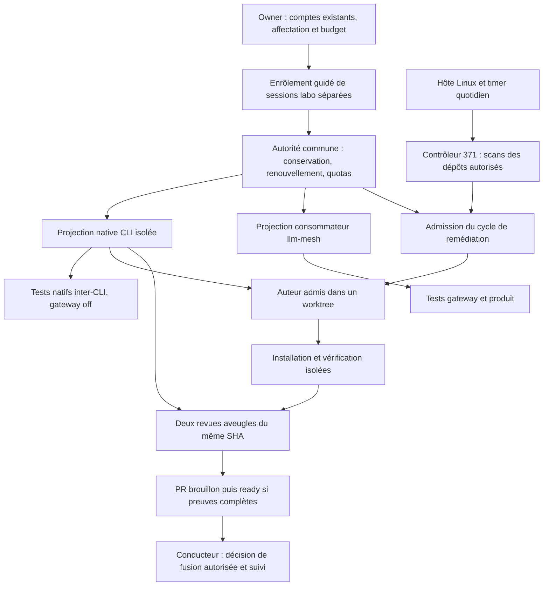

**Analyse indépendante — rendre le job #371 activable**

18 octobre 2026. Analyse en lecture seule du capital fourni, des sources et des métadonnées publiques ; seule cette note est écrite. Aucun code modifié, test exécuté, commit, enrôlement, secret lu, appel de modèle sur siège ou activation. L'autre analyse parallèle n'a pas été consultée. Les tests RED ci-dessous sont des critères à faire échouer avant correction, pas des résultats revendiqués.

**Conclusion : non, la chaîne livrée n'est pas activable de bout en bout aujourd'hui par simple configuration.** #371 apporte un contrôleur utile et des refus protecteurs, mais il manque au moins la liaison effective aux sièges enrôlés, une autorité opérationnelle de capacité et de périmètre, et une combinaison d'auteur/relecteurs conforme aux décisions actuelles. #348 ne fournit pas encore cinq sièges réels prêts à consommer : son lot est essentiellement synthétique, et l'import partagé dépend d'une API amont non publiée. Installer le timer maintenant ne résoudrait aucun de ces problèmes. [S1–S7]

**Recommandation : conserver #371 comme socle, compléter une tranche Linux exploitable avec un auteur Muse et deux revues Codex, puis faire installer et exploiter le job par le conducteur.** Préparer simultanément l'enrôlement CLI **et** llm-mesh des cinq fournisseurs comme demandé. La recette du premier job ne doit pas attendre toute la matrice multi-OS ; elle ne doit pas non plus être présentée comme l'achèvement de cette matrice. La disponibilité Muse, les quotas et les modèles réellement servis restent à qualifier. [JUGEMENT]

Le dossier précédent a posé la mauvaise décision : « fusionner le job dormant ? ». La décision utile est : **« quelle capacité de vos comptes existants affecter à ce job, sur quels dépôts et sous quelle exploitation, avec quelles limites déjà vérifiables ? »** L'owner ne doit pas devenir l'intégrateur de `trusted-seat-authority`, l'auteur de la liste des fichiers de tests ou l'installateur systemd. [S0, S8 ; JUGEMENT]

**Les faits ont été recalés sur les révisions actuelles.**

| Objet | Observation | Conséquence |
|---|---|---|
| h2a `origin/main` local | `46b82b42781709f2a2ab1bec6707ba58131248f0`, après #373 | Le checkout principal est une autre branche avec des modifications tierces ; les faits sur main viennent de `git show origin/main:…`, pas de ce checkout. |
| #348 | Fusionnée par `7670fbed6870fb7e5b985a1315ff55776b362fd8` | Fusion du capital synthétique acquise ; pas preuve d'enrôlement ou de disponibilité live. |
| #371 | GitHub : OPEN, draft ; tête locale/distante `3e0cbc7e319a0c831fae26f8b3ebd8b71923c01d` ; 15 checks SUCCESS | Les anciens constats « CI en attente » sont périmés. La CI verte ne prouve ni quotas, ni comptes, ni timer. |
| Base de #371 | Base commune avec main `5ccc98198a3b166bbc36358584cba91ad64d4e4d` ; #348 n'est pas ancêtre de sa tête | Rebase et intégration du capital #348 nécessaires avant la recette intégrée. |
| Revues fournies | `rev371.md` vise `41ba4ce8…`, `rev371b-last.md` vise `81a4033…` ; `3e0cbc7e3` modifie bien masquage JSON, ordre masquage/troncature et détection TODO | Ne pas présenter les anciennes réserves comme nécessairement ouvertes, ni leurs corrections comme indépendamment validées sur la tête actuelle. |
| Sentropic #681 | GitHub : OPEN, draft, `7293130ee3f6bfc6dd1e2fefcc07b3bd4d751a99` | L'implémentation L1 citée par #348 existe en source, pas encore comme livraison intégrée. |
| Paquets publics consultés | llm-mesh latest `0.26.1`, cluster-mesh latest `0.19.0` | La mention historique cluster-mesh `0.18.0` n'est plus le dernier numéro. Le passage à `0.19.0` seul n'apporte pas les méthodes d'import manquantes. |

Les lectures GitHub/registre ont été faites pendant cette analyse, le 18/10/2026. Les versions épinglées dans le lock de h2a main restent llm-mesh `0.26.0` et cluster-mesh `0.16.0`. Les archives publiques ont été lues en flux, sans installation : llm-mesh `0.26.1` possède le contrat de bundle, mais pas `importSeatBundle`, `parseCliSeatProfile`, `parseTokenSeatEnvelope` dans les surfaces examinées ; cluster-mesh `0.19.0` réexporte les surfaces de llm-mesh. [S1, S2, S7]

**A. « Activable » exige une chaîne effectivement raccordée.**

Il faut distinguer trois résultats : pouvoir lancer la commande ; pouvoir produire un correctif réel avec ses deux revues ; pouvoir répéter cette opération sans intervention quotidienne, puis faire traiter la PR et constater la réduction d'exposition. #371 livre surtout le premier cadre et une partie du deuxième. Le troisième suppose aussi renouvellement des accès, exploitation, traitement des blocages et fusion/publication selon les règles du dépôt. [JUGEMENT]

Le diagramme décrit la cible. Les projections réelles, l'autorité commune et le raccord au lanceur #371 ne sont pas établis par les fixtures. Un compte llm-mesh enrôlé n'est pas un profil CLI natif, et une CLI authentifiée ne prouve pas l'import llm-mesh. Les deux usages consomment la capacité du même compte ; ils ne créent pas deux abonnements ou deux budgets. [S2, S5, S6]

**Ce que #348 apporte, et ce qu'il ne faut pas lui attribuer.**

| Capital acquis sur main | Limite observable |
|---|---|
| Correspondance des cinq CLI et fournisseurs, codecs, schémas de bundles, modes `cli`/`token`, contrôle owner/autorité/lignée | Données et backends de matérialisation synthétiques ; les références ne résolvent pas par magie de vrais credentials. |
| Profils privés par exécution, environnement fermé, séparation MCP, nettoyage, délégation sérialisée et refus de refresh non autorisé | Acceptation par chaque binaire réel, keyrings OS, comportement à expiration/401 et facturation restent à qualifier. |
| Tests de matrice et raccord `native-host` capable de recevoir `MaterializedSeat.childEnv` | Pas une preuve de messages réels N×N ; `scripts/e2e-cli-seats-direct.mjs` est explicitement un stub qui refuse le live. |
| `h2a llm-mesh account enroll …`, sources `cli` et `token`, alias `--cli`/`--token`, lecture privée bornée | Le chemin appelle l'API L1 ; il échoue avant lecture des données si les méthodes manquent. Les dépendances de main ne les livrent pas. |
| Enrôlement OAuth produit déjà présent via la façade Sentropic | Il ne remplace pas le circuit partagé de sessions labo, ne configure pas les CLI et ne démontre pas une autorité unique de renouvellement. |

La documentation de #348 conserve des phrases historiques « must not merge » : elles n'annulent pas la fusion explicitement autorisée par l'owner. Elles documentent des réserves techniques qui, elles, ne disparaissent pas avec le merge. Il faut actualiser la présentation de livraison en conservant ces réserves. [S0, S2]

**Quels sièges et quels credentials, sans demander ni lire leurs valeurs.**

L'objet à affecter est une **session labo séparément émise sur un compte existant**, avec une référence opaque, son fournisseur, sa famille de renouvellement éventuelle et ses droits. Ce n'est ni l'achat implicite de nouveaux comptes, ni la copie du refresh token de la session quotidienne. Les décisions antérieures imposent de mesurer d'abord la coexistence avec la session habituelle et d'arrêter si elle est perturbée. [S0, S6]

| CLI / fournisseur llm-mesh | Usage natif à établir | Usage mesh à établir | Matériel détenu uniquement par l'enrôlement/custody |
|---|---|---|---|
| `claude` / `claude-code` | Session Claude Code en configuration privée ; fichier natif ou Keychain selon OS | Projection consommateur de la même session, sans renouvellement côté mesh | Grant de login natif ; projection access-only seulement si réellement acceptée, sinon détenteur natif sérialisé. |
| `codex` / `codex` | Login ChatGPT/Codex dans un profil labo ; document d'auth natif ou keyring qualifié | Compte consommateur Codex lié à la même lignée | Document natif complet conservé par l'autorité ; projection d'accès ou exécution sérialisée selon preuve. Ne pas falsifier `last_refresh`. |
| `muse` / `muse` | Session navigateur/native Muse dans son stockage isolé réellement supporté | Projection/clé de service dérivée par l'autorité selon le contrat Muse | La clé de service mesh n'est pas présumée être un login CLI. Dérivation, entitlement et expiration des deux représentations doivent être établis. |
| `vibe` / `mistral-vibe` | Login Vibe et credential de plan en profil privé | Projection de la clé de plan, si le même usage est admissible | Classe actuellement prévue `static-key` ; pas de refresh OAuth inventé. Vérifier l'absence de dépassement payant pour cette route. |
| `agy` / `cloud-code` | Login Antigravity et backend/keyring isolé qualifié | Projection Cloud Code de la même session | Credential natif avec identité/application appropriées ; pas de substitution par Gemini CLI, ADC ou clé API générique. |

Les formes de stockage ci-dessus viennent des contrats/codecs ; elles ne sont pas une recette prétendument qualifiée sur cette machine. Le fournisseur d'authentification, l'hôte CLI et le modèle servi sont trois identités distinctes : un modèle Claude via agy ne transforme pas le siège en CLI Claude Code. [S2, S6]

**Répartition des responsabilités d'enrôlement.**

1. **Conducteurs h2a/Sentropic et mainteneur custody** : préparer les profils labo, le helper relu, la destination privée commune, les références non secrètes, les droits GitHub et les validations de quota/entitlement. Fournir la procédure prête à utiliser ; ne pas demander au propriétaire d'inventer ces éléments.
2. **Owner du compte** : effectuer le login navigateur/device/MFA qui exige sa présence, désigner le compte existant et confirmer les limites de facturation dans la console quand nécessaire. Rien n'est collé dans une conversation, un argv ou un rapport.
3. **Helper de confiance** : lire uniquement la source privée explicitement sélectionnée, conserver le canonique sous l'autorité unique, publier les projections et leur lignée ; vérifier la livraison avant de déclarer le siège actif.
4. **Consommateurs CLI et llm-mesh** : recevoir uniquement leur projection et leur environnement admis. Pas de refresh concurrent ; expiration/401 = indisponible, sans repli vers crédits ou home personnel. Si le natif exige le grant renouvelable, utiliser le protocole sérialisé avec capture du successeur, pas une deuxième copie autonome.
5. **Opérateur** : qualifier les deux usages, garder les reçus expurgés, installer l'entretien et les alertes ; guider le réenrôlement en cas de perte définitive du grant.

La commande guidée `make seat-reenroll CLI=… ENV=dev-ci-seat-store` de la spécification partagée v10 §6.2 est **un livrable de conception L3**, pas une commande dont cette analyse a prouvé la disponibilité. En revanche, la surface h2a `llm-mesh account enroll <provider> --from cli --seat-profile <chemin-privé>` existe dans #348 : elle attend un manifeste L1 privé explicitement préparé, pas une découverte automatique du home. `--from token` lit un **SeatBundle consommateur** via stdin borné ou saisie masquée ; ce n'est pas un simple token fournisseur arbitraire. L'owner scope doit correspondre à celui de l'autorité. Le gateway doit ensuite charger le compte importé ; le code actuel signale un redémarrage lorsqu'il était déjà démarré. [S2, S6]

**Le minimum de capacité de remédiation n'est pas « un siège ».**

Le sélecteur actuel exige trois couples hôte/modèle distincts : un auteur et deux relecteurs dont **chacun** diffère à la fois de l'hôte et du modèle de l'auteur. Les deux relecteurs peuvent partager un hôte avec deux modèles différents. Trois entrées de configuration ne signifient donc pas trois abonnements physiques. [S3 : `policy.mjs:41`]

| Combinaison | Résultat |
|---|---|
| Codex seul, même avec trois noms de modèles | Impossible avec la règle d'exclusion de l'hôte auteur. |
| Un modèle Codex auteur + deux modèles Claude | Possible pour le sélecteur actuel, mais contraire à la décision du 17/10 de ne plus employer de sous-traitants Claude Code. |
| Muse Spark 1.3 auteur + Codex Sol 6.1 et Codex Astra relecteurs | Proposition conforme aux orientations récentes ; exige l'adaptateur Muse, ses accès/quota et la qualification des modèles/efforts. Impossible dans #371 inchangée. |
| Deux modèles sur chacun de deux hôtes admissibles | Permet une rotation des auteurs entre ces hôtes selon la politique ; les trois entrées de l'exemple précédent ne rendent éligible que l'auteur Muse. |

La décision « plus de sous-traitants Claude Code » ne supprime **pas** Claude de la matrice de tests native/gateway expressément demandée. Il faut des permissions d'usage distinctes : `test-cli`, `test-gateway`, `vulnerability-remediation`, rôle auteur/relecteur et modèles autorisés. #371 n'a actuellement qu'une liste plate et une rotation ; les capacités de test ne doivent pas devenir une permission de sous-traitance. [S0, S3 ; JUGEMENT]

L'indisponibilité Muse « jusqu'au 19/10 02:00 » est consignée, pas requalifiée ici ; son fuseau n'est pas précisé. Le secours Sol prévu pour coder ne suffit pas à constituer automatiquement un cycle de remédiation dont les deux reviewers seraient également Codex. Aucune exception à l'indépendance ne doit être déduite de ce secours. [S0, S3]

**L'autorité de quota et l'autorité de périmètre sont du travail logiciel et opérationnel réel.**

Dans #371, `LocalSeats.admit()` exécute une commande externe avec `status` ou `reserve`, un siège déclaré, le modèle, `purpose=vulnerability-remediation`, le workspace exact et le digest des hooks. Il attend quota disponible, réserve >20 %, qualification de périmètre fraîche de moins de 24 h et, au dispatch, un reçu de réservation atomique. Codex exige en plus la liaison `h2a@sentropic`. Les tests utilisent une autorité factice ; le chemin `/absolute/trusted-seat-authority` est un exemple. Aucune implémentation de cette interface n'a été identifiée dans main. [S3]

Le complément doit fournir ou raccorder :

- **Capacité réelle** : maximum global de dix unités par CLI/jour UTC, tous dépôts, OS, acteurs et sessions labo du compte ; réserve strictement supérieure à 20 % dans chaque fenêtre fournisseur ; quota absent/illisible = zéro inférence. Une invocation/tour natif compte une unité, chaque requête mesh compte séparément. Un tour natif peut consommer plusieurs requêtes internes : dix unités ne garantissent donc pas une réserve fournisseur après exécution. [S6]
- **Allocation par finalité** : l'addendum CI v5 réserve Codex, en mode normal, à 6 CI / 2 enrôlement protégées / 2 qualification-maintenance. L'étude ne considère pas la remédiation automatiquement incluse dans les deux dernières. La directive daily autorise le travail de remédiation, mais ne chiffre pas le prélèvement sur cette allocation partagée. Il reste à décider puis implémenter la capacité qu'on lui affecte ; ne pas fabriquer un solde local indépendant. [S5, S6]
- **Réservation durable du cycle** : financer auteur et deux revues avant de lancer l'auteur, sous le même état global que les tests. Aujourd'hui #371 incrémente son compteur local pour les trois tâches, mais appelle la réservation externe une tâche à la fois. Les `status` initiaux ne réservent pas la capacité des reviewers contre un consommateur concurrent. [S3 ; JUGEMENT sur le complément]
- **Liaison au vrai siège** : le reçu doit désigner l'identité/famille admise et le lancement doit effectivement utiliser cette projection. Dans `vuln-seat.ts`, `seat.id` ne sélectionne actuellement aucun profil d'authentification ; le processus hérite de `process.env`, avec retrait de quelques clés seulement. Il n'appelle pas la matérialisation #348 et ne reçoit pas son `childEnv`. Une autorité externe ne peut pas corriger cela en modifiant l'environnement de son propre processus enfant. [S2, S3]
- **Qualification native du périmètre** : démontrer le garde avec le vrai binaire, sa version, le bundle livré et le workspace exact. Les worktrees de revue sont créés plus tard et ont d'autres chemins : un reçu unique pour la racine du dépôt n'est pas valable pour les trois tâches. Une réponse statique `guardQualified:true` ne vaut pas preuve. [S3]
- **Séparation des credentials et de la vérification** : le contrôleur possède l'autorité de push/PR ; les agents et tests du candidat ne doivent pas la recevoir. `Repository.tests()` hérite actuellement de l'environnement et conserve le home ambiant malgré l'isolation XDG/H2A. Le runner natif retire certaines clés mais conserve aussi les sélecteurs de profils ambiants. Il faut raccorder l'isolation existante à ces chemins, pas compter sur le masquage des sorties pour empêcher une lecture. [S3, S6]

Ce dernier point est fondé sur les frontières effectivement présentes dans le code, pas sur une exploitation démontrée. #371 dit elle-même que sa voie locale n'est pas un sandbox pour code hostile. Un profil privé, des outils bornés et un worktree n'isolent pas à eux seuls un test Node arbitraire des credentials du contrôleur. Une séparation minimale du vérificateur et du contrôle est nécessaire avant d'y brancher des comptes réels ; elle ne justifie pas de réintroduire la porte générale B9/B10 supprimée par l'owner. [S0, S3 ; JUGEMENT]

**Effet concret d'un budget modeste.** Avec un auteur Muse et deux revues Codex, un cycle minimal consomme une unité Muse et deux Codex. Partager les deux unités Codex de maintenance finance au mieux un candidat par jour **sur l'ensemble des dépôts**, si elles sont libres, et prive ce jour-là la qualification native de ces deux unités. Deux dépôts corrigés la même nuit exigeraient au minimum quatre unités Codex. Les scans peuvent rester quotidiens sur tous les dépôts sans inférence, mais « au plus une tentative par dépôt/jour » dans le code n'est pas une promesse de capacité pour tous. Le code parcourt les dépôts dans l'ordre de configuration ; un curseur de sièges n'assure pas l'équité entre dépôts. [S3, S6 ; calcul conditionnel]

Le secours crédit déjà accordé concerne les **tests CI Sentropic admis**. Il ne finance pas auteur/relecteurs, l'enrôlement ou la qualification native. Un passage CI payé ne qualifie aucun siège. Le chantier CI de l'addendum v5 et ses prérequis produit ne doivent toutefois pas être imposés en bloc à un pilote h2a local qui ne les utilise pas : prendre ses contrats communs de quota/custody et les dépendances réellement traversées. [S6]

**Hôte, timer et dépôts.**

| Élément | Existant | Nécessaire pour activer |
|---|---|---|
| Exécutables | `node`, `npm`, `git`, `gh`, `flock`, `systemctl` et les cinq CLI sont trouvés dans le PATH de ce contexte | Versions qualifiées et chemins stables sur l'hôte de service ; leur présence ne prouve ni login, ni quota, ni disponibilité nocturne. |
| Ordonnancement | Générateur d'unités user systemd : 03:00 dans le fuseau de la machine, retard aléatoire ≤15 min, `Persistent=true`, timeout 6 h, arrêt du cgroup | Choisir l'hôte/compte opérateur, sa disponibilité, son fuseau et le maintien du user manager ; installer puis vérifier le timer. `Persistent` rattrape un lancement manqué, ne réveille pas un ordinateur éteint. |
| État réel du service | La lecture ciblée `systemctl --user show h2a-vuln-fix.timer` échoue : bus utilisateur inaccessible dans ce contexte | Statut du timer **inconnu**, pas « désactivé démontré ». Aucune modification de service effectuée. |
| Secrets et droits GitHub | Le contrôleur utilise git/gh pour fetch, push de branche et création/ready de PR | Identité autorisée sur les seuls dépôts retenus, hors processus agents/tests ; aucun droit de fusion automatique nécessaire au job. |
| Configuration | Schéma explicite : racine canonique, remote `rhanka/<repo>`, tests Node/Vitest ciblés, état hors dépôts, worktrees ignorés | Configuration complète produite par les mainteneurs, vérifiée contre les vrais remotes, domaines npm et commandes du dépôt. |
| Exploitation | Rapports privés, claims durables, détection de PR existante, quarantaine après nettoyage ambigu | Responsable de lecture/notification, suivi du premier lancement planifié et prise en charge des brouillons/PR existantes/quarantaines. Le job ne les résout pas seul. |

Le périmètre déjà exprimé couvre les composants des dépôts de l'écosystème. Les sources identifient h2a, Sentropic, radar-immobilier et graphify ; la correspondance éventuelle graphify/engram reste à confirmer. L'inventaire exact est une tâche des conducteurs, pas une liste de chemins à faire saisir à l'owner. Une exclusion de code privé, un fournisseur non autorisé ou un changement de périmètre réel relève en revanche de lui. [S0, S4, S5]

Sur h2a main, trois locks suivis sont visibles : `package-lock.json`, `apps/focus/package-lock.json`, `packages/h2a/focus-kit/package-lock.json`. #371 sait les découvrir ; il faut encore vérifier les manifests non représentés et les tests applicables. Sentropic a plusieurs domaines et des commandes Make/containers : sa qualification ne se réduit pas à recopier l'exemple `node --test` du runbook. Le validateur #371 n'accepte que des fichiers Node/Vitest ciblés ; si les vérifications requises du dépôt ne sont pas exprimables, il faut un adaptateur de vérification conforme au dépôt avant d'y revendiquer un correctif vérifié. [S3, S5]

Npm et OSV couvrent les arbres de dépendances configurés, avec sévérité inconnue conservée ; les scanners supplémentaires sont raccordables. Cela ne couvre pas automatiquement images/OS, code vendored/généré, autres écosystèmes ou failles non publiées. OSV ne reçoit que les identités de paquets du registre public ; la politique d'envoi npm reste à qualifier par dépôt. Le premier résultat attendu est **npm HIGH/CRITICAL de tous les composants admis**, pas une promesse de correction universelle de toute CVE. [S3–S5]

**Un `dry-run` réussi ne répond pas à A.** Il s'arrête avant sélection et admission des sièges ; il n'exécute ni installation, ni tests, ni auteur, ni revues, ni PR. Il peut réussir avec une autorité manquante ou aucun cycle possible. De même, un dépôt sans finding produit un résultat clean sans tester la capacité de remédiation. Il faut une recette positive distincte de la chaîne complète. [S3 : `controller.mjs:47`]

**B. La présentation manquante doit porter sur l'affectation et l'exploitation.**

La phrase « jobs daily avec des sièges » fixe déjà la finalité, la cadence générale et la priorité npm HIGH/CRITICAL. Les décisions de comptes existants, double usage CLI/mesh, Q1–Q3, harnais strict et double revue sont du capital acquis. Le dossier explicatif de #371 a transformé des travaux techniques restants en « votre config / votre dry-run / votre timer », puis réduit le choix à ranger du code dormant. Il faut corriger cette répartition et montrer une fiche d'activation concrète. [S0, S8]

La fiche doit donner : références non secrètes des sièges proposés, rôles et modèles/efforts ; budget prélevé sur les tests et débit résultant ; dépôts et composants inventoriés ; hôte, opérateur et heure ; autorité de PR/fusion ; procédure de réenrôlement/arrêt ; preuves déjà acquises et cases encore rouges. Aucun champ indispensable ne doit être un `EXACT_APPROVED_MODEL` ou un exécutable fictif. Les modèles effectifs doivent rester distingués des modèles demandés. Le schéma d'effort #371 ne représente que `low|medium|high|xhigh` : l'exigence « Astra max » ne peut pas être déclarée satisfaite par le seul exemple `high` ; utiliser et qualifier le mapping canonique existant, ou corriger le contrat. [S3, S4 ; JUGEMENT]

**Réemploi des six choix de l'étude, sans les reposer en bloc.**

| Choix ancien | Ce qui demeure pertinent | Traitement proposé maintenant |
|---|---|---|
| **VA1 — Dependabot groupé / lots cohérents / dépôt entier / rattrapage** | Coût de coordination et réutilisation des correctifs déjà disponibles | La demande récente tranche pour des jobs sur sièges et toutes sources. Ne pas redemander si Dependabot doit être le détecteur unique. Réutiliser #371 ; conserver les PR utiles sans les écraser. L'ordre des lots relève de la réalisation dans ce cadre. |
| **VA2 — un groupe / cinq / dix puis cinq** | Lisibilité, couplage et coût de relecture | #371 n'implémente pas ce planner : il tente les updates compatibles de tous les locks du dépôt. Pour le pilote, choisir un cas borné et l'annoncer. Ne pas vendre « cinq groupes » comme configurable aujourd'hui. N'arbitrer une taille plus large qu'après mesure ou si elle change vraiment la charge humaine. |
| **VA3 — fusion humaine / routine déléguée / urgences déléguées** | Autorité de fusion et effets image, préproduction, npm | La première voie garde la fusion hors du job, selon les autorisations déjà données aux conducteurs. Aucune nouvelle délégation autonome n'est requise pour produire des PR utiles. Garder VA3 pour une éventuelle délégation ultérieure, sans promettre réduction d'exposition tant que les PR ne sont pas traitées. |
| **VA4 — partager deux unités / protéger deux urgentes / aucune correction Codex** | Concurrence réelle avec CI, enrôlement et matrice native | **Reste un arbitrage bloquant.** A : inclure explicitement remédiation dans les deux maintenance ; B : partition 4/2/2/2 avec urgence protégée ; C : zéro remédiation Codex. Une réponse doit être appliquée dans l'autorité commune, pas seulement dans un JSON local. |
| **VA5 — détection 5 min GitHub/cluster/événements / nuit et humain** | Disponibilité de l'hôte et temps d'exposition | Le daily est demandé. D est la tranche actuelle ; préparer l'hôte et l'horaire. Le détecteur rapide est une évolution distincte, pas une condition pour rendre le daily utile. Ne pas transformer ce pilote en projet cluster imposé. |
| **VA6 — 7 j / 72 h / 14 j, avec règles urgentes différentes** | Version fraîche compromise versus délai de correction | #371 impose **7 jours à tous les paquets modifiés**, sans voie urgente ni paramètre. Présenter cet effet, surtout pour une CRITICAL corrigée aujourd'hui. Si le pilote utilise des versions déjà admissibles, cet arbitrage ne bloque pas son démarrage ; une exception d'âge exacte ou une politique urgente doit être explicite et vérifiée. |

Les pré-sélections historiques B/B/A/A/B/A sont des recommandations de l'étude, pas des réponses owner. Sa fenêtre routine 07:17–12:59 UTC et son sous-plafond de deux unités sont également des propositions de cette étude ; ne pas les assimiler aux seules règles Q1 déjà acquises. Si on les retient, le timer 03:00 local doit être rendu compatible, fuseaux et heure d'été compris. [S5, S6]

Le dossier final owner doit reprendre les huit rubriques de `present-decision`, en Focus DS avec un diagramme de cet écosystème : décision demandée, faits/inconnues, enjeux, options comparables, recommandation, coût/réversibilité, attendus et réponse minimale. Cette note est une entrée indépendante pour ce dossier, pas une validation ou un remplacement de l'autre analyse. Réconcilier les désaccords réels sans réinitialiser une nouvelle étude générale. [S0, S9]

**C. Le plus petit chemin livrable, avec propriétaires et preuves RED.**

Il faut réutiliser les scanners, contrôleur, garde lock-only, rapports et unités #371 ; les codecs/materializers #348 ; les contrats L1/custody et les mécanismes existants de confinement. Il n'est pas nécessaire de refaire l'ensemble du système, de généraliser tous les scanners ou d'automatiser les fusions pour obtenir un premier job utile. [JUGEMENT]

| Lot | Responsable et emplacement | Contenu borné | Critère de sortie et RED à produire si code |
|---|---|---|---|
| **L0 — fiche d'activation** | h-cond avec s-conductor ; dossier/runbook | Inventaire réel des comptes sous références opaques, rôles, dépôts/tests, hôte, autorité commune disponible ou à livrer ; décision de capacité ; état de chaque preuve | Aucun placeholder critique ; pas de lecture de secret ; owner sollicité uniquement pour affectation/coût/droits manquants. Pas de test artificiel pour cette documentation. |
| **L1 — rendre réutilisable l'enrôlement existant** | Sentropic L1/custody puis h2a ; suites de #681/#348 | Publier l'API d'import déjà construite et ses parsers ; pinner les versions compatibles via cluster-mesh ; livrer ou montrer le helper, les projections et l'autorité réelle nécessaires au pilote | **RED :** import absent avec les paquets actuels ; dix imports synthétiques, cinq fournisseurs × cli/token, idempotence/reload/lignée ; refus de refresh et aucun appel fournisseur sur expiry/401, owner incorrect ou projection renouvelable. Puis preuve live du sous-ensemble pilote. Ne pas transformer #681 en PR du contrôleur CVE. |
| **L2 — raccorder le vrai siège au job** | h2a-runtime/h2a ; correctifs bornés dans #371 ou PR de support puis rebase | Contrat entre admission, projection réelle et lancement ; `childEnv` fermé ; profils isolés ; rôles/finalités ; support natif Muse sans prompt en argv, restrictions d'outils et compte rendu de revue adapté | **RED :** deux seatRef de même profil ne doivent pas prendre tous deux l'auth ambiante ; canaris de home/env/clé GH/clé crédit inaccessibles ; Claude réservé aux tests jamais sélectionné pour remédiation ; Muse actuellement refusé. Tester la vraie grammaire du binaire, le nettoyage du prompt privé si ce mécanisme est retenu, le digest/chemin du garde et les verdicts JSON au SHA exact. |
| **L3 — admission et vérification réellement communes** | Mainteneur custody/quota + h2a ; autorité commune et seam #371 | Autoriser le purpose remédiation dans l'allocation décidée ; réserver le cycle complet ; relier les usages CLI/mesh ; qualifier quotas/périmètre ; séparer contrôleur et vérificateur sans credentials | **RED :** concurrence test-CI/job réclamant les dernières unités ; quota absent/20 %/périmé ; restart/minuit sans remise à zéro ; réserve d'enrôlement intouchable ; reviewers non financés = aucun auteur ; ticket mauvais siège/workspace/digest refusé. Un test candidat tentant de lire le credential de publication ou de contacter un provider ne doit pas y parvenir. |
| **L4 — recette d'un dépôt** | Conducteur dépôt + h2a ; config et adaptateurs strictement nécessaires | Rebase sur main intégrant #348 ; domaines npm, baseline, installation sans scripts et tests réellement applicables ; pré-vol séparé du dry-run ; premier cycle complet | **RED :** dry-run sans siège ne doit jamais être interprété « prêt à corriger » ; test requis non exprimable/manquant/skipped bloque ; un finding sans patch et une PR existante produisent un handoff intelligible. Reprendre les régressions masquage JSON/troncature/TODO sur la tête intégrée. **Preuve positive :** finding initial, patch compatible, scan après, deux revues réelles et PR brouillon/ready au même SHA, sans merge automatique. |
| **L5 — mise en service** | h-cond/opérateur, pas l'owner intégrateur | Release revue et chemins stables, configuration privée, timer user, environnement de service, entretien des sièges, notification/suivi, arrêt/reprise | Lancement manuel réussi sous le même contexte que le service ; puis reçu du premier lancement réellement planifié. Refus quota/expiry et reprise produisent une alerte exploitable. Pas de reset des compteurs, pas de simple test d'existence du fichier timer. |
| **L6 — extension sans perdre la demande complète** | h2a + L1/L2a/L3/L4 + conducteurs dépôts ; suites séparées | Cinq fournisseurs utilisables en CLI et mesh ; vraie matrice native et gateway ; ajout des autres dépôts/scanners et équité de file si budget contraint | **RED :** cellule native remplacée par gateway rejetée comme preuve ; provider ou OS non qualifié visible ; aucun faux vert cinq-CLI ; dépôt toujours dernier ne doit pas être affamé. Chaque extension vérifie ses vrais locks, règles et tests. Linux d'abord, autres OS selon priorité déjà donnée. |

L1/L2/L3 sont des frontières de responsabilité, pas une invitation à créer trois systèmes parallèles. Avant d'implémenter, vérifier ce que les branches amont livrent déjà et raccorder leurs API publiques. Le fait qu'une pièce ne soit pas visible dans #371 ne prouve pas qu'aucun autre chantier ne la construit ; il oblige à identifier sa version, son mainteneur et son reçu de qualification. [JUGEMENT]

Le chemin critique recommandé est : **affectation/capacité + primitives de siège utilisables → lancement/admission intégrés → recette positive → déploiement/timer**. L'inventaire, les fixtures et le dossier peuvent progresser pendant l'attente Muse/amont. Pas d'estimation « 15–25 jours » reprise de l'étude : elle chiffrerait un autre périmètre avant #348/#371. Chiffrer les écarts bornés à partir de la vélocité effective et des disponibilités de dépendances, une fois identifiés. [S0, S5 ; JUGEMENT]

**Nuance sur la dépendance #681.** Le moteur #371 exécute des CLI natives ; il n'appelle pas llm-mesh pour écrire un correctif. L'API d'import mesh n'est donc pas une dépendance algorithmique de son scan ou de sa boucle auteur/revue. Un pilote local peut précéder la livraison complète mesh **si** des projections natives labo, une autorité de quota commune et une gestion unique du renouvellement existent déjà et sont qualifiées. En revanche, créer un nouveau coffre local ou exploiter silencieusement les logins personnels pour éviter #681 ne respecte pas le capital partagé. À défaut de ces preuves, la publication/réutilisation de L1 est bien sur le chemin d'intégration retenu ; ne pas annoncer qu'un simple wrapper shell l'évite. [S3, S6 ; JUGEMENT]

**Runbook d'activation à livrer, puis à exécuter par l'opérateur.**

1. Fixer versions/binaires, références de sièges et dépôts ; vérifier le contexte de service, le filesystem privé, les droits de publication et la disponibilité nocturne. Préparer les critères du pilote avant toute consommation.
2. Faire effectuer au titulaire les seuls actes de login/console indispensables, puis enrôler via les helpers qualifiés. Recueillir uniquement les reçus expurgés d'identité/lignée/expiry/quota et les preuves CLI/mesh pertinentes. Un login réussi ne vaut pas admission.
3. Qualifier la lecture des quotas et l'absence de repli crédit, les outils natifs, le garde de workspace, la séparation du vérificateur et l'arrêt des descendants. Une réserve déclarée par un stub n'est pas un contrôle.
4. Produire la configuration exacte de dépôts/tests et faire le dry-run pour l'inventaire. Vérifier ensuite séparément tous les sièges du cycle, y compris sur les worktrees de revue ; le dry-run ne le fait pas.
5. Exécuter une fois le contrôleur avec une vraie admission sur un correctif compatible autorisé. Si aucun finding réel corrigible n'est disponible, utiliser un dépôt de qualification explicitement prévu avec fixture contrôlée pour la preuve du trajet ; distinguer cette preuve d'une CVE réellement réparée. Ne pas introduire de vulnérabilité sur main pour fabriquer la démonstration.
6. Vérifier le finding avant/après, les tests requis, l'origine/âge du paquet, les deux avis aveugles, le SHA et la PR. Un résultat `ready` du contrôleur ne dispense pas des checks CI et règles de fusion du dépôt.
7. Installer la release et les unités, activer le timer quotidien, vérifier la prochaine échéance et attendre une première exécution planifiée observable. Contrôler aussi l'entretien des grants ; le timer de remédiation n'est pas leur mécanisme de refresh.
8. Après chaque lancement, traiter les blocages et les PR. Pour suspendre : arrêter les nouvelles admissions/timer, drainer les processus, conserver claims/quarantaines/réservations et les preuves. Pour reprendre : réconcilier l'état distant et les sièges ; ne pas effacer le passé pour obtenir un nouveau quota.

**Ce qui doit précéder la fusion de #371.**

L'owner a refusé sa fusion sans compréhension et vient de refuser l'utilité d'une livraison non activable. Il serait incorrect de transformer cette objection en approbation d'un merge dormant. Ma recommandation est donc de maintenir le draft jusqu'à une tranche d'activation concrète, relue et démontrable, plutôt que de demander de nouveau « ranger le code ? ». [S0 ; JUGEMENT]

Le minimum est :

- Réconcilier les deux analyses indépendantes et présenter l'affectation/capacité/hôte proposés avec les écarts techniques, au format demandé.
- Rebaser sur main intégrant #348 et les supports nécessaires ; fermer les défauts directement bloquants d'admission, de sélection d'auth et de séparation du vérificateur pour la voie retenue. Les pièces génériques peuvent être livrées dans des PR de support ; leur absence ne doit pas rester un travail logiciel à découvrir après le merge.
- Obtenir les deux revues indépendantes exigées sur la tête pertinente, après corrections, avec résolution des constats et checks verts de cette tête. L'ancien dossier ne demandant qu'une revue fraîche Sol ne reflète pas la dernière règle de double revue. Cette analyse ne vaut pas revue de code finale.
- Fournir la configuration et le runbook sans dépendance inconnue, et une recette positive du pilote à partir du candidat admis. L'activation durable du timer peut suivre la fusion/release : **activable avant merge ne signifie pas timer déjà activé avant merge**.

Il n'est pas nécessaire avant cette fusion de finir les cinq CLI sur trois OS, la remédiation OS/images, le détecteur cinq minutes, une fusion autonome ou tout le programme CI crédit Sentropic. Ces sujets gardent leurs lots et leurs propres critères de sortie. À l'inverse, un timer présent, un test avec autorité simulée ou une PR CI verte ne remplacent pas la preuve du trajet retenu. [JUGEMENT]

**D. Questions owner à préparer, options et incertitudes.**

Ne poser ces questions qu'après avoir rempli les faits techniques disponibles. Les réponses sont des choix d'affectation/autorité, jamais une demande de transmettre des secrets. Le conducteur peut les rassembler dans une décision d'activation précise ; les préférences déjà tranchées ne doivent pas être redemandées. [JUGEMENT]

| Question et contexte | Options réelles | Recommandation et conséquence |
|---|---|---|
| **Quels comptes/sessions labo affecter au premier cycle ?** Les comptes restent les comptes existants ; Claude reste à couvrir pour les tests mais ne peut plus être sous-traitant par défaut. | Affecter Muse auteur + Codex deux modèles reviewers ; choisir un autre auteur non-Claude seulement s'il est déjà qualifié et conforme à la politique ; différer le live si aucune combinaison n'est disponible. | Muse/Codex après contrôle du quota. Nommer les références de comptes, pas demander des tokens. Trois rôles, deux comptes/fournisseurs peuvent suffire ; rotation complète des auteurs à élargir ensuite. |
| **Quelle part de capacité prendre aux tests ? — VA4.** Deux revues Codex épuisent les deux unités maintenance disponibles dans le scénario minimal. | A : partager ces deux unités avec remédiation ; B : réserver en plus deux urgentes en passant CI de six à quatre ; C : aucune correction Codex tant que l'allocation reste inchangée. | A pour le premier pilote borné, avec conflit natif/maintenance visible et sans promesse de cadence par dépôt. B si la capacité urgente prime explicitement sur les tests. Ne pas prendre les deux unités d'enrôlement. |
| **Quel hôte peut être disponible chaque nuit et qui l'exploite ?** Le bus systemd n'est pas accessible dans ce contexte. | Hôte Linux existant avec contexte de service isolé et disponibilité vérifiée ; VM/runner dédié déjà administré ; plateforme CI privée lorsque ses prérequis sont réellement prêts. | Le Linux existant s'il satisfait les contrôles, sinon l'hôte dédié déjà exploité. h-cond fait le déploiement ; l'owner n'a à arbitrer que disponibilité/coût/droits réellement manquants. |
| **Y a-t-il des exclusions de dépôts ou de partage fournisseur ?** La cible écosystème est déjà exprimée ; inventaire technique à fournir. | Périmètre identifié complet avec pilote h2a puis Sentropic et suivants ; exclusions nominatives de dépôts/chemins/fournisseurs ; autre ordre motivé par une faille active. | Garder la cible complète, sans assimiler pilote à réduction définitive du périmètre. Demander seulement les exclusions ou consentements de partage non établis, pas une nouvelle liste de tests. |
| **Qui traite/fusionne les PR et dans quel délai d'exploitation ? — VA3.** Le job s'arrête à ready ; une PR ouverte bloque les suivantes. | Conducteurs selon leurs autorisations actuelles ; approbation owner pour les cas non déjà délégués ; délégation automatique nouvelle via dossier ultérieur. | Première option dans les limites existantes. Désigner le responsable et la voie d'alerte ; aucune nouvelle auto-fusion nécessaire à l'activation. |
| **Une urgence peut-elle déroger à l'âge de sept jours ? — VA6.** Le code bloque aujourd'hui une version plus jeune même si elle corrige une CRITICAL. | Conserver sept jours et traiter une exception exacte humainement ; politique urgente explicite avec tous les autres contrôles ; attendre les versions admissibles. | Ne pas construire la voie urgente avant besoin/arbitrage ; afficher le délai et préparer l'exception exacte si un finding réel l'impose. Aucune signature/provenance invalide ne devient acceptable par exception d'âge. |

L'heure exacte peut rester une proposition opérateur — 03:00 dans un fuseau affiché, avec la marge existante — tant qu'elle respecte disponibilité et admission. La cadence quotidienne est acquise. Une fréquence de détection cinq minutes, une capacité garantie par dépôt/nuit ou une autorité de fusion automatique seraient des engagements supplémentaires à présenter, pas des interprétations silencieuses du mot daily. [S0, S3, S5 ; JUGEMENT]

Une formulation finale possible, **une fois les références réelles et les reçus joints**, serait : « Affectons-nous les sessions labo Muse [réf.] et Codex [réf.] à un pilote quotidien sur [dépôts], avec au plus un cycle financé dans les deux unités Codex de maintenance, sur [hôte] exploité par h-cond, et fusion par les conducteurs selon leurs droits actuels ? » Ce n'est pas une question à poser maintenant avec les crochets vides. [JUGEMENT]

**Incertitudes qui ne doivent pas être transférées à l'owner sous forme de questions techniques.**

| Inconnue | Qui la résout / preuve attendue |
|---|---|
| Sessions labo réellement disponibles, entitlement, quota restant par fenêtre et coexistence avec sessions quotidiennes | Mainteneur sièges + titulaire pour login/console ; inventaire de métadonnées et reçus sans secret. Aucun état de compte n'a été inspecté ici. |
| Disponibilité du coffre commun, helper L3, refresh, livraison vérifiée et ledger global | Conducteurs/mainteneur custody : version déployée, API, reçus de remplacement/expiration/reprise. Une spec n'est pas un service opérationnel. |
| Publication effective L1 et intégration h2a | Mainteneurs #681/#348 : versions et essais d'import à la frontière publique. Les résultats actuels montrent un manque ; ils devront être relus au moment de l'activation. |
| Muse sans interface, contrôles outils, parsing des réponses, modèle/effort réellement servi | Mainteneur runtime : réutiliser les capacités natives prouvées, tests puis qualification. Ne pas résoudre par renommage d'un profil ou par assertion dans le prompt. |
| Contrôles requis et compatibilité du moteur de tests pour chaque dépôt | Conducteur du dépôt : manifeste de vérification fondé sur ses règles/CI. L'exemple h2a n'est pas une sélection suffisante pour Sentropic. |
| Présence de findings corrigibles aujourd'hui et packages satisfaisant provenance/âge | Nouveau scan admis au moment du pilote ; les nombres de l'étude du 17/10 ne sont pas un inventaire courant. Aucun scan de vulnérabilités n'a été lancé ici. |
| Dernière revue indépendante après `3e0cbc7e3`, puis après rebase/intégration | Conducteur : deux verdicts sur le candidat pertinent, sans attribuer de GO frais aux revues fournies. |
| Timer, user manager, fuseau, maintenance nocturne, canal d'alerte | Opérateur sur le véritable hôte ; état systemd et premier reçu planifié. Échec d'accès au bus ici ne permet pas de conclure à l'absence du service. |

**Alternatives et limites de la recommandation.** [JUGEMENT]

| Voie | Meilleur argument pour | Meilleur argument contre |
|---|---|---|
| Compléter #371 avec le capital partagé — recommandée | Rend utile l'investissement déjà livré, conserve quotas et double usage sans coffre concurrent, tranche pilote bornée | Publication L1 et qualification native peuvent rester le vrai délai ; le contrôleur ne crée pas de quota. |
| Pilote natif local transitoire avant intégration mesh complète | Peut donner une première PR plus tôt si profils labo et autorité commune sont déjà utilisables | Ne satisfait pas la demande CLI + mesh ; une voie séparée de credentials/compteurs ferait perdre le capital et demanderait une dérogation réelle. Elle ne fonctionne pas aujourd'hui par la seule présence des CLI. |
| Attendre toute la matrice cinq CLI et tous les OS | Offre une preuve complète et maximise ensuite les possibilités de rotation | Retarde sans nécessité la première correction npm ; mélange l'acceptation du job à celle du programme de tests complet. |

Ce qui renverserait la recommandation : des preuves immédiates d'une autorité commune et de profils natifs déjà qualifiés permettraient le pilote local sans attendre l'import mesh ; à l'inverse, une source de quota illisible ou l'absence durable d'une combinaison conforme interdirait de promettre un daily correcteur sur ce siège, même après le code. Il faudrait alors soumettre ce conflit précis à l'owner, sans inventer un repli crédit. [JUGEMENT]

Pré-mortem : six mois plus tard, le service échoue parce que les tests ont consommé la capacité avant le job, qu'un compte a expiré silencieusement et qu'une PR bloquée empêche toutes les suivantes ; les chiffres d'exécution masquent l'absence de failles effectivement résolues. Réservation partagée, alerte d'indisponibilité, responsable des PR et mesure scan → candidat → merge → livraison sont les preuves opérationnelles qui préviennent cet échec. [JUGEMENT]

Intérêt du présentateur : recommander une intégration complète peut faciliter l'orchestration et repousser la responsabilité d'une activation. Intérêt de l'owner : une première correction réellement utilisable, sans compromettre ses tests, ses sessions ni ses dépenses. C'est pourquoi les lots sont limités au trajet nécessaire, la matrice complète reste distincte, et une publication dormante n'est pas présentée comme l'objectif atteint. [JUGEMENT]

**Sources et points d'entrée vérifiables.**

- **S0 — demandes et décisions.** Verbatim du mandat présent ; [DECISIONS-owner.md](/home/antoinefa/.cache-tmp/claude-1000/-home-antoinefa-src-h2a/902cb8f7-eb8e-4897-9640-8b9653fc7d0e/scratchpad/0985/DECISIONS-owner.md:18), notamment double usage à la ligne 88, finalité sécurité à 162, sous-traitants à 166, NO GO fusion à 171, déploiements/double revue à 175, deux analyses indépendantes à 180. Les dates portées par ce journal et les dates citées dans le mandat ne coïncident pas toutes ; la substance des verbatim est préservée.
- **S1 — Git/GitHub.** h2a `origin/main` et branche vulnfix aux SHA indiqués ; [PR #348](https://github.com/rhanka/h2a/pull/348), [PR #371](https://github.com/rhanka/h2a/pull/371), [Sentropic #681](https://github.com/rhanka/sentropic/pull/681). Commandes de lecture `git show`, `git rev-parse`, `git merge-base`, `gh pr view` ; aucun fetch ou mutation.
- **S2 — capital #348 lu à `origin/main`.** [docs/cli-seat-l2s.md](https://github.com/rhanka/h2a/blob/46b82b42781709f2a2ab1bec6707ba58131248f0/docs/cli-seat-l2s.md), [codecs](https://github.com/rhanka/h2a/blob/46b82b42781709f2a2ab1bec6707ba58131248f0/packages/h2a-runtime/src/cli-seat-codecs.ts), [matérialisation](https://github.com/rhanka/h2a/blob/46b82b42781709f2a2ab1bec6707ba58131248f0/packages/h2a-runtime/src/cli-seat-materialization.ts), [enrôlement et comptes](https://github.com/rhanka/h2a/blob/46b82b42781709f2a2ab1bec6707ba58131248f0/packages/h2a-runtime/src/llm-mesh-accounts.ts), [stub live](https://github.com/rhanka/h2a/blob/46b82b42781709f2a2ab1bec6707ba58131248f0/scripts/e2e-cli-seats-direct.mjs). Points : docs lignes 35, 88, 107, 125 ; matérialisation 264/336 ; comptes 354–390 ; CLI `index.ts` 10732–10845.
- **S3 — implémentation #371.** [admission](/home/antoinefa/src/h2a/tmp/worktrees/vulnfix/packages/h2a/src/vuln-fix/seats.mjs:25), [runner natif](/home/antoinefa/src/h2a/tmp/worktrees/vulnfix/packages/h2a-runtime/src/vuln-seat.ts:36), [sélection](/home/antoinefa/src/h2a/tmp/worktrees/vulnfix/packages/h2a/src/vuln-fix/policy.mjs:41), [contrôleur](/home/antoinefa/src/h2a/tmp/worktrees/vulnfix/packages/h2a/src/vuln-fix/controller.mjs:47), [vérification et publication](/home/antoinefa/src/h2a/tmp/worktrees/vulnfix/packages/h2a/src/vuln-fix/repository.mjs:82), [scans](/home/antoinefa/src/h2a/tmp/worktrees/vulnfix/packages/h2a/src/vuln-fix/scan.mjs:53), [âge/provenance](/home/antoinefa/src/h2a/tmp/worktrees/vulnfix/packages/h2a/src/vuln-fix/verify.mjs:6), [unités systemd](/home/antoinefa/src/h2a/tmp/worktrees/vulnfix/packages/h2a/src/vuln-fix/cli.mjs:21), [refus Muse/Vibe headless](/home/antoinefa/src/h2a/tmp/worktrees/vulnfix/packages/h2a-runtime/src/agent-launch-args.ts:129). Tests lus : `vuln-fix-seats.test.js`, `vuln-seat.test.ts` ; pas exécutés.
- **S4 — contrat et runbook #371.** [SPEC_EVOL_DAILY_VULN_FIX.md](/home/antoinefa/src/h2a/tmp/worktrees/vulnfix/docs/specs/SPEC_EVOL_DAILY_VULN_FIX.md), [operator.md](/home/antoinefa/src/h2a/tmp/worktrees/vulnfix/packages/h2a/skills/vuln-fix/references/operator.md). Leur formulation « local daily systemd » est un choix de la spécification ; le verbatim owner ne désigne pas à lui seul un hôte précis.
- **S5 — étude antérieure et six choix.** [study-v5.md](/home/antoinefa/src/sentropic/.tmp/vuln-autofix/study-v5.md:9), §§3–8, 11–12 ; le fichier conserve son titre/historique v4 et une note finale v5. [dossier-vuln-autofix-v6.html](/home/antoinefa/src/sentropic/.tmp/vuln-autofix/dossier-vuln-autofix-v6.html), [dossier h2a vuln](/home/antoinefa/.cache-tmp/claude-1000/-home-antoinefa-src-h2a/902cb8f7-eb8e-4897-9640-8b9653fc7d0e/scratchpad/0985/vuln/dossier.json).
- **S6 — modèle partagé et limites déjà décidées.** [spec-v10.md](/home/antoinefa/src/sentropic/.tmp/ci-seats-v4/spec-v10.md:11), §1, §3.3 dont unité Q1 à la ligne 158, §5 et §6.2 ; [ci-ai-seat-mode-addendum-v5.md](/home/antoinefa/src/sentropic/.tmp/ci-seats-v4/ci-ai-seat-mode-addendum-v5.md:9), D-CI-01 à D-CI-07. Documents de conception : les exigences citées ne sont pas attribuées à un déploiement observé.
- **S7 — publication.** Métadonnées publiques [llm-mesh latest](https://registry.npmjs.org/@sentropic%2Fllm-mesh/latest), [cluster-mesh latest](https://registry.npmjs.org/@sentropic%2Fcluster-mesh/latest) ; lecture en flux des archives `llm-mesh-0.26.1.tgz` (`dist/service/facade.js`, `dist/enrollment/index.js`, `dist/enrollment/seat-bundle.js`) et `cluster-mesh-0.19.0.tgz` (`dist/integrations/llm-mesh/{enrollment,facade}.js`). Aucun paquet installé ou exécuté.
- **S8 — historique de livraison/revue et présentation précédente.** [vulnfix-report.md](/home/antoinefa/.cache-tmp/claude-1000/-home-antoinefa-src-h2a/902cb8f7-eb8e-4897-9640-8b9653fc7d0e/scratchpad/0985/vulnfix-report.md), [rev371.md](/home/antoinefa/.cache-tmp/claude-1000/-home-antoinefa-src-h2a/902cb8f7-eb8e-4897-9640-8b9653fc7d0e/scratchpad/0985/rev371.md), [rev371b-last.md](/home/antoinefa/.cache-tmp/claude-1000/-home-antoinefa-src-h2a/902cb8f7-eb8e-4897-9640-8b9653fc7d0e/scratchpad/0985/rev371b-last.md), [dossier explicatif #371](/home/antoinefa/.cache-tmp/claude-1000/-home-antoinefa-src-h2a/902cb8f7-eb8e-4897-9640-8b9653fc7d0e/scratchpad/0985/explain/dossier-371.json).
- **S9 — méthode appliquée.** [using-harness](/home/antoinefa/.codex/plugins/cache/sentropic/h2a/0.98.7/skills/harness/using-harness/SKILL.md), [harness/security](/home/antoinefa/.codex/plugins/cache/sentropic/h2a/0.98.7/skills/harness/security/SKILL.md), [present-decision](/home/antoinefa/.codex/skills/present-decision/SKILL.md). Le mandat d'analyse seule prévaut sur les actions de construction, de délégation supplémentaire et d'enregistrement Track : aucune de ces actions n'a été effectuée.
